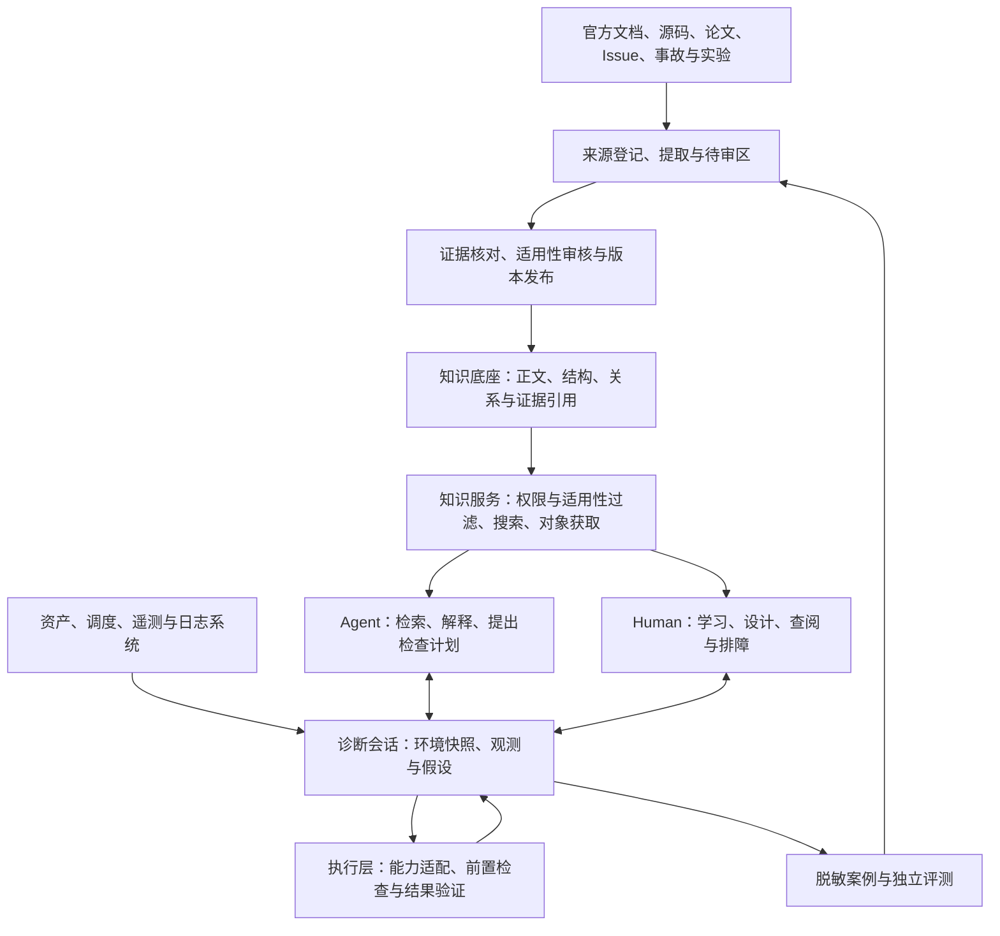

# AI 算力基础设施与计算可靠性知识库：架构建议

> 归档声明（2026-10-22；优先于下文历史指令）：本文中的“当前”“下一批”、模型与 CLI 约定均指当时快照，不再生效；原始记录、证据与待验证事实保留，不据此启动续作。日常入口：[当前状态](docs/current-status.md)；[归档索引](docs/archive/README.md)。

日期：2026-09-29。依据：[调研备忘录](research-memo-2026-09-29.md)。本文描述目标架构；目前已建立 Markdown 内容骨架、元数据校验及导航/Agent 清单生成，尚未实现所述网站、服务接口或现场适配器。当前可用入口见 [README](README.md)。

覆盖范围：GPU/NPU、全栈基础设施、训练/后训练/推理，以及 Human 学习与工程决策、Agent 检索与诊断。NPU 以昇腾作为本轮研究样板，实际厂商与参考环境待确定。

## 1. 推荐架构与取舍

采用 **一个版本化知识底座、Human 与 Agent 两类入口、独立的现场诊断和工具执行层**。

知识底座保存经过整理的领域知识、适用条件和证据关联；人读页面、搜索索引和 Agent 上下文由它生成。实时环境与诊断会话单独存储，通过实体标识、时间和知识版本与知识底座连接。

建议先采用模块化单体：一个内容仓库、一个构建流程、一个知识服务；现场连接器按需求部署。下图中的模块是职责边界，不要求分别部署成微服务。



五项核心决定：

1. Markdown 正文和结构化元数据是可审查的源数据；索引属于可以重建的发布产物。
2. 按问题和任务关联知识，按平台和环境限制适用范围。
3. Human 与 Agent 引用同一条知识、同一版本和同一组证据。
4. 知识推荐、诊断判断、工具执行分别记录；正文不会赋予执行权限。
5. 新资料和新事故产生修订提案，经审核后发布；自动总结不自动成为已验证结论。

## 2. 内容架构：技术领域 × 工作任务 × 适用环境

具体的一、二级目录、内容归属、NPU 落位和主题组织方式，已单独细化为[知识库内容总目录](content-outline.md)。以下保留对象和服务设计所需的总体说明。

### 2.1 技术领域

| 领域 | 核心内容 |
|---|---|
| 物理设施与硬件 | 电力、散热、机架、BMC、CPU、GPU/NPU、设备内存、固件与故障域 |
| 系统与设备软件 | OS、驱动、runtime、容器、设备发现、虚拟化与隔离 |
| 通信与互联 | PCIe、厂商互联、超节点、RDMA、网络拓扑、集合通信 |
| 存储与数据 | 数据加载、缓存、对象/并行存储、checkpoint 和数据完整性 |
| 集群与调度 | Kubernetes/Slurm、配额、gang、拓扑亲和性、资源健康与作业生命周期 |
| 训练与后训练 | 分布式并行、算子与图、数值精度、优化器、容错、rollout 与权重同步 |
| 推理与服务 | 引擎、模型加载、量化、KV cache、路由、排队、PD 分离、服务 SLO |
| 运行与工程决策 | 观测、验收、容量、性能、成本、变更、事故与计算正确性 |

工作任务包括：学习、架构选型、部署、验收、巡检、性能分析、诊断、恢复、迁移与升级。可用性、正确性、性能稳定性、可恢复性作为贯穿各领域的可靠性标签。

同一知识对象可以属于多个领域和任务。目录只保存一份正文，多个导航视图通过 ID 引用，避免按厂商或训练/推理重复复制文章。

### 2.2 八类知识对象

| 对象类型 | 保存什么 | 典型例子 |
|---|---|---|
| Concept | 概念、机制、先修关系与边界 | 集合通信、故障域、计算非确定性 |
| Component / Environment | 组件依赖、参考环境、兼容性与功能支持矩阵 | CANN—torch_npu—PyTorch 版本组合 |
| Metric | 测量语义、单位、时间窗口、统计范围、基线条件 | TTFT、有效训练进展、设备内存错误计数 |
| Failure pattern | 症状、候选原因、支持/反对证据和排除条件 | 通信超时、慢 rank、算子精度异常 |
| Procedure | 操作或诊断步骤、决策分支、输入输出、停止和成功条件 | 新节点验收、HCCL 超时调查、模型迁移验证 |
| Capability | 工具能力契约、参数 schema、适用环境、执行影响和结果格式 | 查询设备状态、解析日志、运行集合通信测试 |
| Case | 现场快照、按时间记录的证据、调查过程、结果与未解问题 | 一次升级后吞吐回退的复盘 |
| Experiment / Evaluation | 实验配置、对照、回放任务与通过判据 | 恢复一致性实验、隐藏根因的诊断评测 |

原始来源记录属于独立登记表。正文中的关键主张通过 `claim_id` 关联来源或实验；初期无需把每句话都拆成单独对象，优先结构化版本约束、根因判断和操作依据。

### 2.3 共同字段与关系

所有对象至少具有：

- `id / revision / type / title / aliases / owner`：稳定身份、版本与责任人。
- `domains / tasks / workload_types`：内容导航与任务标签。
- `applicability`：平台、硬件、软件组合、拓扑、工作负载和排除条件。
- `claims / evidence_refs`：关键主张与具体证据位置。
- `relations`：组件依赖、概念关联、案例引用和验证关系。
- `review_status / verification_records / reviewed_at`：审核状态与独立的验证记录。
- `license / attribution / access_scope`：该对象及其引用材料的许可、署名和访问范围。

审核状态和实验验证分开：条目可以“已审核，但尚未实测”；一次实测成功只覆盖该实验的环境和条件。将上游声明支持、本地验证通过、明确不支持、未知分别记录。

关系先用 ID 引用保存：`depends_on`、`requires`、`related_to`、`supports_claim`、`refutes_claim`、`tested_by`、`supersedes`。故障模式描述可能机制，诊断会话中的假设记录本次判断；不要因相关或共同出现就写入因果边。

## 3. GPU/NPU 适配架构

### 3.1 通用意图、平台机制、工具实现三层

| 层次 | 内容 | 示例 |
|---|---|---|
| 通用意图 | 用户要回答的问题与需要的证据 | 设备是否健康、通信为何超时、恢复状态是否正确 |
| 平台机制 | 特定平台的组件、语义、限制、诊断分支 | Ascend 的 CANN/HCCL/DCMI，NVIDIA 的 CUDA/NCCL/DCGM |
| 工具实现 | 在已知环境中如何采集或验证，以及如何解释输出 | npu-smi 查询适配器、平台日志解析器、通信测试适配器 |

这里是语义上的分层，并非上述工具彼此等价。一个通用问题可以对应多个工具，也可以在某平台没有受支持的实现。适配器必须返回 `unsupported` 或 `unknown`，不能将缺测、解析失败或工具不支持转成“健康”。

### 3.2 环境档案是适用性判断的核心

每次诊断引用不可变的环境快照，包括：

```text
组织/集群/故障域
  → 主机架构、服务器型号
  → 厂商、设备型号、物理/逻辑设备标识
  → 固件、驱动、设备 runtime
  → 框架与适配层、训练/推理引擎、算子包
  → 容器镜像摘要、模型 revision 与量化方式
  → 节点内/跨节点拓扑、设备与 rank 映射
  → shape、dtype、layout、执行模式、并行策略
```

版本规则支持精确版本、受约束的范围和明确例外；优先保存已知有效的整套组合。未知版本号不会自动落入兼容范围。模型和引擎的功能支持也需绑定硬件与版本，例如上游引擎支持某特性，不能据此推断某硬件插件支持。

实体关系应保存时效：某 rank 在事故时使用哪块设备，不能用今天的调度映射覆盖。定义稳定 ID；IP、Pod 名和逻辑设备序号不宜单独作为永久身份。

### 3.3 一条 NPU 诊断条目的示意

下例仅展示模型；未指定实际环境，因此不能作为可执行处方。

```yaml
id: procedure.ascend.hccl-timeout-triage
revision: 1
type: procedure
title: 昇腾分布式训练 HCCL 超时调查
domains: [communication, training]
tasks: [diagnosis]
applicability:
  platform: ascend
  environment_profile_refs: []
  on_unknown: collect_missing_environment_evidence
review_status: draft
verification_records: []
entry_observations:
  - HCCL 超时或相关任务异常
required_context:
  - driver_cann_framework_versions
  - job_rank_device_mapping
  - topology_and_recent_changes
hypotheses:
  - rank_exited_before_collective
  - inconsistent_collective_progress
  - network_or_device_problem
steps:
  - id: establish_timeline
    intent: 对齐各 rank 与 host/device 日志，寻找更早异常
    capability_refs: []
    expected_output: 带时间、实体与原文定位的事件列表
stop_conditions:
  - 环境不满足适用条件或关键证据缺失
completion:
  - 标明已排除、仍待确认及尚不可判断的假设
evidence_refs: []
```

正式发布前必须补齐来源、适用环境、具体分支、能力引用和完成判据。不同图模式、通信拓扑或版本可引用独立的平台流程；避免在一个巨大 YAML 内堆满所有条件。

## 4. 服务架构：共享知识，区分使用方式

### 4.1 知识服务

建议提供稳定、与模型厂商无关的接口。HTTP、CLI 或 MCP 都只是访问方式，不另建内容副本。

| 建议接口 | 作用 |
|---|---|
| `search_knowledge(query, filters, environment_ref)` | 返回对象 ID、匹配原因、适用性、版本和证据摘要 |
| `get_object(id, revision)` | 获取完整对象及关系，避免只靠碎片回答 |
| `get_evidence(ref)` | 获取有权限访问的来源定位、摘要或原始材料 |
| `check_applicability(object_ref, environment_ref)` | 返回 applicable / inapplicable / unknown，以及理由和缺失字段 |
| `get_procedure(id, environment_ref)` | 返回匹配的平台流程、分支、前置条件及完成判据 |
| `list_capabilities(environment_ref)` | 返回当前环境可使用的能力及限制 |

检索顺序建议：访问范围过滤 → 错误码/组件/实体识别 → 平台与环境约束 → 关键词与可选语义召回 → 相邻知识扩展 → 返回证据与适用性。

错误码用 `厂商/组件/版本/代码` 命名空间消歧，保留原始形式。术语支持中文、英文、缩写与历史别名。未知环境下可以返回背景知识和补充信息建议，但不能把未确认适用的操作作为有效处方。

初期用 SQLite 保存发布目录、对象关系与结构化字段，全文检索索引保存正文和别名。对中文分词、错误码及中英文混合查询选定小型验证集，确认检索效果后再定具体分词方案。语义召回与图数据库分别在有实际收益时增加。

### 4.2 Human 入口

提供四类页面：教程、原理解释、操作指南、参考资料。主要导航包括：

- 学习：从一次训练或推理的端到端路径进入，关联概念、案例和实验。
- 设计：按容量、拓扑、并行方式、恢复目标和 SLO 比较方案，显示假设与证据。
- 工程：从症状、错误码、组件、环境版本进入指南与兼容矩阵。
- 案例：按时间线阅读现场证据、判断理由、处理结果与反例。

页面显式展示适用范围、知识版本、审核与实测状态，以及来源。人工补充的教学叙事可以独立编写，关键事实、版本表和操作流程引用共同知识对象。

### 4.3 Agent 入口

使用短小的任务入口发现知识和能力，按需加载相关对象与证据。Agent 输出至少区分：已观测事实、候选解释、支持/反对证据、缺失信息、建议的下一项检查。

一次诊断固定知识发布版本和环境快照；需要更新时显式记录，以便复盘。Agent 对知识库的写入是修订提案，不能直接把生成结论覆盖正式条目。

外部文档、Issue 与日志属于待解释的数据。它们的内容不应改变 Agent 的工具权限或执行策略；工具定义由能力注册表提供。

## 5. 现场状态、执行与诊断会话

### 5.1 各类数据的保存位置

| 数据 | 建议存放 | 关键约束 |
|---|---|---|
| 整理后的知识与来源登记 | Git 中的 Markdown/YAML | 可评审、可追溯、可固定版本 |
| 原始资料与大型证据附件 | 按许可和访问范围管理的文件/对象存储，Git 保存引用和摘要 | URL、revision、位置、内容摘要、获取时间；不能假定公开可读即允许镜像 |
| 搜索索引与发布目录 | SQLite/全文索引；按需补充向量索引 | 可从知识发布包重建，保留对应 release ID |
| 实时资产、指标和日志 | 现有资产、调度、监控、日志系统 | 继续由原系统提供权威数据 |
| 诊断快照和动作记录 | 独立的会话存储与证据附件 | 快照不可变，保留时间、实体、来源与有效期 |
| 脱敏案例和评测定义 | Git 中的案例/评测目录，附件外置 | 评测答案与输入分离，控制数据泄漏 |

### 5.2 会话数据结构

一次 `Investigation` 包含：问题与目标、知识 release、环境快照、观测列表、假设列表、检查计划、动作记录、结果、未解问题。

每项观测携带 `entity_id / observed_at / collected_at / source / scope / validity / artifact_ref`。采集失败与观测结果分开；输出过期时重新采集或明确降级为历史证据。

假设有自己的证据列表与状态，例如待检验、得到支持、被反驳、暂不可判断；单个相关日志不足以自动标记根因已确认。

### 5.3 工具能力与执行

Runbook 引用能力 ID，执行层将其映射到当前平台实现。能力契约包括输入输出 schema、实现版本、支持环境、所需权限、目标范围、资源影响、超时、前置条件、停止条件和结果验证。

离线解析、在线查询、主动测试、配置或生命周期变更分别分类。查询也可能有运行成本；通信或设备压力测试即使不写配置，也可能干扰任务。执行层根据用户已有授权与环境策略决定可运行范围，无需在每一步重新询问。

无法回滚的动作明确标记；可回滚动作说明条件。执行结果保存退出状态、原始证据引用、标准化结果与解释，不把“命令返回成功”直接视为故障消失或计算正确。

## 6. 知识更新、发布与评估

### 6.1 更新流程

来源登记 → 获取允许保存的材料 → 提取候选主张 → 去重与冲突检查 → 关联适用条件和证据 → 审核 → 构建校验 → 发布 → 跟踪来源与实验变化。

来源登记至少包含 URL、项目/文档版本、commit 或内容摘要、具体位置、获取时间、许可与内容归属。上游内容变化时，沿证据引用寻找受影响条目并生成复核任务；不直接覆写历史结论。

Issue 关闭、PR 合并、厂商公告、论文实验、本地复现分别记录证据类型。特别是“closed Issue → FAQ”需检查关闭原因、适用版本和复现情况。

### 6.2 发布校验

构建检查 schema、重复 ID、断开的关系、证据定位、缺失的适用条件、过期的来源及公共发布范围。可执行流程还检查能力引用、输入输出、停止条件和完成判据。

每个 release 附 manifest，记录 schema 版本、内容 commit、对象 revision、来源快照引用及索引构建版本。网站、API 和 Agent 使用同一发布标识，支持回退和历史诊断回放。

### 6.3 评估维度

| 维度 | 关注问题 |
|---|---|
| 学习与设计 | 人能否解释机制、比较方案、选择检查并理解适用边界 |
| 检索与证据 | 能否找到正确对象、引用正确来源、识别错平台/错版本和过期信息 |
| 诊断 | 是否保留合理假设，下一项检查能否区分原因，证据不足时是否承认未知 |
| 执行 | 是否满足前置条件，参数和范围是否匹配，结果是否经过验证 |
| 恢复与计算正确性 | 持续进度、状态一致性、数值基准和服务 SLO 是否满足要求 |

评测案例按事故家族、版本、环境和时间划分保留集，按时间释放证据，隐藏最终根因。不能将同一事故的完整复盘放入检索库，再宣称诊断评测成功。

## 7. 建议目录与第一版实现

当前已按用户确认的系统领域主目录建立以下骨架。平台内容通过专题页聚合；案例、实验和操作指南归属相应领域，不再复制一套按厂商划分的主知识树。

```text
sources/                    # 来源、许可范围和版本状态
schemas/                    # 内容元数据与来源约束
config/                     # 00–08 主目录登记
knowledge/
  00-overview/
  01-hardware/
  02-software-stack/
  03-communication/
  04-data-storage/
  05-cluster-platform/
  06-training/
  07-inference/
  08-reliability/
paths/                      # 平台与任务阅读路径
templates/                  # 概念、参考、流程、案例、实验模板
docs/                       # 写作指南
src/kb/                     # 结构校验与清单生成
tests/                      # 校验工具回归测试
build/                      # 可重建的人读导航和 Agent JSON 清单
```

知识文件采用 YAML front matter 加 Markdown 正文；较大的兼容矩阵、能力契约和评测定义用独立 YAML/JSON，并通过 ID 引用。大量日志、时序数据、密钥与实时状态不进入内容仓库。

网站、API/MCP、现场适配器、独立评测集和实际环境档案仍属后续工作。以下阶段描述保留为目标，当前骨架建立不代表这些阶段已经完成。

### 第一阶段：知识结构与双入口

交付共同 schema、来源登记、环境档案、全景导航、人读站点与只读知识接口。建立错误码/术语精确搜索和适用性判断。用一个已知 NPU 环境和一个已知 GPU 环境校验模型；环境尚未取得时明确记录为待验证。

优先完成六类案例：版本配套、设备可见性、通信超时、算子/精度异常、checkpoint 恢复一致性、推理尾延迟。各领域先有入口；案例深度按证据可获得性分批建设。

完成标准：人和 Agent 能取得相同版本的对象与证据；错误平台和未知版本不会返回确定的操作处方；可以从条目追溯到具体来源。

### 第二阶段：诊断和现场证据

接入已有资产/遥测，先实现离线日志解析和必要的在线查询，保存诊断会话；导入脱敏事故进行回放。按接口契约逐步适配 Ascend FaultDiag 等工具。

完成标准：每次诊断的环境、事实、假设和下一步检查可回放；工具解析失败和缺失数据不会被误判为正常。

### 第三阶段：验证实验和受控操作

接入通信基准、设备验收、恢复实验及必要的操作能力，补齐执行策略和完成验证。只有确有需要时增加向量检索、图数据库或复杂 Agent 协作。

完成标准：在独立案例中证明诊断或恢复质量提高，并能解释失败；评价不止看问答是否流畅或命令是否执行成功。

## 8. 已有项目如何对应到架构

以下是依据调研提出的复用位置，不代表已经集成：

| 架构部分 | 参考资源与借鉴方式 |
|---|---|
| 内容组织与学习 | [ml-engineering](https://github.com/stas00/ml-engineering)、[AIInfra](https://github.com/Infrasys-AI/AIInfra)：学习路径、工程案例、资料与脚本组织 |
| NPU 环境与运行知识 | [TorchNPU](https://github.com/Ascend/pytorch)、[MindCluster](https://github.com/Ascend/mind-cluster)：兼容矩阵、组件关系和平台指南 |
| 故障模式与诊断适配 | [Ascend FaultDiag](https://github.com/Ascend/mind-cluster/tree/master/component/ascend-faultdiag)：研究事件、故障实体、解析和诊断接口 |
| Agent 任务入口与维护流程 | [Ascend Agent Skills](https://github.com/Ascend/agent-skills)：按任务加载；[FAQ Generator](https://github.com/Ascend/agent-skills/blob/master/skills/vLLM-ascend_FAQ_Generator/SKILL.md)：从工程问题产生知识提案 |
| 恢复知识与验证 | [MindIO](https://github.com/Ascend/mind-cluster/tree/master/component/mindio)：理解恢复机制及其前提，设计状态验证实验 |
| 推理知识与回归案例 | [vllm-ascend](https://github.com/vllm-project/vllm-ascend)、[MindIE-LLM](https://github.com/Ascend/MindIE-LLM)：平台支持、部署与问题案例 |
| 评测组织 | [AIOpsLab](https://github.com/microsoft/AIOpsLab)：借鉴任务、环境、故障与评估的分离；GPU/NPU 场景仍需另建 |

初期最值得自主建设的是：共同对象模型、平台适用规则、主张与证据关系、跨层诊断路径，以及可回放案例。文档发布、数据库和工具协议尽量采用简单、可替换的实现。
