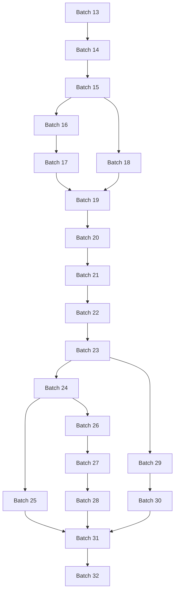

# Batch 13–32 依赖关系与并行推进

更新时间：2026-10-08。依据[主执行清单](../plans/full-coverage-backlog.yaml)的 85 项任务 `depends_on` 推导，完整机器可读视图见[依赖清单](../plans/batch-dependencies.yaml)。任务依赖不变；批次表与图只是它的投影。此表不判断正在其他会话中运行的批次是否完成，完成状态以实际交付、审阅与复核记录为准。

## Batch 14 为什么依赖 Batch 13

**Batch 14 可以先推进三项任务；第四项需要 Batch 13 的一个具体交付。** 整批依赖不能解释为该批所有任务都不能开始。

| Batch 14 任务 | 必需前置 | 可以怎样推进 |
|---|---|---|
| T01-05 板卡到超节点的组成与拓扑约束扩展 | 无任务前置（仍须来源/输入准备） | 先做来源准备，通过后可撰写 |
| T01-06 BMC、固件身份与跨层硬件事件 | 无任务前置（仍须来源/输入准备） | 先做来源准备，通过后可撰写 |
| T01-07 三平台错误信息与健康覆盖映射 | T01-06（Batch 14） | 待 T01-06 验收后撰写；不依赖整批 13 |
| T01-08 节点选型、隔离返修、长期管理与退役 | T01-01（Batch 13）；T01-05（Batch 14）；T01-07（Batch 14） | 可先准备材料；使用 T01-01 前先验收该交付，并等待本批两项前置 |

T01-08 的跨批输入是 **T01-01「机柜供电、散热预算与共享依赖」**，用于节点选型/生命周期的资源和故障域约束；同批还需要 T01-05 的组成/拓扑与 T01-07 的健康覆盖。它的 `context_topic_refs`（00.5、05.6）是参考范围，不要求这些主题先全部完成。

## 执行规则

- **任务前置**：具体使用前置交付前，先确认相关内容、来源/边界和定向复核已通过；仅创建文件或模型仍在运行不算前置交付完成。若没有单项验收记录，采用前置整批通过的保守门槛。
- **整批前置**：下表采用前置整批通过作为保守门槛，便于直接启动完整 Batch；若只启动该批中的独立任务，应按任务表判断。
- **参考主题**：`context_topic_refs` 不产生硬等待，也不使缺失的必要材料自动变为可用。
- **来源入口**：无任务前置只表示没有新的任务等待，不表示来源已核验。`depends_on` 与来源/输入就绪要同时满足。
- **集成写入**：不同正文可以并行；来源登记、领域索引、公共路径、主计划和审阅记录、`build/` 由一个集成角色串行处理。审阅沿用 gpt-6.1-sol / xhigh。

## 全部批次前置表

“约简前置”只列批次层最近的门槛，其他前置由更早批次链间接满足；“全部直接前置”列出本批任务显式引用的所有跨批批号。约简不得替代原任务列表的前置，也不表示只验收列出的部分任务。

| Batch | 约简前置批次 | 全部直接前置批次 | 保守波次 |
|---|---|---|
| 13 | 无新增任务前置 | 无新增任务前置 | 1 |
| 14 | 13 | 13 | 2 |
| 15 | 14 | 13–14 | 3 |
| 16 | 15 | 15 | 4 |
| 17 | 16 | 15–16 | 5 |
| 18 | 15 | 13–15 | 4 |
| 19 | 17–18 | 15–18 | 6 |
| 20 | 19 | 15、18–19 | 7 |
| 21 | 20 | 15–16、19–20 | 8 |
| 22 | 21 | 13、15、21 | 9 |
| 23 | 22 | 13、17、21–22 | 10 |
| 24 | 23 | 17–18、22–23 | 11 |
| 25 | 24 | 17–18、24 | 12 |
| 26 | 24 | 17、20、24 | 12 |
| 27 | 26 | 17、20、26 | 13 |
| 28 | 27 | 14、18、20、22、26–27 | 14 |
| 29 | 23 | 13、21、23 | 11 |
| 30 | 29 | 29 | 12 |
| 31 | 25、28、30 | 13–30 | 15 |
| 32 | 31 | 13–31 | 16 |

## 批次关系图

图中边表示前置批次 → 后续批次，采用约简后的关系；用于整批调度。

## 保守并行波次

按每批整体交付/审阅通过后再解锁后续批次，20 批可分成 **16 个波次**。同一波的批次可并行；下表无日历、工时或提速承诺，来源不足会使某个分支继续等待。实际执行不必等同波兄弟全部完成才解锁下一任务，应按其自身前置判断。

| 波次 | 批次 |
|---|---|
| 1 | Batch 13 |
| 2 | Batch 14 |
| 3 | Batch 15 |
| 4 | Batch 16, Batch 18 |
| 5 | Batch 17 |
| 6 | Batch 19 |
| 7 | Batch 20 |
| 8 | Batch 21 |
| 9 | Batch 22 |
| 10 | Batch 23 |
| 11 | Batch 24, Batch 29 |
| 12 | Batch 25, Batch 26, Batch 30 |
| 13 | Batch 27 |
| 14 | Batch 28 |
| 15 | Batch 31 |
| 16 | Batch 32 |

## 可以提前准备的任务

以下任务没有新增任务前置，即使所属整批尚未解锁，也可先准备自己的来源；来源/边界和输入通过入口后可开展该任务。它们不构成当前运行状态判断，也不意味着整批可以同时完成。

| 任务 | 所属 Batch | 内容 |
|---|---|---|
| T00-01 | 13 | 统一术语、先修关系与系统责任边界 |
| T01-01 | 13 | 机柜供电、散热预算与共享依赖 |
| T01-03 | 13 | NUMA、主机内存与 I/O 局部性及成对验证 |
| T01-04 | 13 | 三平台执行单元、内存层次与数据移动机制 |
| T01-05 | 14 | 板卡到超节点的组成与拓扑约束扩展 |
| T01-06 | 14 | BMC、固件身份与跨层硬件事件 |
| T02-04 | 16 | AMD ROCm 软件栈及文档样板档案 |
| T03-04 | 18 | 扩展集合通信数据流、算法与工作负载映射 |
| T05-02 | 22 | Kubernetes 作业全生命周期与控制器责任 |
| T08-01 | 29 | 故障模型、跨层传播与共享失效分析 |
| T08-04 | 30 | 补齐 SDC 检测、训练传播与平台证据 |

## 每批具体等待哪些交付

下列逐任务表包括批内前置和跨批前置。任务引用过多时按批分组显示；精确集合在依赖 YAML 的 `task_dependencies` 与主计划的 `tasks[].depends_on` 中。

### Batch 13

| 任务 | 必需前置任务 |
|---|---|
| T00-01 统一术语、先修关系与系统责任边界 | 无任务前置（仍须来源/输入准备） |
| T01-01 机柜供电、散热预算与共享依赖 | 无任务前置（仍须来源/输入准备） |
| T01-02 供电散热观察的训练 NPU 补齐与设施告警关联 | T01-01（Batch 13） |
| T01-03 NUMA、主机内存与 I/O 局部性及成对验证 | 无任务前置（仍须来源/输入准备） |
| T01-04 三平台执行单元、内存层次与数据移动机制 | 无任务前置（仍须来源/输入准备） |

### Batch 14

| 任务 | 必需前置任务 |
|---|---|
| T01-05 板卡到超节点的组成与拓扑约束扩展 | 无任务前置（仍须来源/输入准备） |
| T01-06 BMC、固件身份与跨层硬件事件 | 无任务前置（仍须来源/输入准备） |
| T01-07 三平台错误信息与健康覆盖映射 | T01-06（Batch 14） |
| T01-08 节点选型、隔离返修、长期管理与退役 | T01-01（Batch 13）；T01-05（Batch 14）；T01-07（Batch 14） |

### Batch 15

| 任务 | 必需前置任务 |
|---|---|
| T01-09 节点验收的环境档案和证据接入规范 | T01-08（Batch 14） |
| T02-01 OS/进程资源压力与设备访问诊断 | T01-03（Batch 13） |
| T02-02 驱动初始化、运行时执行同步与库装载 | T01-04（Batch 13） |
| T02-03 两平台文档配套档案的完整约束交集核对 | T02-02（Batch 15） |

### Batch 16

| 任务 | 必需前置任务 |
|---|---|
| T02-04 AMD ROCm 软件栈及文档样板档案 | 无任务前置（仍须来源/输入准备） |
| T02-05 CUDA、ROCm、CANN 三栈职责与能力对照 | T02-03（Batch 15）；T02-04（Batch 16） |
| T02-06 算子分发、编译与计算图执行机制 | T02-02（Batch 15）；T02-04（Batch 16） |
| T02-07 GPU 算子、编译和图执行失败的定向诊断 | T02-06（Batch 16） |

### Batch 17

| 任务 | 必需前置任务 |
|---|---|
| T02-08 框架到设备后端的适配与能力核对 | T02-05（Batch 16）；T02-06（Batch 16） |
| T02-09 GPU 分配器、保留内存与 OOM 证据 | T02-02（Batch 15）；T02-04（Batch 16） |
| T02-10 dtype、layout、格式转换与有限精度语义 | T02-04（Batch 16） |
| T02-11 Ascend 主机传输、stream 与同步证据补齐 | T02-02（Batch 15） |

### Batch 18

| 任务 | 必需前置任务 |
|---|---|
| T03-01 节点内、节点间与超节点互联路径参考 | T01-05（Batch 14） |
| T03-02 Ethernet、IB、RoCE 与 RDMA 机制 | T01-03（Batch 13）；T02-01（Batch 15） |
| T03-03 RDMA 网络基线、路由与拥塞诊断 | T03-01（Batch 18）；T03-02（Batch 18） |
| T03-04 扩展集合通信数据流、算法与工作负载映射 | 无任务前置（仍须来源/输入准备） |

### Batch 19

| 任务 | 必需前置任务 |
|---|---|
| T03-05 RCCL 运行条件、观测与最小验证档案 | T02-04（Batch 16）；T03-04（Batch 18） |
| T03-06 三套通信库能力与版本条件档案 | T02-03（Batch 15）；T02-04（Batch 16）；T03-04（Batch 18）；T03-05（Batch 19） |
| T03-07 扩展跨节点、rail 与拥塞性能基线口径 | T03-03（Batch 18）；T03-05（Batch 19）；T03-06（Batch 19） |
| T03-08 带宽退化、通信热点与来源案例补齐 | T03-03（Batch 18）；T03-07（Batch 19） |
| T04-01 扩展数据集身份、预处理、缓存与数据游标 | T02-10（Batch 17）；T02-11（Batch 17） |

### Batch 20

| 任务 | 必需前置任务 |
|---|---|
| T04-02 本地与共享文件存储的版本化参考 | T02-01（Batch 15）；T03-02（Batch 18） |
| T04-03 对象与并行存储的版本化参考 | T04-02（Batch 20） |
| T04-04 模型制品与 Checkpoint 的传输、发布和读回 | T04-02（Batch 20）；T04-03（Batch 20） |
| T04-05 扩展数据、制品与后端完整性校验证据 | T04-01（Batch 19）；T04-03（Batch 20）；T04-04（Batch 20） |

### Batch 21

| 任务 | 必需前置任务 |
|---|---|
| T04-06 存储负载、容量与长尾基线口径 | T04-02（Batch 20）；T04-03（Batch 20） |
| T04-07 存储客户端、后端异常与恢复验证 | T04-02（Batch 20）；T04-03（Batch 20）；T04-05（Batch 20）；T04-06（Batch 21） |
| T04-08 对接后端基线与数据/Checkpoint 阶段诊断 | T04-01（Batch 19）；T04-04（Batch 20）；T04-06（Batch 21）；T04-07（Batch 21） |
| T05-01 镜像制品、容器运行时与设备暴露基线 | T02-01（Batch 15）；T02-02（Batch 15）；T02-03（Batch 15）；T02-04（Batch 16） |

### Batch 22

| 任务 | 必需前置任务 |
|---|---|
| T05-02 Kubernetes 作业全生命周期与控制器责任 | 无任务前置（仍须来源/输入准备） |
| T05-03 Slurm 作业生命周期、设备资源与状态参考 | T01-03（Batch 13）；T02-01（Batch 15） |
| T05-04 扩展 GPU 与 Slurm 设备资源账本 | T05-01（Batch 21）；T05-02（Batch 22）；T05-03（Batch 22） |
| T05-05 扩展 gang、配额和双平台调度策略 | T05-02（Batch 22）；T05-03（Batch 22） |

### Batch 23

| 任务 | 必需前置任务 |
|---|---|
| T05-06 加速器共享与租户隔离机制 | T01-04（Batch 13）；T02-09（Batch 17）；T05-01（Batch 21）；T05-04（Batch 22） |
| T05-07 多租户争用、公平性与容量验证 | T05-05（Batch 22）；T05-06（Batch 23） |
| T05-08 节点摘除、drain 与资源回收流程 | T05-02（Batch 22）；T05-03（Batch 22）；T05-04（Batch 22） |
| T05-09 平台组件升级、发布、回退与回服 | T05-01（Batch 21）；T05-08（Batch 23） |

### Batch 24

| 任务 | 必需前置任务 |
|---|---|
| T05-10 控制面故障、平台恢复与账本核对 | T05-02（Batch 22）；T05-03（Batch 22）；T05-04（Batch 22）；T05-08（Batch 23）；T05-09（Batch 23） |
| T06-01 补齐并行策略选择、专家并行与组合映射 | T02-08（Batch 17）；T02-10（Batch 17）；T03-04（Batch 18） |
| T06-02 训练框架组件、执行循环与平台职责对照 | T02-08（Batch 17）；T02-10（Batch 17）；T03-04（Batch 18）；T06-01（Batch 24） |
| T06-03 预训练与微调工作流和状态契约 | T06-02（Batch 24） |

### Batch 25

| 任务 | 必需前置任务 |
|---|---|
| T06-04 RL rollout、权重同步与训练推理协同 | T06-03（Batch 24） |
| T06-05 混合精度、算子适配与收敛验证 | T02-08（Batch 17）；T02-10（Batch 17）；T03-04（Batch 18）；T06-02（Batch 24） |
| T06-06 训练性能分解、profiling 与优化验证 | T02-08（Batch 17）；T02-10（Batch 17）；T03-04（Batch 18）；T06-01（Batch 24）；T06-02（Batch 24） |
| T06-07 训练吞吐回归的公开证据案例 | T06-06（Batch 25） |

### Batch 26

| 任务 | 必需前置任务 |
|---|---|
| T06-08 核验恢复状态与弹性训练的 v1 边界 | T06-01（Batch 24）；T06-02（Batch 24） |
| T07-01 权重加载、引擎 ready 与启动失败诊断 | T02-08（Batch 17）；T02-09（Batch 17）；T02-10（Batch 17）；T04-04（Batch 20） |
| T07-02 推理引擎组件与平台功能交集档案 | T02-08（Batch 17）；T02-09（Batch 17）；T02-10（Batch 17）；T04-04（Batch 20）；T07-01（Batch 26） |
| T07-03 MindIE 推理执行与配置样板 | T02-08（Batch 17）；T02-09（Batch 17）；T02-10（Batch 17）；T04-04（Batch 20）；T07-02（Batch 26） |

### Batch 27

| 任务 | 必需前置任务 |
|---|---|
| T07-04 补齐量化、算子优化与支持冲突边界 | T02-08（Batch 17）；T02-09（Batch 17）；T02-10（Batch 17）；T04-04（Batch 20）；T07-02（Batch 26）；T07-03（Batch 26） |
| T07-05 推理输出质量的对照评估方法与案例 | T02-08（Batch 17）；T02-09（Batch 17）；T02-10（Batch 17）；T04-04（Batch 20）；T07-04（Batch 27） |
| T07-06 分布式推理布局与并行选择 | T07-02（Batch 26）；T07-03（Batch 26） |
| T07-07 补齐 PD connector 前提、指标与失败链 | T07-03（Batch 26）；T07-06（Batch 27） |

### Batch 28

| 任务 | 必需前置任务 |
|---|---|
| T07-08 请求路由、准入与流控 | T07-02（Batch 26）；T07-06（Batch 27） |
| T07-09 容量、扩缩容与冷启动决策 | T07-01（Batch 26）；T07-08（Batch 28） |
| T07-10 服务版本发布、副本故障与恢复验证 | T07-07（Batch 27）；T07-08（Batch 28）；T07-09（Batch 28） |
| T07-11 GPU 推理 OOM 与状态恢复诊断 | T07-01（Batch 26）；T07-02（Batch 26） |
| T00-02 单机、集群与超节点的参考架构及选择 | T01-05（Batch 14）；T03-01（Batch 18）；T04-03（Batch 20）；T05-02（Batch 22）；T05-03（Batch 22） |

### Batch 29

| 任务 | 必需前置任务 |
|---|---|
| T00-03 容量、成本、能耗与可靠性目标的设计权衡 | T01-01（Batch 13）；T04-06（Batch 21）；T05-07（Batch 23） |
| T08-01 故障模型、跨层传播与共享失效分析 | 无任务前置（仍须来源/输入准备） |
| T08-02 相关故障与冗余失效的公开案例 | T08-01（Batch 29） |
| T08-03 隔离、重试预算、降级与恢复选择 | T08-01（Batch 29）；T08-02（Batch 29） |

### Batch 30

| 任务 | 必需前置任务 |
|---|---|
| T08-04 补齐 SDC 检测、训练传播与平台证据 | 无任务前置（仍须来源/输入准备） |
| T08-05 统一测试选择、压力/注入与统计方法 | T08-01（Batch 29） |
| T08-06 可靠性统计、有效产出与恢复损失 | T08-03（Batch 29） |
| T08-07 事故复盘、来源更新与知识维护 | T08-03（Batch 29）；T08-06（Batch 30） |
| T08-08 诊断评测方法与公开教学题组 | T08-05（Batch 30）；T08-07（Batch 30） |

### Batch 31

| 任务 | 必需前置任务 |
|---|---|
| T06-09 训练主题的五方面入口与交付核对 | T02-08（Batch 17）；T02-10（Batch 17）；T03-04（Batch 18）；T06-01（Batch 24）；T06-02（Batch 24）；T06-03（Batch 24）；T06-04（Batch 25）；T06-05（Batch 25）；T06-06（Batch 25）；T06-07（Batch 25）；T06-08（Batch 26） |
| T07-12 推理主题入口及缓存/SLO 最终边界核对 | Batch 17：T02-08, T02-09, T02-10；Batch 20：T04-04；Batch 26：T07-01, T07-02, T07-03；Batch 27：T07-04, T07-05, T07-06, T07-07；Batch 28：T07-08, T07-09, T07-10, T07-11 |
| T02-12 三平台安装基线、迁移升级与回退验证 | Batch 15：T02-01, T02-03；Batch 16：T02-04, T02-05；Batch 17：T02-08, T02-09, T02-10, T02-11；Batch 25：T06-05；Batch 27：T07-04, T07-05；Batch 31：T06-09, T07-12 |
| T00-04 训练与推理端到端路径的终态范围验收 | T00-01（Batch 13）；T06-03（Batch 24）；T06-04（Batch 25）；T06-08（Batch 26）；T06-09（Batch 31）；T07-08（Batch 28）；T07-09（Batch 28）；T07-10（Batch 28）；T07-11（Batch 28）；T07-12（Batch 31） |
| T00-05 学习者、架构设计与运维角色阅读路径 | Batch 13：T00-01, T01-01, T01-02, T01-03, T01-04；Batch 14：T01-05, T01-06, T01-07, T01-08；Batch 15：T01-09, T02-01, T02-02, T02-03；Batch 16：T02-04, T02-05, T02-06, T02-07；Batch 17：T02-08, T02-09, T02-10, T02-11；Batch 18：T03-01, T03-02, T03-03, T03-04；Batch 19：T03-05, T03-06, T03-07, T03-08, T04-01；Batch 20：T04-02, T04-03, T04-04, T04-05；Batch 21：T04-06, T04-07, T04-08, T05-01；Batch 22：T05-02, T05-03, T05-04, T05-05；Batch 23：T05-06, T05-07, T05-08, T05-09；Batch 24：T05-10, T06-01, T06-02, T06-03；Batch 25：T06-04, T06-05, T06-06, T06-07；Batch 26：T06-08, T07-01, T07-02, T07-03；Batch 27：T07-04, T07-05, T07-06, T07-07；Batch 28：T00-02, T07-08, T07-09, T07-10, T07-11；Batch 29：T00-03, T08-01, T08-02, T08-03；Batch 30：T08-04, T08-05, T08-06, T08-07, T08-08；Batch 31：T00-04, T02-12 |

### Batch 32

| 任务 | 必需前置任务 |
|---|---|
| T00-06 选型、节点验收与环境安装任务路径 | T00-03（Batch 29）；T01-08（Batch 14）；T01-09（Batch 15）；T02-03（Batch 15）；T02-04（Batch 16）；T02-12（Batch 31） |
| T08-09 可靠性主题五方面及状态边界核对 | T08-01（Batch 29）；T08-02（Batch 29）；T08-03（Batch 29）；T08-04（Batch 30）；T08-05（Batch 30）；T08-06（Batch 30）；T08-07（Batch 30）；T08-08（Batch 30） |
| T00-07 性能优化、迁移升级与故障恢复任务路径 | Batch 15：T02-03；Batch 16：T02-04；Batch 22：T05-02, T05-03；Batch 23：T05-08, T05-09；Batch 25：T06-06, T06-07；Batch 26：T06-08；Batch 28：T07-08, T07-09, T07-10, T07-11；Batch 29：T08-01, T08-02, T08-03；Batch 31：T00-04, T02-12, T06-09, T07-12；Batch 32：T08-09 |
| T00-08 三平台入口与现有排障路径的收口 | Batch 13：T00-01, T01-01, T01-02, T01-03, T01-04；Batch 14：T01-05, T01-06, T01-07, T01-08；Batch 15：T01-09, T02-01, T02-02, T02-03；Batch 16：T02-04, T02-05, T02-06, T02-07；Batch 17：T02-08, T02-09, T02-10, T02-11；Batch 18：T03-01, T03-02, T03-03, T03-04；Batch 19：T03-05, T03-06, T03-07, T03-08, T04-01；Batch 20：T04-02, T04-03, T04-04, T04-05；Batch 21：T04-06, T04-07, T04-08, T05-01；Batch 22：T05-02, T05-03, T05-04, T05-05；Batch 23：T05-06, T05-07, T05-08, T05-09；Batch 24：T05-10, T06-01, T06-02, T06-03；Batch 25：T06-04, T06-05, T06-06, T06-07；Batch 26：T06-08, T07-01, T07-02, T07-03；Batch 27：T07-04, T07-05, T07-06, T07-07；Batch 28：T00-02, T07-08, T07-09, T07-10, T07-11；Batch 29：T00-03, T08-01, T08-02, T08-03；Batch 30：T08-04, T08-05, T08-06, T08-07, T08-08；Batch 31：T00-04, T00-05, T02-12, T06-09, T07-12；Batch 32：T00-06, T00-07, T08-09 |

## 核对与维护

当前静态任务图指纹：`30f1ec47a201dc711086b3ff6d49bed9ad8a2b4a80e784621ef3b37869911bfe`。核对范围为 20 个批次、85 个任务、405 条任务前置及 99 个显式目标文件。主计划改变任务 ID、标题、批号、前置、参考主题或目标后须重新生成表/图/波次并核对指纹，不能沿用旧视图判断就绪。

最终核对通过：批次聚合与约简的可达关系一致，16 波次覆盖且无同波依赖/正文目标冲突，全部任务前置/标题/参考主题和 169 处本地链接匹配；`make check`、`make build` 均 PASS，仍为 69 content entries / 84 sources。独立子任务完成同一关系核算；结果记录于依赖 YAML 的 validation 与主计划的 dependency_view_validation。该检查不证明来源技术正确或实际运行通过。
