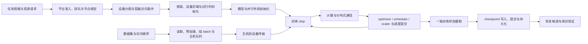
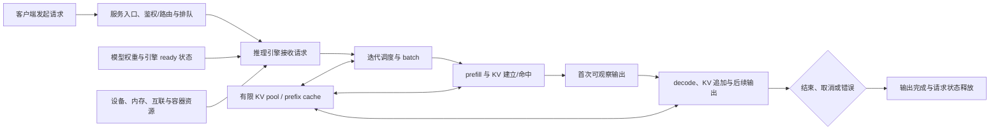

# 第五批 F01/F02 端到端总览来源准备

交付日期：2026-09-30。本记录准备 `overview.training-lifecycle` 与 `overview.inference-lifecycle` 的内容边界、内部链接、精确来源和待确认项；主任务授权正文阶段后，已据此创建 backlog 指定的两篇草稿。来源登记、导航和共享计划不在本批修改范围。

## backlog 身份与验收边界

| 任务 | 标题 | 稳定 ID | 目标路径 | 验收重点 |
|---|---|---|---|---|
| F01 | 一次训练任务的端到端路径 | `overview.training-lifecycle` | `knowledge/00-overview/training-lifecycle.md` | 有资源、状态和数据路径图；连接 F03/F05/F07/F09/F11/F13，并可引用已完成的 F14；不把单一训练框架等同所有实现 |
| F02 | 一次推理请求的端到端路径 | `overview.inference-lifecycle` | `knowledge/00-overview/inference-lifecycle.md` | 说明请求、执行、缓存和服务指标的关系；连接 F03/F05/F11/F15/F16；区分推理引擎与设备后端条件 |

总览页的职责是帮助读者判断“下一层应看哪篇正文”。硬件规格、框架状态字段、collective 契约、缓存算法和指标公式继续只有一个主要归属；F01/F02 只画关系、说明观察边界并链接下钻，不复制各章的表格或版本细节。

## 当前材料状态

- F03、F05、F07、F09、F11、F13、F14、F15 和 F16 正文已经实际读取。F16 落盘后又复核了其 frontmatter、定义表、客户端/服务端时间线、0/1-token 例外、失败过滤、分位数聚合与 Ascend 边界。
- F13/F14 已冻结等待第四批审阅，本批不改动它们。
- 所需外部资料均可复用现有 registry 或第四批已准备的固定来源。本批没有理由新增一个宽泛“AI 系统全景”主页来源。

## 单一主归属与内部链接地图

| 总览中的问题 | 下一层正文与稳定 ID | 总览只保留什么 | 不在总览重复什么 |
|---|---|---|---|
| 任务最终落在哪种 CPU、内存、加速器、互联、NIC 与存储入口上 | [计算节点资源与拓扑参考](../../knowledge/01-hardware/resource-topology.md)，`hardware.resource-topology`（F03） | 资源对象及连接会约束放置、数据移动和故障范围 | Atlas/DGX 规格、拓扑记录 schema、具体机型差异 |
| 模型意图如何经过框架/引擎、设备后端、平台运行时和驱动到达硬件 | [主机到模型执行的软件栈分层](../../knowledge/02-software-stack/layers-and-boundaries.md)，`software-stack.layers-and-boundaries`（F05） | 层间职责与引擎/框架后端的区别 | CUDA、TorchNPU、vLLM 插件的版本和组件细节 |
| 分布式参与者如何匹配 collective，为什么一个 rank 会等待另一个 rank | [集合通信与 rank 进展](../../knowledge/03-communication/collectives-and-rank-progress.md)，`communication.collectives-and-rank-progress`（F07） | 训练 step 中通信是独立进展域，需要对齐 group/rank/operation | NCCL/HCCL 参数契约、stream/Work 语义和超时分析全文 |
| batch 从存储到训练消费经历哪些缓冲与等待 | [训练数据供给路径与等待](../../knowledge/04-data-storage/training-data-path.md)，`data-storage.training-data-path`（F09） | 数据流、生产/消费与背压关系 | worker、缓存、pinning、传输指标和瓶颈判据全文 |
| 物理设备如何变成平台可上报、可调度、可分配并最终可由容器访问的资源 | [从物理设备到容器资源的状态链](../../knowledge/05-cluster-platform/device-resource-chain.md)，`cluster-platform.device-resource-chain`（F11） | 控制面资源状态与业务运行状态是不同观察 | Device Plugin 接口、MindCluster 固定实现和现场诊断表 |
| DP/TP/PP/分片怎样改变权重、optimizer、RNG、数据进度与并行映射 | [并行策略与训练状态](../../knowledge/06-training/parallelism-and-state.md)，`training.parallelism-and-state`（F13） | 训练循环中的状态类别、所有者和布局 | 责任矩阵、PyTorch/MindSpeed 条件和重分片细节 |
| checkpoint 读写后怎样确认训练真正续接 | [Checkpoint 恢复一致性](../../knowledge/06-training/checkpoint-state-consistency.md)，`training.checkpoint-state-consistency`（F14） | 保存点是训练生命周期的恢复候选，不是自动正确的终点 | 状态覆盖、DCP 条件、same-input 对照和容差细节 |
| prefill/decode、迭代 batch 与 KV 状态怎样关联 | [推理执行与 KV cache](../../knowledge/07-inference/execution-and-kv-cache.md)，`inference.execution-and-kv-cache`（F15） | 请求从输入到连续输出的逻辑阶段，KV 是有限运行时状态 | vLLM block、抢占、prefix cache、chunked prefill 的实现细节 |
| TTFT、TPOT、ITL、E2E、throughput 和 goodput 分别从哪里量 | [推理延迟与吞吐指标字典](../../knowledge/07-inference/latency-metrics.md)，`inference.latency-metrics`（F16） | 指标连接到请求时间线的起止点与观察者 | 指标字典、客户端/服务端例外、分位数与失败过滤规则 |

### 尚无已完成主归属的两段

- F01 的作业提交、准入、排队、gang 和拓扑放置细节属于 F12 `cluster-platform.admission-and-placement`，当前仍未完成。总览可以画出“提交/排队/绑定”的逻辑阶段，但只能链接 05 章入口或标为待建设，不能在 F01 中补写一篇调度策略正文。
- F02 的网关、认证、路由、限流、代理 flush 和副本扩缩容尚无本批指定的完成条目。总览可把“客户端到达所选观测边界”和“输出返回客户端”画成端点；不得据此发明统一代理栈或把服务端 TTFT 当完整客户端体验。

## F01：训练生命周期的组织模型

### 建议主图

正式正文可以采用下面的逻辑图。它是导航图，不是线程、进程或严格串行状态机；预取、计算、通信和异步 checkpoint 可以重叠。



图中 `A` 的具体策略仍待 F12；`R` 链接 F11，`S` 链接 F05，资源和连接背景链接 F03，`D/P/X` 链接 F09，`M/T/U/Q` 链接 F13，`C` 链接 F07，`W` 链接 F10，`V` 链接 F14。F01 backlog 没有把 F10/F14列为直接依赖，但主任务要求串联 F13–F16，且 checkpoint 文件边界与训练恢复已经有单一主归属；在总览中只需以可选保存/恢复分支链接，不把每个训练 step 描述成必然保存。

### 四条并行阅读线

| 阅读线 | 生命周期中跟踪的对象 | 关键边界 | 推荐下钻 |
|---|---|---|---|
| 资源 | CPU/NUMA、主机内存、GPU/NPU、设备内存、NIC、互联、存储入口；平台账本、分配和容器访问 | 产品规格、平台可分配量、Pod/作业实际分配和进程可用不是同一状态 | F03 → F11 → F05 |
| 数据 | 数据版本与访问顺序、存储读取、缓存、worker、预处理、batch、主机队列、设备 tensor | “上游有数据”“主机 batch 就绪”“设备已收到”“该 step 已消费”是不同完成点 | F09；恢复时再看 F13/F14 的数据进度 |
| 训练状态 | 参数/buffer、梯度、optimizer、scheduler、scaler、RNG、global/micro step、samples/tokens、并行映射 | 复制、分片、stage 所有和暂态不能用一个 rank-local 文件表达 | F13 → F14；字节落盘看 F10 |
| 进展与指标 | 控制面阶段、首 batch/稳定阶段、input wait、copy、forward/backward、collective、optimizer step、checkpoint、失败/重启 | 主机返回、设备完成、其他 rank 进度和训练语义提交不能混写成“step 完成” | F07、F09、F10、F14；指标共同字段可参考可靠性章节 |

### 一个 step 的最小关系

F01 不需要讲算子或 collective 实现，但应让读者看出一个训练 step 至少把这些关系连在一起：

1. sampler/数据状态决定 rank 下一批消费什么；读取、预处理和传输使输入在设备侧可用；
2. 模型和并行布局决定本 rank 拥有哪些参数、stage/shard 与通信域；
3. forward/backward 产生输出、loss 与梯度，分布式并行在相应边界执行 collective 或点对点通信；
4. optimizer、scheduler、scaler 和训练计数按应用顺序推进；
5. 只有在定义好的逻辑提交点，状态才成为 checkpoint 截取候选；保存 API、持久化和恢复验证仍是后续不同完成点。

PyTorch 2.6 `DataLoader` 是数据生产路径的固定实现样板（[torch.utils.data](https://docs.pytorch.org/docs/2.6/data.html)）；PyTorch 2.6 DDP/FSDP/TP/PP 与 state-dict 页面是训练布局样板（[DDP](https://docs.pytorch.org/docs/2.6/generated/torch.nn.parallel.DistributedDataParallel.html)、[FSDP](https://docs.pytorch.org/docs/2.6/fsdp.html)、[Tensor Parallel](https://docs.pytorch.org/docs/2.6/distributed.tensor.parallel.html)、[Pipeline Parallel](https://docs.pytorch.org/docs/2.6/distributed.pipelining.html)、[DCP](https://docs.pytorch.org/docs/2.6/distributed.checkpoint.html)）。总览只能把它们称为样板，不能声称所有训练框架都使用 worker 进程、PyTorch state dict 或相同并行 API。

### F01 可采用的指标入口

F01 当前没有独立的训练指标字典，宜只说明指标必须绑定对象、阶段、窗口和观测点：

- 控制面：任务提交、排队、绑定、容器创建、框架 ready 的时刻与失败分类；调度细节在 F12 建设前保持有限。
- 数据：samples/tokens、读取/预处理/组 batch、队列深度、input wait、host-to-device 时间及稳定/冷启动窗口，定义见 F09。
- step：step/micro-step、batch shape、forward/backward/optimizer 与 wall time；不能只用设备利用率判断瓶颈。
- 通信：group/rank/operation identity、主机进入/返回、设备完成和 timeout，定义见 F07。
- checkpoint/恢复：截取、暂存、写入、提交、持久化、load、状态验证分别计时，定义见 F10/F14。
- 结果：吞吐和 loss/数值结果需同时记录工作负载、并行布局、版本和容差；本页不给阈值。

## F02：推理请求生命周期的组织模型

### 建议主图

指标节点使用 F16 的正式定义，但图中仍只保留导航级名称。



`H` 链接 F03/F11，框架或引擎到平台后端的关系链接 F05，`B/P/D/V` 链接 F15，首次输出、后续间隔、请求完成和吞吐的测量链接 F16。入口中的路由、代理和限流是候选职责，不代表所有部署都存在这些独立组件；没有相应主归属正文前不展开实现。

### 请求、状态、资源与指标的对应

| 请求阶段 | 主要输入/状态 | 主要资源关系 | 指标连接点；最终以 F16 为准 |
|---|---|---|---|
| 到达与排队 | request ID、模型/版本、prompt 或多模态输入、到达时刻、deadline/取消状态 | 网关/代理、服务副本与队列；具体实现未固定 | attempted/completed/failed/cancelled、queue time；客户端和服务端起点可能不同 |
| 引擎调度 | 请求阶段、优先级、token budget、活动 batch、抢占状态 | CPU 调度、设备执行槽、设备内存与并行资源 | scheduled time、batch/token 组成、preemption；指标名和暴露能力依引擎 |
| prefill | 未处理 prompt token、可复用 prefix KV、模型权重 | 计算、设备内存、KV pool、可能的跨 rank 通信 | 首次可观察输出边界连接 TTFT；prefix 命中不等于整个请求完成 |
| decode/流式输出 | 已有 KV、已生成 token、采样状态、停止条件 | 反复调度、KV 读写/追加、输出传输 | ITL/TPOT/E2E；一个 engine update 或 stream chunk 不保证恰好一个 token |
| 完成/取消/错误 | finish reason、输出 token、最终请求状态 | 释放活动引用；空闲 prefix block 是否保留由引擎策略决定 | 成功/错误/取消必须与 latency 分布和 throughput 分母一起报告 |
| 聚合窗口 | 请求长度分布、并发/arrival、cold/warm、模型与后端版本 | 副本数、容量、缓存热度与负载共同决定结果 | request/token throughput、goodput 和 percentile 必须说明对象、窗口、筛选和聚合 |

固定 vLLM `v0.14.0` 可作为可复核样板：其文档把请求组织为迭代 batch，说明 chunked prefill、KV 空间不足时的抢占重算和 block 级 prefix caching（[固定 optimization](https://github.com/vllm-project/vllm/blob/b17039bccc17b94a2ea107272ad7bc93508708df/docs/configuration/optimization.md)、[固定 prefix caching 设计](https://github.com/vllm-project/vllm/blob/b17039bccc17b94a2ea107272ad7bc93508708df/docs/design/prefix_caching.md)）。这些实现不能写成全部推理引擎的统一状态机、默认策略或容量公式。

引擎与设备后端也必须分开。vLLM `v0.14.0` 的 [Plugin System](https://docs.vllm.ai/en/v0.14.0/design/plugin_system/#types-of-supported-plugins)把 platform plugin 作为接入树外平台的扩展点；vLLM Ascend `v0.14.0rc1` 固定快照只说明该插件自身的功能矩阵和硬件/版本条件。后者的文档构建变量指向 vLLM `v0.14.1`，与本页上游样板 `v0.14.0` 没有在本仓库配套验证，因此 F02 只能用它示范“引擎能力与平台后端条件要分别核对”，不能拼成 NPU 部署组合。

### F16 正文复核结果

1. 标题、ID 与路径符合 backlog：`inference.latency-metrics`、`knowledge/07-inference/latency-metrics.md`；source refs 固定为 vLLM `v0.14.0`、Prometheus 2026-09-29 动态文档登记和 vLLM Ascend `v0.14.0rc1`。
2. TTFT、TPOT、ITL、E2E、request/output-token/total-token throughput 与 goodput 都给出了样本对象、单位、起止点和主要例外。F02 只需要把时间线节点链接过去。
3. 客户端的首个含 `choices` 的 SSE payload、服务端首个 engine output 和严格的首个非空 token 不是同一事件；engine update 或 stream chunk 也不保证恰好一个 token。
4. vLLM 固定服务端 finish reason 包括 STOP/LENGTH/ABORT/ERROR，但所读路径没有证明所有取消入口都进入同一 finished-request 统计；固定 `bench serve` 的 latency 与 token throughput 只纳入成功请求。F02 必须让失败和取消与延迟/吞吐并列，避免幸存者偏差。
5. 客户端 percentile 来自一次 benchmark 的样本数组；服务端 Prometheus histogram 需要固定 rate 窗口、标签和兼容 buckets 后聚合。实例 p99 不能取平均得到整体 p99。
6. F16 自身明确 vLLM Ascend 固定快照没有重新定义 NPU 专属指标语义，也没有证明上游 `v0.14.0` 指标在该 RC 全部存在；F02 继续把引擎口径与设备插件条件分开。

## 建议复用的来源 ID

以下选择以“总览正文实际直接出现的外部事实”为准。内部链接本身不要求把下游页面的所有来源复制进总览 frontmatter。

### F01 候选 `source_refs`

```yaml
source_refs:
  - src.kubernetes.device-plugins-v1-32
  - src.pytorch.data-loader-2.6
  - src.pytorch.distributed-2.8
  - src.pytorch.parallel-training-state-2.6
  - src.pytorch.dcp-2.6
```

- `src.kubernetes.device-plugins-v1-32` 支持资源注册、上报、分配和容器配置边界，不支持全部调度策略或框架可用性。
- `src.pytorch.data-loader-2.6` 支持 DataLoader 样板的数据集、采样、worker、预取与组 batch，不代表其他训练框架。
- `src.pytorch.distributed-2.8` 只在总览直接解释 process group/rank/collective 进展时使用；NCCL/HCCL 版本细节继续留在 F07。
- `src.pytorch.parallel-training-state-2.6` 支持 DDP/FSDP/TP/PP 和 optimizer/scheduler/scaler/RNG 等状态样板。
- `src.pytorch.dcp-2.6` 支持 save/load 与目标 state-dict/resharding 边界；持久化与恢复正确性仍链接 F10/F14。

上述 ID 已存在于 `sources/registry.yaml`。F01 若最终只用内部链接概括某一层，可从 `source_refs` 删除对应外部来源，避免 frontmatter 虚增依赖。

### F02 候选 `source_refs`

```yaml
source_refs:
  - src.kubernetes.device-plugins-v1-32
  - src.vllm.plugin-system-v0-14
  - src.vllm.inference-v0-14
  - src.ascend.vllm-ascend-v0-14-0rc1
  - src.prometheus.histograms-2026-09-29
```

- 五项现在均存在于 registry；`src.kubernetes.device-plugins-v1-32` 只支持资源链，`src.vllm.plugin-system-v0-14` 只支持引擎平台插件边界。后三项的完整核查过程和许可证范围见 [F15/F16 来源记录](batch-04-inference-sources.md)，本批不重复创建同义来源。
- `src.vllm.inference-v0-14` 是 F15/F16 的共同固定 vLLM commit；F02只抽取请求阶段与指标连接点。
- `src.ascend.vllm-ascend-v0-14-0rc1` 只用于 NPU 插件范围和版本冲突边界。
- `src.prometheus.histograms-2026-09-29` 是动态官方页面的带读取日期登记，只用于 histogram/quantile 聚合边界。

本批不新增来源登记 YAML。现有精确来源足以支持两篇导航型总览；新增宽泛首页只会降低可定位性。

## 正文写作结构建议

### F01

1. 定义“任务生命周期”是资源、数据、训练状态和进展四条线的交汇，不是单一框架调用栈。
2. 放端到端导航图，每个节点近旁链接对应主归属。
3. 用四条阅读线表解释同一阶段应观察什么对象和状态。
4. 用一个 step 的最小关系连接数据供给、计算、通信和状态提交。
5. 将 checkpoint 保存/恢复画成可选分支，分别链接 F10/F14。
6. 列出平台/框架边界与缺口：F12 未完成、NPU 数据传输语义未知、无现场验证。

### F02

1. 从客户端请求和服务观测边界开始，说明入口组件依部署而异。
2. 放请求、迭代 batch、prefill、首次输出、decode、完成/取消/错误的导航图。
3. 单表连接阶段、状态、资源与指标，不复制 F15/F16 全文。
4. 解释 KV 是有限的请求运行时状态，模型权重、活动请求 KV 与可复用 prefix cache 不是同一对象。
5. 明确客户端/服务端指标边界和失败过滤，链接 F16。
6. 用 vLLM/vLLM Ascend 作为分开的固定样板，保留版本冲突和未配套验证边界。

## 必须保留的未知项

- 没有执行训练、推理、调度、数据传输、通信、checkpoint、GPU/NPU 或性能实验；两张生命周期图都是来源支持的职责关系整理。
- 没有一个来源证明所有训练框架或推理引擎采用同一阶段顺序。异步预取、流水线、投机解码、外部 KV、PD 分离和重试都可能改变时序。
- F12 尚未完成，训练任务的准入、gang、队列和拓扑放置只可作为导航节点，不得在 F01 中补写无来源机制。
- F02 尚无网关、路由、限流、代理和副本生命周期的固定实现来源；服务入口保持部署相关。
- 资源“已分配”、容器“可见”、框架/引擎“ready”、设备任务“完成”、训练状态“已提交”与请求“成功”是不同状态，不能以单一 Running/HTTP 200/调用返回替代。
- `generic` 只表示导航关系可跨平台使用，不代表 CUDA、TorchNPU、NCCL、HCCL、vLLM 和 vLLM Ascend 具有相同 API、默认值或支持组合。

## 执行记录

- 本轮只读取仓库内 backlog、内容架构、已完成正文、来源 registry 和第四批推理研究记录。
- 没有打开或运行任何上游代码、训练/推理服务、GPU/NPU、集群或存储；没有下载依赖或执行 benchmark。
- 没有修改 F13/F14、registry、导航或计划；本记录交付阶段只新增 backlog 指定的 F01/F02 正文。没有运行 `make check`、`make build` 或 `make test`。

## 集成后与第四批审阅同步

F01 已链接完成的准入与放置概念页；F02 依据第四批 R2 补正 HTTP/frontend/engine request 的阶段图。服务端 TTFT/E2E 的默认 arrival 晚于常规 OpenAI 预处理，终点是 frontend 接收输出后的 iteration wall-clock；详细固定调用链统一维护在 F16 与第四批审阅报告。
