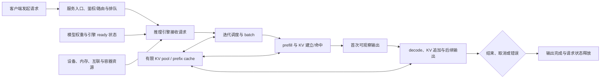
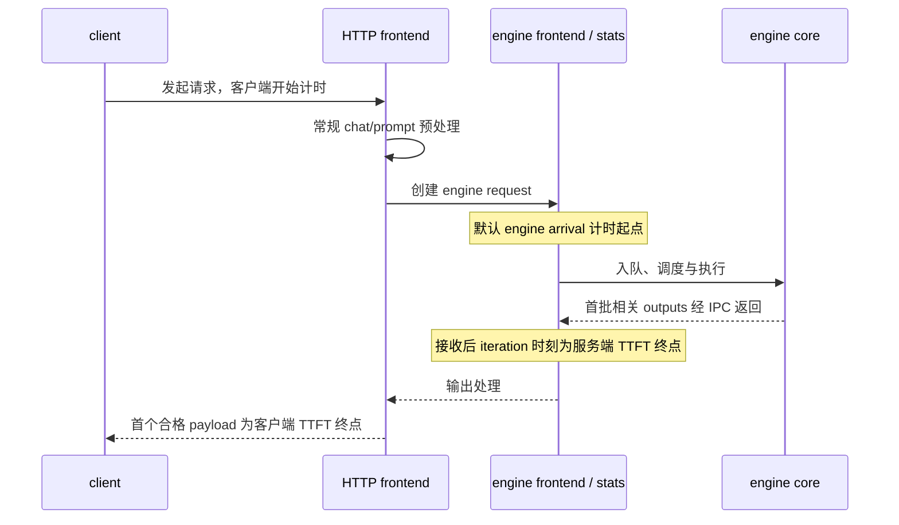

# 一次推理请求的端到端路径

一次流式生成请求会穿过客户端与服务边界，进入推理引擎的队列和迭代调度，再经历 prefill、首次输出、decode 与完成。与此同时，模型权重、请求状态和 KV cache 占用不同资源，客户端和服务端又从不同事件开始计时。本页用这条路径选择下一层知识，不把某个引擎的调度器或某个平台插件当作统一实现。

## 从请求到输出的导航图

图中的服务入口依部署而异，不保证存在独立网关、鉴权器或路由器。一次引擎 update 或 stream chunk 也不保证恰好含一个 token。投机解码、多模态 encoder、外部 KV、PD 分离与非流式协议会增加或改变阶段，不能从这张概念图推断线程、kernel 或网络时序。

## 每个问题应进入哪层知识

| 当前问题 | 先选择的正文 | 原因 |
|---|---|---|
| 服务副本实际获得了哪些 CPU、内存、GPU/NPU、互联和网络路径 | [计算节点资源与拓扑参考](../01-hardware/resource-topology.md) | 资源总量、连接和共享故障域决定容量与影响范围 |
| 平台显示设备可分配，但容器或引擎不能使用 | [从物理设备到容器资源的状态链](../05-cluster-platform/device-resource-chain.md) | 物理存在、驱动可见、上报、绑定、分配和容器访问是不同状态 |
| 框架可直接执行，但推理引擎不能识别平台或初始化后端 | [主机到模型执行的软件栈分层](../02-software-stack/layers-and-boundaries.md) | 引擎、引擎平台插件、框架后端、运行时和驱动职责不同 |
| 请求为何在 prefill/decode 间等待，KV 为什么不足，prefix 命中或抢占意味着什么 | [推理执行与 KV cache](../07-inference/execution-and-kv-cache.md) | 该页维护执行、调度、KV 生命周期和容量边界 |
| TTFT、TPOT、ITL、E2E、吞吐或 goodput 的数值能否比较 | [推理延迟与吞吐指标字典](../07-inference/latency-metrics.md) | 名称必须绑定对象、单位、起止点、窗口、筛选和聚合 |
| 请求成功但结果错误，或恢复后服务可用但性能/正确性未达标 | [可靠性维度与故障域](../08-reliability/dimensions-and-failure-domains.md) | 协议成功、正确性、性能稳定性与可恢复性需要分别定义 |

Kubernetes Device Plugin 的 `Allocate` 可以提供设备节点、挂载、环境变量或 CDI 等容器配置，但这不证明推理引擎后端已经加载，也不证明目标模型、算子或指标可用（[Kubernetes v1.32 Device Plugins](https://v1-32.docs.kubernetes.io/docs/concepts/extend-kubernetes/compute-storage-net/device-plugins/)）。因此资源层和请求执行层之间需要独立 ready 与最小功能证据。

## 副本变更、失败/重试与恢复验证入口

请求路径之外，服务副本生命周期会改变上图前提；相关入口：

| 变化 | 与请求路径的关系 | 入口正文 |
|---|---|---|
| 副本扩缩容与冷启动 | 改变"到达与排队"层的容量与分母；缩容 drain 时**新请求**经实际路由收敛转向其他可服务副本，**在途流**按 drain 契约完成/取消（超期或终态不明按重试边界处理，不承诺已输出流透明续传或 KV 自动迁移——见目标正文） | [容量、扩缩容与冷启动决策](../07-inference/capacity-and-autoscaling.md) |
| 版本发布 | 灰度五步（预热/递增/gate/drain/回退）改变副本集合与模型版本 | [服务版本发布、副本故障与恢复验证](../07-inference/release-and-recovery.md) |
| 请求失败与重试 | 请求身份、幂等与断连/取消/流式重试的边界决定"完成"判据 | [请求路由、准入与流控](../07-inference/routing-and-flow-control.md) |
| 副本/引擎故障 | liveness/readiness/推理质量三层分开，摘除与恢复验证分层 | [服务版本发布、副本故障与恢复验证](../07-inference/release-and-recovery.md)（含 PD 单侧故障分支） |
| 启动/执行期 OOM | 加载、图编译、prefill/decode 各首失败阶段的分诊 | [GPU 推理 OOM 诊断](../07-inference/gpu-inference-oom-triage.md)（NVIDIA/AMD）与[昇腾推理 OOM 诊断](../07-inference/ascend-inference-oom-triage.md) |

恢复验证的判据与本文"失败过滤与聚合同样属于口径"一致：恢复后须同时核对延迟分布、失败/取消计数与输出质量（见[发布恢复验证设计](../07-inference/release-and-recovery.md)），不以副本 ready 代替请求恢复。环境前置（引擎安装、平台栈升级与回退）见[三平台安装基线、迁移升级与回退验证](../02-software-stack/environment-installation-and-upgrade.md)（文档样板，未实测）。

## 平台分支

- 引擎侧：三线分立——本页**上游 vLLM** 执行/计时细节均限 b17039bc 固定快照；vLLM Ascend 限 52d4acf 固定快照（其文档构建变量指向 vLLM v0.14.1，差异见文末既有说明）；MindIE 的组件与交集入口对应其**仓内文档线自述的 3.1.0**（开源仓 69e5a5dd 快照，产品包/latest 支持表映射仍 unknown，见[MindIE 执行档案](../07-inference/mindie-execution-profile.md)）。三平台特性交集（支持/条件/未证实/冲突分列）见[推理引擎组件与平台功能交集档案](../07-inference/engine-backend-boundaries.md)。
- AMD/ROCm：特性交集的 AMD 行与 [GPU 推理 OOM 诊断](../07-inference/gpu-inference-oom-triage.md) 的 ROCm 取证差异；vLLM ROCm 安装边界（无预编译 wheel、docker 推荐）见其登记文档。MindIE PD 混部/分离等昇腾侧语义见[MindIE 执行档案](../07-inference/mindie-execution-profile.md)。未列入交集档案的组合保持 unknown，不画成已支持。

## 请求、状态、资源与指标怎样对应

| 请求阶段 | 主要输入或状态 | 主要资源关系 | 观察边界 |
|---|---|---|---|
| 到达与排队 | request ID、模型/版本、prompt 或多模态输入、到达、deadline 与取消状态 | 入口、服务副本和队列；具体实现未固定 | attempted/completed/failed/cancelled 与 queue time；客户端和服务端起点可能不同 |
| 引擎调度 | 请求阶段、优先级、token budget、活动 batch 与抢占状态 | CPU 调度、设备执行槽、设备内存与并行资源 | scheduled、batch/token 组成和 preemption；字段依引擎 |
| prefill | 未处理 prompt token、可复用 prefix KV、模型权重 | 计算、KV pool、可能的并行通信 | 第一次可观察输出连接 TTFT；prefix 命中只省去相应前缀计算 |
| decode 与流式返回 | 已有 KV、已生成 token、采样状态和停止条件 | 反复调度、KV 读写/追加和输出传输 | ITL、TPOT、E2E；update/chunk/token 不能自动互换 |
| 完成、取消或错误 | finish reason、输出 token、最终请求状态 | 释放活动引用；空闲 prefix block 是否保留由实现决定 | 成功、错误和取消要与 latency 分布、throughput 分母一起报告 |
| 聚合窗口 | 请求长度分布、arrival/concurrency、cold/warm、模型与后端版本 | 副本数、容量、缓存热度与负载共同作用 | request/token throughput、goodput 和 percentile 都需要完整统计条件 |

## 三类状态不能混为一个 cache

1. **模型权重与引擎 ready 状态**属于服务副本生命周期。模型已加载不表示某个请求已经调度，也不表示目标平台插件与全部模型能力得到验证。
2. **活动请求状态**包括输入、已生成 token、采样/停止条件、排队与执行位置。取消或错误要结束或清理这些状态，但具体路径依引擎。
3. **KV 状态**为后续注意力保留历史 key/value。活动 KV、请求结束后仍可复用的 prefix block、外部 KV load 和模型权重加载是不同对象。

固定 vLLM `v0.14.0` 是这里的可复核样板。其优化文档描述迭代 batch、chunked prefill，以及 KV 空间不足时的抢占与重算（[optimization](https://github.com/vllm-project/vllm/blob/b17039bccc17b94a2ea107272ad7bc93508708df/docs/configuration/optimization.md)）；prefix caching 设计使用 block pool、hash identity 和引用/驱逐关系（[prefix caching](https://github.com/vllm-project/vllm/blob/b17039bccc17b94a2ea107272ad7bc93508708df/docs/design/prefix_caching.md)）。这些细节不能外推成其他引擎的默认策略、block 格式或容量公式。

## 客户端和服务端在不同位置计时

固定 vLLM `v0.14.0` 常规 OpenAI 路径在已有 HTTP/prompt/chat 预处理后创建 engine request，未覆盖 arrival 时才设置默认起点；服务端 TTFT 结束于 frontend 收到首批相关 outputs 后的 iteration 时刻，包含返回 IPC/等待。它不是“HTTP 收到请求→engine 产出 token”（[`input_processor.py` 470–471](https://github.com/vllm-project/vllm/blob/b17039bccc17b94a2ea107272ad7bc93508708df/vllm/v1/engine/input_processor.py#L470-L471)、[`async_llm.py` 498–519](https://github.com/vllm-project/vllm/blob/b17039bccc17b94a2ea107272ad7bc93508708df/vllm/v1/engine/async_llm.py#L498-L519)）。显式 arrival 或其他入口要另查调用链，完整依据见[指标字典](../07-inference/latency-metrics.md)。

服务端 TTFT/E2E 使用 frontend wall-clock，ITL/阶段区间来自 engine-core monotonic 时间；固定 benchmark 客户端使用 `perf_counter()`，从 POST 前计到首个含 `choices` 的 SSE payload，该 payload 不保证恰好含一个 token（[`stats.py` 193–305](https://github.com/vllm-project/vllm/blob/b17039bccc17b94a2ea107272ad7bc93508708df/vllm/v1/metrics/stats.py#L193-L305)、[`endpoint_request_func.py`](https://github.com/vllm-project/vllm/blob/b17039bccc17b94a2ea107272ad7bc93508708df/vllm/benchmarks/lib/endpoint_request_func.py)）。两种 TTFT 相减不是精确网络时间。

指标名称还需回到[指标字典](../07-inference/latency-metrics.md)：TPOT 是请求级平均，必须说明 0/1-token 规则；ITL 的样本可能是 engine update 或 stream chunk interval；E2E 的终点随 endpoint 改变；throughput 必须写清请求或 token 分子和测量窗口；goodput 还要列出全部 SLO 条件。

失败过滤与聚合同样属于口径。固定 `bench serve` 只把成功请求纳入 latency 分布和 token throughput，延迟改善可能与失败增加同时发生。服务端 histogram 的整体分位数需要在共同窗口聚合兼容 bucket 后计算；实例 p99 不能取平均得到整体 p99（[Prometheus Histograms and summaries](https://prometheus.io/docs/practices/histograms/)、[`histogram_quantile`](https://prometheus.io/docs/prometheus/latest/querying/functions/#histogram_quantile)，2026-09-29 读取）。

## 引擎与设备后端是两层条件

vLLM `v0.14.0` 把 platform plugin 定义为接入树外平台的扩展点（[Plugin System](https://docs.vllm.ai/en/v0.14.0/design/plugin_system/#types-of-supported-plugins)）。所以“引擎有某项机制”和“目标设备后端、模型与版本支持该机制”是两个问题。

vLLM Ascend `v0.14.0rc1` 固定功能矩阵把 chunked prefill 和 automatic prefix caching 标为 Functional，但同一快照还限定硬件和软件范围，310P 有 release-note 限制；其文档构建变量指向 vLLM `v0.14.1`，并非本文上游样板 `v0.14.0`（[功能矩阵](https://github.com/vllm-project/vllm-ascend/blob/52d4acfa51fb868823d1070b81cbd2d97e9e4696/docs/source/user_guide/support_matrix/supported_features.md)、[`conf.py`](https://github.com/vllm-project/vllm-ascend/blob/52d4acfa51fb868823d1070b81cbd2d97e9e4696/docs/source/conf.py)、[release notes](https://github.com/vllm-project/vllm-ascend/blob/52d4acfa51fb868823d1070b81cbd2d97e9e4696/docs/source/user_guide/release_notes.md)）。本库没有安装或验证这两个快照的配套，不能把它们拼成 NPU 部署组合。

## 适用边界与待建设项

本文没有固定网关、认证、路由、限流、代理 flush、服务发现、扩缩容或版本发布实现；这些控制面环节的方法档案与固定样板（Envoy/K8s v1.32/KServe/production-stack 等，均未实测）见 07 域[路由与流控](../07-inference/routing-and-flow-control.md)、[容量与扩缩容](../07-inference/capacity-and-autoscaling.md)与[发布与恢复](../07-inference/release-and-recovery.md)，本页只保留请求侧口径。也没有提供 KV bytes/token、并发上限、设备利用率、TTFT/TPOT 阈值或调优参数。

对其他引擎、GPU/NPU 插件和协议，应复用"请求阶段—状态—资源—观测边界"的记录方法，重新读取其调度、cache 和指标实现。缺少版本、模型、硬件、请求分布、cold/warm 状态与错误计数时，性能值不可当作通用基线。来源选择和未解决条件见[第五批研究记录](../../docs/research/batch-05-overview-sources.md)；2026-10-21 终态核对（T00-04）只补链接与入口，不改变上述边界。
