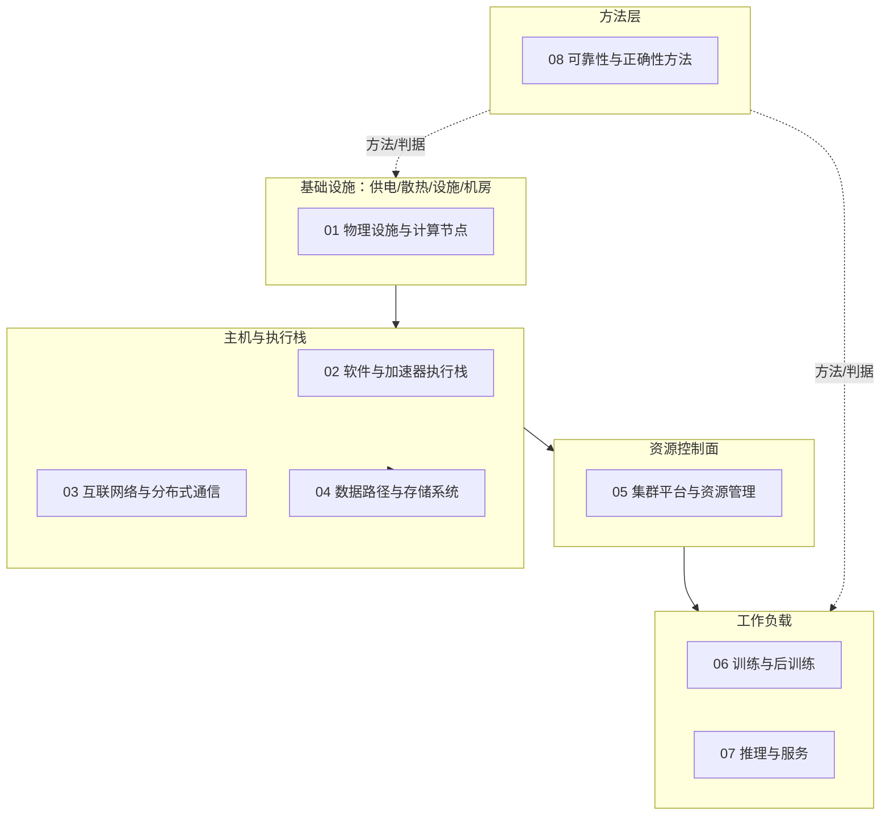

# 统一术语、先修关系与系统责任边界

本页约定知识库九个领域共用的核心术语和先修关系，并划出基础设施、工作负载、资源控制与现场诊断之间的责任边界。术语范围以[内容总目录](../../content-outline.md)的九领域为限，不建立无限词典；厂商特定名称只在对应正文中展开。

`generic` 表示这里统一的是概念和导航边界。两个平台存在同名概念不等于命令、字段或语义兼容；具体平台的定义以各自正文和版本化来源为准。

## 术语分组与主归属

每组术语只列本库用到的含义；「主归属」是该术语完整定义所在的正文；**尚无专题正文的术语，其当前定义即本页对应条目**，主归属标注为本页，链接仅作背景阅读，专题交付后再迁移。链接目标即阅读顺序中的先修点。

### 设备、芯片、板卡、节点、超节点

| 术语 | 本库用法 | 主归属与边界 |
|---|---|---|
| 芯片（die/chip） | 加速器封装内的计算硅片实体；一个封装可含多个芯片（如 AMD MI200 的 2×GCD） | 执行单元与内存层次见[加速器执行与数据移动](../01-hardware/accelerator-execution-and-data-movement.md)；芯片数量不等于可分配设备数 |
| 设备（device） | 对主机可见、被驱动枚举、可被平台分配的计算端点 | 记录字段见[计算节点资源与拓扑参考](../01-hardware/resource-topology.md)；OS 设备节点、PCIe 端点、调度资源是同一物理实体在不同层的**映射候选**，但拆分、聚合或虚拟化会打破一一对应：例如 NVIDIA MIG 把一块物理 GPU 呈现为多个带独立 UUID 的 MIG 设备（[MIG Device Names](https://docs.nvidia.com/datacenter/tesla/mig-user-guide/mig-device-names.html)，2026-10-08 观察），见[设备资源链](../05-cluster-platform/device-resource-chain.md)。不得以设备 ordinal 或设备节点数量推断物理端点或故障域数量 |
| 板卡（card/module） | 承载芯片、内存与互联端口的可插拔实体（PCIe 卡、OAM 模块等） | 机型组成见[资源与拓扑参考](../01-hardware/resource-topology.md)；板卡可替换边界与故障域按机型手册 |
| 节点（node/server） | 一台可独立安装 OS、拥有主机 CPU/内存/根复合体的服务器 | 同上；Kubernetes 的 worker node 指运行负载的节点机器（[Cluster Architecture](https://kubernetes.io/docs/concepts/architecture/)，2026-10-08 观察） |
| 超节点（supernode/SuperPoD） | 厂商定义的、经节点内/柜内高速互联组织多台服务器的实体；组成、互联和维护边界按具体产品 | 主归属（2026-10-21 迁移，T01-05/T00-02 均已交付）：组成层次与机型样板见[计算节点资源与拓扑参考](../01-hardware/resource-topology.md)，三类参考架构与选择见[单机、集群与超节点的参考架构](reference-architectures.md)；未公开组成的产品不类推同构关系 |

### rank、worker、副本

| 术语 | 本库用法 | 主归属与边界 |
|---|---|---|
| rank | 分布式训练/集合通信中进程组内的序号身份 | 通信域与 rank 映射见[集合通信与 rank 进展](../03-communication/collectives-and-rank-progress.md)；rank 是逻辑身份，不固定等于物理设备编号 |
| worker | 按语境区分：Kubernetes worker node（节点机器）、PyTorch DataLoader worker（加载子进程，`num_workers`，[PyTorch 2.6 data](https://docs.pytorch.org/docs/2.6/data.html)）、torchrun/elastic worker（训练进程） | 三种含义互不相干；诊断时必须先确定语境。数据加载 worker 的等待见[数据饥饿诊断](../04-data-storage/data-starvation-triage.md) |
| 副本（replica） | 推理服务中同一模型的独立服务实例；训练语境的 DP 副本指持有完整参数的 rank 组 | 推理副本与恢复见[推理请求端到端路径](inference-lifecycle.md)；数据并行状态见[并行策略与状态](../06-training/parallelism-and-state.md)。两种「副本」不共享生命周期 |

### 驱动、运行时、框架后端、设备插件

| 术语 | 本库用法 | 主归属与边界 |
|---|---|---|
| 驱动（driver） | 内核态/固件侧的设备驱动，负责枚举、初始化与硬件交互 | 分层见[软件栈分层与边界](../02-software-stack/layers-and-boundaries.md) |
| 运行时（runtime） | 用户态运行时库（如 CUDA Runtime 构建于 Driver API 之上，[CUDA 12.8 编程指南](https://docs.nvidia.com/cuda/archive/12.8.0/cuda-c-programming-guide/index.html) Introduction）；与 Kubernetes container runtime（kubelet 经 [CRI](https://kubernetes.io/docs/concepts/architecture/cri/) 驱动的节点组件）是完全不同的层 | 同名异义高发点：说「runtime 错误」必须限定是哪一层 |
| 框架后端（framework backend） | PyTorch 等框架内的设备后端（CUDA/HIP/PrivateUse1），负责算子分发与设备执行 | 适配与失败分支见[算子与图执行失败诊断（Ascend）](../02-software-stack/ascend-op-graph-failure-triage.md) |
| 设备插件（device plugin） | Kubernetes 中向 kubelet 上报设备资源并参与分配的组件 | 职责链见[设备资源链](../05-cluster-platform/device-resource-chain.md)；与框架后端是不同概念，不可互换 |

### 状态、持久化、恢复

| 术语 | 本库用法 | 主归属与边界 |
|---|---|---|
| 状态（state） | 三种含义分开：训练状态（权重/优化器/RNG/数据进度）、集群平台作业状态（调度相位，如 Volcano PodGroup `status.phase` 的 pending/running/unknown/inqueue，[v1.15.0 文档](https://volcano.sh/docs/v1.15.0/concepts/podgroup/)）、设备健康状态 | 训练状态契约见[Checkpoint 状态一致性](../06-training/checkpoint-state-consistency.md)；平台状态见[准入与放置](../05-cluster-platform/admission-and-placement.md)；设备健康见[设备健康证据](../01-hardware/health-evidence.md) |
| checkpoint | 训练框架的可恢复状态点；与 gradient checkpointing（省显存计算技术）和平台作业状态无关 | 写入与持久化见[Checkpoint 持久化](../04-data-storage/checkpoint-durability.md)；PyTorch elastic 明确 "you will lose progress up to the most recent checkpoint"（[2.6 train_script](https://docs.pytorch.org/docs/2.6/elastic/train_script.html)） |
| 持久化（durability） | 数据落到非易失介质并可读回的性质 | 语义与后端差异归[数据与存储](../04-data-storage/index.md)领域 |
| 恢复（recovery） | 从持久化状态或冗余组件重建服务能力的过程；区分应用恢复、平台恢复与设备恢复 | 训练恢复验证见[Checkpoint 恢复诊断](../06-training/checkpoint-state-recovery-triage.md)；恢复判据见[可靠性维度](../08-reliability/dimensions-and-failure-domains.md) |

## 系统责任边界

上图是本库的领域分工图，不是部署架构图。读法：

- **基础设施 → 主机与执行栈 → 资源控制面 → 工作负载**：下层异常沿依赖向上表现为性能退化、资源不可用或作业失败，但上层症状不能反向单独证明下层根因。
- **08 是方法层**：故障模型、证据关联、假设检验、测试与判据服务于所有领域，不拥有具体设备或作业。
- **诊断入口**：症状出现在哪一层就先在哪一层取证；跨层归因遵循[证据与假设](../08-reliability/evidence-and-hypotheses.md)的支持/反驳/未知纪律，以及 Google SRE 的假设—演绎循环定义（"given a set of observations … we iteratively hypothesize potential causes for the failure and try to test those hypotheses"，[SRE Book 第 12 章](https://sre.google/sre-book/effective-troubleshooting/)，注意该章属 SRE Book 而非 workbook）。

通用抽象不构成命令兼容：上图中每个方框只承诺知识组织方式；同名机制（如「健康检查」「带宽测试」）在 NVIDIA、Ascend、AMD 各自由对应正文和版本化来源定义。

## 先修关系

| 阅读目标 | 先修 |
|---|---|
| 01 物理设施 | 本页术语组 1；[资源与拓扑参考](../01-hardware/resource-topology.md)的记录纪律 |
| 02 软件栈 | 术语组 3；[分层与边界](../02-software-stack/layers-and-boundaries.md) |
| 03 通信 | 术语组 2 的 rank；[训练任务端到端路径](training-lifecycle.md)的并行背景 |
| 04 数据存储 | 术语组 4 的持久化；[训练数据路径](../04-data-storage/training-data-path.md) |
| 05 集群平台 | 术语组 2/3；[设备资源链](../05-cluster-platform/device-resource-chain.md) |
| 06 训练 | 术语组 2/4；[训练任务端到端路径](training-lifecycle.md) |
| 07 推理 | 术语组 2 的副本；[推理请求端到端路径](inference-lifecycle.md) |
| 08 可靠性 | 全部四组术语；[可靠性维度](../08-reliability/dimensions-and-failure-domains.md) |

**路径可达性验收（2026-10-08）**：本页四组术语的主归属链接与先修表链接均指向仓库内已存在文件，经 `make check`（73 content entries / 119 sources）校验通过；超节点一词的当前定义落在本页对应条目（[计算节点资源与拓扑参考](../01-hardware/resource-topology.md)仅作背景阅读），待 T01-05/T00-02 交付后改为专题正文，不提前链接不存在的文件。该验收只证明链接可达与定义落点存在，不证明目标正文已覆盖术语的全部深度。

## 同名异义与错误归属反例

| 症状/说法 | 错误归属 | 正确做法 | 依据 |
|---|---|---|---|
| 「worker 挂了」 | 直接当成 Kubernetes 节点故障 | 先确定语境：K8s worker node、DataLoader worker 进程还是 torchrun worker；三者证据和处置完全不同 | [K8s 架构](https://kubernetes.io/docs/concepts/architecture/) vs [PyTorch 2.6 data](https://docs.pytorch.org/docs/2.6/data.html) |
| 「runtime 报错」 | 直接当成容器运行时问题 | 限定是 CUDA/CANN 运行时库、框架后端还是 container runtime（CRI） | [CUDA 12.8 指南](https://docs.nvidia.com/cuda/archive/12.8.0/cuda-c-programming-guide/index.html) vs [K8s CRI](https://kubernetes.io/docs/concepts/architecture/cri/) |
| 「状态不一致」 | 混用训练状态与作业相位 | 训练状态查 checkpoint 契约；作业相位查平台 status；设备健康查健康证据 | [Checkpoint 状态一致性](../06-training/checkpoint-state-consistency.md)、[Volcano PodGroup](https://volcano.sh/docs/v1.15.0/concepts/podgroup/) |
| 「checkpoint 开了还占内存」 | 把 gradient/activation checkpointing 当训练状态持久化 | 激活检查点通过反向重算部分中间张量，以计算换内存；该机制本身不提供持久化训练状态 | [PyTorch 2.6 torch.utils.checkpoint](https://docs.pytorch.org/docs/2.6/checkpoint.html#torch.utils.checkpoint.checkpoint)；持久化另见[Checkpoint 持久化](../04-data-storage/checkpoint-durability.md) |
| 「AI 安全问题」 | 引用 AIInfra 07Application/07Safe 作基础设施可靠性依据 | 该章是应用安全，基础设施可靠性归 08 领域正文 | AIInfra 章节归属核对（2026-10-08） |

按症状定位责任领域的方法：先在症状所在层采集身份（设备/作业/请求）与时间线，列出候选责任领域，再按[证据与假设](../08-reliability/evidence-and-hypotheses.md)选择有区分力的下一项检查；症状本身不构成根因归属。

## 来源与更新范围

- [stas00/ml-engineering](https://github.com/stas00/ml-engineering)（固定 commit fb75494c，CC-BY-SA-4.0）：compute/accelerator、network/comms、orchestration、debug 章节作术语的通用组织参考；具体命令回查厂商资料。
- [Infrasys-AI/AIInfra](https://github.com/Infrasys-AI/AIInfra)（固定 commit b97c0385；正文 Apache-2.0，LICENSE-CODE 为 MIT 且主体为 Microsoft、范围待核）：中文术语对照与章节组织入口；多节自标未完成，不作兼容性证据。
- [Google SRE Book — Effective Troubleshooting](https://sre.google/sre-book/effective-troubleshooting/)：假设—演绎排障定义。
- [Kubernetes Cluster Architecture](https://kubernetes.io/docs/concepts/architecture/) 与 [CRI](https://kubernetes.io/docs/concepts/architecture/cri/)（可变网页，2026-10-08 观察）：worker node 与 container runtime 定义。
- [Volcano v1.15.0 PodGroup](https://volcano.sh/docs/v1.15.0/concepts/podgroup/)：调度相位实例。
- [NVIDIA MIG Device Names](https://docs.nvidia.com/datacenter/tesla/mig-user-guide/mig-device-names.html)（可变网页，2026-10-08 观察）：物理 GPU 与逻辑设备不一一对应的反例。
- 逐条主张与证据定位见[第十三批术语来源记录](../../docs/research/batch-13-terms-sources.md)。
- 待确认：其他领域新增正文引入的新同名异义应回本页登记。（2026-10-21 更新：超节点术语主归属已于 Batch 28 迁移至专题正文——见上文条目行；2026-10-08 的路径可达性验收记录为历史口径。）
