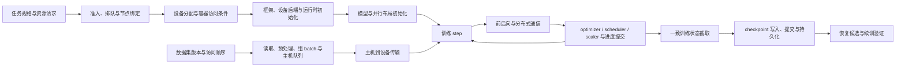

# 一次训练任务的端到端路径

一次训练任务不是一个从 `start` 到 `finish` 的单线程调用。平台在管理资源和进程，数据流水线持续生产 batch，设备执行前后向与通信，训练框架推进参数和逻辑进度，checkpoint 又把其中一个状态截面交给存储。本页沿四条线连接这些阶段，帮助读者选择下一篇知识；各层机制仍在其主要归属页面维护。

`generic` 表示这张关系图可以用于组织多种训练系统，不表示 PyTorch、其他框架、GPU 和 NPU 具有相同进程模型、API、默认值或版本组合。

## 一张端到端导航图

箭头表示职责依赖，不保证严格串行。预取可与计算重叠，多个 micro-step 可汇入一个 optimizer step，pipeline stage 可同时处理不同 micro-batch，异步保存也可能与之后的训练并行。判断“任务走到哪里”时，应记录具体对象和观察点，而不是只看进程是否存在。

## 每个阶段应进入哪层知识

| 阶段 | 当前需要回答的问题 | 下一层知识 |
|---|---|---|
| 资源请求与节点选择 | 需要多少 CPU、内存、加速器、网络与存储入口；放置是否符合实际连接和故障域 | [计算节点资源与拓扑参考](../01-hardware/resource-topology.md)；[准入、调度与拓扑放置](../05-cluster-platform/admission-and-placement.md) |
| 设备上报、分配与容器创建 | 物理设备是否已被驱动枚举、平台上报、分配给任务，并转化为容器内访问条件 | [从物理设备到容器资源的状态链](../05-cluster-platform/device-resource-chain.md) |
| 框架初始化 | 镜像中的框架、设备后端、平台运行时、驱动和固件分别承担什么职责，版本证据是否足够 | [主机到模型执行的软件栈分层](../02-software-stack/layers-and-boundaries.md) |
| 数据供给 | 样本从存储、缓存和 worker 到主机队列及设备 tensor 的哪一段形成等待 | [训练数据供给路径与等待](../04-data-storage/training-data-path.md) |
| 模型与并行初始化 | 参数、optimizer、stage/shard、RNG 和数据分区由哪些 rank 持有 | [并行策略与训练状态](../06-training/parallelism-and-state.md) |
| 分布式 step | 各通信域的参与者、操作次序和进度是否匹配；慢 rank 从哪里开始落后 | [集合通信与 rank 进展](../03-communication/collectives-and-rank-progress.md) |
| 状态截取与写入 | 截取视图、后台写入、元数据提交和持久化分别完成到哪里 | [Checkpoint 写入与持久化边界](../04-data-storage/checkpoint-durability.md) |
| 重启与续训 | 装载对象是否完整、状态是否来自同一逻辑点、恢复后输入和更新是否符合约定 | [Checkpoint 恢复一致性](../06-training/checkpoint-state-consistency.md) |

Kubernetes v1.32 的 Device Plugin 文档把注册、持续设备上报和 `Allocate` 分为不同接口；`Allocate` 返回的是容器运行时配置，而不是框架计算成功证明（[Device Plugins](https://v1-32.docs.kubernetes.io/docs/concepts/extend-kubernetes/compute-storage-net/device-plugins/)）。因此图中的资源分配、容器访问和框架 ready 是三个不同状态。

## 四条同时推进的线

| 阅读线 | 需要跟踪的对象 | 容易混淆的完成点 |
|---|---|---|
| 资源 | CPU/NUMA、主机内存、GPU/NPU、设备内存、NIC、互联、存储入口；平台账本、绑定和具体设备分配 | 产品规格、`allocatable`、任务请求、已分配设备和进程实际可用量不是同一个数 |
| 数据 | 数据版本、索引/采样顺序、读取与缓存、预处理、batch、主机队列和设备输入 | 已读、已预取、主机 batch 就绪、设备可用和已用于一次更新不是同一进度 |
| 训练状态 | 参数/buffer、梯度、optimizer、scheduler、scaler、RNG、global/micro step、样本/token 数和并行映射 | rank-local 字节、完整逻辑状态、写入完成和可正确续训不能互相替代 |
| 进展与指标 | 控制面事件、input wait、copy、forward/backward、collective、optimizer step、checkpoint 和重启代次 | 主机函数返回、本地设备完成、全组进展和训练状态提交是不同观察 |

这四条线以运行身份、rank/设备映射、step/batch 身份和时间窗口连接。缺少这些共同键时，数据侧的“第 100 批”、通信侧的“rank 3 timeout”和训练侧的“step 100”可能来自不同对象或重启代次。

## 一个训练 step 怎样连接各层

1. sampler 或数据集迭代状态决定各 rank 接下来处理哪些样本；worker、缓存和预取把 batch 送到主机消费边界。PyTorch 2.6 `DataLoader` 是一个含 dataset、sampler、worker、自动组 batch 与预取的具体样板，其他框架不必采用相同结构（[torch.utils.data](https://docs.pytorch.org/docs/2.6/data.html)）。
2. 平台运行时和设备后端安排输入进入设备。是否异步、何时可由计算消费以及能否与计算重叠，依赖具体后端和版本；相同 Python 参数名不构成 GPU/NPU 等价证据。
3. 模型和并行布局决定本 rank 拥有哪些参数、stage/shard 与通信域。DDP、FSDP、Tensor Parallel 和 Pipeline Parallel 只是 PyTorch 2.6 的版本化样板（[DDP](https://docs.pytorch.org/docs/2.6/generated/torch.nn.parallel.DistributedDataParallel.html)、[FSDP](https://docs.pytorch.org/docs/2.6/fsdp.html)、[Tensor Parallel](https://docs.pytorch.org/docs/2.6/distributed.tensor.parallel.html)、[Pipeline Parallel](https://docs.pytorch.org/docs/2.6/distributed.pipelining.html)）。
4. forward/backward 产生输出、loss 与梯度，所选并行策略在相应边界执行 collective 或点对点通信。process group 中的 rank 只在对应组内解释，不能直接当作物理设备身份（[PyTorch 2.8 distributed](https://docs.pytorch.org/docs/2.8/distributed.html#torch.distributed.get_rank)）。
5. optimizer、scheduler、scaler 和训练计数按应用定义的顺序推进。只有先定义完整 step、micro-step 或其他逻辑提交点，才能说明某个状态截面代表哪里。

## checkpoint 是可选分支，不是每个 step 的自动终点

任务可以周期性或按事件从已定义的逻辑边界截取训练状态。保存调用只处理调用者交给它的内容；PyTorch 2.6 DCP 支持分布式 state dict 和加载时重分片，但要求目标对象和支持的表示，不会自动发现 scheduler、RNG、数据游标或业务进度（[Distributed Checkpoint](https://docs.pytorch.org/docs/2.6/distributed.checkpoint.html)）。

随后还要分别判断暂存、分片写入、提交和目标故障域下的持久性。重启时，文件可读与 `load` 返回也只说明恢复链的一部分；状态覆盖、逻辑进度和同输入继续训练需要独立验证。

## 指标要绑定阶段和观察点

| 关注点 | 至少保留的上下文 | 不能单独得出的结论 |
|---|---|---|
| 排队与启动 | 提交、绑定、容器创建、框架 ready 的起止事件，失败与重试分类 | Running 不等于设备可用或训练已开始 |
| 数据等待 | batch/step、冷/热缓存、worker、队列深度、样本/token、主机就绪和设备传输时间 | 低设备利用率不等于存储慢 |
| step 时间 | micro/optimizer step、batch shape、forward/backward/optimizer 与 wall time | 一个平均 step time 不能定位输入、计算或通信 |
| 通信 | group/rank/operation、主机进入/返回、设备完成、timeout 和首个前序异常 | 最先打印 timeout 的 rank 不必是根因 |
| 保存与恢复 | 截取、暂存、写入、提交、持久化、load、状态验证和允许进度损失 | 保存或加载 API 成功不等于正确续训 |

吞吐、loss、梯度和恢复后的差异还需固定工作负载、并行布局、版本、随机性与容差。本页不给任何模型、GPU/NPU 或集群的正常阈值。

## 平台边界与待建设项

本文没有选择可部署的 GPU 或 NPU 软件组合。CUDA 的内存传输和 stream 语义不能补写 TorchNPU/CANN 的未知行为；PyTorch 的并行/state-dict 样板也不能替代 MindSpeed、其他框架或平台的实现资料。目标环境必须另行固定硬件、固件、驱动、运行时、框架后端、通信库、容器和模型配置。

作业准入、队列、gang 与拓扑放置的概念边界见[对应专页](../05-cluster-platform/admission-and-placement.md)，目标配置与运行结果仍待验证。强化学习 rollout、专家并行、pipeline mid-step 恢复和精确 DataLoader worker 游标也不由这张总览证明。来源选择与已知缺口见[第五批研究记录](../../docs/research/batch-05-overview-sources.md)。
