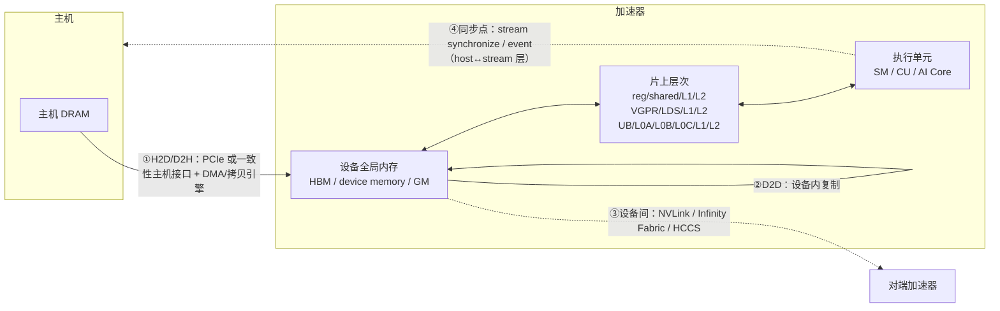

# 加速器执行单元、内存层次与数据移动机制

## 定义与要解决的问题

训练慢、传输慢、OOM、通信超时，最终都要落到同一组硬件问题上：计算在什么执行单元上跑、数据放在哪一级存储、沿哪条路径搬运、在哪里同步。本文建立一个**统一观察点**的框架来回答这些问题，同时保留 NVIDIA H100（Hopper）、AMD MI200（CDNA2）、Ascend Atlas A2（CANN 8.2.RC1.alpha001 文档所述代际）各自的真实术语——三个平台的执行组织**不做一一映射**，同名概念（如「共享内存」「设备内存」）语义按各自文档。

`generic` 只统一观察点（主机内存、设备全局内存、片上层次、搬运路径、互联、同步点、可观测边界），不表示硬件或 API 一一对应；硬件原理（白皮书/ISA/用户指南）与运行时 API 语义（CUDA/HIP/ACL 文档）分开引用，互不外推。

## 三平台执行组织与内存层次（代际样板）

### NVIDIA H100 SXM5（Hopper，compute capability 9.0）

| 方面 | 术语与数值 | 来源 |
|---|---|---|
| 执行组织 | SM（H100 SXM5 共 132 个）；每 SM 128 个 FP32 核 + 4 个第四代 Tensor Core；SIMT，warp = 32 线程，Volta 起 Independent Thread Scheduling；每 SM 64 warps/2048 线程 | [H100 白皮书 V1.01](https://www.advancedclustering.com/wp-content/uploads/2022/03/gtc22-whitepaper-hopper.pdf)（第三方镜像，官方原链 2026-10-08 实测失效）与[官方博客表 3](https://developer.nvidia.com/blog/nvidia-hopper-architecture-in-depth/)交叉核对；[CUDA 12.8 指南 §4.1/§4.2](https://docs.nvidia.com/cuda/archive/12.8.0/cuda-c-programming-guide/index.html) |
| 片上存储 | 寄存器 256KB/SM；L1+shared memory 合体 256KB（shared 可配至 228KB）；L2 50MB | 同上（白皮书表 3、博客） |
| 设备内存 | 80GB HBM3；带宽口径冲突：白皮书/博客 3000 GB/s（标注 preliminary），NVIDIA H100 产品页现记 3.35 TB/s（H100 SXM；H100 NVL 为 3.9 TB/s，[产品页](https://www.nvidia.com/en-us/data-center/h100/)，2026-10-08 观察）——引用时分列口径与时间 | 同上 |
| 互联 | NVLink 第四代 18 链路 900GB/s；NVSwitch 第三代 64 端口；PCIe Gen5 128GB/s 双向 | 同上 |

### AMD MI200（CDNA2，MI250X）

| 方面 | 术语与数值 | 来源 |
|---|---|---|
| 执行组织 | wavefront = 64 work-items；CU 内含 SALU（每 wavefront 一值）与 VALU；EXEC mask；矩阵指令 V_MFMA_F64_16x16x4/4x4x4 等；220 CU/880 Matrix Core（MI250X，后者出自 AMD 署名的 Hot Chips 34 deck，非白皮书正文） | [MI200 ISA 指南](https://www.amd.com/content/dam/amd/en/documents/instinct-tech-docs/instruction-set-architectures/instinct-mi200-cdna2-instruction-set-architecture.pdf)（2022-02-04，许可禁止摘录、只可归纳）；[HC34 deck](https://hc34.hotchips.org/assets/program/conference/day1/GPU%20HPC/HC2022.AMD.AlanSmith.v13.Final.20220818.pdf)；HIP 文档另记「warp 典型 64、有时 32」（[HIP 6.3.3 编程模型](https://rocm.docs.amd.com/projects/HIP/en/docs-6.3.3/user_guide/programming_manual.html)，MIT）——CDNA2 以 ISA 的 64 为准 |
| 片上存储 | LDS 64kB/CU（32 bank）；L2 每 GCD 8MB | ISA 指南；[CDNA2 白皮书](https://www.amd.com/content/dam/amd/en/documents/instinct-business-docs/white-papers/amd-cdna2-white-paper.pdf) |
| 设备内存 | 2×GCD，每 GCD 64GB HBM2e（整卡 128GB），聚合 3.2TB/s | CDNA2 白皮书 |
| 互联 | 封装内 Infinity Fabric 400GB/s 双向；8 条外部 IF 链路合计 800GB/s（MI250/X；MI210 为 3 链路 300GB/s）；一致性主机接口（16-lane IF，配特定 EPYC 时缓存一致，否则回退 PCIe） | CDNA2 白皮书 |

### Ascend Atlas A2（CANN 8.2.RC1.alpha001 文档所述代际）

| 方面 | 术语与数值 | 来源 |
|---|---|---|
| 执行组织 | AI Core = Cube（矩阵）/Vector（向量）/Scalar（标量）三类计算单元 + 存储单元 + 搬运单元（MTE1/2/3、FixPipe）；分耦合架构与分离架构（AIC/AIV），Atlas A2 训练/推理系列为分离架构（AIC：MTE1/MTE2/Cube/Scalar；AIV：MTE2/MTE3/Vector/Scalar）；编程模型为 SPMD（`GetBlockIdx()` 区分分片）；Scalar 把指令分发到各单元独立队列，队列内 PipeBarrier、队列间 SetFlag/WaitFlag 同步 | [CANN 8.2 树 Ascend C 基本架构 0008](https://www.hiascend.com/document/detail/zh/CANNCommunityEdition/82RC1alpha001/opdevg/Ascendcopdevg/atlas_ascendc_10_0008.html)、[0009](https://www.hiascend.com/document/detail/zh/CANNCommunityEdition/82RC1alpha001/opdevg/Ascendcopdevg/atlas_ascendc_10_0009.html)、[0011](https://www.hiascend.com/document/detail/zh/CANNCommunityEdition/82RC1alpha001/opdevg/Ascendcopdevg/atlas_ascendc_10_0011.html)、[0012](https://www.hiascend.com/document/detail/zh/CANNCommunityEdition/82RC1alpha001/opdevg/Ascendcopdevg/atlas_ascendc_10_0012.html)（2026-10-08 观察） |
| 片上存储 | GM/L1/L0A/L0B/L0C/UB 多级内部存储：L1 Buffer 为通用中转区（暂存 Cube 反复使用的数据）；L0A/L0B 为 Cube 指令输入；L0C 为 Cube 输出（累加计算时也是输入）；Unified Buffer 为向量/标量计算的输入输出；另有 BT Buffer（BiasTable）与 FP Buffer（Fixpipe 参数）（[0010 存储单元 表 1](https://www.hiascend.com/document/detail/zh/CANNCommunityEdition/82RC1alpha001/opdevg/Ascendcopdevg/atlas_ascendc_10_0010.html)，经原始 HTML 核对）；Cube 完成 A(M×K)×B(K×N)；Vector 源/目的必须在 UB、通常 32B 对齐；核外 L2 Cache；各存储大小随处理器型号，由 `GetCoreMemSize` 获取 | [0009/0010](https://www.hiascend.com/document/detail/zh/CANNCommunityEdition/82RC1alpha001/opdevg/Ascendcopdevg/atlas_ascendc_10_0009.html)；**各 buffer 容量与 AI Core 数量无官方版本化数值，二手数字不采用** |
| 设备内存 | Atlas 800T A2 用户指南 26：昇腾 910 AI 处理器、片上内存 64GB、带宽 1600GB/s | [用户指南 26·技术规格](https://support.huawei.com/enterprise/zh/doc/EDOC1100317202/f3dba488)（可变网页，2026-10-08 观察） |
| 互联 | 每路 7 条 HCCS 互连链路、最大理论带宽 392GB/s、8 路 HCCS 8P Full mesh；每 NPU 经 PCIe 4.0 x16 与 CPU 互联 | 同上；老 910（Atlas 800/9000）为 3 链路 90GB/s，代际不混 |

数据流差异（官方描述）：NVIDIA/AMD 以「全局内存 ↔ L2 ↔ L1/shared（LDS）↔ 寄存器」组织；Ascend 以「GM→L1→L0A/L0B→Cube→L0C→FixPipe→GM/L1」与「GM→UB→Vector→UB→GM」两条流水线组织，MTE 搬运可随路做格式/类型转换，读写 GM 默认经 L2（[0010](https://www.hiascend.com/document/detail/zh/CANNCommunityEdition/82RC1alpha001/opdevg/Ascendcopdevg/atlas_ascendc_10_0010.html)）。这是不同的显式管理哲学：前者以缓存层次+shared memory 为主，后者以显式 buffer 队列为主，不能把 shared memory 与 UB、L0A/B/C 画等号。

## 统一观察点的数据移动图

注意图中有四类路径，层次不同：①是主机↔设备的总线传输；②是设备全局内存内部/设备间复制；③是设备间互联；GM↔片上层次（⑤，图中 `GM <--> ONCHIP`）是设备内部的搬运，**不是主机传输**——CUDA 的 `cuda::memcpy_async`/TMA、Ascend 的 MTE 队列属于这一层。④只画 host↔stream 层同步；kernel 内部同步（线程/队列/流水依赖）是另一层，见对照表末两行。

④的同步语义和①②⑤的拷贝语义是运行时 API 层属性，三平台分别标注：

| 观察点 | NVIDIA（CUDA 12.8） | AMD（HIP 6.3.3） | Ascend（CANN 8.2 ACL） |
|---|---|---|---|
| ①H2D/D2H（主机↔设备） | pageable vs page-locked（pinned）主机内存；异步拷贝与 kernel 重叠条件见 §3.2.6/§3.2.8.3（`asyncEngineCount`） | `hipHostMalloc`（pinned）；`hipMemcpyAsync` 对非 pinned 内存**退化为同步**；文档注记「on HCC 不支持 H2D+D2H 重叠」（实现注记，非硬件断言）；pinned 小批量可走 DMA 不涉 CPU | `aclrtMemcpy` 立刻复制、无隐式 device/流同步，**kind 为预留参数**（本版本按地址推断方向）；`aclrtMemcpyAsync` 下发≠完成、源/目的 64B 对齐；**Host 内存非 `aclrtMallocHost` 申请时行为不可预知**；EP 形态不支持异步 H2H，RC 形态 H2D/D2H/H2H 内部按 D2D 执行（[0105](https://www.hiascend.com/document/detail/zh/CANNCommunityEdition/82RC1alpha001/API/appdevgapi/aclcppdevg_03_0105.html)/[0106](https://www.hiascend.com/document/detail/zh/CANNCommunityEdition/82RC1alpha001/API/appdevgapi/aclcppdevg_03_0106.html)） |
| ②D2D/P2P | 设备内复制与 P2P 访问按 §3.2.8 | P2P 需 `hipDeviceEnablePeerAccess`，否则经 host staging | Device 间复制须先 `aclrtDeviceCanAccessPeer` + `aclrtDeviceEnablePeerAccess` |
| ⑤设备全局内存↔片上层次（**非主机传输**） | `cuda::memcpy_async`（§2.5 异步 SIMT 编程）、TMA（§7.29，需 CC 9.0）——global↔shared 搬运 | 片上搬运由 kernel 指令显式管理（LDS）；ISA 记内存控制器承担 DMA 功能 | MTE1/2/3 队列显式搬运 GM↔L1/L0/UB，可随路格式/类型转换 |
| ③互联 | NVLink/NVSwitch（900GB/s 级） | Infinity Fabric（封装内 400GB/s、外部 800GB/s） | HCCS：每一路 AI 处理器 7 条互连链路、最大理论带宽 392GB/s、8P Full mesh（[用户指南 26](https://support.huawei.com/enterprise/zh/doc/EDOC1100317202/f3dba488)；392GB/s 为每路 7 链路的合计口径，原文未标注单向/双向，每链路数值未单独给出） |
| ④host↔stream 同步 | `cudaStreamSynchronize`/event | `hipStreamSynchronize`/event | `aclrtSynchronizeStream`（0106 页明确「调用接口成功仅表示任务下发成功」） |
| kernel 内/流水同步（另一层） | 异步屏障等（§2.5 Asynchronous SIMT） | （wavefront 内 EXEC/屏障指令，ISA 层） | PipeBarrier（队列内）、SetFlag/WaitFlag（队列间）；Scalar 分发到各单元独立队列 |
| 可观测边界 | 官方示例 [cuda-samples bandwidthTest](https://github.com/NVIDIA/cuda-samples/tree/master/Samples/1_Utilities/bandwidthTest)（D2D、H2D/D2H pageable 与 pinned 四路，event 计时；许可未核） | [rocm_bandwidth_test](https://github.com/ROCm/rocm_bandwidth_test)（固定 develop d7f5efe，MIT；该 revision 已含重写后的 RBT-NG 实现（基于 TransferBench 插件架构），该 commit 另新增 RBT 弃用/迁移声明（迁移至 TransferBench/RVS），行为/输出格式按版本限定） | ascend-dmi bandwidth 覆盖 H2D/D2H/D2D/P2P 四方向（[MindX DL 6.0.RC2](https://www.hiascend.com/doc_center/source/zh/mindx-dl/60rc2/toolbox/ascenddmi/toolboxug_0020.html)） |

主机侧还有一个常被忽略的观察点：H2D 带宽同时受 **NUMA 局部性**影响（源内存在远端节点时先跨 socket 再上 PCIe），绑定与测量方法见[NUMA、主机内存与 I/O 局部性](numa-memory-and-io-locality.md)。

## 带宽、延迟、并发与计算强度

- **计算强度**（arithmetic intensity，每字节内存访问对应的运算量）决定 kernel 更可能受计算还是受带宽限制；CUDA 指南 §5.2 用它讨论利用率，并强调以占用率/并行度隐藏延迟（[CUDA 12.8 §5.2](https://docs.nvidia.com/cuda/archive/12.8.0/cuda-c-programming-guide/index.html)）。概念跨平台成立，具体阈值按各自架构。
- **小批量传输是延迟主导**：pinned/对齐内存 + 异步拷贝 + 流水化，是把「多次小传输」变成「重叠流水」的通用手段；但生效条件各平台不同（HIP 非 pinned 退化为同步；ACL 异步有 64B 对齐与 EP 形态限制）。
- **并发与聚合带宽**：单个拷贝引擎/队列有上限，聚合带宽依赖多引擎、多链路并发；设备间带宽（NVLink/IF/HCCS）与主机链路（PCIe）是不同路径，测量时分开报告。
- **定义待执行的小型传输/同步验证**（方法定义，本库未执行）：在三平台分别运行上表「可观测边界」行的官方工具，固定消息大小序列，记录 H2D/D2H/D2D（及 P2P）带宽与同步等待契约（下发≠完成）；基线口径与跨节点扩展见[带宽基线](../03-communication/bandwidth-baselines.md)。验证结果只能覆盖所测机型、版本与消息范围。

## 适用边界

- 代际绑定：H100 数字不适用于 H200/B200；MI200 数字不适用于 MI300（CDNA3 本轮未取证）；Atlas A2 的 HCCS 规格不适用于老 910 机型（3 链路 90GB/s）或 A3 代。
- 证据层级：NVIDIA 白皮书为第三方镜像（官方原链失效），数字经官方博客交叉核对；AMD 的 220 CU/880 Matrix Core 出自 AMD 署名会议 deck 而非白皮书正文；Ascend 各 buffer 容量与 AI Core 数量**没有官方版本化来源**，本文只写「随型号、以 `GetCoreMemSize`/架构规格页为准」。
- API 语义版本绑定：aclrtMemcpy 同步版 kind 预留 vs 异步版 kind 有效是 8.2.RC1.alpha001 的版本行为；HIP「on HCC」重叠限制是文档中的实现注记；两者都不能推广到其他版本或写成硬件能力断言。
- MI200 ISA 指南的许可仅允许归纳，本文不摘录其原文；H100 白皮书法律声明未逐字提取，只链接+归纳。
- 未执行任何 kernel、拷贝或带宽测试；上表工具只作验证方法入口。

## 常见误解

- **「warp/wavefront/AI Core 可以换算」**：三者执行组织不同（32 线程 SIMT / 64 work-item wavefront / Cube+Vector+Scalar 队列），换算表本身就是错误。
- **「设备内存大 = 传输快」**：HBM 容量/带宽与主机↔设备路径（PCIe/一致性接口/DMA）是两组资源；80GB HBM3 不说明 H2D 能达到多少。
- **「异步拷贝调用返回 = 数据已到」**：三者都是下发语义，完成以同步点为准（`aclrtMemcpyAsync` 页明确「任务下发成功≠完成」）。
- **「片上存储容量可以跨平台引用」**：Ascend 各 buffer 容量无官方公开数值；二手数字（如 L1 512KB/1MB）无版本化出处，不采用。
- **「HCCS/NVLink/Infinity Fabric 带宽数字可以直接对比」**：三家口径不同（理论最大/双向/聚合），且拓扑（Full mesh、Switch、链路段）不同；对比只在统一测量方法下有意义。

## 例子与相关知识

选型或排查时，先用[计算节点资源与拓扑参考](resource-topology.md)记录机型与连接，再用本文框架标注数据移动路径上的观察点；主机侧放置问题接[NUMA 局部性](numa-memory-and-io-locality.md)；运行时/库的职责边界接[软件栈分层](../02-software-stack/layers-and-boundaries.md)；NPU 侧内存/OOM 证据接[Ascend 内存与 OOM 证据](../02-software-stack/ascend-memory-oom-evidence.md)；跨节点带宽口径接[带宽基线](../03-communication/bandwidth-baselines.md)。

## 来源与待确认问题

- NVIDIA：[H100 白皮书 V1.01（镜像）](https://www.advancedclustering.com/wp-content/uploads/2022/03/gtc22-whitepaper-hopper.pdf)、[官方博客](https://developer.nvidia.com/blog/nvidia-hopper-architecture-in-depth/)、[CUDA 12.8 编程指南](https://docs.nvidia.com/cuda/archive/12.8.0/cuda-c-programming-guide/index.html)、[H100 产品页](https://www.nvidia.com/en-us/data-center/h100/)（3.35 TB/s SXM / 3.9 TB/s NVL 口径）、[cuda-samples bandwidthTest](https://github.com/NVIDIA/cuda-samples/tree/master/Samples/1_Utilities/bandwidthTest)。
- AMD：[CDNA2 白皮书](https://www.amd.com/content/dam/amd/en/documents/instinct-business-docs/white-papers/amd-cdna2-white-paper.pdf)、[MI200 ISA 指南](https://www.amd.com/content/dam/amd/en/documents/instinct-tech-docs/instruction-set-architectures/instinct-mi200-cdna2-instruction-set-architecture.pdf)、[HC34 deck](https://hc34.hotchips.org/assets/program/conference/day1/GPU%20HPC/HC2022.AMD.AlanSmith.v13.Final.20220818.pdf)、[HIP 6.3.3 文档](https://rocm.docs.amd.com/projects/HIP/en/docs-6.3.3/user_guide/programming_manual.html)、[rocm_bandwidth_test](https://github.com/ROCm/rocm_bandwidth_test)（固定 develop d7f5efe，MIT；弃用声明版本）。
- Ascend：[CANN 8.2 Ascend C 架构 0008–0012](https://www.hiascend.com/document/detail/zh/CANNCommunityEdition/82RC1alpha001/opdevg/Ascendcopdevg/atlas_ascendc_10_0008.html)、[aclrtMemcpy 0105](https://www.hiascend.com/document/detail/zh/CANNCommunityEdition/82RC1alpha001/API/appdevgapi/aclcppdevg_03_0105.html)/[Async 0106](https://www.hiascend.com/document/detail/zh/CANNCommunityEdition/82RC1alpha001/API/appdevgapi/aclcppdevg_03_0106.html)、[Atlas 800T A2 用户指南 26](https://support.huawei.com/enterprise/zh/doc/EDOC1100317202/f3dba488)、[ascend-dmi](https://www.hiascend.com/doc_center/source/zh/mindx-dl/60rc2/toolbox/ascenddmi/toolboxug_0020.html)。
- 逐条主张与证据定位见[第十三批加速器执行来源记录](../../docs/research/batch-13-accelerator-execution-sources.md)。
- 待确认：H100 白皮书官方可驻留链接；AMD 白皮书后半（CU/Matrix Core 计数的白皮书页码）；Ascend「架构规格」数值表（0010 表 1 已补得六行描述，但各 buffer 容量数值仍无官方来源，规格章节页码未定位）；CDNA3/MI300 代际；cuda-samples 的 LICENSE；各平台 H2D/D2H 实测基线（验证轨道）。
