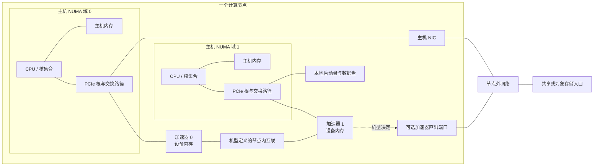

# 计算节点资源与拓扑参考

本文给出一套记录计算节点资源和连接关系的字段，供容量设计、放置判断、故障影响分析和跨层取证使用。它不是某一平台的通用布线图，也不提供探测命令、性能阈值或现场验收结果。

`generic` 表示记录方法可以用于不同平台，不表示 GPU 与 NPU 的内存、互联、设备编号或可分配单位一一对应。具体机型的数值和边必须来自该机型、该配置的物料清单、硬件手册或现场证据；缺少证据时填写 `unknown`，不能用 `0` 或邻近型号代替。

2026-10-09 扩展：本文在节点记录字段之外，补充「PCIe 板卡 → 模块/托盘 → 服务器节点 → 超节点」四个组成层次的通用关系，并核对三个有官方资料的样板——NVIDIA GB200 NVL72（超节点）、Huawei Atlas 900 A3 SuperPoD（超节点）、Supermicro AS-8125GS-TNMR2（AMD OEM 服务器节点）。共同机制是逐层包含关系与共享上游关系；平台差异在于互联协议（NVLink、灵衢 LQC、Infinity Fabric）、托盘内 CPU–加速器配比、供电冗余形态与服务可替换粒度，这些差异按各机型文档分别记录，不能跨平台换算。AMD 侧本轮只取得 OEM 节点样板，无官方同构超节点公开资料，超节点层次保留 `unknown`、不向上类推。

## 一张用于记录关系的概念图

这是本库原创的**关系记录图**。图中的两个 NUMA 域、两台加速器和连线都只是占位，不代表任何具体 GPU 或 NPU 服务器；“节点内互联”也不预设 NVLink、NVSwitch、HCCS、PCIe 或其他实现。主机 NIC 与加速器直出端口是分开的候选连接方式，不表示每个机型都同时具备；网络方框也不表示管理、存储与计算网络共用同一物理网络。实际记录应把每条边替换为有来源的端点、方向、链路类型和共享上游；本图不表示完整数据流。

## 资源层次与边界

| 层次 | 本页记录什么 | 不能从该层直接推出什么 |
|---|---|---|
| CPU、NUMA 与主机内存 | CPU 型号和插槽、NUMA 域、核集合、每域内存容量，以及它们与 PCIe 根的关系 | 仅凭总内存不能推出每个 NUMA 域容量相同，也不能推出进程实际获得本地内存 |
| GPU/NPU 与设备内存 | 物理设备或芯片身份、设备内存类型与容量、分区关系、PCIe 或板内端点 | “整机加速器总内存”不自动等于单设备可用容量；GPU 与 NPU 的切分单位和保留空间不能互相套用 |
| PCIe | 从 CPU/根复合体经过根端口、交换器到设备的路径，以及链路代际、宽度和协商状态的证据 | 槽位数不能推出所有设备共享同一根或同一带宽，也不能代替端到端性能测试 |
| NIC 与加速器网口 | 端口、PCIe/片上归属、NUMA 关系、协议模式、标称速率和上联网络 | 端口标称速率不能证明应用有效带宽、路由正确或 RDMA 已可用 |
| 节点内互联 | 加速器之间的真实端点、交换单元、链路类型和可达关系 | 不能因两种服务器都有“高速互联”就假定全互联、同带宽或同故障语义 |
| 存储 | 启动盘、本地缓存盘、数据盘、控制器/RAID 关系和节点外存储入口 | 本地盘清单不能说明训练数据已经落在本地，也不能证明共享存储的持久性或性能 |
| 共享资源与故障域 | 多个资源共同依赖的根、交换器、控制器、电源组、散热区、机箱、机架和上游网络/存储 | 共享上游只形成相关故障假设；没有部件图、告警或故障试验时不能宣布共同根因 |

软件驱动、运行时和框架边界见[主机到模型执行的软件栈分层](../02-software-stack/layers-and-boundaries.md)。物理设备怎样变成平台可发现、可分配的资源见[设备资源链](../05-cluster-platform/device-resource-chain.md)；调度器中的资源数量不等于本文中的物理连接图。训练数据从存储到节点和设备的路径见[训练数据路径](../04-data-storage/training-data-path.md)。

## 建议的节点拓扑字段

以下是本库建议的记录 schema，不是某个工具的输出格式。`documented`、`observed` 和 `allocated` 应分列保存，避免把产品规格、现场枚举和作业获得的资源混成同一个值。

| 对象 | 建议字段 | 记录规则 | 缺失时的解释 |
|---|---|---|---|
| 节点身份 | `node_id`、厂商、产品型号、机箱/主板版本、BOM 或配置标识 | 产品型号与具体配置分开；保留来源日期或文档版本 | 型号已知但 BOM 未知时，不能套用可选部件数量 |
| 物理位置 | 机房、机架、机位、机箱/托盘、供电分组 | 只记录授权且可长期维护的资产信息 | 未记录不表示资源位于同一故障域 |
| CPU | 插槽 ID、型号、核/线程集合、所属 NUMA 域 | 使用稳定的物理身份；逻辑 CPU 编号另列 | 总核数不能替代每域核集合 |
| 主机内存 | NUMA 域、类型、插槽/通道、已装容量、可见容量、单位 | 明确是产品上限、实际装配还是 OS 可见值 | 不知道分布时只保留整机总量，不做均分 |
| 加速器 | 平台、产品/芯片型号、物理槽位或板内位置、设备/芯片 ID、序列号范围、分区父子关系 | 区分物理设备、芯片与虚拟/切分实例；记录标识来自哪一层 | “8 卡作业”不能代替物理芯片和板卡清单 |
| 设备内存 | 加速器 ID、内存类型、文档容量、现场可见容量、分区容量、单位、保留量是否已知 | GPU/NPU 分别使用厂商定义；整机总量、单设备容量和作业可用量分列 | 未公开容量时写 `unknown`，不从训练脚本或同系列型号推算 |
| PCIe 路径 | 域/总线/设备/功能标识、根端口、交换器、终端设备、标称与协商代际/宽度、NUMA 归属 | 保存完整父子路径和证据时间；同名设备用稳定 ID 区分 | 只有终端 BDF 时仍不知道是否共享交换器或上游根 |
| NIC/端口 | 控制器与端口 ID、PCIe/片上归属、NUMA 域、MAC/端口位置、协议模式、标称速率、上联标识 | 管理、存储和计算网络分开；物理端口与 OS 名称分开 | 接口存在不能证明链路可达或数据面配置正确 |
| 节点内互联 | 链路 ID、两端加速器/交换单元、厂商链路类型、方向、标称属性、健康证据来源 | 以具体机型拓扑图为准；不要把调度亲和性标签反推为物理边 | 文档未给拓扑时保留未知，不画“常见”环或全互联 |
| 本地存储 | 介质/盘 ID、容量、接口、控制器、RAID/镜像成员、用途、NUMA/PCIe 路径 | 启动盘、缓存盘和数据盘分开；标明物理盘与逻辑卷层次 | RAID 名称不说明缓存策略、持久性或故障恢复行为 |
| 外部存储入口 | 客户端接口、NIC/网络、挂载或对象端点角色、缓存层、凭据边界 | 此处只登记节点入口；完整数据路径归 04 章节 | 已配置入口不等于数据已可读、带宽充足或一致性已验证 |
| 共享上游 | 共享 PCIe 根/交换器、NIC、控制器、电源组、风扇区、机箱、上联交换机、存储服务 | 为每个共享组列成员和证据来源 | 未确认的共享关系只能作为待验证假设 |
| 故障域 | `failure_domain_id`、范围、成员、共同依赖、预期影响、依据、验证状态 | 区分文档声明、现场观测和实验复现；故障域可嵌套 | 没有证据时不要把一次同时告警写成确定的共同故障域 |

## 读取拓扑时的四条路径

1. **主机到加速器：** 从 CPU/NUMA 域和主机内存开始，沿 PCIe 根、交换器或板内连接定位到物理加速器。用于判断“设备靠近哪个 CPU”和“哪些设备共享上游”，不是性能结论。
2. **加速器之间：** 单独记录设备间的直连或交换结构。端点可达、链路健康、集合通信可用和应用性能是四个不同问题，不能由一张静态图互相替代。
3. **加速器到网络：** 记录加速器、CPU、NIC/加速器网口及物理端口的关系。若厂商文档给出端口到 CPU/GPU 的映射，应保留映射来源；NPU 机型没有同类资料时不能照搬 GPU 的字段值。
4. **存储到设备：** 区分本地启动盘、缓存/数据盘和节点外存储入口，再关联主机内存、PCIe 和网络路径。本文只记录硬件入口；数据加载、缓存和共享存储语义由 04 章节描述。

## 官方机型例子：Huawei Atlas 800T A2

2026-09-29 实际打开的华为企业产品页把 Atlas 800T A2 描述为 4U AI 服务器，并列出 4 颗鲲鹏 920、32 个 DDR4 内存插槽（单条支持 16/32/64 GB）、三种本地 SATA/NVMe 数量组合、8 个 200GE QSFP 直出接口（RoCE）、最多 3 个 PCIe 4.0 扩展插槽、4 个 2.6 kW 电源模块（2+2 冗余）和 8 个热插拔风扇模组（N+1 冗余）（[Atlas 800T A2 产品页，“技术规格”](https://e.huawei.com/cn/products/computing/ascend/atlas-800t-a2)）。这些字段足以建立主机、网络、扩展槽、存储与部分机箱故障域的**产品级候选清单**，但仍不能替代具体交付 BOM。

该公开产品页没有给出 NPU 数量、单 NPU 设备内存容量、NPU 到 CPU/PCIe 的映射或节点内互联边。本文因此不填这些值，也不从 8 个网络端口、训练任务常见卡数或其他 Atlas A2 产品反推。对实际 Atlas 800T A2 节点，必须补齐对应硬件手册/BOM 和现场枚举，才能形成可用于放置或故障归因的物理拓扑。

这个例子也说明“有明确 NPU 机型”与“已知 NPU 拓扑”是两种证据状态。产品页能支持的主机规格保持已知；未发布在该页的设备容量与连接关系保持 `unknown`。

## 官方机型例子：NVIDIA DGX H100

NVIDIA DGX H100/H200 用户指南的组件表把 DGX H100 记录为 8 个 H100 GPU、640 GB 整机总 GPU 内存、2 颗 Intel Xeon 8480C CPU、32 根 DIMM 组成的 2 TB 系统内存；同一表还分别列出 2 块 1.92 TB NVMe M.2 系统盘（RAID 1）和 8 块 3.84 TB NVMe U.2 数据缓存盘（RAID 0）（[Introduction to NVIDIA DGX H100/H200 Systems，“Component Descriptions”](https://docs.nvidia.com/dgx/dgxh100-user-guide/introduction-to-dgxh100.html)）。这里的 640 GB 是指南给出的整机总量；本文不把它改写成作业可用量。

同一指南为集群网络列出 4 个 OSFP 端口对应 8 张单端口 ConnectX-7 卡，为存储与带内管理列出 2 张双端口 ConnectX-7 卡；其“Network Modules”表进一步给出 OSFP 端口到 network module/CPU 和 GPU 的映射，并提供一张 DGX H100/H200 系统拓扑图（[同页，“Network Connections, Cables, and Adaptors”及“System Topology”](https://docs.nvidia.com/dgx/dgxh100-user-guide/introduction-to-dgxh100.html#network-connections-cables-and-adaptors)）。因此，DGX H100 记录可以把 GPU、CPU 与集群网络端口关联起来，但仍应以实际 H100 配置、固件/BOM 和现场枚举确认设备身份。

这个 GPU 例子的端口映射不能迁移到 Atlas 800T A2。两份资料的粒度本来就不同：DGX 指南公开了端口映射和拓扑图，Atlas 产品页当前只支持较粗的产品规格。比较时应把“证据缺口”保留下来，而不是补齐一张看似对称的 GPU/NPU 表。

## 板卡到超节点的四个组成层次

在节点字段之上，本文增加四个组成层次的记录：PCIe 板卡/加速器模块、模块/托盘、服务器节点、超节点/机柜。层次划分锚定 OCP OAI（Open Accelerator Infrastructure）子项目公开的分层对象清单：OAI-OAM（加速器模块）、OAI-UBB（通用底板）、OAI-HIB（主机接口板）、OAI-PDB（配电）、OAI-EXP（UBB 之外扩展）、OAI-SCM（安全控制管理）、OAI-Tray、OAI Chassis（含风冷/液冷）；当前已发布 OAI-OAM r2.0 v1.0、OAI-UBB r2.0 v1.0、OAI-EXP r2.0 v1.0（均 2023-09-14 提交），历史版 OAM v1.5 / UBB v1.5（2022-02-23），另有 NVIDIA 贡献的 HGX Form Factor Specification（r1.0/v0.1，2022-05-05）（[OCP Server/OAI wiki](https://www.opencompute.org/wiki/Server/OAI)，2026-10-09 观察）。本轮只固定 wiki 页的版本与层级划分，规范 PDF 本体未逐页核对；规范本体采用 OWF CLA 贡献许可，引用规范条文前需确认再分发条款。OCP OAI 对象清单止于 chassis，「超节点」层没有对应的公开规范对象，按各厂商系统文档分别记录。

| 要素 | PCIe 板卡 / 加速器模块 | 模块 / 托盘 | 服务器节点 | 超节点 / 机柜 |
|---|---|---|---|---|
| 实体与记录粒度 | 单张 PCIe 卡或 OAM/SXM 等模块形态（OCP OAI-OAM）；记录芯片身份、设备内存与上行端口 | 承载模块与扣板的可抽拉单元（OCP OAI-UBB/HIB/Tray）；记录 tray/抽屉内模块清单、背板与连接器 | 运行独立 OS 实例的最小整机（OCP OAI Chassis）；记录完整主机资源，即前文「建议的节点拓扑字段」 | 多节点/托盘经共享交换结构组成的高速互联域，含交换托盘或总线设备、背板、机柜级供电与液冷 manifold；无公开规范对象，按厂商系统文档记录 |
| 资源单位 | 最小分配/计数单位通常为单芯片或单模块（1 颗 MI300X OAM、1 块 NPU 模组） | 固件管理（BMC）与部分维护操作的边界；NVIDIA compute tray 的 compute node = 2× Grace CPU + 4× Blackwell GPU（DGX GB UG §1.2 配置表） | 调度与资产记录的基本单位 | 高速互联域边界：NVIDIA 产品页称单机柜为 72-GPU NVLink 域（2026-10-09 观察）；华为用户指南明确「当组网不涉及总线设备柜时，计算柜就是 Atlas 900 A3 SuperPoD 超节点」（产品概述章节）——超节点边界按厂商定义，不按 U 数推定 |
| CPU / 设备内存 | 模块自带设备内存、无主机 CPU：MI300X 每 OAM 192 GB HBM3、8 模块合计 1.5 TB（AMD 平台数据表） | tray 内 CPU–加速器配比固定：NVIDIA compute tray 为 2× Grace + 4× Blackwell（DGX GB UG §1.2）；HPE 原文给出 tray→board→CPU 层级「Each compute tray contains 2 GB200 boards. Each board has 1 Grace ARM processor.」（QuickSpecs V6） | 主机内存与设备内存并存：AS-8125GS-TNMR2 为 2× EPYC 9005/9004 + 24× DDR5 DIMM（最高 6 TB）+ 8× 板载 MI300X（手册 §1.1）；Atlas A3 计算节点为 4× 鲲鹏920（2 块天池基础板、每处理器 8× DDR DIMM）+ 8× NPU 模组（逻辑结构章节） | 域内内存总量按厂商宣称记录：NVIDIA 产品页列整柜 13.4 TB HBM3E / 576 TB/s、CPU 内存 17 TB LPDDR5X / 14 TB/s、CPU 共 2,592 核；华为产品页列 48 TB 片上内存统一编址（均为 2026-10-09 观察的可变网页）。宣称口径不等于作业可用量 |
| 互联 | 模块级链路上行：MI300X 每 GPU 7× 128 GB/s Infinity Fabric 全互连、每 OAM 1× PCIe Gen5 x16 上行至主机（AMD 平台数据表） | tray 背部连接器接入交换层：NVIDIA compute tray 经背部连接器通过 NVSwitch tray 以 NVLink 互连（DGX GB UG §1.2）；Atlas A3 节点内每个 NPU 模组直出 2×200G 以太（参数面）+ 2×7×200G LQC（灵衢总线面），经线缆至灵衢总线板（逻辑结构章节） | 节点内交换单元：DGX H100 为 4× 第四代 NVSwitch（900 GB/s GPU-to-GPU，组件表）；MI300X 平台为 8 卡 Infinity Fabric 全互连（聚合 896 GB/s）；Atlas A3 节点内灵衢总线板承载灵衢 L1 层（组网拓扑章节） | 域级交换：NVLink 5.0 每 GPU 双向 1.8 TB/s，经 cable cartridge 无源铜缆背板连通全部 compute tray 与 NVLink switch tray，fabric 由 Fabric Manager（NVLSM）管理，NVSwitch 支持 SHARP 网内计算（DGX GB UG §2.1）；灵衢 L2 层由总线设备柜内 LingQu 630 V1 组成，L1–L2 间按规模用铜缆或光纤，7 个平面组网（组网拓扑章节） |
| 供电 / 冷却 | 单模块功耗上限：MI300X 最大 TBP 750 W（AMD 平台数据表）；散热由所在托盘/机箱提供 | NVIDIA compute tray 的 CPU/GPU 由沿机柜 manifold 供液的 cold plate 液冷，网络/存储等其余部件风冷（DGX GB UG §1.2）；Atlas A3 CPU 抽屉含 3× 1420W 液冷电源模块 + 1× 600W 风冷电源模块（物理结构章节） | 节点级电源冗余：DGX H100 为 6× 3.3 kW PSU、4+2 冗余（用户指南电源冗余节）；AS-8125GS-TNMR2 为 6× 3000 W Titanium（96%）、3+3 冗余、最多装 8 个（手册 §1.1/§3.7） | 机柜级供电与液冷：NVL72 由 bus bar 配电、power shelf 将 AC 转 50–51V DC、机柜功耗约 120 kW、8 个 power shelf N+N（每 shelf 6× 5.5 kW 风冷 PSU、33 kW 输入，DGX GB UG §1.4）；Atlas 计算柜 2× 3U 电源框共 66 kW、最大输入功耗 54 kW、Manifold 供水 5–40℃/流量 45–60 LPM（表9-2）。机柜预算方法见[机柜供电、散热预算与共享依赖](rack-power-cooling-and-failure-domains.md) |
| 服务可替换边界 | 依机箱形态而定：AS-8125GS-TNMR2 的 MI300X 板载于 GPU tray 内 GPU 基板（手册 §1.2）；Atlas A3 维护指南部件更换章节含 NPU 模组（版本 14）。不能假设板卡可现场单换 | DGX GB UG 维护操作枚举含 compute tray、switch tray 更换（§7.1 前置条件列表）；Atlas A3 维护指南部件更换章节含 CPU 抽屉、NPU 抽屉 | AS-8125GS-TNMR2 手册 §3.7：PSU 可不下电更换但不得超过冗余余量，标准配置 3+3，原文注明「up to three modules can be offline for service, although that is not recommended」；NVMe 支持 surprise hot-swap、推荐 orderly hot-swap | DGX GB UG 的可更换粒度以枚举为准（compute tray、switch tray、trunk links、cable cartridge），文档无 FRU 清单与更换流程章节，不能扩写为「现场可换 GPU 载板」；HPE 仅给 3 年保修与 CSR Mandatory/Optional 分类框架，未列出各部件归属（QuickSpecs V6 Product Warranty 节） |

三个样板的层次实体映射（每层均至少有一个官方来源；命名按厂商原文保留，不统一改写）：

| 层次 | NVIDIA | Ascend | AMD（OEM 节点） |
|---|---|---|---|
| PCIe 板卡 / 模块 | Blackwell GPU；GB200 superchip = 1 Grace + 2 Blackwell，经 NVLink-C2C 互联（产品页，2026-10-09 观察） | NPU 模组（计算节点 NPU 抽屉内 TOP/BOTTOM 面，物理结构章节） | MI300X OAM（UBB 2.0 底板承载 8 颗，AMD 平台数据表） |
| 模块 / 托盘 | 1RU compute tray（2× Grace + 4× Blackwell，DGX GB UG §1.2） | CPU 抽屉（K）+ NPU 抽屉（A1/A2）+ 3× 灵衢总线板 + 1× 灵衢总线和以太板（物理结构章节） | GPU tray（GPU 基板 + UBB 2.0 底板，手册 §1.2） |
| 服务器节点 | DGX H100（8U，节点层样板，见上文机型例子） | Atlas A3 计算节点（8U，4× 鲲鹏920 + 8× NPU 模组，逻辑结构章节） | AS-8125GS-TNMR2（8U，2× EPYC + 8× MI300X，手册 §1.1） |
| 超节点 / 机柜 | GB200 NVL72 机柜（18× compute tray + 9× NVLink switch tray，DGX GB UG §1.1） | Atlas 900 A3 SuperPoD（12× 计算柜 + 4× 总线设备柜，产品页，2026-10-09 观察） | 无官方同构超节点公开样板，保留 `unknown`，不向上类推 |
| 再上层 | DGX GB UG 引言示例口径「multi-rack deployments such as a SuperPOD (eight NVL72 racks)」——"such as" 为示例而非固定定义 | 支持 16/32/64/128/256/384 卡逻辑超节点（产品页）；384 为物理架构，实际部署数量取决于解决方案可靠性冗余设计（组网拓扑章节） | 同上，不外推 |

四层记录的三条纪律：一是层次名称按厂商原文记录（tray、抽屉、GPU tray 是同一层的不同命名）；二是跨层推断必须逐条核证据，「模块属于某 tray」不等于「该 tray 的失效影响等于全部模块失效之和」，共享上游关系单独记录（见下文故障隔离方法）；三是每层的服务可替换边界以厂商维护枚举为上限，文档未枚举的粒度不假设可更换。节点内 CPU/主机内存的局部性验证方法见[NUMA、主机内存与 I/O 局部性的成对验证](numa-memory-and-io-locality.md)；加速器间数据移动的机制边界见[加速器执行单元、内存层次与数据移动机制](accelerator-execution-and-data-movement.md)。

## NVIDIA 超节点样板：GB200 NVL72

以 NVIDIA DGX GB200 用户指南（网页与 PDF 均标 2026-09-17）为主轴，产品页与 HPE/Supermicro 规格书为对照。该指南同时覆盖 GB200 与 GB300 两型，以下只取 GB200 口径；index 页页脚另显示 2026-03-03，以章节页与 PDF 为准。

**组成（[§1 Hardware 引言与 §1.1 Rack Configuration](https://docs.nvidia.com/dgx/dgxgb200-user-guide/hardware.html)）**：一个 NVL72 机柜是一个 72-GPU NVL 域，含 18× 1RU compute tray（每 tray 2× Grace CPU + 4× Blackwell GPU）、9× 1RU NVLink switch tray、2× 管理用 TOR 交换机，以及向所有 tray 供电的 power shelf；机柜级系统由 compute tray（含一到两块计算板）、NVLink switch tray、NVLink 无源铜缆背板（cable cartridge）、power shelf、bus bar 与液冷 manifold 组成。

**Compute tray（同页 §1.2 Compute Trays）**：承载计算板与外围扣板、运行 OS 镜像的 1RU 机箱；CPU/GPU 由沿机柜 manifold 供液的 cold plate 液冷，网络/存储等其余部件风冷；tray 间经背部连接器通过 NVSwitch tray 以 NVLink 互连；带外管理由 tray BMC + HMC 组合提供。同节配置表：compute node = 2× Grace CPU + 4× Blackwell GPU；GB200 集群网络为 4× ConnectX-7 单口 400G OSFP（GB300 为 4× CX-8 800G）；存储/管理网络为 2× BlueField-3 DPU 双口 400G；OOB 管理口 = tray BMC 1× 1GbE RJ45 + BF-3 BMC 2× 1GbE RJ45；数据缓存为 4× 3.84 TB E1.S NVMe（软 RAID 0）；启动盘为 1× 1.92 TB M.2 NVMe。该节未给单 tray 重量/功耗。

**NVLink switch tray（同页 §1.3 NVLink Switch Trays）**：1U 内提供 57.6 Tbps 全双工（第五代 NVLink）；每 tray 2× NVLink NVSwitch（每颗 72 个 NVLink 端口），运行 NVOS 2.0+，含 BMC（attestation/recovery）、FM/SM 控制面与 CPU ERoT。该节未给 switch tray 功耗/重量。

**供电（同页 §1.4 Power Shelves）**：bus bar 配电，power shelf 将 AC 转为 50–51V DC；机柜功耗约 120 kW；8 个 power shelf 为 N+N，每 shelf 6× 5.5 kW 风冷 PSU、33 kW 输入。与 OEM 口径的差异及机柜预算方法见[机柜供电、散热预算与共享依赖](rack-power-cooling-and-failure-domains.md)。

**NVLink 拓扑（[§2.1 NVLink Networking](https://docs.nvidia.com/dgx/dgxgb200-user-guide/)）**：NVLink 5.0 每 GPU 双向 1.8 TB/s；tray 背部连接器接入 cable cartridge，沿机柜上下连通全部 compute tray 与 NVLink switch tray；fabric 由 Fabric Manager（NVLSM）管理；NVSwitch 支持 SHARP 网内计算。指南未给端口级连线表。

**产品页口径（[NVIDIA GB200 NVL72 产品页](https://www.nvidia.com/en-us/data-center/gb200-nvl72/) Specifications 表，可变网页，2026-10-09 观察）**：36× Grace CPU + 72× Blackwell GPU；GB200 superchip = 1 Grace + 2 Blackwell，经 NVLink-C2C 互联；NVLink Switch System 提供 130 TB/s GPU 通信；整柜 GPU 显存 13.4 TB HBM3E / 576 TB/s、CPU 内存 17 TB LPDDR5X / 14 TB/s、CPU 共 2,592 核。产品页无功率/重量数字，性能倍数为厂商宣称口径（页面自带测算脚注），与手册规格分开记录。

**OEM 口径（与 NVIDIA UG 并列、不合并）**：

- HPE QuickSpecs V6（2026-09-08）：18× compute tray，原文确认层级「Each compute tray contains 2 GB200 boards. Each board has 1 Grace ARM processor.」；9× NVLink switch tray；6（最大 8）× 33 kW power shelf；50 V DC busbar；2× SN2201 TOR；44U 机柜液冷 manifold；Grace 为 72 核 Neoverse V2、焊接 512 GB LPDDR5X（480 GB 可用）、ECC 默认开启、内存不可配置；BMC 基于 OpenBMC + ASPEED 2600（[HPE QuickSpecs a50009224enw](https://www.hpe.com/us/en/collaterals/collateral.a50009224enw.html) Platform Information / Processors / Memory / On System Management Chipset）。
- Supermicro 数据表（©2025，2025 年 2 月版）：72× B200 + 36× 72 核 Grace；18× 1U compute tray；9× NVLink switch tray（每 compute tray 4 个 NVLink 端口接 72 GPU，1.8 TB/s GPU-to-GPU）；compute tray 内含 2 颗 GB200 superchip，GPU 显存最高 372 GB HBM3e/superchip（744 GB/tray）、CPU 内存最高 480 GB LPDDR5X/superchip（960 GB/tray），后部 4× NVLink 端口，前部 4× 单口 CX-7、最多 2× BF-3、最多 8× E1.S PCIe 5.0；tray 由机柜 4+4 power shelf 共享供电（[Supermicro SuperCluster GB200 NVL72 数据表](https://www.supermicro.com/datasheet/datasheet_SuperCluster_GB200_NVL72.pdf)）。「Up to」为可选上限口径，不等于标准配置。

**可维护性（证据薄，按枚举记录）**：DGX GB UG 的维护操作对象为 compute tray、switch tray、trunk links、cable cartridge 更换（[§7.1 Cold Reboot Sequence 前置条件列表](https://docs.nvidia.com/dgx/dgxgb200-user-guide/)）；Mission Control 宣称可隔离故障组件并隔离受影响基础设施（§4.1）。安全警告级证据：PSU 为 hot-plug、内部无用户可维护部件；更换 hot-plug PSU 需先拔该 PSU 电源线；非 hot-plug 部件拆装前须断电（§5 Safety）。用户指南无 FRU 清单与更换流程章节——GB200 的「服务可替换部件」粒度只能写到 tray/背板级枚举，不能扩写为「现场可换 GPU 载板」。HPE 仅给 3 年硬件保修与 CSR（Customer Self Repair）Mandatory/Optional 分类框架，未列出各部件归属（QuickSpecs V6 Product Warranty 节 Notes）。

**E1.S 数量冲突（如实分列，不以任何一方为准）**：

| 来源 | 每 compute tray E1.S 口径 |
|---|---|
| NVIDIA DGX GB UG §1.2 配置表 | 4× 3.84 TB E1.S NVMe（软 RAID 0） |
| HPE QuickSpecs V6 Internal Storage 表 | 8× 3.84 TB E1.S（前置，SED，Opal/TCP，hot-pluggable and hot-swappable）+ 1× 1.98 TB M.2（内置） |
| Supermicro 数据表 | 最多 8× E1.S PCIe 5.0（「Up to」上限口径） |

记录目标机型时按交付方 BOM 与文档版本确定实际配置；确定前该字段写 `unknown`。

**再上层**：DGX GB UG 引言以示例口径提到「multi-rack deployments such as a SuperPOD (eight NVL72 racks)」——"such as" 表明这是示例而非固定定义，记录多机柜结构时以实际部署文档为准。

## Ascend 超节点样板：Atlas 900 A3 SuperPoD

以华为用户指南 13（EDOC1100401572，文档版本 13，2026-06-25）为主轴，产品页（可变网页，2026-10-09 观察）与官方彩页（26H1）为对照。型号后缀口径不一，保留各来源原样：产品页写「昇腾910」，官方硬件彩页（26H1 预训练版）写「昇腾910C」，用户指南 13 正文以「昇腾910 AI 处理器」表述——引用时按来源分列，不统一改写。

**形态与总量（[Atlas 900 A3 SuperPoD 产品页](https://e.huawei.com/cn/products/computing/ascend/atlas-900-a3-superpod)「技术规格」与「超节点架构」区）**：形态为 12× 计算柜（47U）+ 4× 总线设备柜（47U）；最大 384× 昇腾910 NPU、192× 鲲鹏920 CPU、1536× DDR5（5200 MT/s，单条 64/96 GB）、384× 128 GB 片上内存（带宽最大 3.2 TB/s）；D2D 双向 784 GB/s；本地存储最大 480× 2.5 英寸盘；供电三相 380V AC + 三相 380V AC；散热为液冷（计算柜）+ 风冷（总线设备柜）；48 TB 片上内存统一编址、总线带宽 1:1 无收敛、200 ns 单跳时延；支持 16/32/64/128/256/384 卡逻辑超节点。算力口径多档并存：产品页为 307.2/288.7 PFLOPS@FP16，[官方硬件彩页（26H1 预训练版）](https://e-file.huawei.com/marketingcloud/pep/asset/20000001/Material/5d4c82c0af394286b120ce799b786bc5/M3T1A669N1253094776671068388/Atlas%20900%20A3%20SuperPoD%E7%A1%AC%E4%BB%B6%E5%BD%A9%E9%A1%B5-%E5%A4%A7%E6%A8%A1%E5%9E%8B%E9%A2%84%E8%AE%AD%E7%BB%83%E8%A7%A3%E5%86%B3%E6%96%B9%E6%A1%8825_0-%E5%BD%A9%E9%A1%B5_26H1_.pdf)写 288.7，另一彩页版本写 240.3——对应不同 SKU/档位，按来源分开引用，不合并为单一规格。

**计算柜（[用户指南 13 计算柜章节表9-2 特性规格](https://support.huawei.com/enterprise/zh/doc/EDOC1100401572)）**：单柜 47U，含 4× 8U 计算节点；2× 3U 电源框共 66 kW，最大输入功耗 54 kW（原文脚注：极限压测功耗不代表实际业务功耗）；预留 1× 1U GE 交换机位；RM211 管理模块（2 GE + 1 Mgmt + 1 RS485）；Manifold 供水 5–40℃、流量 45–60 LPM、最大压力 350 kPa；满配含水约 1285 kg；单柜 AI 算力 20.032/24.064/25.600 PFLOPS@FP16；单柜片上内存最大 4096 GB（带宽 2×1600 GB/s）。

**物理组成（[产品概述章节](https://support.huawei.com/enterprise/zh/doc/EDOC1100401572/bd23f260)，图2-1/2-2/2-3 及部件表）**：计算柜含平板前门（可选）、平板后门（可选）、4 个计算节点、2 个电源框（主 + 扩展）、1 个 GE 交换机（可选）、液冷机柜、RM211 管理模块、电源转接板；总线设备柜含 14× 灵衢总线设备 LingQu 630 V1、1 个电源框（电源机箱 + 电源模块）、1 个 GE 交换机（可选）、RM211。指南明确「当组网不涉及总线设备柜时，计算柜就是 Atlas 900 A3 SuperPoD 超节点」——在该产品线中「超节点」与「机柜」不是固定两个层级，记录时按实际组网形态确定。

**计算节点（8U）**：物理结构为 CPU 抽屉（K）+ NPU 抽屉（A1）+ NPU 抽屉（A2）+ 机框 + 3× 灵衢总线板（PIC1–PIC6）+ 1× 灵衢总线和以太板（PIC7/PIC8）；CPU 抽屉含 2× CPU 基础板、内存、硬盘背板、Riser 模组 1/2、8080 风扇模块、4056 风扇托盘/模块、3× 1420W 液冷电源模块（PSU1/2/3）+ 1× 600W 风冷电源模块、BMC 扩展板、Busbar 接线排、缓启板、超级电容支架；NPU 抽屉含液冷散热器、风扇模块、NPU 模组（TOP/BOTTOM 面）、低速管理板、风扇背板（[物理结构章节](https://support.huawei.com/enterprise/zh/doc/EDOC1100401572/d3e2c244)，图6-2/6-3/6-4 部件表）。逻辑结构：2× 天池基础板共 4× 鲲鹏920（每处理器 8× DDR DIMM）；8× NPU 模组，每模组直出 2×200G 以太（参数面）+ 2×7×200G LQC（灵衢总线面），经线缆至灵衢总线板；灵衢总线板下行连 NPU/CPU、上行至灵衢总线设备，以太面下行连 NPU、上行至柜外 RoCE 标准交换机；最大 8× NVMe（CPU4 直出）+ 2× SATA（经 Riser + RAID 卡）；BMC 扩展板为华为自研芯片、外出 1 GE（[逻辑结构章节](https://support.huawei.com/enterprise/zh/doc/EDOC1100401572/6e226b8e)，图6-5）。每节点 8 NPU + 4 CPU 与柜级（4 节点）、超节点级（12 柜）总量自洽：4×8×12=384、4×4×12=192。

**灵衢组网（[组网拓扑章节](https://support.huawei.com/enterprise/zh/doc/EDOC1100401572/d975beba)，图3-1）**：LQC 协议（华为缓存一致性互联接口协议，视作处理器内部 SoC 总线的外延）承载超节点内部通信，7 个平面组网；L1 层由计算节点内灵衢总线板承载，L2 层由总线设备柜内灵衢总线设备（LingQu 630 V1，即灵衢交换机）组成，L1–L2 间按规模用铜缆或光纤；支持 64/96/192/384 超节点配置；384 超节点光互联为一套总线设备柜内 56 台灵衢总线设备与多套计算柜内 48 台计算节点的光纤全互联。原文明确「物理架构 384，实际部署数量取决于解决方案可靠性冗余设计」——384 是物理上限，不能写成必然可用规模。

**超节点级带宽口径（[技术规格章节](https://support.huawei.com/enterprise/zh/doc/EDOC1100401572/de187aa3)表9-1「带宽」行）**：超节点内任意两个 NPU 模组之间高速总线互联带宽「理论达到」双向 784 GB/s——「理论达到」非实测。该指南多处把细项指向《Atlas 900 A3 SuperPoD 超节点 系统关键参数》，该文档本轮未取得，相关分档指标保留 `unknown`；技术白皮书 07（e.huawei.com 文档页，需下载）同样未取得。

**灵衢 LingQu 630 V1（L2 总线设备，[用户指南 03 特性规格章节](https://support.huawei.com/enterprise/zh/doc/EDOC1100463086/afae8edb)，文档版本 03，2026-01-30）**：2U（88.1×442×600 mm）、20 kg；风冷 4× 风扇模块、3+1 备份（风扇热备份）；业务端口 48× QSFP-DD-400G（2×200G，每个 QSFP-DD 分接 2 个交换芯片）；1× 管理网口 + 1× 管理串口；供电 AC 220–240V / HVDC 240V / ±48V DC；整机最大功耗 <1200 W；2× 电源模块、1+1 备份；电源模块与风扇模块支持热插拔。彩页另给「单总线设备交换容量 19.2T、总线设备柜 14 台共 672× 400G 端口、柜最大功耗 17.8 kW」口径，与用户指南并列引用、不合并。

**可维护性（[维护与服务指南 14](https://support.huawei.com/enterprise/zh/doc/EDOC1100401573)，文档版本 14，2026-08-18）**：指南覆盖巡检、故障处理、应急处理、部件更换；部件更换章节含 CPU 抽屉、NPU 抽屉、NPU 模组、内存、Riser 模组、PCIe 卡、RAID 卡、电源模块（版本 10 修改记录注明「电源模块支持热插拔」）、光模块、RTC 电池、风扇模块等；漏液运维含 iRM 上报 Manifold 漏液告警、iBMC 上报服务器节点漏液告警、节点下架快接头漏液处理，前言定义渗漏/喷射两类漏液。本轮仅确认章节存在与主题范围，具体更换步骤页未逐页核对；某部件是否「热维护」须按各部件章节原文判定，不在本轮展开。

**代际注意**：上文机型例子的 Atlas 800T A2 属 PCIe 代际、公开产品页给出 200GE QSFP 直出接口形态，与 A3 超节点的灵衢架构不同代，两代数字不可互相借用；Atlas 800T A2 的 NPU 数量与节点内互联在本文继续保持 `unknown`（见上文机型例子节）。CloudMatrix 384 的官方组成/互联公开文档本轮未取得（仅见第三方转述），本文不引用其数字。

## AMD OEM 节点样板：AS-8125GS-TNMR2

AMD 侧本轮只取得 OEM 节点样板（Supermicro AS-8125GS-TNMR2 + AMD MI300X 平台数据表），无官方同构超节点公开资料；按任务约定不向上类推，AMD 行的超节点层次保留 `unknown`。MI300X 之外（MI325X/MI355X）本轮未取证。

**节点组成（[用户手册 MNL-2671 Rev 1.0b](https://www.supermicro.com/manuals/superserver/8U/MNL-2671.pdf) §1.1 System Overview、§1.2 Motherboard Tray / GPU Tray Features，©2025）**：8U 双路节点——2× AMD EPYC 9005/9004（SP5，TDP 最高 400 W）；24× DDR5 DIMM（9004 最高 6 TB 4800 MT/s；9005 最高 6 TB 6000 MT/s，需主板 rev 2.0+）；8× 板载 MI300X GPU（GPU tray 内 GPU 基板）；4× PCIe switch（用于 GPU 直通的通信路径）；12+4× 热插拔 2.5" NVMe + 2× 热插拔 2.5" SATA + 2× M.2 NVMe；8× PCIe 5.0 x16 LP + 最多 4× FHFL；前 5 + 后 5 重载热插拔风扇；6× 3000 W Titanium（96%）3+3 冗余 PSU（最多可装 8 个）；BMC 专用 RJ45。手册同页声明规格随配置变化；电源条款附原文保留条件「Power supply full redundancy based on configuration and application load」。

**服务边界（同手册 §3.7 Power Supply 与 NVMe 热插拔章节）**：PSU 可不下电更换，但不得超过冗余余量；标准配置 3+3 冗余，「up to three modules can be offline for service, although that is not recommended」照录原文；PSU 支持 100–120 V / 180–240 V 自适应。NVMe 支持 surprise hot-swap，推荐 orderly hot-swap（可远程弹出更换）；无厂商实测故障率数据。

**数据表口径（[Supermicro AS-8125GS-TNMR2 datasheet 页](https://www.supermicro.com/en/products/system/datasheet/as-8125gs-tnmr2)，©2024 可变网页，2026-10-09 观察）**：Key Features 列 8U、8× MI300X、24 DIMM 最高 6 TB、8× PCIe 5.0 x16 LP + 最多 4× FHFL、2× 热插拔 SATA + 1× M.2 启动 + 最多 16× 热插拔 NVMe（12 默认 + 4 可选）、10× 重载风扇、6× 3000 W Titanium 冗余 PSU、「8 NIC for GPU direct RDMA (1:1 GPU Ratio)」。网页表格主体以图片渲染，仅 Key Features 文本层可核对，详细行项目以用户手册为准；M.2 数量两处口径（手册 2× M.2 NVMe vs 网页 1× M.2 启动）并列保留，不取其一。

**MI300X 平台（板卡→底板层，[AMD Instinct MI300X Platform Data Sheet](https://www.amd.com/content/dam/amd/en/documents/instinct-tech-docs/data-sheets/amd-instinct-mi300x-platform-data-sheet.pdf)，©2023，PID #232405395-D）**：UBB 2.0 通用底板承载 8× OAM 形态 MI300X（原文「industry-standard-based universal baseboard (UBB 2.0)」「eight OCP Accelerator Modules (OAMs)」为该层级术语出处）；每 OAM 192 GB HBM3（合计 1.5 TB）；每 GPU 7× 128 GB/s Infinity Fabric 链路全互连（8 卡聚合 896 GB/s）；每 OAM 1× PCIe Gen5 x16 上行至主机；单 GPU 最大 TBP 750 W；RAS 含全芯片 ECC、page retirement/avoidance。

**明确不外推**：该样板只覆盖板卡→托盘→节点三层；AMD 无公开的同构超节点样板，本文不为 AMD 填写超节点层的任何组成、互联或功耗数字，也不从 8 卡节点数量反推机柜级结构。

## 共享资源与故障域的记录方法

故障域应从共享上游关系生成，而不是从产品类别猜测。可以按以下顺序记录：

1. 为每个加速器、NIC 和本地盘找到上游根、交换器或控制器；
2. 为共同依赖同一部件的资源建立 `shared_group`，附上机型文档或现场证据；
3. 再把电源组、散热区、机箱、机架、上联网络和共享存储等更大范围作为嵌套候选域；
4. 分别记录“文档推定影响”“现场同时观测”和“实验已复现”，不要把三者合并为已确认根因。

以 Atlas 产品页为例，2+2 电源冗余和 N+1 风扇冗余能支持建立电源、风扇的产品级候选域，但没有模块到 NPU/CPU 的影响映射，不能据此写出单模块失效会影响哪些设备。DGX H100 指南则说明系统包含 6 个电源并采用 4+2 冗余（[“Support for PSU Redundancy and Continuous Operation”](https://docs.nvidia.com/dgx/dgxh100-user-guide/introduction-to-dgxh100.html#support-for-psu-redundancy-and-continuous-operation)）；它仍不能代替目标机架的 PDU 分组和供电现场记录。

## BOM/文档/现场枚举三方核对清单

四个组成层次中任何一层的记录，都建议用三方证据互相核对：交付 BOM/配置清单（实际装配）、官方文档（型号级声明）、现场枚举（授权下的资产/固件读取）。三者粒度与口径不同，不一致是常态；处理原则是分列口径、标注来源与日期，不以任何一方为准做换算，缺证据写 `unknown`。核对产出落回前文「建议的节点拓扑字段」的 `documented` / `observed` / `allocated` 分列原则；现场枚举需要授权，本文不授予执行权限。

| 核对项 | BOM/配置清单能提供 | 官方文档能提供 | 现场枚举能提供 | 不一致时的处理 |
|---|---|---|---|---|
| 部件身份与数量 | 实际装配的模块、盘、电源数量 | 型号级配置表（如 DGX GB UG §1.2 每 tray 4× E1.S；HPE/Supermicro 的 8× E1.S 口径冲突未解决） | 盘/模块的物理槽位与序列号范围 | 按来源分列（见上文 E1.S 冲突表）；未确定写 `unknown`，不取「最大值」 |
| 内存容量与可见量 | 实际装配 DIMM/焊接容量 | 文档容量与可用量分开（HPE：Grace 焊接 512 GB LPDDR5X、480 GB 可用、不可配置） | OS/固件可见容量 | 区分产品上限、实际装配、OS 可见三列，不互相替代 |
| 互联拓扑 | 线缆/背板配置标识 | 厂商拓扑图与端口映射（DGX H100 的 OSFP→network module/CPU/GPU 映射；A3 组网拓扑图3-1 的 L1/L2 分层） | 链路协商状态与健康读数 | 文档拓扑不证明现场可达；端口级连线表未公开时保留 `unknown` |
| 供电分组与冗余 | PSU 数量与接线路径 | 冗余级别声明（DGX H100 4+2；NVL72 power shelf N+N；AS-8125GS-TNMR2 3+3；Atlas 计算柜 2× 3U 电源框共 66 kW） | PDU 分组、PSU 在位与功耗读数 | 文档冗余级别是设计口径，不等于现场接线；机柜预算方法见[机柜供电、散热预算与共享依赖](rack-power-cooling-and-failure-domains.md) |
| 可替换边界 | 备件清单 | 维护枚举（DGX GB：tray/背板级；Atlas A3：抽屉/模组/电源/光模块等章节；AS-8125GS-TNMR2：PSU/NVMe 热插拔条款）与保修/CSR 分类 | 授权维护操作记录 | 文档未枚举的部件不假设可现场更换；「热插拔」声明按部件逐一确认 |
| 固件与文档版本 | 固件清单 | 文档版本与修改记录（如 Atlas A3 维护指南版本 10 注明「电源模块支持热插拔」） | 现场固件读数 | 绑定文档版本与观察日期；可变网页引用必须带日期 |

带外管理面（BMC、固件身份与硬件事件）的字段与证据边界见[BMC、固件身份与跨层硬件事件](bmc-firmware-and-events.md)；新节点入柜前的规格核对流程见[新节点与返修节点验收](node-acceptance-triage.md)。

## 共享根/供电/互联故障的隔离假设与验收方法

共享根故障假设从共享上游关系生成（见上文「共享资源与故障域的记录方法」）。本节的增量是把四层结构中的共享点固定为核对对象，并区分三种证据状态：**文档声明**（厂商文档写的冗余级别与失效语义）、**现场观测**（授权窗口内同时记录的告警与读数）、**实验复现**（受控单变量操作）。三者逐级增强，不得合并为「已确认根因」。

按层的隔离假设（均为文档推定、待验证，不是已确认影响域）：

- **托盘层**：NVIDIA compute tray 的 CPU/GPU 共用沿机柜 manifold 供液的 cold plate 液冷回路、其余部件风冷（DGX GB UG §1.2）——单 tray 液冷失效假设限于该 tray，manifold 失效假设为机柜级，两者分开记录。Atlas A3 节点内灵衢总线板（L1）位于本节点（物理结构章节），其失效假设按节点边界提出；以太面经柜外 RoCE 标准交换机（逻辑结构章节），与总线面分开记录。
- **节点层供电**：DGX H100 为 6× 3.3 kW PSU、4+2 冗余；3 个 PSU 失电时系统以降性能继续运行，仅 ≥3 个 PSU 才允许开机，<3 个时仅 BMC 可用（[DGX H100/H200 用户指南电源冗余节](https://docs.nvidia.com/dgx/dgxh100-user-guide/introduction-to-dgxh100.html#support-for-psu-redundancy-and-continuous-operation)）——「reduced performance level」条款只针对三 PSU 失效情景，不能外推到单路失效。AS-8125GS-TNMR2 标准 3+3 冗余、最多 3 个 PSU 模块离线维护（原文注明不推荐，手册 §3.7）。
- **超节点层供电**：NVL72 的 8 个 power shelf 为 N+N、bus bar 配电（DGX GB UG §1.4）——任一 shelf 失效的容量影响按 N+N 设计口径，实测行为未验证；OEM 口径差异（HPE 6/最大 8、Supermicro 4+4 共享供电）按交付方文档绑定机型记录。
- **超节点层互联**：NVLink fabric 由 Fabric Manager（NVLSM）管理，Mission Control 宣称可隔离故障组件并隔离受影响基础设施（DGX GB UG §2.1/§4.1）——属宣称级证据；switch tray 失效的影响域文档未给量化口径，保留为待验证假设。灵衢组网分 L1（节点内总线板）与 L2（总线设备柜内 LingQu 630 V1，电源 1+1、风扇 3+1 热备份）；「物理架构 384，实际部署数量取决于解决方案可靠性冗余设计」意味着冗余方案本身是配置变量，隔离假设必须绑定实际部署形态，不能按满配物理拓扑写死。

验收方法（按证据状态逐级执行）：

1. **文档声明核对**：把厂商文档中的冗余级别、失效语义与可更换枚举逐条摘录并绑定文档版本（如 DGX GB UG 2026-09-17、Atlas A3 用户指南 13 / 维护指南 14、AS-8125GS-TNMR2 手册 Rev 1.0b）；容量口径（持续/瞬态/冗余/余量）的区分见[机柜供电、散热预算与共享依赖](rack-power-cooling-and-failure-domains.md)。
2. **现场观测**：在授权维护窗口内记录 PSU/风扇/链路告警与 BMC 读数，按共享组对齐同一时间线；同时观测只形成相关性证据，不能单独宣布共同根因。观测字段与检测边界见[设备健康证据与检测边界](health-evidence.md)；设备侧降频/温度证据见[供电、散热与性能退化证据](power-thermal-evidence.md)。
3. **实验复现**：只改变一个条件（如按厂商维护流程退出一个 power shelf、或按维护指南流程处理单块灵衢总线板），保持负载、软件版本、并发与其他环境不变，观察功耗/链路/告警读数的变化方向；每组对照记录前提、操作、窗口与恢复步骤。此类操作影响供电或互联冗余，必须按现场授权与维护窗口执行，本文不授予执行权限。

互联故障的隔离与带宽验收分开：NVLink 5.0 每 GPU 双向 1.8 TB/s、灵衢「理论达到」双向 784 GB/s 均为文档口径的互联上限参照，不是验收通过值；带宽是否达标属于验证轨道的实测问题。加速器间数据移动的机制语义见[加速器执行单元、内存层次与数据移动机制](accelerator-execution-and-data-movement.md)。

## 适用边界与待补证据

本文的字段表适合建立资产和拓扑档案，也适合指出下一份证据应来自机型手册、BOM、固件清单、平台资源链还是数据路径。它不证明字段在任意平台都有同名 API，也不授权执行探测、压力测试或配置变更。

在把拓扑用于调度、性能或故障判断前，至少还需补齐：

- 目标节点的完整产品型号、BOM/板卡版本、CPU 和实际内存装配；
- 每个 GPU/NPU 的稳定物理身份、设备内存类型与现场可见容量；
- PCIe 父子路径、协商状态，以及加速器、NIC、NVMe 的 NUMA 归属；
- 该机型节点内互联的真实端点、交换单元和链路状态；
- 网络端口到上联交换机、存储入口到后端服务的对应关系；
- 电源、散热、控制器、交换器和机架级共享故障域的现场证据。

2026-10-09 扩展后新增/仍未关闭的待补项：

- 目标超节点/机柜的交付 BOM 与文档版本：E1.S 数量（NVIDIA 4× vs HPE 8× vs Supermicro 最多 8×）、AS-8125GS-TNMR2 的 M.2 数量（手册 2× vs 数据表页 1×）等冲突项，在 BOM 确定前不合并取值；
- GB200 NVL72 的 FRU 清单（当前只有 compute tray / switch tray / trunk links / cable cartridge 的维护枚举；HPE CSR 分类未列部件清单），以及 NVLink switch tray 失效影响域的量化口径；
- 《Atlas 900 A3 SuperPoD 超节点 系统关键参数》与技术白皮书 07（本轮未取得，用户指南中「具体请参见」的分档指标保留 `unknown`）；CloudMatrix 384 官方组成/互联公开文档（未取得，不引用第三方数字）；
- 灵衢 L1/L2 失效影响域、NVL72 power shelf 失效容量影响的实验复现证据（当前均为文档推定）；
- AMD 侧超节点公开样板（无，相关行保留 `unknown`）；MI325X/MI355X 平台资料未取证；
- OCP OAI 规范 PDF 本体（本轮只固定 wiki 版本索引，引规范条文前需另取 PDF 并确认 OWF CLA 再分发条款）；
- 「SuperPOD = 8× NVL72 机柜」为 DGX GB UG 的示例口径，多机柜结构以实际部署文档为准。

## 来源核对范围

- [Huawei Atlas 800T A2 训练服务器产品页](https://e.huawei.com/cn/products/computing/ascend/atlas-800t-a2)：2026-09-29 打开并核对“技术规格”。只支持本文写出的主机、内存槽、本地盘组合、网络、PCIe 扩展槽、电源和风扇规格；不支持 NPU 数量、设备内存或节点内互联判断。
- [NVIDIA DGX H100/H200 System User Guide](https://docs.nvidia.com/dgx/dgxh100-user-guide/)及其 [Introduction 页面](https://docs.nvidia.com/dgx/dgxh100-user-guide/introduction-to-dgxh100.html)：页面标注最后更新于 2026-01-26；核对组件表、网络端口/模块映射、拓扑图入口和电源冗余说明。没有在 DGX H100 上进行本地复现。
- [NVIDIA DGX GB200 用户指南](https://docs.nvidia.com/dgx/dgxgb200-user-guide/hardware.html)：网页与 PDF 均标 2026-09-17（index 页页脚另显示 2026-03-03，以章节页与 PDF 为准）；2026-10-09 核对 §1.1 机柜组成、§1.2 compute tray 与配置表、§1.3 NVLink switch tray、§1.4 power shelf、§2.1 NVLink 拓扑、§4.1 Mission Control、§5 安全警告、§7.1 维护枚举。文档同时覆盖 GB200/GB300，本文只取 GB200 口径。
- [NVIDIA GB200 NVL72 产品页](https://www.nvidia.com/en-us/data-center/gb200-nvl72/)（可变网页，2026-10-09 观察）：核对 Specifications 表的 36 Grace/72 Blackwell、superchip 组成、内存与带宽宣称；无功率/重量数字。
- [HPE GB200 NVL72 QuickSpecs a50009224enw](https://www.hpe.com/us/en/collaterals/collateral.a50009224enw.html)（V6，2026-09-08）：核对 tray→board→CPU 层级原文、Grace 内存焊接/可用口径、8× E1.S 存储、power shelf 数量与 CSR 分类框架。
- [Supermicro SuperCluster GB200 NVL72 数据表](https://www.supermicro.com/datasheet/datasheet_SuperCluster_GB200_NVL72.pdf)（©2025，2025 年 2 月版）：核对 compute tray 组成、「Up to」上限口径与 4+4 power shelf 共享供电。
- [Atlas 900 A3 SuperPoD 产品页](https://e.huawei.com/cn/products/computing/ascend/atlas-900-a3-superpod)（可变网页，2026-10-09 观察）：核对形态、总量、统一编址/时延宣称；型号写「昇腾910」、算力 307.2/288.7 PFLOPS@FP16 为该页口径。
- [Atlas 900 A3 SuperPoD 超节点用户指南 13](https://support.huawei.com/enterprise/zh/doc/EDOC1100401572)（EDOC1100401572，文档版本 13，2026-06-25）：核对产品概述（[bd23f260](https://support.huawei.com/enterprise/zh/doc/EDOC1100401572/bd23f260)）、物理结构（[d3e2c244](https://support.huawei.com/enterprise/zh/doc/EDOC1100401572/d3e2c244)）、逻辑结构（[6e226b8e](https://support.huawei.com/enterprise/zh/doc/EDOC1100401572/6e226b8e)）、组网拓扑（[d975beba](https://support.huawei.com/enterprise/zh/doc/EDOC1100401572/d975beba)）、技术规格（[de187aa3](https://support.huawei.com/enterprise/zh/doc/EDOC1100401572/de187aa3)）各章节。
- [Atlas 900 A3 SuperPoD 超节点维护与服务指南 14](https://support.huawei.com/enterprise/zh/doc/EDOC1100401573)（EDOC1100401573，文档版本 14，2026-08-18）：核对部件更换章节清单、版本 10 修改记录的电源模块热插拔注明与漏液运维主题；具体更换步骤页未逐页核对。
- [灵衢总线设备 LingQu 630 V1 用户指南 03](https://support.huawei.com/enterprise/zh/doc/EDOC1100463086)（EDOC1100463086，文档版本 03，2026-01-30）：核对特性规格章节（[afae8edb](https://support.huawei.com/enterprise/zh/doc/EDOC1100463086/afae8edb)）的端口、供电、功耗与热插拔。
- [Atlas 900 A3 SuperPoD 硬件彩页（26H1 预训练版）](https://e-file.huawei.com/marketingcloud/pep/asset/20000001/Material/5d4c82c0af394286b120ce799b786bc5/M3T1A669N1253094776671068388/Atlas%20900%20A3%20SuperPoD%E7%A1%AC%E4%BB%B6%E5%BD%A9%E9%A1%B5-%E5%A4%A7%E6%A8%A1%E5%9E%8B%E9%A2%84%E8%AE%AD%E7%BB%83%E8%A7%A3%E5%86%B3%E6%96%B9%E6%A1%8825_0-%E5%BD%A9%E9%A1%B5_26H1_.pdf)：核对型号写「昇腾910C」、算力 288.7 档位、总线设备柜 14 台共 672× 400G 端口等彩页口径。
- [Supermicro AS-8125GS-TNMR2 用户手册 MNL-2671 Rev 1.0b](https://www.supermicro.com/manuals/superserver/8U/MNL-2671.pdf)（©2025）：核对 §1.1/§1.2 配置、§3.7 电源与 NVMe 热插拔章节；[数据表页](https://www.supermicro.com/en/products/system/datasheet/as-8125gs-tnmr2)（©2024 可变网页，2026-10-09 观察）仅 Key Features 文本层可核对，详细行项目以手册为准。
- [AMD Instinct MI300X Platform Data Sheet](https://www.amd.com/content/dam/amd/en/documents/instinct-tech-docs/data-sheets/amd-instinct-mi300x-platform-data-sheet.pdf)（©2023，PID #232405395-D）：核对 UBB 2.0/OAM 术语、192 GB HBM3、Infinity Fabric 链路、750 W TBP 与 RAS。
- [OCP Server/OAI wiki](https://www.opencompute.org/wiki/Server/OAI)（2026-10-09 观察）：核对分层对象清单与 OAM/UBB/EXP r2.0 v1.0 版本索引；规范 PDF 未逐页核对。
- 逐条主张与证据定位、缺口与冲突清单见[第十四批来源记录：板卡到超节点的组成与拓扑约束](../../docs/research/batch-14-supernode-composition-sources.md)。
