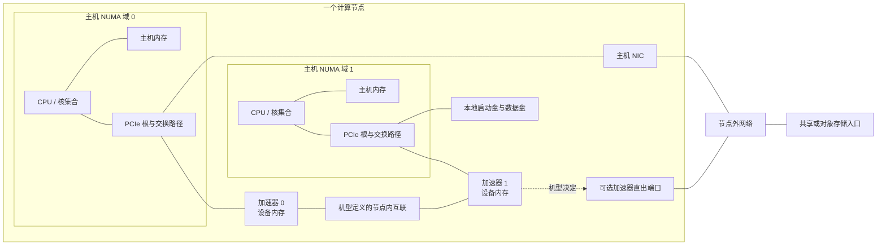

# 计算节点资源与拓扑参考

本文给出一套记录计算节点资源和连接关系的字段，供容量设计、放置判断、故障影响分析和跨层取证使用。它不是某一平台的通用布线图，也不提供探测命令、性能阈值或现场验收结果。

`generic` 表示记录方法可以用于不同平台，不表示 GPU 与 NPU 的内存、互联、设备编号或可分配单位一一对应。具体机型的数值和边必须来自该机型、该配置的物料清单、硬件手册或现场证据；缺少证据时填写 `unknown`，不能用 `0` 或邻近型号代替。

## 一张用于记录关系的概念图

这是本库原创的**关系记录图**。图中的两个 NUMA 域、两台加速器和连线都只是占位，不代表任何具体 GPU 或 NPU 服务器；“节点内互联”也不预设 NVLink、NVSwitch、HCCS、PCIe 或其他实现。主机 NIC 与加速器直出端口是分开的候选连接方式，不表示每个机型都同时具备；网络方框也不表示管理、存储与计算网络共用同一物理网络。实际记录应把每条边替换为有来源的端点、方向、链路类型和共享上游；本图不表示完整数据流。

## 资源层次与边界

| 层次 | 本页记录什么 | 不能从该层直接推出什么 |
|---|---|---|
| CPU、NUMA 与主机内存 | CPU 型号和插槽、NUMA 域、核集合、每域内存容量，以及它们与 PCIe 根的关系 | 仅凭总内存不能推出每个 NUMA 域容量相同，也不能推出进程实际获得本地内存 |
| GPU/NPU 与设备内存 | 物理设备或芯片身份、设备内存类型与容量、分区关系、PCIe 或板内端点 | “整机加速器总内存”不自动等于单设备可用容量；GPU 与 NPU 的切分单位和保留空间不能互相套用 |
| PCIe | 从 CPU/根复合体经过根端口、交换器到设备的路径，以及链路代际、宽度和协商状态的证据 | 槽位数不能推出所有设备共享同一根或同一带宽，也不能代替端到端性能测试 |
| NIC 与加速器网口 | 端口、PCIe/片上归属、NUMA 关系、协议模式、标称速率和上联网络 | 端口标称速率不能证明应用有效带宽、路由正确或 RDMA 已可用 |
| 节点内互联 | 加速器之间的真实端点、交换单元、链路类型和可达关系 | 不能因两种服务器都有“高速互联”就假定全互联、同带宽或同故障语义 |
| 存储 | 启动盘、本地缓存盘、数据盘、控制器/RAID 关系和节点外存储入口 | 本地盘清单不能说明训练数据已经落在本地，也不能证明共享存储的持久性或性能 |
| 共享资源与故障域 | 多个资源共同依赖的根、交换器、控制器、电源组、散热区、机箱、机架和上游网络/存储 | 共享上游只形成相关故障假设；没有部件图、告警或故障试验时不能宣布共同根因 |

软件驱动、运行时和框架边界见[主机到模型执行的软件栈分层](../02-software-stack/layers-and-boundaries.md)。物理设备怎样变成平台可发现、可分配的资源见[设备资源链](../05-cluster-platform/device-resource-chain.md)；调度器中的资源数量不等于本文中的物理连接图。训练数据从存储到节点和设备的路径见[训练数据路径](../04-data-storage/training-data-path.md)。

## 建议的节点拓扑字段

以下是本库建议的记录 schema，不是某个工具的输出格式。`documented`、`observed` 和 `allocated` 应分列保存，避免把产品规格、现场枚举和作业获得的资源混成同一个值。

| 对象 | 建议字段 | 记录规则 | 缺失时的解释 |
|---|---|---|---|
| 节点身份 | `node_id`、厂商、产品型号、机箱/主板版本、BOM 或配置标识 | 产品型号与具体配置分开；保留来源日期或文档版本 | 型号已知但 BOM 未知时，不能套用可选部件数量 |
| 物理位置 | 机房、机架、机位、机箱/托盘、供电分组 | 只记录授权且可长期维护的资产信息 | 未记录不表示资源位于同一故障域 |
| CPU | 插槽 ID、型号、核/线程集合、所属 NUMA 域 | 使用稳定的物理身份；逻辑 CPU 编号另列 | 总核数不能替代每域核集合 |
| 主机内存 | NUMA 域、类型、插槽/通道、已装容量、可见容量、单位 | 明确是产品上限、实际装配还是 OS 可见值 | 不知道分布时只保留整机总量，不做均分 |
| 加速器 | 平台、产品/芯片型号、物理槽位或板内位置、设备/芯片 ID、序列号范围、分区父子关系 | 区分物理设备、芯片与虚拟/切分实例；记录标识来自哪一层 | “8 卡作业”不能代替物理芯片和板卡清单 |
| 设备内存 | 加速器 ID、内存类型、文档容量、现场可见容量、分区容量、单位、保留量是否已知 | GPU/NPU 分别使用厂商定义；整机总量、单设备容量和作业可用量分列 | 未公开容量时写 `unknown`，不从训练脚本或同系列型号推算 |
| PCIe 路径 | 域/总线/设备/功能标识、根端口、交换器、终端设备、标称与协商代际/宽度、NUMA 归属 | 保存完整父子路径和证据时间；同名设备用稳定 ID 区分 | 只有终端 BDF 时仍不知道是否共享交换器或上游根 |
| NIC/端口 | 控制器与端口 ID、PCIe/片上归属、NUMA 域、MAC/端口位置、协议模式、标称速率、上联标识 | 管理、存储和计算网络分开；物理端口与 OS 名称分开 | 接口存在不能证明链路可达或数据面配置正确 |
| 节点内互联 | 链路 ID、两端加速器/交换单元、厂商链路类型、方向、标称属性、健康证据来源 | 以具体机型拓扑图为准；不要把调度亲和性标签反推为物理边 | 文档未给拓扑时保留未知，不画“常见”环或全互联 |
| 本地存储 | 介质/盘 ID、容量、接口、控制器、RAID/镜像成员、用途、NUMA/PCIe 路径 | 启动盘、缓存盘和数据盘分开；标明物理盘与逻辑卷层次 | RAID 名称不说明缓存策略、持久性或故障恢复行为 |
| 外部存储入口 | 客户端接口、NIC/网络、挂载或对象端点角色、缓存层、凭据边界 | 此处只登记节点入口；完整数据路径归 04 章节 | 已配置入口不等于数据已可读、带宽充足或一致性已验证 |
| 共享上游 | 共享 PCIe 根/交换器、NIC、控制器、电源组、风扇区、机箱、上联交换机、存储服务 | 为每个共享组列成员和证据来源 | 未确认的共享关系只能作为待验证假设 |
| 故障域 | `failure_domain_id`、范围、成员、共同依赖、预期影响、依据、验证状态 | 区分文档声明、现场观测和实验复现；故障域可嵌套 | 没有证据时不要把一次同时告警写成确定的共同故障域 |

## 读取拓扑时的四条路径

1. **主机到加速器：** 从 CPU/NUMA 域和主机内存开始，沿 PCIe 根、交换器或板内连接定位到物理加速器。用于判断“设备靠近哪个 CPU”和“哪些设备共享上游”，不是性能结论。
2. **加速器之间：** 单独记录设备间的直连或交换结构。端点可达、链路健康、集合通信可用和应用性能是四个不同问题，不能由一张静态图互相替代。
3. **加速器到网络：** 记录加速器、CPU、NIC/加速器网口及物理端口的关系。若厂商文档给出端口到 CPU/GPU 的映射，应保留映射来源；NPU 机型没有同类资料时不能照搬 GPU 的字段值。
4. **存储到设备：** 区分本地启动盘、缓存/数据盘和节点外存储入口，再关联主机内存、PCIe 和网络路径。本文只记录硬件入口；数据加载、缓存和共享存储语义由 04 章节描述。

## 官方机型例子：Huawei Atlas 800T A2

2026-09-29 实际打开的华为企业产品页把 Atlas 800T A2 描述为 4U AI 服务器，并列出 4 颗鲲鹏 920、32 个 DDR4 内存插槽（单条支持 16/32/64 GB）、三种本地 SATA/NVMe 数量组合、8 个 200GE QSFP 直出接口（RoCE）、最多 3 个 PCIe 4.0 扩展插槽、4 个 2.6 kW 电源模块（2+2 冗余）和 8 个热插拔风扇模组（N+1 冗余）（[Atlas 800T A2 产品页，“技术规格”](https://e.huawei.com/cn/products/computing/ascend/atlas-800t-a2)）。这些字段足以建立主机、网络、扩展槽、存储与部分机箱故障域的**产品级候选清单**，但仍不能替代具体交付 BOM。

该公开产品页没有给出 NPU 数量、单 NPU 设备内存容量、NPU 到 CPU/PCIe 的映射或节点内互联边。本文因此不填这些值，也不从 8 个网络端口、训练任务常见卡数或其他 Atlas A2 产品反推。对实际 Atlas 800T A2 节点，必须补齐对应硬件手册/BOM 和现场枚举，才能形成可用于放置或故障归因的物理拓扑。

这个例子也说明“有明确 NPU 机型”与“已知 NPU 拓扑”是两种证据状态。产品页能支持的主机规格保持已知；未发布在该页的设备容量与连接关系保持 `unknown`。

## 官方机型例子：NVIDIA DGX H100

NVIDIA DGX H100/H200 用户指南的组件表把 DGX H100 记录为 8 个 H100 GPU、640 GB 整机总 GPU 内存、2 颗 Intel Xeon 8480C CPU、32 根 DIMM 组成的 2 TB 系统内存；同一表还分别列出 2 块 1.92 TB NVMe M.2 系统盘（RAID 1）和 8 块 3.84 TB NVMe U.2 数据缓存盘（RAID 0）（[Introduction to NVIDIA DGX H100/H200 Systems，“Component Descriptions”](https://docs.nvidia.com/dgx/dgxh100-user-guide/introduction-to-dgxh100.html)）。这里的 640 GB 是指南给出的整机总量；本文不把它改写成作业可用量。

同一指南为集群网络列出 4 个 OSFP 端口对应 8 张单端口 ConnectX-7 卡，为存储与带内管理列出 2 张双端口 ConnectX-7 卡；其“Network Modules”表进一步给出 OSFP 端口到 network module/CPU 和 GPU 的映射，并提供一张 DGX H100/H200 系统拓扑图（[同页，“Network Connections, Cables, and Adaptors”及“System Topology”](https://docs.nvidia.com/dgx/dgxh100-user-guide/introduction-to-dgxh100.html#network-connections-cables-and-adaptors)）。因此，DGX H100 记录可以把 GPU、CPU 与集群网络端口关联起来，但仍应以实际 H100 配置、固件/BOM 和现场枚举确认设备身份。

这个 GPU 例子的端口映射不能迁移到 Atlas 800T A2。两份资料的粒度本来就不同：DGX 指南公开了端口映射和拓扑图，Atlas 产品页当前只支持较粗的产品规格。比较时应把“证据缺口”保留下来，而不是补齐一张看似对称的 GPU/NPU 表。

## 共享资源与故障域的记录方法

故障域应从共享上游关系生成，而不是从产品类别猜测。可以按以下顺序记录：

1. 为每个加速器、NIC 和本地盘找到上游根、交换器或控制器；
2. 为共同依赖同一部件的资源建立 `shared_group`，附上机型文档或现场证据；
3. 再把电源组、散热区、机箱、机架、上联网络和共享存储等更大范围作为嵌套候选域；
4. 分别记录“文档推定影响”“现场同时观测”和“实验已复现”，不要把三者合并为已确认根因。

以 Atlas 产品页为例，2+2 电源冗余和 N+1 风扇冗余能支持建立电源、风扇的产品级候选域，但没有模块到 NPU/CPU 的影响映射，不能据此写出单模块失效会影响哪些设备。DGX H100 指南则说明系统包含 6 个电源并采用 4+2 冗余（[“Support for PSU Redundancy and Continuous Operation”](https://docs.nvidia.com/dgx/dgxh100-user-guide/introduction-to-dgxh100.html#support-for-psu-redundancy-and-continuous-operation)）；它仍不能代替目标机架的 PDU 分组和供电现场记录。

## 适用边界与待补证据

本文的字段表适合建立资产和拓扑档案，也适合指出下一份证据应来自机型手册、BOM、固件清单、平台资源链还是数据路径。它不证明字段在任意平台都有同名 API，也不授权执行探测、压力测试或配置变更。

在把拓扑用于调度、性能或故障判断前，至少还需补齐：

- 目标节点的完整产品型号、BOM/板卡版本、CPU 和实际内存装配；
- 每个 GPU/NPU 的稳定物理身份、设备内存类型与现场可见容量；
- PCIe 父子路径、协商状态，以及加速器、NIC、NVMe 的 NUMA 归属；
- 该机型节点内互联的真实端点、交换单元和链路状态；
- 网络端口到上联交换机、存储入口到后端服务的对应关系；
- 电源、散热、控制器、交换器和机架级共享故障域的现场证据。

## 来源核对范围

- [Huawei Atlas 800T A2 训练服务器产品页](https://e.huawei.com/cn/products/computing/ascend/atlas-800t-a2)：2026-09-29 打开并核对“技术规格”。只支持本文写出的主机、内存槽、本地盘组合、网络、PCIe 扩展槽、电源和风扇规格；不支持 NPU 数量、设备内存或节点内互联判断。
- [NVIDIA DGX H100/H200 System User Guide](https://docs.nvidia.com/dgx/dgxh100-user-guide/)及其 [Introduction 页面](https://docs.nvidia.com/dgx/dgxh100-user-guide/introduction-to-dgxh100.html)：页面标注最后更新于 2026-01-26；核对组件表、网络端口/模块映射、拓扑图入口和电源冗余说明。没有在 DGX H100 上进行本地复现。
