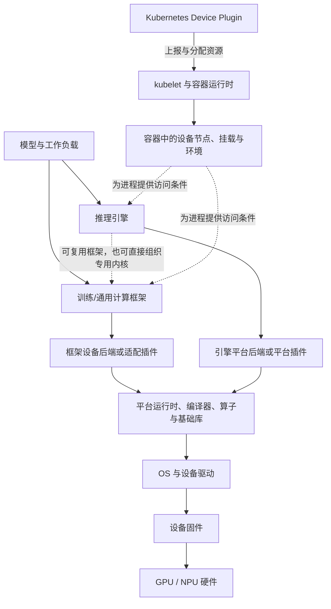

# 主机到模型执行的软件栈分层

本文提供一张用于理解依赖和归属的概念地图：模型代码如何经过框架或推理引擎，转成加速器可以执行的工作。它不提供安装命令、版本配套表或已验证的诊断流程。

`generic` 只表示这套划分可用于比较多种平台。下面的 GPU 与 NPU 例子说明角色关系，不证明任意软件组合都兼容，也不证明同名层在不同平台有相同 API、包结构或故障语义。

## 定义与要解决的问题

“软件栈分层”是按**职责和接口**划分组件，而不是按安装包名称排一条固定直线。它主要回答三个问题：

1. 谁把模型或算子意图翻译成设备工作；
2. 谁管理主机进程对设备的访问、内存和执行资源；
3. 一个现象首先跨越了哪条接口边界，应由哪个组件的证据开始缩小范围。

典型控制与执行关系可简化为：

虚线表示可选关系或运行条件，不表示必经的函数调用。编译、算子库、通信库和内存管理也可能横跨多层；具体实现应回到对应版本的组件文档。

## 各层职责与依赖

| 层或角色 | 主要职责 | 依赖与边界 |
|---|---|---|
| 设备固件 | 在设备侧提供与硬件代际相关的初始化、管理和执行基础 | 与具体设备和驱动配套；仅凭主机用户态包不能确认固件适用性 |
| OS 与设备驱动 | 让主机进程能够访问设备，并承接内核态设备管理与用户态调用入口 | 受内核、OS、设备和安全边界约束；“OS 发现设备”不等于上层运行时或框架已可用 |
| 平台运行时、toolkit 与基础库 | 提供设备、上下文、流、内存、任务下发等能力，并可能包含编译器、算子库、数学库、通信库和调试工具 | 这是若干职责的集合。具体发行包可能拆分或捆绑这些能力，不能仅按产品名推断文件和 ABI 边界 |
| 训练/通用计算框架 | 表达张量、算子、自动微分、模块和执行图，组织训练或通用模型计算 | 框架的公共 API 需要设备后端提供相应实现；框架能启动不代表目标设备上的每个算子或执行模式都受支持 |
| 框架设备后端或适配插件 | 把框架的设备、调度和算子语义接到平台软件栈，并承担注册、转换或平台优化 | 属于框架执行路径。昇腾的 TorchNPU 明确定位为基于昇腾 NPU 的 PyTorch 适配插件，固定快照的安装顺序也把 PyTorch、CANN 与 TorchNPU 区分为不同组件；这与集群资源上报插件不是同一角色（[TorchNPU 固定快照 README](https://github.com/Ascend/pytorch/blob/bc51ab84cc6f35c77aab1c59886e0ea43681a317/README.md)） |
| 推理引擎 | 围绕模型加载、请求调度、批处理、缓存和执行计划组织推理；可能复用框架，也可能调用专用内核或编译路径 | 引擎自身不等于设备运行时。引擎的平台后端负责接入特定硬件；例如 vLLM `v0.14.0` 将 platform plugin 定义为注册树外平台的扩展点（[Plugin System](https://docs.vllm.ai/en/v0.14.0/design/plugin_system/#types-of-supported-plugins)） |
| 集群设备插件与容器资源链 | 发现、上报和分配节点设备，并把容器访问所需的信息交给容器运行时 | 属于资源管理平面，不负责把框架算子翻译为设备内核。Kubernetes v1.32 文档描述的是向 kubelet 注册、上报设备健康并响应 `Allocate`（[Device Plugins](https://v1-32.docs.kubernetes.io/docs/concepts/extend-kubernetes/compute-storage-net/device-plugins/#device-plugin-implementation)） |

这张表中的层是分析单位，不是软件包清单。以 CUDA 12.8 为例，官方归档将 Toolkit 描述为包含 GPU 加速库、调试与优化工具、C/C++ 编译器和运行时库；Linux 安装指南又区分 `cuda-toolkit-12-8`、`cuda-runtime-12-8`、`cuda-libraries-12-8` 等元包，并说明 Toolkit 元包不包含驱动（[CUDA Toolkit 12.8 文档入口](https://docs.nvidia.com/cuda/archive/12.8.0/)，[Linux 安装指南的元包表](https://docs.nvidia.com/cuda/archive/12.8.0/cuda-installation-guide-linux/#meta-packages)）。因此，“CUDA”既可能指平台与编程模型，也可能泛指一组包；它不等于上图中的单独一个 runtime 方框。

CANN 也应按同样原则处理：TorchNPU 的固定快照只支持“安装 TorchNPU 前先准备 CANN”这一依赖方向，不足以把某个 CANN 发行包精确拆成上图的各层。CANN 的编译、运行时、算子库和工具边界，以及它与驱动、固件的关系，需要在选定版本的 CANN/HDK 官方文档中另行核对。抽象层相似，也不表示 CANN 与 CUDA 的 API、ABI、包名或兼容规则等价。

## 两条示例路径

### GPU：框架或引擎到 CUDA

框架路径可概括为“模型 → 框架 → CUDA 设备后端 → CUDA 运行时/库/编译产物 → 驱动 → 固件与 GPU”。推理引擎可以在框架之上组织执行，也可以通过自己的 CUDA 平台后端选择 worker、内核和执行配置。两条路径可能共享底层库，却拥有不同的配置、缓存和插件边界。

这里的重点不是给出一个通用 CUDA 配套，而是辨认失败发生在框架设备后端、引擎平台后端、用户态平台库还是驱动接口。CUDA 12.8 的归档只能说明该版本文档中的组件职责，不能替代当前环境的版本与硬件支持证据。

### NPU：PyTorch、TorchNPU 与 CANN

昇腾 PyTorch 路径在本概念图中可概括为“模型 → PyTorch → TorchNPU → CANN 平台软件 → NPU 驱动与固件 → NPU”。固定快照只支持 TorchNPU 的 PyTorch 适配角色及其对 CANN 的依赖；“CANN → 驱动与固件”的具体接口和配套关系仍待同版本 CANN/HDK 官方资料确认。本文也不从该快照外推所有算子、执行模式或设备型号均可用。

若再加入推理引擎，通常还会出现独立的引擎平台后端。它与 TorchNPU 可能协作或共享下层依赖，但职责仍不同：前者处理引擎如何选择和组织平台执行，后者处理 PyTorch 如何接入 NPU。Kubernetes Device Plugin 及符合该接口的厂商实现则处于资源上报与容器分配路径，不属于这两类执行适配插件；具体厂商实现仍需查阅对应版本资料。

## 用边界归属故障

下表给 Human 与 Agent 一个**形成候选假设**的起点。它不是根因判定表；每一行都需要同环境、同进程边界和同时间窗口的证据继续验证。

| 现象 | 先检查的边界 | 能说明什么，不能说明什么 |
|---|---|---|
| 同一主机上的多个进程都无法建立设备访问 | OS/驱动 ↔ 设备固件与硬件 | 可先确认底层访问链；不能仅凭“看不到设备”断言硬件损坏 |
| 进程能访问设备，但框架不能创建目标设备张量或初始化设备后端 | 框架 ↔ 设备后端 ↔ 平台运行时 | 可检查后端是否加载、接口是否匹配；不能由框架报错直接认定驱动是根因 |
| 只有特定算子、shape、dtype 或执行模式失败 | 框架/引擎 ↔ 算子、编译和基础库 | 优先收集失败算子与执行路径；较低层故障仍需证据排除 |
| 框架直接执行可用，但推理引擎无法识别或初始化平台 | 推理引擎 ↔ 引擎平台后端 | 优先核对引擎插件发现、平台选择和能力声明；不应转而检查 Kubernetes Device Plugin 的算子支持 |
| 节点已上报可分配设备，但容器内缺少设备访问条件 | Device Plugin/kubelet ↔ 容器运行时 ↔ 容器 | 先区分“资源已分配”与“进程可访问”；资源上报成功不能证明容器内用户态库和框架配套正确 |
| 容器内直接访问设备成功，但调度系统没有相应资源或健康状态 | 设备 ↔ Device Plugin ↔ kubelet 资源账本 | 优先检查资源管理平面的发现和上报链；这不证明模型执行栈没有其他问题 |

记录故障归属时，至少保留：最后一个成功接口、首个失败接口、所在进程或容器、相关组件及其来源可追溯版本、失败是否跨模型或跨进程复现、哪些更低层和更高层假设尚未排除。这样 Agent 可以选择下一份证据，而不是把最上层错误文本直接当作根因。

## 常见误解

- **“越靠下越像根因。”** 上层的插件发现、算子覆盖、图转换或引擎配置都能产生看似底层的错误；层级只能组织假设，不能代替证据。
- **“一个产品名就是一层。”** CUDA Toolkit 已明确包含多类组件；CANN 的具体包也必须按版本文档拆解。产品、安装包和抽象职责不是同一套边界。
- **“框架设备插件就是 Kubernetes Device Plugin。”** 前者参与模型和算子执行，后者向 kubelet 上报、分配设备并准备容器访问条件。
- **“推理引擎就是框架的另一种名称。”** 引擎负责服务侧执行组织；它可能调用框架，也可能使用独立 worker、内核或编译路径，并拥有自己的平台后端接口。
- **“抽象图相同就能共享版本表和命令。”** GPU 与 NPU 都可以画出驱动、运行时和适配层，但具体 API、ABI、日志、工具和支持矩阵仍需分别取证。

## 适用边界与待确认问题

本文只完成来源层面的职责核对，未在 GPU 或 NPU 环境中执行安装、模型运行或故障复现。结构检查通过也只能证明文档格式与引用关系有效，不能证明技术组合可运行。

仍需在后续兼容档案或实验中确认：

- 目标硬件、OS、内核、固件、驱动、平台软件、框架、适配插件和引擎的完整版本组合；
- 选定 CANN 版本的组件与包边界，以及其与驱动、固件的官方约束；
- 特定框架后端或引擎平台插件实际支持的模型、算子、dtype、执行模式和并行方式；
- 容器镜像内外分别提供哪些驱动接口、用户态库和设备文件；
- 来源声明与目标环境实测之间是否存在差异。

版本证据如何分级见[如何判断版本配套是否有依据](compatibility-evidence.md)；固定的昇腾文档基线及其未知项见[昇腾软件栈的文档配套档案](ascend-documented-profile.md)。

相关主目录边界见[本章入口](index.md)、[集群平台与资源管理](../05-cluster-platform/index.md)、[训练与后训练系统](../06-training/index.md)和[推理与服务系统](../07-inference/index.md)。

## 来源核对范围

- [CUDA Toolkit Documentation 12.8](https://docs.nvidia.com/cuda/archive/12.8.0/)：核对 Toolkit 所列组件；[Linux Installation Guide 12.8](https://docs.nvidia.com/cuda/archive/12.8.0/cuda-installation-guide-linux/#meta-packages)：核对驱动、Toolkit、runtime 与 libraries 元包的文档边界。
- [TorchNPU README，annotated tag `v7.2.0-pytorch2.6.0`，commit `bc51ab84cc6f35c77aab1c59886e0ea43681a317`](https://github.com/Ascend/pytorch/blob/bc51ab84cc6f35c77aab1c59886e0ea43681a317/README.md)：核对 TorchNPU 的 PyTorch 适配角色及其对 CANN 的依赖方向。该文件未说明驱动、固件关系，本文将这部分保留为待确认。
- [Kubernetes v1.32 Device Plugins](https://v1-32.docs.kubernetes.io/docs/concepts/extend-kubernetes/compute-storage-net/device-plugins/)：核对设备插件的注册、健康上报与分配职责。
- [vLLM v0.14.0 Plugin System](https://docs.vllm.ai/en/v0.14.0/design/plugin_system/)：核对引擎 platform plugin 的扩展角色；未据此判断任何具体硬件插件的功能范围。
