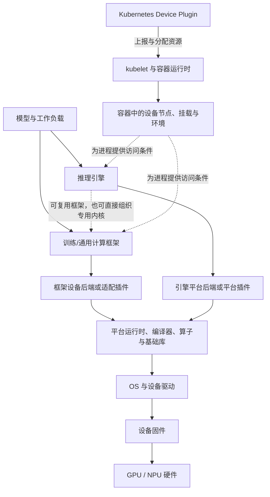

# 主机到模型执行的软件栈分层

本文提供一张用于理解依赖和归属的概念地图：模型代码如何经过框架或推理引擎，转成加速器可以执行的工作。它不提供安装命令、版本配套表或已验证的诊断流程。

`generic` 只表示这套划分可用于比较多种平台。下面的 GPU 与 NPU 例子说明角色关系，不证明任意软件组合都兼容，也不证明同名层在不同平台有相同 API、包结构或故障语义。

## 定义与要解决的问题

“软件栈分层”是按**职责和接口**划分组件，而不是按安装包名称排一条固定直线。它主要回答三个问题：

1. 谁把模型或算子意图翻译成设备工作；
2. 谁管理主机进程对设备的访问、内存和执行资源；
3. 一个现象首先跨越了哪条接口边界，应由哪个组件的证据开始缩小范围。

典型控制与执行关系可简化为：

虚线表示可选关系或运行条件，不表示必经的函数调用。编译、算子库、通信库和内存管理也可能横跨多层；具体实现应回到对应版本的组件文档。

## 各层职责与依赖

| 层或角色 | 主要职责 | 依赖与边界 |
|---|---|---|
| 设备固件 | 在设备侧提供与硬件代际相关的初始化、管理和执行基础 | 与具体设备和驱动配套；仅凭主机用户态包不能确认固件适用性 |
| OS 与设备驱动 | 让主机进程能够访问设备，并承接内核态设备管理与用户态调用入口 | 受内核、OS、设备和安全边界约束；“OS 发现设备”不等于上层运行时或框架已可用 |
| 平台运行时、toolkit 与基础库 | 提供设备、上下文、流、内存、任务下发等能力，并可能包含编译器、算子库、数学库、通信库和调试工具 | 这是若干职责的集合。具体发行包可能拆分或捆绑这些能力，不能仅按产品名推断文件和 ABI 边界 |
| 训练/通用计算框架 | 表达张量、算子、自动微分、模块和执行图，组织训练或通用模型计算 | 框架的公共 API 需要设备后端提供相应实现；框架能启动不代表目标设备上的每个算子或执行模式都受支持 |
| 框架设备后端或适配插件 | 把框架的设备、调度和算子语义接到平台软件栈，并承担注册、转换或平台优化 | 属于框架执行路径。昇腾的 TorchNPU 明确定位为基于昇腾 NPU 的 PyTorch 适配插件，固定快照的安装顺序也把 PyTorch、CANN 与 TorchNPU 区分为不同组件；这与集群资源上报插件不是同一角色（[TorchNPU 固定快照 README](https://github.com/Ascend/pytorch/blob/bc51ab84cc6f35c77aab1c59886e0ea43681a317/README.md)） |
| 推理引擎 | 围绕模型加载、请求调度、批处理、缓存和执行计划组织推理；可能复用框架，也可能调用专用内核或编译路径 | 引擎自身不等于设备运行时。引擎的平台后端负责接入特定硬件；例如 vLLM `v0.14.0` 将 platform plugin 定义为注册树外平台的扩展点（[Plugin System](https://docs.vllm.ai/en/v0.14.0/design/plugin_system/#types-of-supported-plugins)） |
| 集群设备插件与容器资源链 | 发现、上报和分配节点设备，并把容器访问所需的信息交给容器运行时 | 属于资源管理平面，不负责把框架算子翻译为设备内核。Kubernetes v1.32 文档描述的是向 kubelet 注册、上报设备健康并响应 `Allocate`（[Device Plugins](https://v1-32.docs.kubernetes.io/docs/concepts/extend-kubernetes/compute-storage-net/device-plugins/#device-plugin-implementation)） |

这张表中的层是分析单位，不是软件包清单。以 CUDA 12.8 为例，官方归档将 Toolkit 描述为包含 GPU 加速库、调试与优化工具、C/C++ 编译器和运行时库；Linux 安装指南又区分 `cuda-toolkit-12-8`、`cuda-runtime-12-8`、`cuda-libraries-12-8` 等元包，并说明 Toolkit 元包不包含驱动（[CUDA Toolkit 12.8 文档入口](https://docs.nvidia.com/cuda/archive/12.8.0/)，[Linux 安装指南的元包表](https://docs.nvidia.com/cuda/archive/12.8.0/cuda-installation-guide-linux/#meta-packages)）。因此，“CUDA”既可能指平台与编程模型，也可能泛指一组包；它不等于上图中的单独一个 runtime 方框。

CANN 也应按同样原则处理：TorchNPU 的固定快照只支持“安装 TorchNPU 前先准备 CANN”这一依赖方向，不足以把某个 CANN 发行包精确拆成上图的各层。CANN 的编译、运行时、算子库和工具边界，以及它与驱动、固件的关系，需要在选定版本的 CANN/HDK 官方文档中另行核对。抽象层相似，也不表示 CANN 与 CUDA 的 API、ABI、包名或兼容规则等价。

## 两条示例路径

### GPU：框架或引擎到 CUDA

框架路径可概括为“模型 → 框架 → CUDA 设备后端 → CUDA 运行时/库/编译产物 → 驱动 → 固件与 GPU”。推理引擎可以在框架之上组织执行，也可以通过自己的 CUDA 平台后端选择 worker、内核和执行配置。两条路径可能共享底层库，却拥有不同的配置、缓存和插件边界。

这里的重点不是给出一个通用 CUDA 配套，而是辨认失败发生在框架设备后端、引擎平台后端、用户态平台库还是驱动接口。CUDA 12.8 的归档只能说明该版本文档中的组件职责，不能替代当前环境的版本与硬件支持证据。

### NPU：PyTorch、TorchNPU 与 CANN

昇腾 PyTorch 路径在本概念图中可概括为“模型 → PyTorch → TorchNPU → CANN 平台软件 → NPU 驱动与固件 → NPU”。固定快照只支持 TorchNPU 的 PyTorch 适配角色及其对 CANN 的依赖；“CANN → 驱动与固件”的具体接口和配套关系仍待同版本 CANN/HDK 官方资料确认。本文也不从该快照外推所有算子、执行模式或设备型号均可用。

若再加入推理引擎，通常还会出现独立的引擎平台后端。它与 TorchNPU 可能协作或共享下层依赖，但职责仍不同：前者处理引擎如何选择和组织平台执行，后者处理 PyTorch 如何接入 NPU。Kubernetes Device Plugin 及符合该接口的厂商实现则处于资源上报与容器分配路径，不属于这两类执行适配插件；具体厂商实现仍需查阅对应版本资料。

## 三栈职责对照：六个职责域

「各层职责与依赖」回答的是层次问题；本节把其中最厚的一层——平台运行时、toolkit 与基础库——按职责域拆开，逐域并列 NVIDIA CUDA、AMD ROCm 与华为 CANN 官方文档的表述。对照单位是**职责域，不是包名**：三栈的发行粒度、渠道与命名互不相同，同一职责在不同栈里可能由一个包、几个包或一个独立产品承担（直接证据见下文「包名不等于能力」）。因此本节不提供「包 A ≈ 包 B ≈ 包 C」式的等价表，共同名称也不代表相同限制。

三栈各绑定一个已固定文档样板：CUDA 12.8.0（NGC PyTorch 25.01-py3 容器语境）、ROCm Core SDK 10.1.0（Instinct MI300X 样板语境）、CANN 8.3.RC1（包清单）加 8.2.RC1.alpha001（AscendCL/HCCL/aclnn 职责页）。完整版本表、兼容交集与各栈未知项分别在 [NVIDIA 软件栈的文档配套档案](nvidia-documented-profile.md)、[AMD ROCm 软件栈的文档配套档案](amd-rocm-documented-profile.md) 与 [昇腾软件栈的文档配套档案](ascend-documented-profile.md)，本文只引用与职责直接相关的字段。AMD 路径在本概念图中可概括为「模型 → PyTorch（ROCm 构建）或推理引擎 → HIP/ROCr 与 roc*/hip* 库 → amdgpu/ROCK 内核驱动 → GPU」，与上面两条示例路径的抽象位置相似。

### 编译

- **CUDA**：12.8 组件表把 CUDA NVCC 与 CUDA NVRTC 固定为 12.8.61，另有 nvJitLink 12.8.61、nvFatbin 12.8.55；归档 Tools 区把 NVCC 列为 CUDA 编译器驱动的参考文档，Compiler SDK 区另列 libNVVM API、libdevice 与 NVVM IR（[CUDA Toolkit 12.8 Release Notes](https://docs.nvidia.com/cuda/archive/12.8.0/cuda-toolkit-release-notes/index.html) Table 1 与[归档入口](https://docs.nvidia.com/cuda/archive/12.8.0/)）。同一表说明「Starting with CUDA 11, the various components in the toolkit are versioned independently」：编译器组件有自己的版本号，「CUDA 12.8」一个数字不能代替它们。
- **ROCm**：编译职责由 LLVM 24.0.0 承担（含 ROCm 设备编译器 amdclang，编译 HIP 与 OpenCL），配套 HIPIFY 10.1.0、SPIRV-LLVM-Translator 24.0.0；hipcc 的组件文档站标题为 1.1.1，且过渡指南注明 HIPCC 已并入 `amdrocm-llvm` 包（[runtimes and compilers](https://rocm.docs.amd.com/en/docs-10.1.0/components/runtimes-and-compilers.html)、[TheRock 过渡指南](https://rocm.docs.amd.com/en/docs-10.1.0/about/transition-guide-TheRock.html)）。HIP 与 LLVM 的文档站标题和组件表版本号存在未消解冲突（跟踪表 C1/C2），本文组件版本一律以 release notes 组件表为准并注明站标差异。
- **CANN**：包清单把「算子/应用/模型的开发和编译」归入 `Ascend-cann-toolkit` 包职责（[CANN 社区版 8.3.RC1《准备软件包》](https://www.hiascend.com/document/detail/zh/CANNCommunityEdition/83RC1/softwareinst/instg/instg_0003.html)，离线/Yum/Conda 三表同文）。Toolkit 内部编译器组件（如 Ascend C 编译器、图编译器）的独立职责页本轮未取证：CANN 在该域的「平台声明」只能到包级描述，不能写成组件级结论（跟踪表 U1）。

### 运行时

- **CUDA**：CUDA Runtime（cudart）12.8.57 在组件表中独立版本化；runtime API 提供隐式初始化、上下文与模块管理，driver API 提供显式控制，两套接口的边界与逐条语义见[驱动初始化、运行时执行同步与库装载](runtime-execution-and-library-loading.md)。元包层面，Linux 安装指南写 `cuda-toolkit-12-8`「Installs all CUDA Toolkit packages required to develop CUDA applications. Does not include the driver.」，而 `cuda-runtime-12-8` 含运行所需 Toolkit 包**以及 Driver 包**（[Linux 安装指南元包表](https://docs.nvidia.com/cuda/archive/12.8.0/cuda-installation-guide-linux/index.html#meta-packages)）。「Toolkit 元包不含驱动」与 release notes 组件表列出的随发布捆绑驱动行（NVIDIA Linux Driver 570.86.10）是发布捆绑与元包依赖两个口径，须分列。
- **ROCm**：HIP 10.1.0 自述为「A C++ runtime API and kernel programming language designed for AMD GPUs…interface closely aligned with NVIDIA CUDA」；ROCr Runtime 1.21.0 自述为「AMD's implementation of the HSA runtime, providing the foundation for GPU execution and management in the ROCm software stack」（[runtimes and compilers](https://rocm.docs.amd.com/en/docs-10.1.0/components/runtimes-and-compilers.html)）。HIP 的初始化、stream/event 与错误逐条语义固定在 6.3.x 文档线（见[驱动初始化、运行时执行同步与库装载](runtime-execution-and-library-loading.md)），10.1.0 线未逐条重做——引用语义必须带版本线，且 HIP 与 CUDA 的接口对齐只是移植便利，不承诺逐条语义等价。
- **CANN**：AscendCL 自述为「一套用于在 CANN 上开发深度神经网络推理应用的 C 语言 API 库，提供模型加载与执行、媒体数据处理、算子加载与执行等 API」，并定义 Host/Device 概念（[8.2.RC1.alpha001 AscendCL 快速入门](https://www.hiascend.com/document/detail/zh/CANNCommunityEdition/82RC1alpha001/appdevg/aclcppdevg/aclcppdevg_000001.html)）。两个边界：该句以推理应用为主语，训练路径经 TorchNPU 使用 CANN 运行时接口，既不能据此把 AscendCL 断言为仅限推理，也不能把它写成与 CUDA runtime 全场景等价的层；驱动/固件边界由包清单另行描述——NPU 驱动「部署在昇腾 AI 处理器……为上层 CANN 软件提供处理器控制、资源分配等接口」，固件包含昇腾 AI 处理器自带的 OS 与功耗管理器件控制软件（[8.3.RC1《准备软件包》](https://www.hiascend.com/document/detail/zh/CANNCommunityEdition/83RC1/softwareinst/instg/instg_0003.html)）。

### 算子与数学库

- **CUDA**：12.8 组件表的数学库行包括 cuBLAS 12.8.3.14、cuFFT、cuSOLVER、cuSPARSE、cuRAND、NPP、nvJPEG 与 Thrust/CUB/libcu++ 等（[Release Notes Table 1](https://docs.nvidia.com/cuda/archive/12.8.0/cuda-toolkit-release-notes/index.html)）。结构性负面证据：该表全文没有 cuDNN 与 NCCL 条目（对提取文本逐行核对，0 命中）；cuDNN 有独立文档树（[cuDNN 文档](https://docs.nvidia.com/deeplearning/cudnn/latest/)，滚动 latest），NGC 25.01 容器 Contents 把 cuDNN 9.7.0.66、NCCL 2.25.1 与 CUDA 12.8.0.038 分列（[NVIDIA PyTorch Release 25.01](https://docs.nvidia.com/deeplearning/frameworks/pytorch-release-notes/rel-25-01.html)）。「cuDNN/NCCL 是 Toolkit 之外的独立产品」的证据形态是「组件表不收录 + 独立文档树 + 容器清单分列」的结构性证据，不是某一句官方声明；两个组件与 25.01 对应版本的独立版本化归档页未取得（跟踪表 U5）。
- **ROCm**：官方分层表述——「Libraries prefixed with roc* are native, high-performance implementations written in HIP specifically for AMD GPUs. Libraries prefixed with hip* are portable wrappers that implement NVIDIA CUDA-equivalent APIs」（[math and compute libraries](https://rocm.docs.amd.com/en/docs-10.1.0/components/math-and-compute-libs.html)）。固定版本如 rocBLAS 5.7.0（HIP 原生 BLAS 实现）、hipBLAS 3.7.0（BLAS-marshalling，支持 rocBLAS 与 cuBLAS 后端）、hipBLASLt 1.4.1、MIOpen 3.6.1（开源深度学习原语库）。两条边界：roc* 与 cu* 的对应关系是 marshalling 后端支持声明，不是 API 等价证明；默认后端随 GPU 代际可变（rocBLAS 5.7.0 起 gfx950 的 GEMM 默认改用 hipBLASLt 后端）。
- **CANN**：Kernels 是「CANN 二进制算子包」，含单算子 API 执行（例如 aclnn 类 API）的动态/静态库文件与 kernel 二进制，单算子 API 执行场景**必须安装**；NNAL 为神经网络加速库，含 ATB（面向大模型训练/推理性能）与 SiP（[8.3.RC1《准备软件包》](https://www.hiascend.com/document/detail/zh/CANNCommunityEdition/83RC1/softwareinst/instg/instg_0003.html)）。aclnn 采用 GetWorkspaceSize 加执行的两段式接口，「直接调用算子二进制包（Ascend-cann-kernels）中已编译好的算子、无需再编译」（[8.2.RC1.alpha001 单算子调用流程](https://www.hiascend.com/document/detail/zh/CANNCommunityEdition/82RC1alpha001/appdevg/aclcppdevg/aclcppdevg_000017.html)）。与 CUDA/ROCm 把算子库作为链接库分发不同，CANN 把「已编译算子二进制」作为独立发行物：Kernels 包缺失会直接表现为单算子 API 不可用，而不是某个链接库版本不匹配。

### 通信

- **NCCL（CUDA 栈）**：职责表述为「a library providing inter-GPU communication primitives that are topology-aware…implements both collective communication and point-to-point send/receive」，支持 PCIe、NVLink、InfiniBand Verbs 与 IP sockets（[NCCL User Guide](https://docs.nvidia.com/deeplearning/nccl/user-guide/docs/overview.html)，滚动 latest，另有 2.27.5 固定归档线）。NCCL 不在 CUDA Toolkit 12.8 组件表内（负面核对同上）。
- **RCCL（ROCm 栈）**：自述为「stand-alone library that provides multi-GPU and multi-node collective communication primitives optimized for AMD GPUs…uses PCIe and xGMI high-speed interconnects」（[RCCL 文档](https://rocm.docs.amd.com/projects/rccl/en/docs-10.1.0/index.html)）；10.1.0 组件表标注 RCCL 仅支持 Linux，另有 rocSHMEM 3.7.0。
- **HCCL（CANN 栈）**：职责页绑定 8.2.RC1.alpha001 树——「基于昇腾 AI 处理器的高性能集合通信库」，支持 AllReduce、Broadcast、AllGather、ReduceScatter、AlltoAll 等通信原语与 Ring、Mesh、Halving-Doubling 等算法，「基于 HCCS、RoCE 和 PCIe 高速链路实现集合通信」；软件架构分适配层/集合通信业务层/集合通信平台层三层，通信流程分通信域初始化、建立连接（socket 建链，超时上报建链超时错误）、执行通信（经 Runtime 下发任务调度器）、销毁四阶段（[HCCL 简介](https://www.hiascend.com/document/detail/zh/CANNCommunityEdition/82RC1alpha001/commlib/hcclug/docs/zh/user_guide/hccl_intro.md)）。框架接入分工也来自该页：C 语言接口用于单算子模式的框架适配（「HCCL 单算子 API 嵌入到 PyTorch 后端代码中」，用户直接使用 PyTorch 原生集合通信 API），Python 接口用于图模式。版本线边界：8.3.RC1 树的对应页未核对；已登记的 HCCL 文档为 8.0.RC1.alpha003（API 参考）与 8.1.RC1.alpha001（用户指南）两条其他版本线——三线不可混（跟踪表 U6）。

通信域本体（拓扑、rank 进度与超时排查）见[集合通信与 rank 进度](../03-communication/collectives-and-rank-progress.md)；本文只保留栈职责层的对照。

### 框架后端

- **PyTorch CUDA 后端**：PyTorch 官方分发把 CUDA 列为 Linux 计算平台路径之一，源码构建写「for NVIDIA GPUs, install CUDA」（[Get Started Locally](https://pytorch.org/get-started/locally/)，latest 可变页，2026-10-09 观察）。CUDA 后端的行为锚点（pinned memory、non_blocking 拷贝、stream 语义）见已登记的 PyTorch 2.6 CUDA 语义文档；它只覆盖 CUDA，不能作为 ROCm 或 NPU 行为的证据。
- **PyTorch ROCm 后端**：同一页把 ROCm 列为并列计算平台路径，关键精确表述是「the ROCm build of PyTorch uses the same semantics at the python API level, so the below commands should also work for ROCm」（验证命令即 `torch.cuda.is_available()`）。两个边界：这是 python API 层的语义声明，不是功能覆盖或性能声明；分发渠道分叉——上游 wheel 索引的 ROCm 目录 2026-10-09 只到 rocm7.14，ROCm 10.x 的 wheel 由 AMD 自有索引分发（完整取证见 [AMD 档案](amd-rocm-documented-profile.md)），「上游 wheel 已支持 ROCm 10.1.0」不能写成既成事实（跟踪表 U7）。
- **TorchNPU（树外后端）**：PyTorch 教程说明 PrivateUse1 保留 dispatch key 供树外后端集成，并点名「One example about PrivateUse1 integration is Ascend NPU」（[PrivateUse1 教程](https://docs.pytorch.org/tutorials/advanced/privateuseone.html)，可变页，2026-10-09 观察）；TorchNPU 固定快照自述「This repository develops the Ascend Extension for PyTorch named torch_npu to adapt Ascend NPU to PyTorch」（[README 固定 commit](https://github.com/Ascend/pytorch/blob/bc51ab84cc6f35c77aab1c59886e0ea43681a317/README.md)）。教程是机制说明，不声明 TorchNPU 任一版本的能力范围；后端能力仍以其固定配套表与源码为准。

### 引擎插件

vLLM `v0.14.0` 的插件系统把插件分为 general、platform、io_processor、stat_logger 四类；platform plugins 通过 entry point 组 `vllm.platform_plugins`「register custom, out-of-the-tree platforms into vLLM」，平台类须继承 `vllm.platforms.interface.Platform`，树外平台使用 `PlatformEnum.OOT`；「Compatibility Guarantee」节要求插件作者自行保证与目标 vLLM 版本的兼容（[v0.14.0 Plugin System](https://docs.vllm.ai/en/v0.14.0/design/plugin_system/)）。

- **CUDA/ROCm**：CUDA 是 vLLM 的默认平台；ROCm 平台同样在树内，ROCm 10.1.0 release notes 的 AI ecosystem 表列 vLLM 0.29.0 为该 release 的配套框架（[ROCm 10.1.0 release notes](https://rocm.docs.amd.com/en/docs-10.1.0/about/release-notes.html)）。「树内」是从 plugin 文档对 OOT 的定位反推的结论，两个平台的 supported platforms 职责页未单独取证（跟踪表 U4）。
- **Ascend**：vLLM Ascend 固定快照 `v0.14.0rc1` 是树外平台插件形态的实例（platform/worker/custom ops）。其快照内配套（vLLM v0.14.1、CANN 镜像 tag 8.5.0、PyTorch/torch-npu 2.9.0）与本库昇腾档案基线（torch-npu 2.6.0.post3 × CANN 8.3.RC1）不是同一组合，不可拼接为配套（见[昇腾档案](ascend-documented-profile.md)）。

### 包名不等于能力：三栈的直接证据

「不按包名画等价表」不是风格偏好，三栈都有直接证据：

- **ROCm（TheRock 合并包）**：过渡指南写明「ROCm Core SDK packages are more consolidated than the legacy ROCm release stream. For example, hipBLAS and rocBLAS are now combined into one package, `amdrocm-blas`.」；`amdrocm-runtime` 把 HIP、ROCr 与运行时编译并入一包，`amdrocm-llvm` 含 amdclang++/hipcc/flang，`amdrocm-dnn` 含 hipDNN 与 MIOpen（[TheRock 过渡指南](https://rocm.docs.amd.com/en/docs-10.1.0/about/transition-guide-TheRock.html)）。一个安装包同时覆盖本文拆开的多个职责域——roc* 原生层与 hip* marshalling 层装在同一个包里——包粒度比组件粒度粗，不能从包名推断文件与 ABI 边界。
- **CUDA（元包与独立产品并存）**：Toolkit 元包按职责聚合（compiler/libraries/tools 各自成元包，toolkit 不含驱动）；cuDNN 与 NCCL 则完全在 Toolkit 元包体系之外，由容器镜像或独立渠道提供（上文负面核对与 NGC Contents 分列）。
- **CANN（渠道不同包名不同）**：同一 8.3.RC1 的 Toolkit 包在离线、Yum、Conda 渠道分别是 `Ascend-cann-toolkit_<version>_linux-<arch>.run`、`Ascend-cann-toolkit-8.3.RC1`、`ascend::cann-toolkit==8.3.RC1`；A3 系列的 kernels 包另有 `Atlas-<type>-cann-kernels_...` 形态（[8.3.RC1《准备软件包》](https://www.hiascend.com/document/detail/zh/CANNCommunityEdition/83RC1/softwareinst/instg/instg_0003.html) 三表）。

归纳（本库方法，非厂商原文）：发行包粒度、文档组件粒度与职责域粒度是三套不同的划分。对照只能以职责域为行、以证据态为列；把「装了包 X」读成「具备某栈某域的全部能力」，或把三栈包名排成固定等价表，都会掩盖这些粒度差。

## 对照矩阵：四态证据 × 六职责域 × 三栈

矩阵每格按四态填写；四种状态回答不同问题，不可互相替代，也不能压缩成一个「支持/不支持」：

| 证据态 | 回答的问题 | 典型来源形态 |
|---|---|---|
| 组件存在 | 固定样板的组件表/包清单里有没有该组件及其版本号 | release notes 组件表、安装指南包清单 |
| 平台声明 | 厂商文档对该组件职责的表述 | 组件职责页、开发指南 |
| 框架能力 | 框架/引擎侧对该平台能力边界的表述（引擎插件域为引擎侧表述） | 框架安装与语义文档、引擎插件文档 |
| 实测 | 本库环境实际运行结果 | 本库实验/案例记录（当前全部未执行） |

矩阵绑定三个已固定文档样板：CUDA 12.8.0 + NGC PyTorch 25.01-py3（[NVIDIA 档案](nvidia-documented-profile.md)）；CANN 8.3.RC1 包清单 + TorchNPU v7.2.0-pytorch2.6.0 / torch-npu 2.6.0.post3，其中 AscendCL、HCCL、aclnn 职责页绑定 8.2.RC1.alpha001 树（[昇腾档案](ascend-documented-profile.md)）；ROCm Core SDK 10.1.0 + Instinct MI300X（[AMD 档案](amd-rocm-documented-profile.md)）。格值用语与[如何判断版本配套是否有依据](compatibility-evidence.md)的两条轴一致：`documented` 表示固定样板或来源的自述；`partial` 表示来源覆盖了对象但不完整；`unknown` 表示未取证；`conflict` 表示两条可定位来源互斥。「实测」列全部为 `not_run`——本库未在任何 GPU/NPU 环境安装或运行三栈组件，任何格都不因此转为已验证。

| 职责域 | 栈 | 组件存在 | 平台声明 | 框架能力 | 实测 |
|---|---|---|---|---|---|
| 编译 | CUDA | documented：NVCC/NVRTC 12.8.61、nvJitLink/nvFatbin（组件表） | documented：归档 Tools 与 Compiler SDK 区职责描述 | documented：get-started 源码构建装 CUDA | not_run |
| 编译 | ROCm | documented：LLVM 24.0.0（amdclang）、HIPIFY、HIPCC（站标冲突 C1/C2） | documented：runtimes-and-compilers 页 | documented：get-started 源码构建装 ROCm | not_run |
| 编译 | CANN | partial：Toolkit 包级描述含「开发和编译」 | partial：编译器组件独立职责页未取证（U1） | documented：TorchNPU README 源码构建约束 | not_run |
| 运行时 | CUDA | documented：cudart 12.8.57（组件表） | documented：Runtime/Driver API 职责与逐条语义（见[运行时执行文](runtime-execution-and-library-loading.md)） | documented：`torch.cuda.is_available()` 验证入口 | not_run |
| 运行时 | ROCm | documented：HIP 10.1.0、ROCr 1.21.0（站标冲突 C1） | documented：10.1.0 概念页；逐条语义固定在 6.3.x 线 | documented：「same semantics at the python API level」 | not_run |
| 运行时 | CANN | documented：Toolkit 包 + AscendCL 接口页组（8.2.RC1.alpha001） | documented：AscendCL 职责自述（推理主语边界已注明） | documented：TorchNPU 二进制安装先备 CANN | not_run |
| 算子/数学 | CUDA | documented：cuBLAS 12.8.3.14 等数学库行；cuDNN/NCCL 不在表内（负面核对） | documented：cuBLAS/cuDNN 职责页（cuDNN 为 latest 滚动） | documented：NGC 25.01 Contents 分列 cuBLAS/cuDNN/NCCL | not_run |
| 算子/数学 | ROCm | documented：rocBLAS 5.7.0、hipBLAS 3.7.0、MIOpen 3.6.1 等（组件表） | documented：roc* 原生 / hip* marshalling 分层表述 | documented：release notes AI ecosystem 表列 PyTorch 2.14.0 | not_run |
| 算子/数学 | CANN | documented：Kernels/NNAL 包行（8.3.RC1 包清单） | documented：aclnn 两段式免编译（8.2.RC1.alpha001） | partial：TorchNPU 算子注册实现见来源登记 notes，本文未展开 | not_run |
| 通信 | CUDA | documented（负面核对）：NCCL 为 Toolkit 外独立库；NGC Contents NCCL 2.25.1 | documented：NCCL 用户指南（2.32.3 latest / 2.27.5 归档，引用带观察日期） | documented：PyTorch 分布式 NCCL 路径（已登记来源） | not_run |
| 通信 | ROCm | documented：RCCL 2.30.7（组件表标注仅 Linux） | documented：RCCL 职责页 | unknown：「PyTorch ROCm 后端使用 RCCL」的上游精确表述未取证（U3） | not_run |
| 通信 | CANN | documented：HCCL 职责页（8.2.RC1.alpha001 树；8.3.RC1 对应页未核对，U6） | documented：三层架构/四阶段/建链超时错误 | documented：HCCL「C 接口嵌入 PyTorch 后端」 | not_run |
| 框架后端 | CUDA | documented：官方分发含 CUDA 计算平台路径 | documented：PyTorch 2.6 CUDA 语义文档（pinned memory/stream 锚点） | documented：源码构建「for NVIDIA GPUs, install CUDA」 | not_run |
| 框架后端 | ROCm | documented：官方分发含 ROCm 路径；wheel 渠道分叉（U7） | partial：ROCm 侧安装文档（rocm/pytorch 镜像与 AMD 索引 wheel，latest 页） | documented：「same semantics at the python API level」 | not_run |
| 框架后端 | CANN | documented：PyPI torch-npu 2.6.0.post3 六个 wheel 索引身份 | documented：TorchNPU README 定位与配套表 | documented：PrivateUse1 教程「One example…is Ascend NPU」 | not_run |
| 引擎插件 | CUDA | documented：vLLM v0.14.0 plugin system（platform 插件入口点） | unknown：vLLM 树内 CUDA 平台职责页未单独取证（U4） | documented：CUDA 为 vLLM 默认平台（plugin 文档反推） | not_run |
| 引擎插件 | ROCm | documented：同上 plugin system | partial：release notes AI ecosystem 列 vLLM 0.29.0；树内平台职责页未取证（U4） | documented：platform plugin 为 OOT 扩展点，兼容责任在插件侧 | not_run |
| 引擎插件 | CANN | documented：vLLM Ascend 固定快照 v0.14.0rc1 | partial：快照配套（CANN 8.5.0/torch 2.9.0）与昇腾档案基线非同一组合，不可拼接 | documented：OOT 平台插件形态实例 | not_run |

矩阵中的 `partial`/`unknown`/`conflict` 引用统一指向文末「unknown / conflict 跟踪清单」的编号，最终验收时逐项核对是否已达到。

## 用边界归属故障

下表给 Human 与 Agent 一个**形成候选假设**的起点。它不是根因判定表；每一行都需要同环境、同进程边界和同时间窗口的证据继续验证。

| 现象 | 先检查的边界 | 能说明什么，不能说明什么 |
|---|---|---|
| 同一主机上的多个进程都无法建立设备访问 | OS/驱动 ↔ 设备固件与硬件 | 可先确认底层访问链；不能仅凭“看不到设备”断言硬件损坏 |
| 进程能访问设备，但框架不能创建目标设备张量或初始化设备后端 | 框架 ↔ 设备后端 ↔ 平台运行时 | 可检查后端是否加载、接口是否匹配；不能由框架报错直接认定驱动是根因 |
| 只有特定算子、shape、dtype 或执行模式失败 | 框架/引擎 ↔ 算子、编译和基础库 | 优先收集失败算子与执行路径；较低层故障仍需证据排除 |
| 框架直接执行可用，但推理引擎无法识别或初始化平台 | 推理引擎 ↔ 引擎平台后端 | 优先核对引擎插件发现、平台选择和能力声明；不应转而检查 Kubernetes Device Plugin 的算子支持 |
| 节点已上报可分配设备，但容器内缺少设备访问条件 | Device Plugin/kubelet ↔ 容器运行时 ↔ 容器 | 先区分“资源已分配”与“进程可访问”；资源上报成功不能证明容器内用户态库和框架配套正确 |
| 容器内直接访问设备成功，但调度系统没有相应资源或健康状态 | 设备 ↔ Device Plugin ↔ kubelet 资源账本 | 优先检查资源管理平面的发现和上报链；这不证明模型执行栈没有其他问题 |

记录故障归属时，至少保留：最后一个成功接口、首个失败接口、所在进程或容器、相关组件及其来源可追溯版本、失败是否跨模型或跨进程复现、哪些更低层和更高层假设尚未排除。这样 Agent 可以选择下一份证据，而不是把最上层错误文本直接当作根因。

## 观察、失败分支与最小验证入口（三平台）

上表给出平台无关的假设起点；本节把三平台各自的观察入口与验证入口接到对应正文。所有入口均为文档级取证，本库未执行任何一条。

### 初始化、同步与错误的平台分支

三栈的初始化、stream/event 同步与错误报告语义对照见[驱动初始化、运行时执行同步与库装载](runtime-execution-and-library-loading.md)：CUDA 12.8 归档线（隐式初始化；异步错误可能由后续无关调用报告）；HIP 6.3.42134 线（含 HIP 与 CUDA 的 API 不等价清单——移植过的代码不能假设逐条等价）；CANN 8.2.RC1.alpha001 线（aclrtSynchronizeStream、aclError、aclrtQueryEventStatus 的出参形态）。引用任一语义必须带该文的版本线标注。通信域另有一条平台失败分支：HCCL 建链阶段超时会上报建链超时错误（[HCCL 简介](https://www.hiascend.com/document/detail/zh/CANNCommunityEdition/82RC1alpha001/commlib/hcclug/docs/zh/user_guide/hccl_intro.md)四阶段中的第二阶段），排查入口见[集合通信与 rank 进度](../03-communication/collectives-and-rank-progress.md)。

### 设备访问与资源压力

进程无法建立设备访问时的观察方法（设备节点、权限、cgroup 与主机资源压力）见[OS/进程资源压力与设备访问诊断](host-resource-pressure-and-device-access.md)；各平台安装后的设备可见性查验入口并入下表。

### 安装后最小验证入口（文档级）

| 平台 | 最小验证入口（厂商文档样例，非本库实测） | 证据状态 |
|---|---|---|
| CUDA | CUDA 12.8 Linux 安装指南的安装后验证节 | partial：本轮未逐条展开该节，仅登记入口 |
| ROCm | `rocminfo`（枚举 HSA agent）、`amd-smi version`（样例输出含 ROCm 与 amdgpu 版本行）——install guide「Verify your installation」节，固定 docs-10.1.0 线（见 [AMD 档案](amd-rocm-documented-profile.md)） | documented（未执行） |
| CANN | 安装 CANN 前以 `npu-smi info` 查验 NPU 驱动与固件（[8.3.RC1 快速安装](https://www.hiascend.com/document/detail/zh/CANNCommunityEdition/83RC1/softwareinst/instg/instg_0001.html)，2026-10-09 观察） | documented（未执行） |

通信性能验证工具（nccl-tests、rccl-tests、HCCL Test）在本库同样只有文档与源码级取证，未运行。厂商最小示例的「结果检查」也不对齐：CUDA vectorAdd 示例含官方数值校验步骤，saxpy 无校验，CANN 侧为 ResNet-50 样例页——不能默认三栈示例都自带结果判定，最小验证须自带判据。

### unknown / conflict 跟踪清单

以下子项在本文与三个档案中保持可追踪；最终验收时应逐项标记是否已达到，未取得的不因本文写作转为已覆盖：

| 编号 | 对象 | 状态 | 位置 |
|---|---|---|---|
| U1 | CANN 编译器组件（Ascend C 编译器、图编译器）的独立职责页 | unknown | 矩阵「编译×CANN」；[第十六批取证记录](../../docs/research/batch-16-stack-comparison-sources.md) |
| U2 | CANN 8.3.RC1 精确驱动/固件（HDK）版本交集 | blocked | [昇腾档案](ascend-documented-profile.md)：仅有 HDK 系列级通配，不得冒充精确配套 |
| U3 | 「PyTorch ROCm 后端使用 RCCL」的上游精确表述 | unknown | 矩阵「通信×ROCm」 |
| U4 | vLLM 树内 CUDA/ROCm 平台的 supported platforms 职责页 | unknown | 矩阵「引擎插件×CUDA/ROCm」 |
| U5 | cuDNN 9.7.0.66、NCCL 2.25.1 的独立版本化归档页 | unknown | [NVIDIA 档案](nvidia-documented-profile.md)：以 NGC Contents 分列作替代证据 |
| U6 | 8.3.RC1 树的 HCCL 简介对应页 | unknown | 矩阵「通信×CANN」：HCCL 表述绑定 8.2.RC1.alpha001 树 |
| U7 | ROCm 10.x wheel 在上游 download.pytorch.org 索引的收录 | unknown（2026-10-09 实查仅到 rocm7.14；10.x 由 AMD 索引分发） | [AMD 档案](amd-rocm-documented-profile.md) |
| C1 | HIP 版本号：文档站标题 7.16.0 vs release notes 组件表 10.1.0 | conflict | [AMD 档案](amd-rocm-documented-profile.md)：本文以组件表为准并保留双方 |
| C2 | LLVM 版本号：文档站标题 22.0.0 vs 组件表 24.0.0 | conflict | 同上 |
| C3 | NGC 25.01 驱动 R545 两段条款 | conflict | [NVIDIA 档案](nvidia-documented-profile.md) |

`blocked`（U2）表示既有补齐计划因证据未取得而阻塞；`conflict`（C1–C3）维持双方原文位置，等待同一发布主体的更高位证据或勘误，不因局部收窄证据自动消解。

## 常见误解

- **“越靠下越像根因。”** 上层的插件发现、算子覆盖、图转换或引擎配置都能产生看似底层的错误；层级只能组织假设，不能代替证据。
- **“一个产品名就是一层。”** CUDA Toolkit 已明确包含多类组件；CANN 的具体包也必须按版本文档拆解。产品、安装包和抽象职责不是同一套边界。
- **“框架设备插件就是 Kubernetes Device Plugin。”** 前者参与模型和算子执行，后者向 kubelet 上报、分配设备并准备容器访问条件。
- **“推理引擎就是框架的另一种名称。”** 引擎负责服务侧执行组织；它可能调用框架，也可能使用独立 worker、内核或编译路径，并拥有自己的平台后端接口。
- **“抽象图相同就能共享版本表和命令。”** GPU 与 NPU 都可以画出驱动、运行时和适配层，但具体 API、ABI、日志、工具和支持矩阵仍需分别取证。
- **“三栈的组件能按名字一一对应。”** cuBLAS/rocBLAS、NCCL/RCCL/HCCL、cudart/HIP/AscendCL 只是职责域位置相似；hip* 对 cu* 只是 marshalling 后端支持，HIP 对 CUDA 只是接口对齐。同一职责域内的 API 面、分发渠道、版本规则和失败语义仍需分别取证（见「三栈职责对照」与对照矩阵）。

## 适用边界与待确认问题

本文只完成来源层面的职责核对，未在 GPU 或 NPU 环境中执行安装、模型运行或故障复现。结构检查通过也只能证明文档格式与引用关系有效，不能证明技术组合可运行。

仍需在后续兼容档案或实验中确认：

- 目标硬件、OS、内核、固件、驱动、平台软件、框架、适配插件和引擎的完整版本组合；
- 选定 CANN 版本的组件与包边界，以及其与驱动、固件的官方约束；
- 特定框架后端或引擎平台插件实际支持的模型、算子、dtype、执行模式和并行方式；
- 容器镜像内外分别提供哪些驱动接口、用户态库和设备文件；
- 来源声明与目标环境实测之间是否存在差异。

版本证据如何分级见[如何判断版本配套是否有依据](compatibility-evidence.md)；三个固定文档样板及其未知项分别见[NVIDIA 软件栈的文档配套档案](nvidia-documented-profile.md)、[AMD ROCm 软件栈的文档配套档案](amd-rocm-documented-profile.md)与[昇腾软件栈的文档配套档案](ascend-documented-profile.md)。本文对照中尚未达到的子项集中在「unknown / conflict 跟踪清单」，最终验收时逐项核对。

相关主目录边界见[本章入口](index.md)、[集群平台与资源管理](../05-cluster-platform/index.md)、[训练与后训练系统](../06-training/index.md)和[推理与服务系统](../07-inference/index.md)。

## 来源核对范围

- [CUDA Toolkit Documentation 12.8](https://docs.nvidia.com/cuda/archive/12.8.0/)：核对 Toolkit 所列组件；[Linux Installation Guide 12.8](https://docs.nvidia.com/cuda/archive/12.8.0/cuda-installation-guide-linux/#meta-packages)：核对驱动、Toolkit、runtime 与 libraries 元包的文档边界。
- [CUDA Toolkit 12.8 Release Notes](https://docs.nvidia.com/cuda/archive/12.8.0/cuda-toolkit-release-notes/index.html)：Table 1 组件版本（NVCC/NVRTC/nvJitLink/nvFatbin、cudart、cuBLAS 等）与「组件独立版本化」说明；并对 cuDNN/NCCL 不在组件表内做全文负面核对。[NVIDIA PyTorch Release 25.01](https://docs.nvidia.com/deeplearning/frameworks/pytorch-release-notes/rel-25-01.html)：Contents 中 cuDNN 9.7.0.66、NCCL 2.25.1 与 CUDA 12.8.0.038 的分列。[NCCL User Guide](https://docs.nvidia.com/deeplearning/nccl/user-guide/docs/overview.html)（滚动 latest）与 [cuDNN 文档](https://docs.nvidia.com/deeplearning/cudnn/latest/)（滚动 latest）：职责表述，引用带观察日期。
- [CANN 社区版 8.3.RC1《准备软件包》](https://www.hiascend.com/document/detail/zh/CANNCommunityEdition/83RC1/softwareinst/instg/instg_0003.html)（离线/Yum/Conda 三表）：Toolkit/NNAE/NNRT/Kernels/NNAL、驱动、固件的包职责与包名模式；[8.3.RC1 快速安装](https://www.hiascend.com/document/detail/zh/CANNCommunityEdition/83RC1/softwareinst/instg/instg_0001.html)：`npu-smi info` 查验前提。8.2.RC1.alpha001 树三页：[AscendCL 快速入门](https://www.hiascend.com/document/detail/zh/CANNCommunityEdition/82RC1alpha001/appdevg/aclcppdevg/aclcppdevg_000001.html)（职责与 Host/Device）、[单算子调用流程](https://www.hiascend.com/document/detail/zh/CANNCommunityEdition/82RC1alpha001/appdevg/aclcppdevg/aclcppdevg_000017.html)（aclnn 两段式）、[HCCL 简介](https://www.hiascend.com/document/detail/zh/CANNCommunityEdition/82RC1alpha001/commlib/hcclug/docs/zh/user_guide/hccl_intro.md)（职责、三层架构、四阶段、框架接入分工）。hiascend 页面可变，引用一律带观察日期（2026-10-09）。
- [ROCm 10.1.0 runtimes and compilers](https://rocm.docs.amd.com/en/docs-10.1.0/components/runtimes-and-compilers.html)、[math and compute libraries](https://rocm.docs.amd.com/en/docs-10.1.0/components/math-and-compute-libs.html)、[communication libraries](https://rocm.docs.amd.com/en/docs-10.1.0/components/communication-libs.html)、[RCCL 文档](https://rocm.docs.amd.com/projects/rccl/en/docs-10.1.0/index.html)、[release notes](https://rocm.docs.amd.com/en/docs-10.1.0/about/release-notes.html) 与 [TheRock 过渡指南](https://rocm.docs.amd.com/en/docs-10.1.0/about/transition-guide-TheRock.html)：HIP/ROCr/amdclang 职责、roc*/hip* 分层、RCCL 职责、AI ecosystem 行与合并包证据；组件版本以 release notes 组件表为准，HIP/LLVM 站标冲突见 [AMD 档案](amd-rocm-documented-profile.md)。
- [PyTorch Get Started Locally](https://pytorch.org/get-started/locally/) 与 [PrivateUse1 教程](https://docs.pytorch.org/tutorials/advanced/privateuseone.html)（均为可变页，2026-10-09 观察）：CUDA/ROCm 计算平台路径、「same semantics at the python API level」、树外后端机制与「One example…is Ascend NPU」。wheel 渠道分叉的索引实查见 [AMD 档案](amd-rocm-documented-profile.md)。
- [TorchNPU README，annotated tag `v7.2.0-pytorch2.6.0`，commit `bc51ab84cc6f35c77aab1c59886e0ea43681a317`](https://github.com/Ascend/pytorch/blob/bc51ab84cc6f35c77aab1c59886e0ea43681a317/README.md)：核对 TorchNPU 的 PyTorch 适配角色及其对 CANN 的依赖方向。该文件未说明驱动、固件关系，本文将这部分保留为待确认。
- [Kubernetes v1.32 Device Plugins](https://v1-32.docs.kubernetes.io/docs/concepts/extend-kubernetes/compute-storage-net/device-plugins/)：核对设备插件的注册、健康上报与分配职责。
- [vLLM v0.14.0 Plugin System](https://docs.vllm.ai/en/v0.14.0/design/plugin_system/)：核对引擎 platform plugin 的扩展角色；未据此判断任何具体硬件插件的功能范围。vLLM Ascend 固定快照 `v0.14.0rc1` 的配套身份见来源登记 notes（与本库昇腾档案基线非同一组合）。
- 逐条主张、冲突原文与缺口见[第十六批取证记录](../../docs/research/batch-16-stack-comparison-sources.md)。
