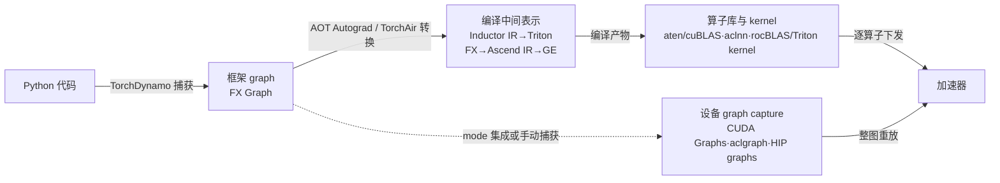

# 算子分发、编译与计算图执行机制

## 范围与阅读方式：四种「图」与一个算子分发层

讨论「图执行」时，至少有四种不同的「图」叠在一起，外加一个算子分发层；它们的产物、缓存与失败形态各不相同，排障和对照实验必须先说明自己站在哪一层：

| 层 | 是什么 | NVIDIA/CUDA（PyTorch 2.6 主样板） | Ascend（TorchNPU 7.2.0 + TorchAir/CANN 8.2.RC1.alpha001） | AMD（ROCm 10.1.0 文档线） |
|---|---|---|---|---|
| 框架 graph | 框架从 Python 代码捕获的计算图 | TorchDynamo 捕获的 FX graph | 同一 Dynamo FX graph（TorchAir 对接 Dynamo） | 同一 Dynamo FX graph（上游声明 Inductor 服务 AMD GPU） |
| 编译中间表示 | 框架图交给编译器后的内部表示与产物 | Inductor IR → Triton kernel（含 cubin） | Ascend IR → GE 图引擎编译（max-autotune 模式） | Inductor → Triton；组件级另有 CK backend for Inductor |
| 设备 graph capture | 设备侧把一串任务录成一张图、整图重放 | CUDA Graphs（stream capture） | aclgraph（经 CANN aclmdlRI 捕获接口；试验特性） | HIP graphs（`hipStreamBeginCapture` 等） |
| 算子库 | 单个算子的实现与调用 | aten 算子族 + cuBLAS/cuDNN 等 | aten 经适配转 aclnn 两段式 + 预编译算子包 | aten 的 HIP 实现 + rocBLAS/MIOpen 等 |

两条总边界：

- **三平台只比较角色槽位，共同名称不代表相同限制。** aclmdlRI 捕获接口全部标注「试验特性，不支持商用」且产品矩阵限部分系列；HIP graphs 与 CUDA Graphs 的捕获约束条目不同（各自小节分列）；Inductor 的算子覆盖与版本配套按平台分别核对——上游 "For NVIDIA, AMD and Intel GPUs…" 是概括声明，不替代逐项能力核对。
- **GPU/NPU 各选一条固定样板，不罗列所有编译器。** GPU 主样板固定为 PyTorch 2.6 文档 + v2.6.0 源码 commit `1eba9b3aa3c43f86f4a2c807ac8e12c4a7767340`（CUDA 语义）；NPU 固定为 TorchNPU 7.2.0 配套 TorchAir（hiascend Pytorch/720 文档树）+ CANN 社区版 8.2.RC1.alpha001；AMD 固定为 ROCm docs-10.1.0（HIP graphs）加上游 PyTorch 证据。所有网页观察日期 2026-10-09。

**算子分发层（eager 基线）**。eager 模式下每个 aten 算子经 PyTorch dispatcher 按输入 tensor 的 dispatch key 路由到设备实现。没有可用实现时，v2.6.0 固定源码给出两种 `NotImplementedError` 形态：无 tensor 参数且缺 fallback 时报 "There were no tensor arguments to this function … no fallback function is registered"；后端不匹配时报 "Could not run '<op>' with arguments from the '<backend>' backend … is only available for these backends"（[OperatorEntry.cpp L537–557 @1eba9b3](https://github.com/pytorch/pytorch/blob/1eba9b3aa3c43f86f4a2c807ac8e12c4a7767340/aten/src/ATen/core/dispatch/OperatorEntry.cpp)）。这是区分「算子层失败」与「图/编译层失败」的证据入口；昇腾侧 PrivateUse1 的分层判定见[昇腾算子不支持与图编译失败诊断指南](ascend-op-graph-failure-triage.md)。算子库的接口形态（aclnn 两段式、cuBLAS/rocBLAS 职责）与进程实载库身份的记录方法，另见[驱动初始化、运行时执行同步与库装载](runtime-execution-and-library-loading.md)。

本文未执行任何编译、图捕获或设备代码；全部结论为固定版本文档与源码核对结果，官方测试反例是源码阅读结论，不是本库的运行记录。

## GPU 主样板：PyTorch 2.6 + CUDA 的 torch.compile 路径

### 组成：Dynamo、AOT Autograd、Inductor

torch.compile 是 JIT 编译栈：TorchDynamo 用 CPython Frame Evaluation API 安全捕获 FX graph；AOT Autograd 提前捕获反向；TorchInductor 是默认后端编译器，"For NVIDIA, AMD and Intel GPUs, it leverages OpenAI Triton as the key building block"；可用后端可由 `torch.compiler.list_backends()` 枚举（[torch.compiler — PyTorch 2.6](https://docs.pytorch.org/docs/2.6/torch.compiler.html)）。末句是上游概括声明：它说明 Inductor 的 GPU 代码生成以 Triton 为构件，不构成任一具体平台算子覆盖或版本配套的逐项证据（ROCm 侧缺口见 AMD 节）。

### Guard、graph break、重编译与 eager 回退

- 编译结果按 code object 缓存；每次调用先执行 guard 运行时检查——文档示例 `TENSOR_MATCH` 检查 type/device/dtype/shape/stride（troubleshooting 页另示 requires_grad）；guard 失败触发重编译（[torch.compile API](https://docs.pytorch.org/docs/2.6/generated/torch.compile.html)、[Troubleshooting Terminology 节](https://docs.pytorch.org/docs/2.6/torch.compiler_troubleshooting.html)）。
- 遇到不可追踪代码发生 graph break：先编译已得到的 FX graph，以 eager 运行不支持的部分，再恢复追踪（同上 Troubleshooting）。
- 重编译上限：超过 `torch._dynamo.config.cache_size_limit`（默认 8）后回落 eager（[torch.compile API](https://docs.pytorch.org/docs/2.6/generated/torch.compile.html)）；固定源码 `torch/_dynamo/config.py` L44 `cache_size_limit = 8`、L47 `accumulated_cache_size_limit = 256`（[@1eba9b3](https://github.com/pytorch/pytorch/blob/1eba9b3aa3c43f86f4a2c807ac8e12c4a7767340/torch/_dynamo/config.py#L44)）。
- 观测手段：`TORCH_LOGS=graph_breaks` / `guards` / `recompiles` / `dynamic`（文档明示 guard 示例输出可能随版本变化）。

### mode 四档与 CUDA graphs 的开启关系（含文档冲突）

mode 取 default / reduce-overhead / max-autotune / max-autotune-no-cudagraphs。reduce-overhead 用 CUDA graphs 降开销，"today, we only reduce overhead for CUDA only graphs which do not mutate inputs"；max-autotune "enables CUDA graphs by default on GPU"（[torch.compile API](https://docs.pytorch.org/docs/2.6/generated/torch.compile.html)）。

一处文档与代码的不一致如实记录：[torch.compile FAQ（2.6）](https://docs.pytorch.org/docs/2.6/torch.compiler_faq.html)称 "CUDA graphs with Triton are enabled by default in inductor"，而 v2.6.0 源码 `torch/_inductor/config.py` L889 `triton.cudagraphs` 默认 False（环境变量 `TORCHINDUCTOR_CUDAGRAPHS` 控制），实际由 mode 开启（[config.py @1eba9b3](https://github.com/pytorch/pytorch/blob/1eba9b3aa3c43f86f4a2c807ac8e12c4a7767340/torch/_inductor/config.py)）。本文按代码默认值书写：**默认关、由 mode 开启**；FAQ 句记为文档表述差异，不作裁决。

### 编译缓存：组成、身份与落盘

- **组成（v2.6.0 固定源码逐项核对）**：FXGraphCache（图级 IR，`torch/_inductor/codecache.py` L937）、AOTAutogradCache（`torch/_functorch/_aot_autograd/autograd_cache.py` L611）、PGO cache（`torch/_dynamo/pgo.py`，`TORCH_DYNAMO_AUTOMATIC_DYNAMIC_LOCAL_PGO` 默认 0）、AutotuneCache（`torch/_inductor/runtime/autotune_cache.py` L64，教程称 AutotuningCache）。教程 `InductorCache`（定义即 FXGraphCache 与 Triton cache 的组合，非同名 Python 类存在性声明）在 2.6 有实现映射：**TritonBundler**（`torch/_inductor/triton_bundler.py` L63——编译期逐个记录 Triton kernel，`collect()` 把已记录 kernel 及其产物转成结构化 blob，读取时 `read_and_emit()` 恢复产物）；cache-miss 分支 `begin_compile()`→`collect()`→`set_triton_bundle()` 后连同 FXGraph 缓存一起保存（`torch/_inductor/compile_fx.py` L679 起），命中读取时经 `graph._triton_bundle` 调 `read_and_emit()`（`codecache.py` L1076）。开关 `bundle_triton_into_fx_graph_cache`（config.py L23–27 定义默认值、L56–58 赋值）：OSS 环境变量未覆盖时默认 **True**；`TritonBundler.is_enabled()`（triton_bundler.py L86）先检查 `force_disable_caches`——实际路径受缓存启用/禁用开关控制，不能把 `is_enabled()` 内的 OSS fallback 分支误读为默认关闭。Triton 相关缓存分三层，不得混写：`TritonCodeCache`（codecache.py L2820，经 `PyCodeCache.load` 加载生成的 Python kernel 模块，**不是** cubin 编译产物缓存）、Triton 编译器自身产物缓存（Triton 仓库 compiler.py，独立命中路径，见下「落盘与开关」）、PyTorch 的产物打包（TritonBundler）。**Mega-Cache（`torch.compiler.save_cache_artifacts()` / `load_cache_artifacts()`）不在 v2.6.0 固定源码中**——`torch/compiler/__init__.py` 无这两个接口——按「较新教程能力（非 2.6）」单独标注，其最低可用版本未取得；教程 "PyTorch 2.4 or later" 的总前提不证明该 API 在 2.6 可用（[Compile Time Caching in torch.compile](https://docs.pytorch.org/tutorials/recipes/torch_compile_caching_tutorial.html)）。
- **身份（官方声明）**："caching validates that the cache artifacts are used with the same PyTorch and Triton version, as well as, same GPU when device is set to be cuda"；FXGraph/AOTAutograd 缓存在遇到 same graph + same Tensor input shapes + same configuration 时跨进程命中（同上教程）。固定源码测试对身份粒度的补充证据（图与 guard 同时变化时的 cache miss；编译配置进入 key；guard 值独立进入 key 未证明）见[官方测试反例](#官方测试反例固定-commit-1eba9b3)。
- **落盘与开关**：`TORCHINDUCTOR_CACHE_DIR`（默认系统临时目录下 `torchinductor_<username>`，如 `/tmp/torchinductor_myusername`）；子目录 `fxgraph/` 与 `aotautograd/`（[Compile Time Caching Configurations](https://docs.pytorch.org/tutorials/recipes/torch_compile_caching_configuration_tutorial.html)）。**`TORCHINDUCTOR_FORCE_DISABLE_CACHES=1` 只禁 Inductor 层缓存**（v2.6.0 [config.py L90–91 @1eba9b3](https://github.com/pytorch/pytorch/blob/1eba9b3aa3c43f86f4a2c807ac8e12c4a7767340/torch/_inductor/config.py#L90-L91) 注释 "Force disabled all inductor level caching"）：它不等于「缓存机制正常开启、但目录为空」的冷启动条件，也不是全栈冷启动证明——显式设置的 `TRITON_CACHE_DIR` 不随 `TORCHINDUCTOR_CACHE_DIR` 更换而变（v2.6.0 [runtime/cache_dir_utils.py @1eba9b3](https://github.com/pytorch/pytorch/blob/1eba9b3aa3c43f86f4a2c807ac8e12c4a7767340/torch/_inductor/runtime/cache_dir_utils.py) 的 `triton_cache_dir` 优先返回显式值，未设时才落在 `TORCHINDUCTOR_CACHE_DIR` 的 `triton/<device>` 子目录），且 Triton 编译器有独立缓存命中路径（Triton 3.2.0 线 commit 35c6c7c6 的 [compiler.py L250 附近](https://github.com/openai/triton/blob/35c6c7c6284582b3f41c71c150e11b517acf074a/python/triton/compiler/compiler.py#L250)，"# cache hit!"）。测量冷缓存启动须**同时处理两个独立维度**：其一，进程内状态（新进程或进程内重置，并说明方式）；其二，测量范围内相关持久化缓存（Inductor/Triton/远程）处于**已说明的冷状态**——记录实际生效的 Inductor/Triton 缓存目录、远程缓存处理方式与清理范围，并保留命中/未命中观测。只重启进程而保留磁盘缓存（FXGraphCache 会按 key 从磁盘/远程读取候选，Triton 编译器也会读取自身缓存元数据直接返回产物）应称「新进程启动」，不能称「冷缓存启动」。两个教程是 latest 可变页（页标 Last Updated 2025-06-24、要求 PyTorch 2.4+），envvar 名与默认值以 2.6 代码复核为准：`fx_graph_cache` OSS 默认开（config.py L45–47）、`force_disable_caches`（L91）、`triton.cudagraphs` 默认 False（L889）、`triton.cudagraph_trees = True`（L892）、`cudagraph_skip_dynamic_graphs = False`（L896）（[config.py @1eba9b3](https://github.com/pytorch/pytorch/blob/1eba9b3aa3c43f86f4a2c807ac8e12c4a7767340/torch/_inductor/config.py)）。

### 动态形状

默认按静态形状特化；因 size 变化重编译时自动尝试按更动态的形状重编译（automatic dynamic）；`torch._dynamo.mark_dynamic` 可显式标注（可带 min/max）；`dynamic=False` 时每个不同 size 都重编译；不支持 dynamic rank；数据依赖的 unbacked SymInt（`.item()`/`.nonzero()` 等）上做控制流必须 graph break；`TORCH_LOGS=dynamic` 查 "eval" 条目定位过度特化（[Dynamic shapes — PyTorch 2.6](https://docs.pytorch.org/docs/2.6/torch.compiler_dynamic_shapes.html)）。该页外链的 "The dynamic shapes manual" 是不可固定的 Google Doc，本库未采用。

### warmup 与稳态

torch.compile 是 JIT，"the initial one or two runs of the compiled function are expected to be significantly slower"；冷启动（未命中缓存）常见模型数秒到数分钟、大模型 30 分钟到数小时；缓存可跨进程复用；生产环境可用 `dynamo.run` 冻结模式禁止新编译（[Troubleshooting "Setting Expectations"](https://docs.pytorch.org/docs/2.6/torch.compiler_troubleshooting.html)、[FAQ](https://docs.pytorch.org/docs/2.6/torch.compiler_faq.html)）。官方未给统一 warmup 迭代数公式，按负载实测。

### 设备图捕获（一）：CUDA Graphs 手动路径

stream capture 语义：捕获期间工作不实际执行、录制进图；replay 每次跑相同 kernel、相同参数、相同内存地址（[CUDA semantics — PyTorch 2.6，CUDA Graphs 节](https://docs.pytorch.org/docs/2.6/notes/cuda.html)）。Constraints 按原文分两档后果，不可合并；两档原文措辞均为 "likely"（多半），既不是必然报错，也不是必然无报错：

- **违反多半 runtime error**：capture 须在非默认流；捕获中禁止 `.item()` 等 CPU↔GPU 同步；多 generator 须先 `CUDAGraph.register_generator_state` 注册并使用 graphsafe API。
- **违反多半静默数值错误或未定义行为**：同进程同时只能一个 capture（"only one capture may be underway at a time"）；capture 期间进程内任何线程不得运行非捕获 CUDA 工作（non-captured CUDA work）；CPU 工作不被捕获（replay 时被省略）；每次 replay 读写相同虚拟地址；禁止动态控制流与动态形状——"The graph assumes every tensor in the captured op sequence has the same size and layout in every replay"；多流捕获允许但另有限制。

其余约束：捕获前须先跑若干 eager 迭代 warmup，且 **warmup 必须在 side stream 上**；输入/输出 tensor 须保持长存活引用，换数据靠 `copy_` 写进静态输入（同上）。

`torch.cuda.CUDAGraph`（beta API）：`capture_begin(pool, capture_error_mode)`，capture_error_mode 取 global/thread_local/relaxed，对应 cudaStreamCaptureMode——"During cuda graph capture, some actions, such as cudaMalloc, may be unsafe"；`replay()` 重放；`pool()` 共享内存池 token（[torch.cuda.CUDAGraph — PyTorch 2.6](https://docs.pytorch.org/docs/2.6/generated/torch.cuda.CUDAGraph.html)）。

### 设备图捕获（二）：CUDAGraph Trees（mode="reduce-overhead" 集成路径）

三次调用语义：第一次运行 warmup（含 cuBLAS/Triton benchmark），第二次录制，第三次起 replay；eager 输入拷贝到静态地址；参数/buffer 假定地址不变并做运行时检查。动态形状下每组唯一 shape 重录一张图；`triton.cudagraph_trees` 默认 True、`triton.cudagraph_skip_dynamic_graphs` 默认 False（置 True 可跳过动态图）（[CUDAGraph Trees — PyTorch 2.6](https://docs.pytorch.org/docs/2.6/torch.compiler_cudagraph_trees.html)、[config.py @1eba9b3 L892/L896](https://github.com/pytorch/pytorch/blob/1eba9b3aa3c43f86f4a2c807ac8e12c4a7767340/torch/_inductor/config.py)）。

跳过 CUDAGraph 的原因清单：eager 输入被原地改写、含 CPU 算子、多设备算子、free unbacked symbols、不兼容算子（`aten.multinomial.default`、`aten._local_scalar_dense`、`run_and_save_rng_state` 等，确定性模式下更多）（同上文档）。

Limitations：前次调用的输出 tensor 会被后续调用覆盖，访问报 `RuntimeError: Error: accessing tensor output of CUDAGraphs that has been overwritten by a subsequent run.`（同上文档；与官方测试互证见[反例一](#反例一图输出生命周期test_error_on_dealloc_use)）。页内另注 NVIDIA 每 kernel launch 64KB 设备内存直至 CUDA 12.4/Driver 550+，属平台实现细节。

## NPU 路径：TorchNPU 7.2.0 / TorchAir 与 CANN 8.2.RC1.alpha001

### TorchAir 定位、使能形态与两种模式

TorchAir（Torch Ascend Intermediate Representation）是 torch_npu 的图模式能力扩展库，提供昇腾设备亲和的 torch.compile 图模式后端；**当前版本为 beta 特性，主要关注推理场景**；使用约束：每进程只用 1 张 NPU 卡；aclgraph 仅 Atlas A2 训练系列 / Atlas 800I A2 推理 / A200I A2 Box 与 Atlas A3 系列支持（[PyTorch图模式使用(TorchAir) 简介（Pytorch/720，torchair_00001）](https://www.hiascend.com/document/detail/zh/Pytorch/720/modthirdparty/torchairuseguide/torchair_00001.html)）。

使能形态（[快速上手 torchair_00005](https://www.hiascend.com/document/detail/zh/Pytorch/720/modthirdparty/torchairuseguide/torchair_00005.html)，页面自述示例仅供参考、不支持直接拷贝运行）：`import torch_npu, torchair`（先 torch_npu 后 torchair）→ `config = torchair.CompilerConfig()`（默认 max-autotune，可改 reduce-overhead）→ `npu_backend = torchair.get_npu_backend(compiler_config=config)` → `torch.compile(model, backend=npu_backend)`；使能前须先在单算子模式正确执行。

两种工作模式（config.mode 切换）：

- **reduce-overhead**：aclgraph（Capture&Replay），经 CANN Runtime `aclmdlRICaptureXxx` 系列接口实现；
- **max-autotune**：FX 图 → Ascend IR 计算图 → GE 图引擎编译执行。

CANN 侧总览与之对应：GE 图引擎提供计算图优化、多流并行、内存复用、模型下沉等手段；TorchAir 对接 PyTorch Dynamo，将 FX 图转换为 Ascend IR，经 GE 编译优化下发昇腾硬件（《[CANN社区版 8.2.RC1.alpha001 图模式使用介绍](https://www.hiascend.com/doc_center/source/zh/CANNCommunityEdition/82RC1alpha001/graph/graphguide/CANN社区版%208.2.RC1.alpha001%20图模式使用介绍%2001.pdf)》，文档版本 01，2025-05-15；版权页声明不得擅自摘抄复制，本库只链接并原创归纳）。

### aclgraph 的运行时机制与限制

运行时接口（aclmdlRI，AscendCL）：`aclmdlRICaptureBegin/End` 之间 Stream 任务不立即执行、暂存于内部模型运行实例，`aclmdlRIExecuteAsync` 才真正执行（异步接口，返回成功仅代表下发成功）；`aclmdlRIDestroy` 销毁；Begin/End 成对且同 Stream；capture mode 枚举 GLOBAL=0（全线程禁非安全函数）/THREAD_LOCAL/RELAXED；非安全函数含 aclrtMemset/aclrtMemcpy/aclrtMemcpy2d；任务更新走 `aclmdlRICaptureTaskGrpBegin/End` + `aclmdlRICaptureTaskUpdateBegin/End`；捕获持续消耗 Stream 资源（受 `aclrtCreateStream` 上限约束）（[aclmdlRICaptureBegin（aclcppdevg_03_1782）](https://www.hiascend.com/document/detail/zh/CANNCommunityEdition/82RC1alpha001/API/appdevgapi/aclcppdevg_03_1782.html) 页组）。**该页组全部接口标注「试验特性，不支持商用」；产品支持矩阵仅 Atlas A2 训练系列 / 800I A2 推理 / A200I A2 Box 为 √，Atlas 推理系列 / 训练系列 / 200&300&500 / 200I&500 A2 均为 ×。**

捕获约束（指南章节）：进入捕获前 Stream 任务仍立即执行；捕获中对默认 Stream 操作非法；任务使用的 Device 内存必须保持不变直至模型销毁；GLOBAL 模式下调内存同步类函数非法、校验报错导致捕获失败（可用 `aclmdlRICaptureThreadExchangeMode` 切 RELAXED 解除）；**捕获中对 Stream/Event/Device/Context 的查询或同步在任何捕获模式下均非法**（[基于捕获方式构建模型运行实例（aclcppdevg_000519）](https://www.hiascend.com/document/detail/zh/CANNCommunityEdition/82RC1alpha001/appdevg/aclcppdevg/aclcppdevg_000519.html)）。这份约束清单与 CUDA Graphs「角色相当、条目不同」，对照时分列、不合并。

TorchAir 侧限制（[reduce-overhead模式配置 torchair_00015](https://www.hiascend.com/document/detail/zh/Pytorch/720/modthirdparty/torchairuseguide/torchair_00015.html)）：官方类比声明「与 torch.cuda.CUDAGraph 原生接口…功能类似，约束与其保持一致（如不支持 stream sync、动态控制流等）」——这只是厂商一句类比，精确差异（试验特性、产品矩阵、任何模式下查询非法等）以 CANN 页为准；该页另声明 reduce-overhead 面向在线推理、暂不支持反向流程 capture 成图、暂不支持随机数算子 capture、不与 max-autotune 同开。

动态 shape 与输出覆盖（[aclgraph间内存复用功能 torchair_00019](https://www.hiascend.com/document/detail/zh/Pytorch/720/modthirdparty/torchairuseguide/torchair_00019.html)）："由于 aclgraph 本身不支持动态 shape，因此执行过程中可能会存在多张 aclgraph"——dynamic=False 时每种 shape 对应一张 FX graph 加一张 aclgraph；dynamic=True 时一张 FX graph、不同 shape 对应不同 aclgraph；多图内存复用两种模式（use_custom_pool / 默认开启的同 FX graph 内复用，可 disable_mempool_reuse_in_same_fx 关闭）。**输出覆盖**：aclgraph 基于固定内存地址执行，前次执行的输出 Tensor 内存会被后续执行覆盖，"如需将输出结果长时间保存和使用，可能会引入精度问题"，可用 Clone 接口（enable_output_clone）——注意与 PyTorch CUDAGraph Trees 的显式 RuntimeError 不同，TorchAir 此页描述为精度风险提示 + Clone 缓解，未声称报错。

权重/输入地址固定（reduce-overhead，[固定权重类输入地址功能 torchair_00021](https://www.hiascend.com/document/detail/zh/Pytorch/720/modthirdparty/torchairuseguide/torchair_00021.html)）：Parameter 类型图输入内存地址通常不变，可开 `config.experimental_config.frozen_parameter=True` 缩短下发；PyTorch v2.6.0+ 可用 `torch._dynamo.mark_static_address` 标记（如 kv_cache）；to 算子会丢 Parameter 类型，需先转 NPU Tensor。

补充接口族：TorchNPU 固定快照（[bc51ab84](https://github.com/Ascend/pytorch/tree/bc51ab84cc6f35c77aab1c59886e0ea43681a317)）在 torch_npu Python 层另导出手动图捕获接口族——`torch_npu/npu/graphs.py` 的 `__all__` 含 `NPUGraph`、`graph`、`make_graphed_callables`、`graph_pool_handle`、`is_current_stream_capturing`、`graph_task_group_begin/end`、`graph_task_update_begin/end`，形态对齐 torch.cuda.graphs；C++ 侧 NPUGraph.cpp 调用 `AclmdlRICaptureBegin/End/GetInfo/ExecuteAsync/Destroy` 与 TaskGrp/TaskUpdate 系列对接 CANN。其启用条件与 CANN 版本配套以官方文档为准（既有未知项，见文末）。

### CANN 算子编译流程与算子编译缓存

完整 CANN 算子 = 原型定义 + 框架适配插件 + 算子信息库 + 算子实现。执行链（[算子编译运行流程 atlasopdev_10_0012](https://www.hiascend.com/document/detail/zh/CANNCommunityEdition/82RC1alpha001/opdevg/tbeaicpudevg/atlasopdev_10_0012.html)）：GE 调原型库校验参数并按推导函数推导各节点输出 shape/dtype、分配输出 tensor 静态内存；FE 做融合规则匹配与算子选择（默认自定义算子优先级最高；同 OpType 的 TBE 与 AI CPU 算子并存时 GE 优先匹配 TBE）；TBE 算子预编译为算子 kernel（*.o 与 *.json）；GE 图编译含内存分配与流资源分配后生成模型；运行时经 Runtime → Task Schedule 调度在 AI Core 执行。

算子编译缓存：`${ASCEND_CACHE_PATH}/kernel_cache` 为算子编译缓存文件、支持单机多卡共享；优先级链：ATC `--op_compiler_cache_dir` / aclgrphBuildInitialize 与 aclgrphBuildModel 的 `OP_COMPILER_CACHE_DIR` / aclCompileOpt 的 `ACL_OP_COMPILER_CACHE_DIR` > `ASCEND_CACHE_PATH` > 默认 `$HOME/atc_data`；多服务器共享要求各机 AI 处理器型号、固件驱动与 CANN 软件版本一致（缓存身份入 key 的具体字段该页未展开）（[ASCEND_CACHE_PATH（envref_07_0006）](https://www.hiascend.com/document/detail/zh/CANNCommunityEdition/82RC1alpha001/maintenref/envvar/envref_07_0006.html)）。容量管理：`ASCEND_MAX_OP_CACHE_SIZE` 默认 500MB、超限且半小时未访问则老化删除、-1 关闭老化；op_cache.ini > 环境变量 > 默认值；PyTorch 框架场景用环境变量 `ACL_OP_COMPILER_CACHE_DIR` 指定缓存目录（[envref_07_0021](https://www.hiascend.com/document/detail/zh/CANNCommunityEdition/82RC1alpha001/maintenref/envvar/envref_07_0021.html)）。

### TorchAir 编译缓存（cache_compile）

两个模式缓存的阶段不同，不得混写（[max-autotune 版 torchair_00024](https://www.hiascend.com/document/detail/zh/Pytorch/720/modthirdparty/torchairuseguide/torchair_00024.html)、[reduce-overhead 版 torchair_00017](https://www.hiascend.com/document/detail/zh/Pytorch/720/modthirdparty/torchairuseguide/torchair_00017.html)）：

- **max-autotune**：成图耗时分 Dynamo 编译与 FX 图再处理两段；`torchair.inference.cache_compile` 落盘缓存（默认 `.torchair_cache/${model_info}/${func}`，多机含 world_size/global_rank）；ge_cache 另缓存 Ascend IR 编译产物（`graph_${key}_${timestamp}.om/.idx/.rdcpkt`）。
- **reduce-overhead**：执行五阶段 Dynamo / Guards / aclgraph Capture / Input 处理 / Replay，**只缓存 Dynamo 环节**（"通过缓存Dynamo这个耗时占比最大环节"）。

共同约束：仅对应模式可用（reduce-overhead 版另限 Atlas A2/A3 产品）；含 RNG 算子不支持；"缓存要与执行计算图一一对应，若重编译则缓存失效"；**Guards 阶段被跳过**、要求生成与加载脚本一致——即缓存命中不做输入假设校验，比 Inductor 缓存更依赖使用者自行保证一致性；"CANN 包跨版本缓存无法保证兼容性，如果版本升级，需要清理缓存目录并重新编译"；func 只能触发一次 Dynamo trace、必须是未被装饰的 method、必须整图（full graph）。

### 动态形状分档与 eager 对照（run_eagerly）

max-autotune 动态分档（[动态shape图分档执行功能 torchair_00029](https://www.hiascend.com/document/detail/zh/Pytorch/720/modthirdparty/torchairuseguide/torchair_00029.html)）：dynamic=False 静态图遇新 shape 再次触发编译；dynamic=True 动态图支持任意 shape 但无法一次下发、性能较差；`set_dim_gears` 把枚举档位转成静态子图一次下发（要求与 dynamic=True 搭配；分档 tensor 不能传 FRACTAL_NZ 等私有格式）。

eager 对照（[run-eagerly功能 torchair_00013](https://www.hiascend.com/document/detail/zh/Pytorch/720/modthirdparty/torchairuseguide/torchair_00013.html)）：`config.debug.run_eagerly = True` 在图模式执行之前以 Eager 模式执行 FX graph，用于定界「TorchAir 图变换 vs 图执行器」；max-autotune 下所有功能不能与其同开，reduce-overhead 下仅 FX Pass 可同开。**它对照的是 FX graph 级 eager，不等于原生逐算子 eager**，与 GPU 侧消融链层级不同，不可互换表述。

入图算子覆盖（[支持的ATen API清单 torchair_00045](https://www.hiascend.com/document/detail/zh/Pytorch/720/modthirdparty/torchairuseguide/torchair_00045.html)）：清单给出可入图 ATen API 及逐条 dtype 约束（如 torch.addmm 支持 fp16/fp32、torch._softmax 支持 fp32）；不在表内的 API 需 Converter 适配补齐；清单随版本变化，引用绑定 720 树。

## AMD 路径：HIP graphs 与 ROCm 10.1.0 上的 torch.compile 证据

### HIP graphs 机制与捕获约束

HIP graphs 的图 = 节点（kernel launch / host 函数 / 内存拷贝与 memset / 事件 / 信号量 / 嵌套图）+ 依赖边；`hipStreamBeginCapture`/`hipStreamEndCapture` 流捕获或显式构图；`hipGraphInstantiate` 实例化后 `hipGraphLaunch` 单次调用提交整图；launch 流可与捕获流不同。开销提示：图有建立/实例化开销，"graphs only provide a benefit for workloads that require many iterations"。图内存池：`hipDeviceGetGraphMemAttribute` / `hipDeviceGraphMemTrim`（[HIP graphs — HIP docs-10.1.0](https://rocm.docs.amd.com/projects/HIP/en/docs-10.1.0/how-to/hip_runtime_api/hipgraph.html)）。

**捕获约束**：捕获期间隐式落在默认流上的同步 HIP 调用不被允许且会返回错误，含 `hipMalloc`/`hipMemcpy`/`hipFree`，须改用 `hipMallocAsync`/`hipMemcpyAsync`/`hipFreeAsync`（同上）。这份约束与 CUDA Graphs 的两档后果表述「角色相当、条目不同」，分列引用、不互推。

版本标注：该页属 docs-10.1.0 但页标 "HIP 7.16.0"，与 release notes 组件表（HIP 10.1.0）不一致——沿用 [AMD ROCm 软件栈的文档配套档案](amd-rocm-documented-profile.md)记录的站标版本冲突，引用时分列口径。

### torch.compile 在 ROCm 上的证据边界

- **上游声明**：PyTorch 2.6 torch.compiler 页 "For NVIDIA, AMD and Intel GPUs, it leverages OpenAI Triton as the key building block"（[torch.compiler — PyTorch 2.6](https://docs.pytorch.org/docs/2.6/torch.compiler.html)）。但 ROCm 10.1.0 的框架配套是 PyTorch 2.14（见 [AMD ROCm 文档配套档案](amd-rocm-documented-profile.md)），与 2.6 主样板分属不同版本线，引用须分行。
- **文档线缺口**：docs-10.1.0 无 pytorch-compatibility 页（同相对路径 404 实测，2026-10-09 返回 "404 - Page Not Found — AMD ROCm 10.1.0"）；ROCm 10.1.0 文档体系内未找到 torch.compile/Inductor 专项说明页（ai-ecosystem 安装页全文检索无相关字样）。torch.compile 的逐项限制（Inductor 算子覆盖、pytorch-triton-rocm 版本配套）保留 unknown。
- **旁证（不同版本线，仅作对照）**：docs-7.2.3 兼容页称 "Core PyTorch functionality on ROCm includes tensor operations, …, compilation features"，并载 PyTorch 2.7/2.8 + ROCm 7.0/7.1 已知问题（如 `matmul.allow_fp16_reduced_precision_reduction` / `allow_bf16_reduced_precision_reduction` 在 torch.backends.cuda 下不支持）（[PyTorch compatibility — docs-7.2.3](https://rocm.docs.amd.com/en/docs-7.2.3/compatibility/ml-compatibility/pytorch-compatibility.html)）——不能当作 10.1.0 口径引用。
- **组件级关联**：ROCm Core SDK 10.1.0 release notes Composable Kernel 节含 "gfx1250 WMMA instance support to the CK backend for PyTorch Inductor, covering universal GEMM, batched GEMM, and grouped convolution forward" 与 ck4inductor 实例枚举器去重/确定序条目；另载 AOTriton 0.13b 在 MI350X 上 flash-attention backward kernel 选择回归已解决（issue #7696）（[ROCm Core SDK 10.1.0 release notes](https://rocm.docs.amd.com/en/docs-10.1.0/about/release-notes.html)）。这证明 CK/Triton 后端在 Inductor 路径中被使用与维护，不证明具体模型覆盖。
- **上游 issue 存在性证据**：pytorch/pytorch#137414 "[ROCm] [Inductor] Nightly torch.compile assert_size_stride AssertionError: wrong number of dimensions"，labels module: rocm / module: inductor / oncall: pt2；2024-10-06 创建、2024-10-21 closed（state_reason: completed）；报告环境 pytorch-triton-rocm 3.1.0+cf34004b8a + torch 2.6.0.dev20241006+rocm6.2（[issue #137414](https://github.com/pytorch/pytorch/issues/137414)）。issue 关闭不自动证明修复验证；修复落点未核对，只作「ROCm Inductor 曾有此类失败」的存在性证据。
- **torch.cuda.CUDAGraph 对 ROCm 的适用性无直接官方声明**：v2.6.0 `torch/cuda/graphs.py` 全文无 ROCm/HIP 字样；上游测试 test_cudagraph_trees.py 仅两处 `@skipIfRocm`（L1072–1073 test_checkpointing_resets_persistent_refs、L1374–1377 test_workspace_allocation_error），test_error_on_dealloc_use 等其余测试无 ROCm 排除标记（[test_cudagraph_trees.py @1eba9b3](https://github.com/pytorch/pytorch/blob/1eba9b3aa3c43f86f4a2c807ac8e12c4a7767340/test/inductor/test_cudagraph_trees.py)）——无 skip 标记不等于上游 CI 实际在 ROCm 跑该文件（CI 配置未取证）。不能从 CUDA 文档直接宣称 HIP 适用。

## 对照方法：缓存身份、warmup/稳态、动态形状与 eager 对照

以下方法均由上节来源支撑，是实验设计口径，本库未执行。

**编译缓存身份**。GPU 主样板的官方口径是「同 PyTorch + 同 Triton 版本 + 同 GPU + 同图 + 同输入形状 + 同配置」；固定测试补充两点粒度证据：图与 guard 同时变化（val 改变分支 sin→cos，FX 图本身变化）时 cache miss 且不误复用此前产物（[反例二](#反例二图与-guard-同时变化的-cache-misstest_cache_guard)——该测试不能隔离证明 guard 值独立进入缓存 key，此独立证据未取得）；`max_autotune` 配置变化产生不同缓存项（test_hash_config_changes）。NPU 侧：TorchAir cache_compile 跳过 Guards、要求生成与加载脚本一致，CANN 跨版本不保证兼容、升级须清缓存；CANN 算子编译缓存只给共享前提（同 AI 处理器型号、固件驱动、CANN 版本），入 key 字段未展开。操作含义：跨机器/跨版本搬运缓存前逐项核对身份要素；冷/热对照用固定的 `TORCHINDUCTOR_CACHE_DIR` 位置，冷缓存测量须同时处理两个独立维度——进程内状态（新进程或进程内重置，并说明方式）与测量范围内相关持久化缓存（Inductor/Triton/远程）的已说明冷状态（记录实际目录、远程缓存处理方式与清理范围，保留命中/未命中观测）；只重启进程而保留磁盘缓存是「新进程启动」，不是「冷缓存启动」——`TORCHINDUCTOR_FORCE_DISABLE_CACHES=1` 只禁 Inductor 层缓存，不是「缓存开启但为空」的冷启动，也不是全栈冷启动证明（见上文「落盘与开关」）。

**warmup/稳态**。GPU 侧：编译前一两次调用显著更慢；CUDA Graphs 捕获前须 side-stream warmup；CUDAGraph Trees 是三次调用语义（warmup → 录制 → replay）。NPU 侧：720 文档树无独立 warmup 章节（缺口），CUDA 的 side-stream warmup 不能外推到 aclgraph。性能报告至少区分 warmup 段与稳态段，冷/热缓存分开记录。

**动态形状 vs 静态**。GPU 侧 `dynamic=None`（默认，自动动态）/`True`/`False` 与 `mark_dynamic`；设备图捕获层普遍不支持动态 shape（CUDA "same size and layout in every replay"；aclgraph "本身不支持动态 shape"）；NPU 侧另有 `set_dim_gears` 分档。动态形状负载启用图捕获前先固定 shape 桶或分档，并预期存在多张设备图（aclgraph 多图、CUDAGraph Trees 每组唯一 shape 一图）。

**eager 对照（基线一致性）**。基线输入、权重与 dtype 必须一致，并分别验证三件事：

1. **结果**：编译输出与 eager 输出做数值比对——FAQ 明示下游编译器数值可与 eager 有细微差异（[FAQ "Why am I getting incorrect results?"](https://docs.pytorch.org/docs/2.6/torch.compiler_faq.html)），按容差比对而非要求逐位相等；
2. **性能**：warmup 后取稳态计时，冷/热缓存分开报告；
3. **回退后的行为**：GPU 侧超过 cache_size_limit（8）回落 eager 并告警，回退后的正确性与性能都要复核；NPU 侧推理栈文档的 enforce_eager 建议见于 vLLM-Ascend 取证（第十一批记录，训练侧不可外推）。

消融方法：GPU 官方消融链 `backend="eager"` → `"aot_eager"` → `"aot_eager_decomp_partition"` → `"inductor"`，再叠加 mode default/reduce-overhead/max-autotune 与 dynamic=True/False/None 变体；正确性调试用 `TORCHDYNAMO_REPRO_AFTER="aot"` `TORCHDYNAMO_REPRO_LEVEL=4`（[Troubleshooting Reporting Issues > Ablation](https://docs.pytorch.org/docs/2.6/torch.compiler_troubleshooting.html)）。NPU 侧对应 `run_eagerly`（FX graph 级）。两者层级不同、不可互换表述；消融只定界故障组件，不证明编译结果数值等价。权重/地址一致性：GPU CUDAGraph Trees 对参数/buffer 假定地址不变并做运行时检查；NPU 侧 `frozen_parameter` / `mark_static_address` 显式固定权重类输入地址。

## 官方测试反例（固定 commit 1eba9b3）

### 反例一：图输出生命周期（test_error_on_dealloc_use）

[test/inductor/test_cudagraph_trees.py L1664–1679 @1eba9b3](https://github.com/pytorch/pytorch/blob/1eba9b3aa3c43f86f4a2c807ac8e12c4a7767340/test/inductor/test_cudagraph_trees.py#L1664-L1700)：`@torch.compile()` 装饰的函数连调两次后，对第一次的输出做 `out + out`，断言抛出匹配 "overwritten by a subsequent" 的异常；再次调用编译函数后，第二次的输出同样失效。同文件 `test_error_on_dealloc_use2`（L1681–1700）用 FileCheck 校验报错文本含 "overwritten" 与算子表达式。

与文档互证：CUDAGraph Trees 文档 Limitations 节声明前次输出会被后续运行覆盖；该测试证明访问被覆盖输出得到的是**明确 RuntimeError**（"Error: accessing tensor output of CUDAGraphs that has been overwritten by a subsequent run."），而非静默数值错误。测试在 GPU 可用环境运行（上游），本库未执行。

### 反例二：图与 guard 同时变化的 cache miss（test_cache_guard）

[test/inductor/test_codecache.py L779–799 @1eba9b3](https://github.com/pytorch/pytorch/blob/1eba9b3aa3c43f86f4a2c807ac8e12c4a7767340/test/inductor/test_codecache.py#L779-L799)（`@config.patch({"fx_graph_cache": True})`）：函数 `f(x, val)` 中 `val>5` 走 sin、否则 cos；先以 val=6 编译执行（计数 fxgraph_cache_miss=1、hit=0），`self.reset()` 清 dynamo 与代码缓存后以 val=4 再编译执行——**仍 miss=1、hit=0，且 `assertNotEqual(a, b)`**。注意 val=6→4 同时把执行分支从 sin 改为 cos，**FX 图本身随之变化**：该测试证明的是「图变化（伴随 guard 值变化）时不错误复用此前产物」；它**不能隔离证明 guard 值独立进入缓存 key**，也不能推出「所有不同 guard 取值都不互相命中」——实现上 `FxGraphCache._lookup_graph`（[codecache.py L1000 起 @1eba9b3](https://github.com/pytorch/pytorch/blob/1eba9b3aa3c43f86f4a2c807ac8e12c4a7767340/torch/_inductor/codecache.py#L1000)）先按 key 取候选、再对候选求值 guard 表达式判定命中，不能简化为「guard 值不同即不同 key」。「guard 值独立进入缓存 key」的隔离证据未取得，另行标注。

佐证反例：`test_cache_with_symint_non_arg_guard`（[L757–777](https://github.com/pytorch/pytorch/blob/1eba9b3aa3c43f86f4a2c807ac8e12c4a7767340/test/inductor/test_codecache.py#L757-L777)）相同输入跨 reset 二次执行 `fxgraph_cache_hit == 1`，证明命中条件的一致性；`test_hash_config_changes`（[L1047–1068](https://github.com/pytorch/pytorch/blob/1eba9b3aa3c43f86f4a2c807ac8e12c4a7767340/test/inductor/test_codecache.py#L1047-L1068)）max_autotune False 与 True 下 FxGraphHashDetails 序列化结果 `assertNotEqual`，证明编译配置进入 FX graph 缓存 key（仅证明入 key，不列举全部字段）。

## 与排障指南的分工

本文只讲机制与对照方法，不展开具体故障的分层判定。昇腾侧（算子不支持、GE/ACL 错误码、NPU 算子回退 CPU、torch.compile/aclgraph/NPU Graph 启用失败）见[昇腾算子不支持与图编译失败诊断指南](ascend-op-graph-failure-triage.md)。GPU 侧姐妹篇[GPU 算子、编译和图执行失败的定向诊断](gpu-op-graph-failure-triage.md)（NVIDIA/AMD 两平台的失败分支取证、诊断工具观测与 pytorch#188355 来源案例）。dispatcher 两种报错形态原文与昇腾 PrivateUse1 判定在上述指南展开；运行时初始化、stream/event 同步与进程实载库身份见[驱动初始化、运行时执行同步与库装载](runtime-execution-and-library-loading.md)；分层归属总览见[主机到模型执行的软件栈分层](layers-and-boundaries.md)。

## 适用边界

- **版本绑定**：GPU 主样板为 PyTorch 2.6 文档 + v2.6.0 源码 commit `1eba9b3`；NPU 为 TorchNPU 7.2.0 + TorchAir（Pytorch/720 文档树，页面 ID 如 torchair_00001 随版本变化）+ CANN 社区版 8.2.RC1.alpha001（URL 路径段 `/82RC1alpha001/`）；AMD 为 ROCm docs-10.1.0（HIP 页站标 7.16.0 冲突照录）与 docs-7.2.3 旁证。两个 Inductor caching 教程是 latest 可变页（2026-10-09 观察），与 2.6 固定文档冲突时以固定版本为准。
- **beta 与试验特性**：`torch.cuda.CUDAGraph` 为 beta API；TorchAir 整体 beta、以推理为主；aclmdlRI 接口组全部「试验特性，不支持商用」且产品矩阵限 A2/A3 系列部分产品；TorchAir 编译缓存、FX Pass、动态分档等功能页各自标注试验特性。本文不把它们写成正式商用或全产品通用能力。
- **上游概括声明的证据层级**："For NVIDIA, AMD and Intel GPUs…" 说明 Inductor 用 Triton 生成 GPU 代码，不构成逐平台算子覆盖、数值一致性或版本配套的证据；ROCm 侧逐项限制保留 unknown。
- **反例的层级**：两个官方测试反例是固定 commit 源码阅读结论，本库未运行；"测试无 ROCm 排除标记" 也不等于上游 CI 在 ROCm 实跑。
- `generic` 只表示观察框架跨平台，不表示任一接口在所有平台可用或等价；环境未知不能视为兼容。

## 常见误解

- **「三平台都有 graph，约束应该差不多」**：角色槽位可比，条目不可比——aclmdlRI 是试验特性且任何捕获模式下查询/同步非法；HIP 捕获中默认流同步调用（含 hipMalloc/hipMemcpy/hipFree）直接报错；CUDA 把约束分为「多半 runtime error」与「多半静默数值错误」两档。共同名称不代表相同限制。
- **「torch.compile 一定更快」**：前一两次调用显著更慢；graph break、guard 失败重编译、超 cache_size_limit（8）回落 eager 都可能把收益吃掉；性能结论必须附 warmup/稳态与回退行为说明。
- **「缓存命中 = 结果一致」**：test_cache_guard 观察到图与 guard 同时变化时不互相命中、不误复用（设计行为而非缓存缺陷；不能由此推「guard 值不同即不同 key」）；FAQ 明示编译数值可与 eager 有细微差异；TorchAir cache_compile 跳过 Guards，命中不校验输入假设，一致性靠使用者保证。
- **「图捕获的输出 tensor 可以长期持有」**：CUDAGraph Trees 前次输出被后续运行覆盖、访问报 RuntimeError；aclgraph 同样基于固定地址覆盖输出，但 TorchAir 表述为精度风险 + Clone 缓解，未声称报错。两平台都不能直接长期保存输出。
- **「CUDA Graphs 的文档可以直接套到 ROCm」**：torch.cuda.CUDAGraph 对 ROCm 的适用性无直接官方声明（graphs.py 无 HIP 字样），AMD 侧只能依据 HIP graphs 文档。
- **「aclgraph 约束与 CUDA Graphs 一致」**：这是 TorchAir 页的厂商类比句；精确差异（试验特性、产品矩阵、任务更新接口、任何模式查询非法）以 CANN aclmdlRI 页为准。
- **「run_eagerly 等于 GPU 侧的 backend="eager" 消融」**：层级不同——前者是 FX graph 级 eager（定界 TorchAir 图变换 vs 图执行器），后者是 Dynamo/AOTAutograd/Inductor 组件消融链；不可互换表述。

## 来源与待确认问题

- PyTorch 2.6（固定版本文档 + v2.6.0 源码 commit 1eba9b3）：[torch.compiler 概览](https://docs.pytorch.org/docs/2.6/torch.compiler.html)、[torch.compile API](https://docs.pytorch.org/docs/2.6/generated/torch.compile.html)、[Troubleshooting](https://docs.pytorch.org/docs/2.6/torch.compiler_troubleshooting.html)、[FAQ](https://docs.pytorch.org/docs/2.6/torch.compiler_faq.html)、[Dynamic shapes](https://docs.pytorch.org/docs/2.6/torch.compiler_dynamic_shapes.html)、[CUDA semantics（CUDA Graphs 节）](https://docs.pytorch.org/docs/2.6/notes/cuda.html)、[torch.cuda.CUDAGraph](https://docs.pytorch.org/docs/2.6/generated/torch.cuda.CUDAGraph.html)、[CUDAGraph Trees](https://docs.pytorch.org/docs/2.6/torch.compiler_cudagraph_trees.html)、[Compile Time Caching](https://docs.pytorch.org/tutorials/recipes/torch_compile_caching_tutorial.html)（latest，2026-10-09 观察）、[Caching Configurations](https://docs.pytorch.org/tutorials/recipes/torch_compile_caching_configuration_tutorial.html)（latest，同上）、[_dynamo/config.py](https://github.com/pytorch/pytorch/blob/1eba9b3aa3c43f86f4a2c807ac8e12c4a7767340/torch/_dynamo/config.py)、[_inductor/config.py](https://github.com/pytorch/pytorch/blob/1eba9b3aa3c43f86f4a2c807ac8e12c4a7767340/torch/_inductor/config.py)、[OperatorEntry.cpp](https://github.com/pytorch/pytorch/blob/1eba9b3aa3c43f86f4a2c807ac8e12c4a7767340/aten/src/ATen/core/dispatch/OperatorEntry.cpp)、[test_codecache.py](https://github.com/pytorch/pytorch/blob/1eba9b3aa3c43f86f4a2c807ac8e12c4a7767340/test/inductor/test_codecache.py)、[test_cudagraph_trees.py](https://github.com/pytorch/pytorch/blob/1eba9b3aa3c43f86f4a2c807ac8e12c4a7767340/test/inductor/test_cudagraph_trees.py)。
- Ascend（TorchAir 720 树 + CANN 8.2.RC1.alpha001，2026-10-09 观察）：[TorchAir 简介](https://www.hiascend.com/document/detail/zh/Pytorch/720/modthirdparty/torchairuseguide/torchair_00001.html)、[快速上手](https://www.hiascend.com/document/detail/zh/Pytorch/720/modthirdparty/torchairuseguide/torchair_00005.html)、[run-eagerly](https://www.hiascend.com/document/detail/zh/Pytorch/720/modthirdparty/torchairuseguide/torchair_00013.html)、[reduce-overhead 配置](https://www.hiascend.com/document/detail/zh/Pytorch/720/modthirdparty/torchairuseguide/torchair_00015.html)、[reduce-overhead 编译缓存](https://www.hiascend.com/document/detail/zh/Pytorch/720/modthirdparty/torchairuseguide/torchair_00017.html)、[aclgraph 内存复用](https://www.hiascend.com/document/detail/zh/Pytorch/720/modthirdparty/torchairuseguide/torchair_00019.html)、[固定权重地址](https://www.hiascend.com/document/detail/zh/Pytorch/720/modthirdparty/torchairuseguide/torchair_00021.html)、[max-autotune 编译缓存](https://www.hiascend.com/document/detail/zh/Pytorch/720/modthirdparty/torchairuseguide/torchair_00024.html)、[动态 shape 分档](https://www.hiascend.com/document/detail/zh/Pytorch/720/modthirdparty/torchairuseguide/torchair_00029.html)、[ATen API 清单](https://www.hiascend.com/document/detail/zh/Pytorch/720/modthirdparty/torchairuseguide/torchair_00045.html)、[图模式使用介绍 PDF](https://www.hiascend.com/doc_center/source/zh/CANNCommunityEdition/82RC1alpha001/graph/graphguide/CANN社区版%208.2.RC1.alpha001%20图模式使用介绍%2001.pdf)、[aclmdlRICaptureBegin 页组](https://www.hiascend.com/document/detail/zh/CANNCommunityEdition/82RC1alpha001/API/appdevgapi/aclcppdevg_03_1782.html)、[捕获方式构建模型运行实例](https://www.hiascend.com/document/detail/zh/CANNCommunityEdition/82RC1alpha001/appdevg/aclcppdevg/aclcppdevg_000519.html)、[算子编译运行流程](https://www.hiascend.com/document/detail/zh/CANNCommunityEdition/82RC1alpha001/opdevg/tbeaicpudevg/atlasopdev_10_0012.html)、[ASCEND_CACHE_PATH](https://www.hiascend.com/document/detail/zh/CANNCommunityEdition/82RC1alpha001/maintenref/envvar/envref_07_0006.html)、[ASCEND_MAX_OP_CACHE_SIZE](https://www.hiascend.com/document/detail/zh/CANNCommunityEdition/82RC1alpha001/maintenref/envvar/envref_07_0021.html)、[TorchNPU 固定快照 bc51ab84](https://github.com/Ascend/pytorch/tree/bc51ab84cc6f35c77aab1c59886e0ea43681a317)。
- AMD：[HIP graphs（docs-10.1.0，站标 7.16.0）](https://rocm.docs.amd.com/projects/HIP/en/docs-10.1.0/how-to/hip_runtime_api/hipgraph.html)、[ROCm Core SDK 10.1.0 release notes](https://rocm.docs.amd.com/en/docs-10.1.0/about/release-notes.html)、[PyTorch compatibility（docs-7.2.3 旁证）](https://rocm.docs.amd.com/en/docs-7.2.3/compatibility/ml-compatibility/pytorch-compatibility.html)、[pytorch/pytorch#137414](https://github.com/pytorch/pytorch/issues/137414)。
- 逐条主张与证据定位见[第十六批来源记录](../../docs/research/batch-16-operators-compilers-sources.md)；平台文档配套档案见[昇腾文档配套档案](ascend-documented-profile.md)与[AMD ROCm 文档配套档案](amd-rocm-documented-profile.md)。
- 待确认：ROCm 10.x torch.compile 专项文档缺失（10.1.0 同路径 404，ai-ecosystem 安装页无相关内容），docs-7.2.3 仅作版本线旁证；torch.cuda.CUDAGraph 对 ROCm 的适用性无直接官方声明；TorchNPU 720 树无 torch.compile 特性页（Pytorch/2600 树同名页在 720 同路径不存在，720 的支持说明以 TorchAir 指南为准）；NPU 侧 warmup 专项指引未取得（CUDA side-stream warmup 不外推到 aclgraph）；TorchAir「约束与 CUDAGraph 一致」仅为厂商类比句；issue #137414 的修复 PR 与回归测试未追溯（closed ≠ 已验证修复）；Inductor caching 教程不可固定版本；FAQ 与代码在 cudagraphs 默认值上的不一致已照录、未裁决；"The dynamic shapes manual"（Google Doc）未固定、未采用；NPUGraph 接口族的启用条件与 CANN 版本配套仍为既有未知项。
