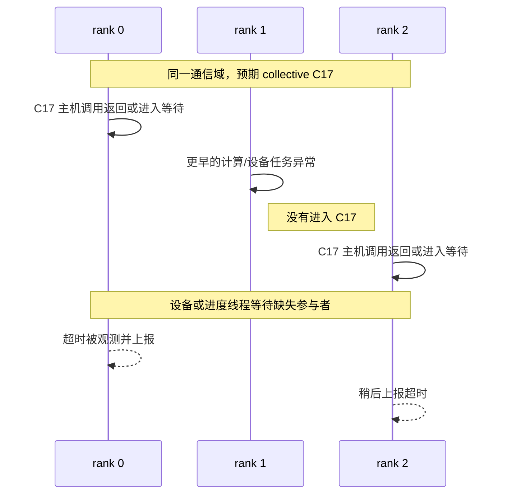

# 集合通信与 rank 进度

集合通信不是“每个进程各自调用一次同名函数”这么简单。一次集合操作由一个确定的参与者集合共同形成：各 rank 必须在同一个通信域里，以彼此兼容的次序和参数进入对应操作。任一 rank 尚未到达、进入了另一项操作、提交了不兼容的参数，或在更早的计算与设备任务中失败，其余 rank 都可能停在看起来正常的通信调用上。

本文回答三个问题：哪些条件使各 rank 的调用能够互相匹配；“调用返回”“设备完成”和“对端继续前进”为何不是同一个时刻；为什么通信超时只描述观察到的等待结果，不能单独证明网络故障。

## 三个基本对象

| 对象 | 含义 | 容易混淆的边界 |
|---|---|---|
| communicator / process group / 通信域 | 一组参与者、组内 rank 编号以及后端通信状态的上下文。PyTorch `ProcessGroup` 是框架抽象；NCCL communicator 和 HCCL 通信域是具体后端对象 | 名称相同、成员数量相同，不足以证明两个进程持有的是同一实例或同一成员顺序 |
| rank | 进程或设备在**某个组内**的逻辑编号。编号只在对应通信域中解释 | global/world rank、group rank、local rank 和物理 GPU/NPU 编号不是同一标识。PyTorch 2.8 将 rank 定义为进程组内连续编号；HCCL 文档还区分 world、group 与 local rank（[PyTorch rank](https://docs.pytorch.org/docs/2.8/distributed.html#torch.distributed.get_rank)，[HCCL 相关概念](https://www.hiascend.com/doc_center/source/zh/CANNCommunityEdition/80RC1alpha003/apiref/hcclapiref/CANN%208.0.RC1.alpha003%20%E9%9B%86%E5%90%88%E9%80%9A%E4%BF%A1%E6%8E%A5%E5%8F%A3%E5%8F%82%E8%80%83%2001.pdf#page=10)） |
| collective instance | 通信域中某一逻辑位置上的一次集体操作，例如第 37 次 all-reduce | “第 37 次”是帮助对齐证据的概念，不保证每个后端日志都暴露相同的 sequence number，也不能跨通信域直接比较 |

通信域决定“谁应当参加”和“rank 编号怎样解释”；集合操作决定这些参与者在本次交换中扮演什么角色。NCCL 2.27.5 要求 communicator 中的每个 CUDA 设备获得唯一的 `0..n-1` rank，并把 communicator 对象固定关联到 rank 与设备（[Creating a Communicator](https://docs.nvidia.com/deeplearning/nccl/archives/nccl_2275/user-guide/docs/usage/communicators.html)）。HCCL 8.0.RC1.alpha003 则把默认 world group 与其子集自定义 group 分开，并说明自定义组中的 rank 会从 0 重新编号。两者都说明：排障记录必须同时保存组身份、组内 rank 与设备映射，不能只写“rank 3”。

## 一次集合操作的匹配契约

可以把一次集合操作的逻辑身份写成：

```text
(通信域实例, 该域内的相对次序, 操作类型, 操作参数契约)
```

它不是任何库承诺的线协议字段，而是一种核对模型。四部分中任一项在参与者间不一致，都可能让不同 rank 以为自己正在参加不同的操作。

| 契约维度 | 需要一致或相容的内容 | 说明 |
|---|---|---|
| 参与者 | 通信域成员、成员顺序、rank 到进程/设备的映射 | 默认 world group 与子组不能混用；root 是组内 rank 时也不能当作物理设备号。NCCL 文档特别说明 broadcast/reduce 的 root 是 rank，不是 device number（[Collective Operations](https://docs.nvidia.com/deeplearning/nccl/archives/nccl_2275/user-guide/docs/usage/collectives.html)） |
| 次序 | 同一通信域内各参与者进入可匹配的 collective；多通信域并发还要满足后端的全局次序约束 | PyTorch 2.8 要求进程组按相同次序创建；对多个 NCCL process group，还要求各 rank 的 collective 执行次序全局一致，并要求多线程调用显式同步（[Groups](https://docs.pytorch.org/docs/2.8/distributed.html#groups)） |
| 操作语义 | collective 类型、root、reduction op、split/count 向量等 API 特有参数 | rank 0 调 all-reduce、rank 1 调 broadcast，即使 buffer 字节数相同也不是一次匹配操作 |
| buffer 契约 | count、dtype、shape/size、输入输出布局和设备位置，按具体 API 检查 | 不能把“所有 collective 的 shape 必须相同”当成统一规则；有的 API 明确允许不等长输入，另一些要求同 count 或同 size |

原生 NCCL 2.27.5 明确要求每个 rank 用相同 count 和 datatype 调用 collective，否则行为未定义，可能挂起、崩溃或数据损坏（[Collective Operations](https://docs.nvidia.com/deeplearning/nccl/archives/nccl_2275/user-guide/docs/usage/collectives.html)）。这里的契约是元素数与数据类型，不是 Python 张量 shape。框架会再叠加自己的约束：PyTorch 2.8 的 `broadcast` 要求参与进程的 tensor 元素数相同，`all_gather_into_tensor` 要求各 rank 输入 tensor 大小相同（[Collective functions](https://docs.pytorch.org/docs/2.8/distributed.html#collective-functions)）。

HCCL 8.0.RC1.alpha003 也按具体原语定义一致性：`HcclAllReduce` 要求所有 rank 的 `count`、`dataType`、`op` 相同；`HcclBroadcast` 还要求 `root` 相同且全局只有一个 root（[HcclAllReduce，3.3.1](https://www.hiascend.com/doc_center/source/zh/CANNCommunityEdition/80RC1alpha003/apiref/hcclapiref/CANN%208.0.RC1.alpha003%20%E9%9B%86%E5%90%88%E9%80%9A%E4%BF%A1%E6%8E%A5%E5%8F%A3%E5%8F%82%E8%80%83%2001.pdf#page=47)、[HcclBroadcast，3.3.2](https://www.hiascend.com/doc_center/source/zh/CANNCommunityEdition/80RC1alpha003/apiref/hcclapiref/CANN%208.0.RC1.alpha003%20%E9%9B%86%E5%90%88%E9%80%9A%E4%BF%A1%E6%8E%A5%E5%8F%A3%E5%8F%82%E8%80%83%2001.pdf#page=48)）。因此应记录应用看到的 shape、后端接收的 count/dtype 和变长操作的分段参数；只比较一个字段不足以证明调用匹配。

## 原语数据流（n=4 原创示意，只表语义不表实现）

下图均为自绘 ASCII 示意，非 NCCL/HCCL 官方图；不表示 ring/tree 走线。记号：rank 0–3，每格一块数据（A0 表示 rank0 的块 0）；`Σ` 为约简；`root=r` 的块用 `*` 标出来源。

```text
all-reduce（n=4 rank，每 rank 4 块）：约简后全员得同值 out[i]=Σ_k in_k[i]
  r0:[A0 A1 A2 A3]  r1:[B0 B1 B2 B3]
  r2:[C0 C1 C2 C3]  r3:[D0 D1 D2 D3]  -->  全员:[Σ0 Σ1 Σ2 Σ3]

reduce（n=4 rank，root=1）：语义同 all-reduce，结果只留 root
  r0:[A0 A1 A2 A3]  r1:[B0 B1 B2 B3]
  r2:[C0 C1 C2 C3]  r3:[D0 D1 D2 D3]  -->  r1:[Σ0 Σ1 Σ2 Σ3]，其余无结果
  （Reduce + Broadcast ≡ AllReduce）

broadcast（n=4 rank，root=0）：root 的 N 元 buffer 复制到全员
  r0:[X0* X1*]  r1:[__ __]  r2:[__ __]  r3:[__ __]  -->  全员:[X0 X1]

all-gather（n=4 rank，每 rank 1 块）：聚成 rank 序全量分发全员
  r0:[A0]  r1:[B0]  r2:[C0]  r3:[D0]  -->  全员:[A0 B0 C0 D0]
  （ReduceScatter 后接 AllGather ≡ AllReduce）

reduce-scatter（n=4 rank，每 rank 4 块）：约简后等块 scatter，每 rank 按 rank index 得一块
  r0:[A0 A1 A2 A3]  r1:[B0 B1 B2 B3]
  r2:[C0 C1 C2 C3]  r3:[D0 D1 D2 D3]  -->  r0:[Σ0] r1:[Σ1] r2:[Σ2] r3:[Σ3]
  （块布局受 rank→设备映射影响）

all-to-all（n=4 rank，每 rank 4 块；分块转置）：每 rank 的第 j 块发往 rank j
  r0:[a0 a1 a2 a3]  r1:[b0 b1 b2 b3]
  r2:[c0 c1 c2 c3]  r3:[d0 d1 d2 d3]  -->  r0:[a0 b0 c0 d0] r1:[a1 b1 c1 d1]
                                     r2:[a2 b2 c2 d2] r3:[a3 b3 c3 d3]

send/recv（点对点，n=2 rank 一对一 + group 融合）：成对调用、同 count+datatype
  r0 send [P0 P1] --> r1 recv [P0 P1]      （基本对：发送块原样到达接收 buffer）
  group 内多对融合可表达 scatter / gather / all-to-all / neighbor exchange；
  NCCL p2p 允许 per-rank sizes/datatypes/buffers 变长（与 collective 等长规则分开）。
```

（[NCCL 2.27.5 collectives](https://docs.nvidia.com/deeplearning/nccl/archives/nccl_2275/user-guide/docs/usage/collectives.html) 各节 + [p2p](https://docs.nvidia.com/deeplearning/nccl/archives/nccl_2275/user-guide/docs/usage/p2p.html) 五模式；[PyTorch 2.8 collective functions](https://docs.pytorch.org/docs/2.8/distributed.html#collective-functions)）

## 变长与 root 边界（按 API 分列）

- **等长类**：NCCL collective 同 count + 同 datatype（否则未定义）；torch `broadcast`/`all_gather_into_tensor`/`reduce_scatter_tensor` 同元素数；MPI `Allreduce` 同 count/datatype/op。
- **变长类（逐对匹配）**：NCCL p2p per-rank sizes/datatypes/buffers（发送方第 i 个 rank 的块大小/类型/buffer 与接收方对应 rank 的 RR 逐对匹配，不要求全组统一）；torch `all_to_all_single` 允许 input/output splits（`input_split_sizes`/`output_split_sizes` 逐 rank 对齐）；MPI `Alltoallv`（`sendcounts/sdispls` 与 `recvcounts/rdispls` 逐对变长，`v` 后缀即变长命名证据）。
- **root 类**：NCCL/torch/HCCL 的 root 均为 rank；torch `src` vs `group_src` 二选一；HCCL root 同一且全局唯一。
- in-place（别名/原地）条件本轮未交付：torch `all_gather`（列表输出）与 `all_gather_into_tensor`（单张量输出）只是签名差异，不作 in-place 验收；NCCL 2.27.5 collective 页 in-place 语句未转录，记 unknown。本节标题不再承诺 in-place 验收。
- shape≠count：契约是元素数与数据类型，不是 Python 张量 shape；框架另叠约束。

## 抽象模型、实现选择与特定版本算法（三层）

三层分开：**抽象 ring/tree 模型**（代价分析用）、**实现选择**（库版本实际支持的算法名单）、**特定版本算法**（该版本实际跑的路径，未取证不写）。

点对点基式 `T=α+nβ`（α 启动时延、β 单字节传输、n 字节；约简另加 `nγ`）；记号：`p` = 参与 rank 数，`n` = 每 rank 最终输出总字节数（all-gather 类）或约简向量总字节数（reduce/all-reduce 类）；`lg` = 以 2 为底对数（取整规则见各行，不跨算法迁移）；假设：距离无关、双向链路同速、单端口、通信对数无关（近似）、无竞争。（[Thakur/Rabenseifner/Gropp 2005](https://fs.hlrs.de/projects/par/rab/publ/HPCA_collectives.pdf) §3；LogP/LogGP 本任务不需要）

| 算法（抽象） | 代价（适用条件见右列） | 条件与前提 |
|---|---|---|
| tree broadcast/reduce（二项树） | `⌈lg p⌉·(α+nβ[+nγ])`；ceil 为二项树文本支持的取整（非二次幂适用），**不迁移到其他算法** | 短消息；操作须可广播/可约简 |
| ring all-gather（等分） | `(p−1)α + ((p−1)/p)nβ`；要求 n 可等分为 p 块（每轮 n/p），不等分另行推导（unknown） | 长消息；p−1 轮 |
| recursive-doubling all-gather | 二次幂 p：`lg p·α + ((p−1)/p)nβ`；**非二次幂有额外通信步骤（Thakur §4.1.1），不套用本式，另行推导/unknown** | 短/中消息；doubling 结构 |
| Rabenseifner reduce（reduce-scatter 递归减半 + binomial-tree gather 到 root） | `2 lg p·α + 2((p−1)/p)nβ + ((p−1)/p)nγ`（Thakur §4.5 原式，无 ceil；递归结构要求二次幂 p，见 §5.1） | 长消息 reduce；预定义约简 op（用户自定义 op 另用二项树，见 §4.5）；**非二次幂不套用本式**：按 §5.1 先缩到最近低位二次幂 p0（r=p−p0 个 rank 首轮配对移出）并产生额外开销（allreduce 非二次幂式见 §5.1：`(3+2⌊lg p⌋)α + 4nβ + …` 量级），或记 unknown；不得以 ceil 推广 |
| ring all-reduce（reduce-scatter + all-gather，各 p−1 轮，等分） | `2(p−1)α + 2((p−1)/p)nβ + ((p−1)/p)nγ`；大 p 近似 `2(p−1)α + 2nβ + nγ`（如 p=2 时字节项差一倍，不得用近似式代替精确式）；不等分/非同构环另行推导 | 大消息带宽最优之一，但时延项 ∝p（[Patarasuk/Yuan 2009](https://cs.fsu.edu/~xyuan/paper/09jpdc.pdf) 作者稿 §4.1/定理 1 文件内 p13：环轮次结论；把环轮次接入本 α–β–γ 模型是推导，非定理原文的完整延迟公式）；要求结合律+交换律、无竞争环 |

红线：历史 cutoff（2KB/12KB/512KB 等）是 Myrinet/IBM SP 调参，不移植为 NCCL/HCCL 阈值；NCCL `NCCL_ALGO`（Ring/Tree/CollnetChain/CollnetDirect/NVLS/NVLSTree/PAT，版本门槛各异，默认 unset 自动选，可按函数分设）与 `NCCL_PROTO`（LL/LL128/Simple）只陈述名单与自动选择事实，不反推某次运行实际算法（tuner 内部未取证）；调试开关不进生产建议。（[NCCL 2.27.5 env](https://docs.nvidia.com/deeplearning/nccl/archives/nccl_2275/user-guide/docs/env.html)）抽象最优 ≠ 该版本实现最优。

## DP/TP/PP/EP 有限映射（冻结实现样板）

实现冻结：Megatron-LM tag `core_v0.19.2`（精确调用路径，latest 浮动线不用作实现证据）+ PyTorch 2.8（`torch.distributed` + FSDP Notes）。下表只写该实现安排，不外推全框架；细节归[训练并行与状态](../06-training/parallelism-and-state.md)。

| 并行策略 | 原语（冻结函数×阶段） | 每 rank 消息：输入/输出 shape × dtype 字节 | 通信组（冻结路径） | 条件 |
|---|---|---|---|---|
| TP | `copy_to_tensor_model_parallel_region`：forward 无通信（返回输入），backward 对 grad 做 all-reduce（`_CopyTo…` L201–218）；`reduce_from_tensor_model_parallel_region`：forward 做 all-reduce，backward 无通信（`_ReduceFrom…` L221–236）；`scatter_to_tensor_model_parallel_region`：forward 本地 last-dim 切分，backward all-gather（L240–257）；`gather_from_tensor_model_parallel_region`：forward all-gather，backward 本地切分（L260–277）；序列并行 `_ScatterToSequenceParallelRegion`：forward 本地 first-dim 切分，backward all-gather（L280–297）；真 all-to-all 变体为 `all_to_all_sp2hp`（[num_tokens/TP,H]→[num_tokens,H/TP]）/`all_to_all_hp2sp`（反向）（L566–621，经 reshape+split+concat + `_AllToAll`） | 每调用输入 = 切分张量元素数 × dtype；all-reduce 全 rank 同输入；all-gather 输出 = p × 输入；reduce-scatter 每 rank 输出 = 输入/p；sp2hp/hp2sp 按文档 shape 逐段核算 | TP 组（`get_tensor_model_parallel_group`；上表函数 group 默认为 TP 组） | [`mappings.py@core_v0.19.2`](https://github.com/NVIDIA/Megatron-LM/blob/core_v0.19.2/megatron/core/tensor_parallel/mappings.py)（forward/backward 逐函数核对） |
| DP（DDP） | 梯度 all-reduce（分桶 bucket）、buffer broadcast | 每桶输入 = 桶内梯度元素数 × dtype 字节（全体 rank 同桶大小）；buffer broadcast 输入 = buffer 元素数 × dtype | DP 组（`get_data_parallel_group`） | [PyTorch DDP](https://docs.pytorch.org/docs/2.8/distributed.html)；桶大小实现可配，不作全表统一公式 |
| DP（FSDP） | forward all-gather + backward all-gather + backward reduce-scatter（activation checkpointing 无额外通信） | 每通信每 rank payload = `unit 参数数 × dtype 字节 / num_gpus`（unit = 一次 `FullyShardedDataParallel` 调用的 flat_param，嵌套 unit 参数除外；embedding/tied 另计）；buffer 另计：forward 需 2× all-gather buffer，backward 约 2× reduce-scatter buffer——**buffer 字节 ≠ 网络传输量**；padding 条件未转录，记 unknown | 分片组（每 unit 一通信组） | [PyTorch FSDP Notes](https://docs.pytorch.org/docs/2.8/notes/fsdp.html)（payload 公式、unit 定义、buffer 三节已核对） |
| PP | P2P send/recv（`P2PCommunicator.send_forward/recv_forward` 等；`_batched_p2p_ops`/`_p2p_ops` 组装请求） | 发送输入 = 输出张量 `tensor_shape`（`microbatch×seq×hidden×pipeline_dtype` 量级）；**shape 跨 rank 通信仅当 `variable_seq_lengths` 或 `mtp_standalone` 为真时经 `_communicate_shapes`，否则直接复用已有 `tensor_shape`**（`is_single_shape` 只是 Python 参数形状检查，不是 shape 通信） | PP 组（`get_pipeline_model_parallel_group`） | [`p2p_communication.py@core_v0.19.2`](https://github.com/NVIDIA/Megatron-LM/blob/core_v0.19.2/megatron/core/pipeline_parallel/p2p_communication.py)（L131–137/L322–328 已核对） |
| EP（有限分支：`MoEAlltoAllTokenDispatcher`，non-fused argsort permute；`token_dispatcher.py@core_v0.19.2`） | forward：permute → A2A(EP) tokens + A2A(EP) probs（同 split 向量，dtype 分开核算）→ TP 条件分支（下）→ combine A2A（splits 交换）→ unpermute；backward 为反向组装 | dispatch 输入（per-pair 逻辑 payload，可代入表达式）：tokens `m_ij·H·b_t`，probs `m_ij·b_p`——其中 `m_ij` = rank i 路由给 rank j 的行数（`tokens_per_expert`），H = hidden，b_t/b_p = token/prob 各自元素字节数；路由后 tokens 为 `[m,H]`（`index_select` 行选），probs 为一维 `[m]`（`moe_utils.py` L423–467 非 fused 分支；drop_and_pad/capacity 变体另计）。两次 dispatch A2A 共享 split 向量（`output_splits`/`input_splits`，L698–717），combine A2A 将二者交换（`input_splits`↔`output_splits`，L855–863，注释 `[SEQL,H]→[SEQL,H/TP]`）。TP 条件：TP=1 为基线分支；TP>1 时 dispatch 后对 tokens **和** probs 各做一次 AG(TP)（条件仅 `tp_size>1`，L734–744），排序（sort/permute2）才以 `num_local_experts>1` 为条件（L746–750）；combine 前做 RS(TP)（条件 `tp_size>1`，L817–826）。统计边界：路由 metadata（`tokens_per_expert`/splits）不计入 payload 公式；fused/padded 布局未核定，记 unknown | EP 组（`ep_group = pg_collection.ep`；TP 侧为 `expt_tp`） | [dispatcher L372–383/L698–744/L746–750/L817–826/L855–863](https://github.com/NVIDIA/Megatron-LM/blob/core_v0.19.2/megatron/core/transformer/moe/token_dispatcher.py) + [permute L423–467](https://github.com/NVIDIA/Megatron-LM/blob/core_v0.19.2/megatron/core/transformer/moe/moe_utils.py)（同 tag；具体路由值、未执行组合、padding 继续 unknown） |

## 四种“进度”不能互相代替

同一句“这个 rank 已完成通信”常把不同层次混在一起。至少要区分以下观察：

| 进度层次 | 能说明什么 | 不能说明什么 |
|---|---|---|
| 主机进入调用 | 进程执行到了框架或通信库入口 | 参数已通过检查、任务已提交到设备、其他 rank 已到达 |
| 主机提交/返回 | 本地主机调用满足了该 API 的返回条件 | 设备数据传输已经完成、输出可被任意 stream/线程使用、对端主机也已返回 |
| 本地设备完成 | 本 rank 的相关设备依赖和数据操作达到完成条件 | 对端应用已经执行到下一步；其他通信域没有未完成工作 |
| 对端/全组进度 | 其他参与者到达了匹配位置或完成了其本地工作 | 所有 rank 的主机、设备和后续应用状态处于同一行代码 |

NCCL 2.27.5 的普通 stream 调用说明区分成功入队与设备异步完成（[CUDA Stream Semantics](https://docs.nvidia.com/deeplearning/nccl/archives/nccl_2275/user-guide/docs/usage/streams.html)），但必须同时识别调用模式：`ncclGroupStart/End` 内的单次 collective 可以在尚未入队时返回；若 communicator 采用 nonblocking 模式，`ncclGroupEnd()` 返回 `ncclInProgress` 时还可能在后台提交，要等相应状态成为 `ncclSuccess` 才能认定该提交阶段成功。即便成功提交，仍需按 CUDA stream/event 语义判断设备完成。这里的 API 聚合组不是 process group 或 communicator（[Group Calls 的 Caution 与 Nonblocking Group Operation](https://docs.nvidia.com/deeplearning/nccl/archives/nccl_2275/user-guide/docs/usage/groups.html)）。

对 PyTorch 2.8 的 NCCL 后端，普通非 barrier Work 在未启用 `TORCH_NCCL_BLOCKING_WAIT`、未传入有效的显式 timeout 时，`wait()` 主要建立当前 CUDA stream 对 NCCL 完成事件的依赖，并不等待 CPU 观测到设备完成。启用 blocking-wait 或设置显式 timeout 会进入 CPU 等待路径；barrier 也有专门的 CPU 同步分支。等待过程中仍可能发现异常，不能把返回和成功混为一谈（[Work.wait API](https://docs.pytorch.org/docs/2.8/distributed.html#torch.distributed.Work.wait)，[v2.8.0 固定实现的 synchronizeStream/wait](https://github.com/pytorch/pytorch/blob/ba56102387ef21a3b04b357e5b183d48f0afefc7/torch/csrc/distributed/c10d/ProcessGroupNCCL.cpp#L775-L839)）。

`is_completed()` 也不能单独充当成功标志。通用文档概览用入队/stream 可用性描述 CUDA 异步操作，但这个固定 `WorkNCCL::isCompleted()` 实现返回“存在异常，或 GPU 结束事件已完成”；因此 `True` 既不能简单等同刚入队，也不能排除错误。记录时应保留具体 backend、版本、错误状态及后续使用所在 stream 的依赖（[固定 isCompleted 实现](https://github.com/pytorch/pytorch/blob/ba56102387ef21a3b04b357e5b183d48f0afefc7/torch/csrc/distributed/c10d/ProcessGroupNCCL.cpp#L580-L585)，[结束事件查询](https://github.com/pytorch/pytorch/blob/ba56102387ef21a3b04b357e5b183d48f0afefc7/torch/csrc/distributed/c10d/ProcessGroupNCCL.cpp#L649-L661)）。上述实现边界不能移植到 HCCL/NPU。

选定的 HCCL 文档给出了另一套机制边界：HCCL 在执行阶段编排 Notify、SDMA 等任务，由 runtime 下发到昇腾设备任务调度器；Notify wait 会阻塞设备任务流，直到对端的 Notify record 到达（[HCCL 执行流程](https://www.hiascend.com/doc_center/source/zh/CANNCommunityEdition/80RC1alpha003/apiref/hcclapiref/CANN%208.0.RC1.alpha003%20%E9%9B%86%E5%90%88%E9%80%9A%E4%BF%A1%E6%8E%A5%E5%8F%A3%E5%8F%82%E8%80%83%2001.pdf#page=8)）。该文档中的 C++ collective 接口接收 `aclrtStream`，示例在通信调用后另行同步 stream；但它没有为本文所覆盖的每个 collective 精确定义“主机函数返回”与“任务已入队/设备已完成”的统一边界。因此这项边界在本页记为 `unknown`，不能用 NCCL 的 CUDA stream 结论补齐，也不能据此推荐 CUDA/NCCL 环境变量。

## 多 rank 时间线：超时常发生在异常之后

下面是一个概念时间线。它不模拟任何具体后端线程或网络协议，只展示“最先出错的 rank”与“最先报告通信超时的 rank”可能不同。



这里 R0 最先打印 timeout，不表示 R0 是故障源；R1 的更早异常才解释了它为什么没有参加 C17。另一类常见分叉是调用次序不一致：部分 rank 在某通信域的第 *k* 个位置调用 all-reduce，另一些 rank 在同一位置调用 broadcast，双方都可能等待“尚未到达”的对端。还有一种情况是所有主机都已提交，某个设备任务因设备错误、stream 依赖或链路问题无法推进，其他 rank 随后一起超时。

HCCL 8.0.RC1.alpha003 文档明确指出，单卡问题和通信链路问题都可能让集群出现大量超时，因此需要收集全组日志来锁定问题位置（[HCCL 异常流程](https://www.hiascend.com/doc_center/source/zh/CANNCommunityEdition/80RC1alpha003/apiref/hcclapiref/CANN%208.0.RC1.alpha003%20%E9%9B%86%E5%90%88%E9%80%9A%E4%BF%A1%E6%8E%A5%E5%8F%A3%E5%8F%82%E8%80%83%2001.pdf#page=9)）。NCCL 2.27.5 的错误说明也分别列出外部 CUDA 调用错误、系统调用错误、无效参数/用法和异步通信错误；其中网络错误只是异步错误的一类（[Error handling](https://docs.nvidia.com/deeplearning/nccl/archives/nccl_2275/user-guide/docs/usage/communicators.html#error-handling-and-communicator-abort)）。

所以 timeout 的可靠含义只是：某个观察者等待的条件在给定时限内没有满足。它提供时间和受影响通信域，却不自动给出根因层。候选解释至少包括：参与者缺失、分支或次序分叉、参数契约不匹配、进程退出、较早的计算/设备异常、设备任务停滞、主机调度长停顿，以及节点内或节点间通信路径故障。

## 用一条可对齐的时间线描述进展

要判断“谁先停下”，来自每个 rank 的记录需要能对齐到同一对象，而不仅是收集更多日志文本。适合长期保存的最小字段包括：

| 字段组 | 建议保留的内容 | 用途 |
|---|---|---|
| 运行身份 | job/run、重启代次、进程 PID、节点、设备稳定标识 | 防止把重启前后或不同作业的同名 rank 混在一起 |
| rank 身份 | world/global rank、group 标识、group rank、local rank、group 成员有序列表 | 判断参与者与编号映射是否一致 |
| 操作身份 | 每通信域 sequence/trace 标识（若实现提供）、collective 类型、root/op、shape、count、dtype、split 信息 | 判断各 rank 是否在谈同一次操作；没有公共 sequence 时只能用邻近事件谨慎重建 |
| 进度事件 | 主机入口、主机返回、设备提交、设备完成、wait/同步入口与返回、超时/错误 | 区分卡在主机、设备依赖还是对端进度 |
| 时间基础 | 原始时间戳、时钟来源、采集端与已知偏差 | 跨节点墙钟未校准时，不能仅按字符串时间决定全局先后 |
| 前序异常 | 同一进程和设备在目标 collective 之前的首个异常、退出或资源事件 | 避免从最后一批连锁 timeout 倒推根因 |

“最早异常”也必须限定证据范围：它是当前已收集记录中最早的异常事件，不自动等于物理根因。若某节点日志缺失、时钟偏移未知或设备异步错误晚于实际故障上报，时间线只能给出下一项待核对关系。

## 平台与版本边界

| 主题 | NCCL 2.27.5 / PyTorch 2.8 样板 | HCCL 8.0.RC1.alpha003 样板 |
|---|---|---|
| 通信上下文 | PyTorch ProcessGroup 映射到 NCCL communicator；多 process group 的并发次序有明确警告 | world/custom group 与 HCCL 通信域；group rank 可相对 world rank 重排 |
| 设备执行 | NCCL 与 CUDA stream 关联；组内调用可能尚未入队，nonblocking group 还需确认提交成功；设备执行和提交分开观察 | 文档描述 runtime 下发 Notify/SDMA 等设备任务，Notify wait/record 协调设备流 |
| 参数契约例子 | NCCL collective 同 count、同 datatype；PyTorch 再定义 tensor size/stream 可见性 | 各 HCCL 原语分别定义 count、datatype、op、root 等一致性 |
| 主机返回边界 | 按 NCCL 普通/聚合组/nonblocking 模式及 PyTorch Work 的 timeout、blocking-wait、barrier 分支分别解释；完成标志还需检查错误 | 所选 HCCL 文档没有给出覆盖所有 collective 的统一精确定义，记为 `unknown` |
| 超时解释 | CUDA、系统、API 使用、进程/节点/网络等都可能妨碍进展 | 正式文档明确列出单卡与链路问题都可能造成集群大量超时 |

这三份版本化资料是用于理解边界的样板，不构成 PyTorch 2.8 与 NCCL 2.27.5 的配套声明，也不构成任何 TorchNPU、CANN、HCCL、固件和 NPU 型号组合的支持声明。NCCL 2.26 起的多 communicator 隐式 launch ordering 还需要特定配置且仍要求各设备上的主机发起次序匹配；不能把该特性概括成“多通信域无需排序”（[NCCL multiple communicators](https://docs.nvidia.com/deeplearning/nccl/archives/nccl_2275/user-guide/docs/usage/communicators.html#using-multiple-nccl-communicators-concurrently)）。

## 来源与待确认问题

- [NCCL 2.27.5 User Guide](https://docs.nvidia.com/deeplearning/nccl/archives/nccl_2275/user-guide/docs/)：通信域、collective 参数、CUDA stream 与多 communicator 次序。
- [PyTorch 2.8 `torch.distributed`](https://docs.pytorch.org/docs/2.8/distributed.html)：process group/rank、组创建顺序、collective 参数与同步/异步语义。
- [CANN 8.0.RC1.alpha003《集合通信接口参考》文档版本 01](https://www.hiascend.com/doc_center/source/zh/CANNCommunityEdition/80RC1alpha003/apiref/hcclapiref/CANN%208.0.RC1.alpha003%20%E9%9B%86%E5%90%88%E9%80%9A%E4%BF%A1%E6%8E%A5%E5%8F%A3%E5%8F%82%E8%80%83%2001.pdf)：HCCL 概念、执行流程、参数约束与异常说明。来源核对范围见[研究记录](../../docs/research/batch-03-f07-sources.md)。
- 待确认：目标环境真实的 group 创建与销毁次序、框架到后端的 sequence 映射、时钟误差、设备与 rank 映射、NPU collective 的主机返回边界，以及平台版本支持关系。
- 2026-10-12 第三轮修订来源：Thakur 一次源 PDF（§4.5 Rabenseifner 原式无 ceil、二项树 Ttree ceil 归属、§5.1 二次幂要求与非二次幂 p0 程序）；Megatron-LM core_v0.19.2（mappings L201–297 六函数阶段语义、L566–621 sp2hp/hp2sp；FSDP Notes payload/buffer；token_dispatcher L372–720 EP A2A 冻结实现）；HCCL 主机返回统一边界沿用 unknown；RCCL 留 T03-05/T03-06。


性能测量口径见[通信带宽与性能基线口径](bandwidth-baselines.md)，证据组织方法见[诊断中的证据、假设与结论](../08-reliability/evidence-and-hypotheses.md)。
