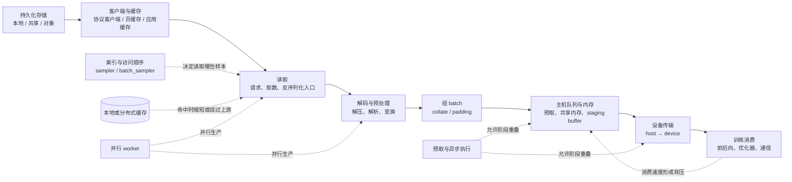

# 训练数据供给路径与等待

训练消费一个 batch 之前，数据可能经过持久化存储、客户端缓存、读取、解码与预处理、采样与组 batch、主机队列、主机到设备传输等阶段。本文提供一套跨 GPU/NPU 的分析框架，用于回答“训练为什么在等数据”以及“等待位于哪一段”。它不是特定框架的调优处方，也不提供通用 worker 数、缓存大小或利用率阈值。

`generic` 表示这些阶段和证据关系可以用于组织不同平台的调查，不表示 CUDA 参数、TorchNPU 行为、内存类型、异步语义或指标名称可以跨平台照搬。

## 路径是带缓冲的流水线

下面是本文整理的逻辑路径。方框表示需要分别观测的职责边界，不要求实现中每个方框都对应独立进程或一次拷贝。

这条路径不是总按箭头逐段串行执行：多个 worker 可以并行读取和处理；缓存命中可以绕过远端或介质读取；存储客户端可能预读；应用可能直接读取已组好的数据块；预取会让第 *n+1* 个 batch 的生产与第 *n* 个 batch 的计算重叠；某些实现还可能融合读取、解码或组 batch。所谓“数据等待”应指**所选训练步骤的关键路径上，消费者因所需输入尚未就绪而无法继续的时间**，而不是所有上游阶段耗时的总和。

PyTorch 2.6 的 `DataLoader` 页面给出了一个具体实现例子：它支持 map-style 与 iterable-style 数据集、采样顺序、自动组 batch、单/多进程加载、预取和内存 pinning；在多进程模式下，数据集访问、内部 I/O、变换和 `collate_fn` 在 worker 中执行。`prefetch_factor` 表示每个 worker 预先加载的 batch 数。这些事实支持把 worker 处理、组 batch、队列和主进程消费分开观察，但并不说明其他框架具有相同进程模型或默认值（[torch.utils.data，PyTorch 2.6](https://docs.pytorch.org/docs/2.6/data.html)）。

索引采样与读取后的组 batch 也应分开：map-style 多进程加载由主进程生成索引并发给 worker，随后取样与 `collate`；iterable-style 的顺序由数据集迭代逻辑控制，不能给它强加同一个 sampler 流程（[数据顺序](https://docs.pytorch.org/docs/2.6/data.html#data-loading-order-and-sampler)、[多进程加载](https://docs.pytorch.org/docs/2.6/data.html#multi-process-data-loading)）。图中的虚线表示控制关系。

## 每个阶段观察什么

先固定同一批 rank、同一训练区间和同一时钟口径。至少把启动/首 batch、稳定阶段、周期边界和异常长尾分开；将全程平均值与异常发生时的小窗口混在一起，会掩盖短暂队列耗尽或缓存状态变化。

| 阶段 | 建议记录的观测量 | 单位与时间窗口 | 能归因到哪里，不能直接推出什么 |
|---|---|---|---|
| 持久化存储与后端网络 | 完成读取字节、操作数、每次操作延迟分布、并发/排队、重试与错误 | `B/s` 或 `GiB/s`、`IOPS`、`ms/op` 的 p50/p95/p99；按稳定阶段及异常窗口分别统计 | 能说明后端在该窗口实际承接的负载与响应；应用吞吐低但后端空闲，不能单独证明存储慢，可能是缓存命中、请求未发出或下游处理受限 |
| 客户端、协议与缓存 | 应用请求字节、后端实际字节、命中/未命中量、预读量、客户端请求延迟 | `B`、请求数、命中率及 `ms/request`；同时标注冷/热状态和数据集工作集 | 应用字节与后端字节的差异可帮助识别缓存或预读；高命中率不证明后端足够快，低后端流量也不必然表示没有数据供给 |
| 读取 worker | 从领取索引到获得原始样本的耗时、样本/字节产出率、并发 worker 状态 | `ms/sample`、`samples/s`、`B/s`；按 worker 和批次窗口统计 | 能区分长尾 worker 与整体后端；worker 等待可能来自存储、客户端锁、进程间通信或调度，仍需与后端时间线对齐 |
| 解码与预处理 | 每类变换耗时、完成样本数、进程 CPU 时间、调度等待、失败样本 | `ms/sample` 或 `ms/batch`、`samples/s`、`CPU-s/window`；保留 shape、格式和变换配置 | 后端读取已完成而处理耗时升高，才支持 CPU/算法处理假设；仅看主机总 CPU 百分比会混入其他进程，也可能漏掉单核或锁竞争 |
| 采样、组 batch 与 padding | 索引生成、`collate`、padding/拼接耗时，batch 大小与有效样本量 | `ms/batch`、`samples/batch`、有效元素或 token 数；区分不同 batch 形状 | 能发现组 batch、变长数据和采样逻辑造成的波动；不能把 `DataLoader` 的总等待全部归为读取 |
| worker → 主机消费队列 | 入队/出队时间、**下一顺位 batch 是否就绪**、队列深度、占用字节、可交付队列为空的持续时间、生产者阻塞时间 | `batch`、`B`、`ms`；用时间序列而非只看平均深度 | 只有“下一顺位 batch 未就绪”且与输入等待重合，才支持瓶颈在供给上游；缓冲占用高不等于可交付（见本节末的按序返回说明），队列长期满才可能指向消费者或更下游 |
| 主机内存与 staging | 分配/复用耗时、拷贝字节、页锁定或注册耗时、内存压力与进程间共享开销 | `ms/batch`、`B/batch`、`B` 常驻量；与 batch 生命周期对齐 | 能识别主机侧内存准备成本；“启用了 pinned memory”本身不能证明数据确实被 pin、传输异步或已经与计算重叠 |
| 主机到设备传输 | 每 batch 传输字节、传输开始/结束、有效带宽、同步等待、与计算/通信的重叠区间 | `B/batch`、`ms/batch`、`GB/s`、重叠 `ms`；需要设备时间线或等价事件 | 主机 batch 已就绪而传输或同步占据关键路径，才支持传输瓶颈；带宽低也可能由小拷贝、同步、NUMA/拓扑或调度方式造成 |
| 训练消费 | batch 请求/就绪、步骤边界、计算核、通信、同步和输入等待 | `ms/step`、`ms` 分项、`samples/s` 或 `tokens/s`；按 rank 对齐 | 可确认设备空档究竟在输入之前、计算内部还是通信/同步处；设备忙碌比例低本身不能区分这些原因 |

不同工具对“读取完成”“设备忙碌”“队列深度”或 CPU 百分比的定义不同。记录指标时应同时写明：采集点、分子与分母、单位、聚合对象、采样周期、是否累计、是否包含缓存和重试。若这些字段未知，该指标只能作为线索。

**队列深度不等于可交付 batch。** PyTorch 2.6 默认按序返回：固定源码的 `_next_data` 先查 `_rcvd_idx` 对应的 batch，乱序先完成的结果留在 `_task_info` 里等待队首（[dataloader.py L1449–1480](https://github.com/pytorch/pytorch/blob/1eba9b3aa3c43f86f4a2c807ac8e12c4a7767340/torch/utils/data/dataloader.py#L1449-L1480)）。因此可以出现“多个后续 batch 已完成、训练仍在等”：瓶颈在队首那个 batch 的生产，而不在消费者。任务索引队列、worker 结果队列、pin-memory 阶段和乱序缓存是不同缓冲点，占用其中任何一个都不能直接读作“消费队列空/满”；用 batch/task ID 与 worker 开始/完成时间对齐，才能区分供给不足、乱序等待、pinning 与消费背压。`in_order=False` 会改变该语义（文档同时警告可能损害可复现性、数据不均衡时可能倾斜分布），不能当作通用的消堵手段。真实队列语义未知的平台保持 `unknown`。

## 为什么低设备利用率不能证明存储慢

“设备利用率低”只描述某种采样口径下设备没有持续处于被计为忙碌的状态。以下候选原因都可能产生类似现象：

- 存储或客户端读取没有及时产出数据；
- 数据已经读入主机，但 CPU 解码、tokenize、增强、组 batch 或进程间传递较慢；
- 主机 batch 已就绪，但内存准备、主机到设备传输或同步落在关键路径；
- 训练自身的算子很短、图或内核下发有间隙，或工作负载不足以填满设备；
- 设备在等其他 rank、集合通信、主机控制逻辑或周期性任务；
- 某个慢 rank 先发生数据或计算延迟，其他 rank 随后在同步点等待；
- 利用率工具的采样周期、忙碌定义或聚合方式没有覆盖需要判断的事件。

反方向也不成立：较高设备利用率不能证明数据路径健康。预取可能暂时掩盖上游长尾，缓存热状态可能绕过存储，设备计算也可能足够长而隐藏读取。判断供给能力需要同时看到 batch 就绪、队列状态、传输和训练步骤时间线。

MLPerf Storage v2.0 提供了一个清晰的边界反例。其训练测试使用模拟加速器，以 `sleep()` 代替真实计算，并用“模拟计算时间 / 基准总时间”定义 AU；如果 I/O 全部被模拟计算覆盖，AU 为 100%。但该版本明确不包含在线或离线预处理，且存储侧数据传输在主机 DRAM 终止，不包含传入设备内存。因此，该 AU 能回答其规则范围内的存储供给问题，不能验证本文路径中的预处理、主机到 GPU/NPU 传输或真实设备计算/通信（[MLPerf Storage v2.0 规则：Benchmark Overview](https://github.com/mlcommons/storage/blob/7e71ca162d8f9e7ae4b5b698d7d79b0883817f25/Submission_guidelines.md#2-benchmark-overview)，[Performance Metrics](https://github.com/mlcommons/storage/blob/7e71ca162d8f9e7ae4b5b698d7d79b0883817f25/Submission_guidelines.md#4-performance-metrics)）。规则还通过 warm-up、数据集与主机内存比例及随机种子约束缓存效应，说明缓存状态是测量条件的一部分，而不是可以省略的背景信息。

## 用相邻边界建立瓶颈证据

将一次异常写成“首个不能按时完成的边界”，并寻找它上下游同时成立的证据。下面的组合是调查假设，不是万能判定规则。

| 候选瓶颈 | 支持该假设的相邻证据 | 需要排除或保留的反例 |
|---|---|---|
| 存储/后端 | 消费队列耗尽；读取请求已经发往后端；同一窗口后端延迟或排队上升、有效供给下降；CPU 处理没有先变慢 | 缓存命中变化、客户端限流/锁、网络路径、请求模式改变；只有应用等待而无后端请求证据时不能定为存储 |
| 客户端或缓存 | 应用读取与后端操作的字节/延迟在异常窗口明显分叉；命中、预读、失效或客户端排队与等待同步变化 | 后端仍可能慢；缓存热/冷比较必须保持数据集、访问顺序和窗口可比 |
| CPU 解码/预处理 | 原始数据已到达；处理阶段耗时或排队增长；worker 产出下降；主机队列随后耗尽 | CPU 平均空闲不排除单 worker、单核、锁、内存带宽或调度问题；高 CPU 也可能是正常并行工作而非瓶颈 |
| worker/组 batch 队列 | 个别 worker 或 `collate` 长尾先发生；下一顺位 batch 未就绪；后端读取未同步退化 | 按序返回时后续 batch 已完成不代表可交付（队首等待）；队列空只把范围收缩到上游，不能单独区分存储、处理或 worker 崩溃；缓冲满需先确认是否为可交付 batch |
| 主机内存/设备传输 | batch 在主机已就绪；等待集中在 staging、copy 或同步；传输与计算没有预期重叠 | 需要核对内存类型、设备流/队列与同步语义；不能用 CUDA 的结论替代 NPU 证据 |
| 设备计算或下发 | batch 和传输及时完成；空档位于算子下发或计算阶段；改变数据侧条件不移动空档 | 通信、设备频率/健康、图编译、动态 shape 等仍是独立候选 |
| 分布式通信或慢 rank | 各 rank 的 batch 就绪和步骤时间线显示某一 rank 先变慢，其他 rank 在同步/通信点随后等待 | 被等待的 rank 可能因本地数据、CPU、传输或计算变慢；其他 rank 的“输入等待”不能直接归给它们各自的存储 |

一个可审查的归因至少应保留以下条件：异常 rank 与对照 rank、batch 或 step 标识、同一时钟下的事件边界、冷/热缓存状态、数据格式与 batch 形状、生产和消费队列变化、是否处于 warm-up/epoch 边界，以及调查尚未覆盖的阶段。比较实验若要改变 worker 数、缓存或传输方式，应一次只改变一个主要因素，并用吞吐、等待和资源代价共同判断；本文不预设“最佳 worker 数”或任何平台通用阈值。

## GPU/NPU 的共同抽象与平台边界

GPU 与 NPU 路径都可以抽象为“主机生产 batch → 主机缓冲 → 平台运行时安排设备传输 → 设备侧消费”，也都需要区分数据生产、传输、计算和通信。然而，主机内存是否需要注册或页锁定、哪些 API 可以异步返回、传输由什么 stream/queue 承载、何时发生隐式同步、哪些 profiler 事件可信，都由框架后端、平台运行时和版本决定。

对 **PyTorch 2.6 + CUDA**，官方文档支持以下有限结论：`DataLoader(pin_memory=True)` 会尝试把取出的 Tensor 放入 pinned memory；从 pinned/page-locked 主机内存发起的 host-to-GPU copy 更快；在 tensor 已 pin 的条件下，`to()` 或 `cuda()` 使用 `non_blocking=True` 可以发起异步 GPU copy，从而有机会与计算重叠。文档同时警告，pinning 本身代价较高，过度使用会在主机内存不足时造成严重问题（[PyTorch 2.6 CUDA semantics：Use pinned memory buffers](https://docs.pytorch.org/docs/2.6/notes/cuda.html#use-pinned-memory-buffers)）。这里的“可以重叠”是能力条件，不等于某次训练已经重叠；仍需时间线和同步点证据。

上述 CUDA 语义不能无证据套给 **TorchNPU**。本文没有选定 TorchNPU/CANN 版本中足以核对 `pin_memory`、`non_blocking`、主机内存注册、stream 或隐式同步的官方资料，也没有 NPU 实验。调查 NPU 时，应记录实际框架后端与平台版本、内存来源、调用参数、传输事件和同步边界，并在取得对应版本文档或源码证据后再解释。相同 Python 参数名不自动意味着与 CUDA 相同的实现和性能结果。

硬件 NUMA、CPU、内存和 I/O 拓扑会改变 worker、缓存和设备传输的路径，物理边界见[计算节点资源与拓扑参考](../01-hardware/resource-topology.md)。容器内设备可见性、调度分配与运行环境链不属于数据加载本身，资源边界见[从物理设备到容器资源的状态链](../05-cluster-platform/device-resource-chain.md)。

## 来源核对范围与真实未知

- [torch.utils.data，PyTorch 2.6](https://docs.pytorch.org/docs/2.6/data.html)：核对 `DataLoader` 的数据集、采样、组 batch、多进程、worker 内 I/O/transform、预取与内存 pinning 行为。
- [CUDA semantics，PyTorch 2.6](https://docs.pytorch.org/docs/2.6/notes/cuda.html#use-pinned-memory-buffers)：仅核对 CUDA pinned memory、`non_blocking=True` 和传输/计算重叠的文档语义及警告。
- [MLPerf Storage Benchmark Submission Guidelines v2.0](https://github.com/mlcommons/storage/blob/7e71ca162d8f9e7ae4b5b698d7d79b0883817f25/Submission_guidelines.md)：核对模拟加速器、AU 定义、缓存约束和“主机 DRAM 为终点”的测量范围；该基准不作为真实 GPU/NPU 端到端实验。

本文仍未知：目标集群的数据格式与访问分布、缓存层和一致性策略、CPU/NUMA/设备拓扑、框架与后端版本、实际队列实现、GPU/NPU 传输语义、各指标定义及正常基线。未安装或运行上游脚本，未访问真实存储、GPU 或 NPU，也未产生吞吐、延迟、利用率或最佳配置结果。
