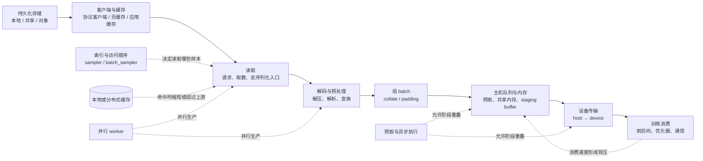

# 训练数据供给路径与等待

训练消费一个 batch 之前，数据可能经过持久化存储、客户端缓存、读取、解码与预处理、采样与组 batch、主机队列、主机到设备传输等阶段。本文提供一套跨 GPU/NPU 的分析框架，用于回答“训练为什么在等数据”以及“等待位于哪一段”。它不是特定框架的调优处方，也不提供通用 worker 数、缓存大小或利用率阈值。

`generic` 表示这些阶段和证据关系可以用于组织不同平台的调查，不表示 CUDA 参数、TorchNPU 行为、内存类型、异步语义或指标名称可以跨平台照搬。

## 路径是带缓冲的流水线

下面是本文整理的逻辑路径。方框表示需要分别观测的职责边界，不要求实现中每个方框都对应独立进程或一次拷贝。

这条路径不是总按箭头逐段串行执行：多个 worker 可以并行读取和处理；缓存命中可以绕过远端或介质读取；存储客户端可能预读；应用可能直接读取已组好的数据块；预取会让第 *n+1* 个 batch 的生产与第 *n* 个 batch 的计算重叠；某些实现还可能融合读取、解码或组 batch。所谓“数据等待”应指**所选训练步骤的关键路径上，消费者因所需输入尚未就绪而无法继续的时间**，而不是所有上游阶段耗时的总和。

PyTorch 2.6 的 `DataLoader` 页面给出了一个具体实现例子：它支持 map-style 与 iterable-style 数据集、采样顺序、自动组 batch、单/多进程加载、预取和内存 pinning；在多进程模式下，数据集访问、内部 I/O、变换和 `collate_fn` 在 worker 中执行。`prefetch_factor` 表示每个 worker 预先加载的 batch 数。这些事实支持把 worker 处理、组 batch、队列和主进程消费分开观察，但并不说明其他框架具有相同进程模型或默认值（[torch.utils.data，PyTorch 2.6](https://docs.pytorch.org/docs/2.6/data.html)）。

索引采样与读取后的组 batch 也应分开：map-style 多进程加载由主进程生成索引并发给 worker，随后取样与 `collate`；iterable-style 的顺序由数据集迭代逻辑控制，不能给它强加同一个 sampler 流程（[数据顺序](https://docs.pytorch.org/docs/2.6/data.html#data-loading-order-and-sampler)、[多进程加载](https://docs.pytorch.org/docs/2.6/data.html#multi-process-data-loading)）。图中的虚线表示控制关系。采样器与游标契约见后文 §B（分片、采样器与数据游标契约）。

## A. 数据集身份、预处理与缓存键

本文采用以下概念关系（应用样板；无统一框架契约时按下述记录，实际格式 unknown 可保留）：manifest 绑定样本逻辑 ID → 物理对象（路径/偏移/长度）→ 内容哈希（算法与对象明确）；预处理结果关联原始输入 ID ＋ 代码/配置/随机状态（[randomness 多 RNG/worker 种子控制](https://docs.pytorch.org/docs/2.6/notes/randomness.html)：`torch.manual_seed` 管全设备 RNG，DataLoader 按多进程算法重种 worker，需 `worker_init_fn`＋generator 保可复现）；缓存键区分缓存阶段（读缓存/预处理结果缓存/组 batch 缓存），使失效可检查（键字段见下）。

DCP 相关主张收窄到取得证据的实现与条件：`Metadata.storage_data` 类型为 `Any`（含义由 planner/storage 插件定，[metadata.py L135–147](https://github.com/pytorch/pytorch/blob/1eba9b3aa3c43f86f4a2c807ac8e12c4a7767340/torch/distributed/checkpoint/metadata.py#L135-L147)）；`(relative_path, offset, length)` 三字段是 FileSystem 后端的 `_StorageInfo`（[filesystem.py L66–72](https://github.com/pytorch/pytorch/blob/1eba9b3aa3c43f86f4a2c807ac8e12c4a7767340/torch/distributed/checkpoint/filesystem.py#L66-L72)），不是 DCP 通用协议；`stateful.py` 只声明 `state_dict/load_state_dict` 两方法协议，不证明 metadata 内容；28 文件 checksum 扫描为历史沿用（本轮未重做全后端扫描）；CRC 注释谈的是 `set_crc32_options(False)` 产生的归档可加载（[serialization.py L196–204](https://github.com/pytorch/pytorch/blob/1eba9b3aa3c43f86f4a2c807ac8e12c4a7767340/torch/serialization.py#L196-L204)），不概括为任意字节损坏仍可加载。

三类独立验证（各有输入与通过条件）：(1) 清单身份——输入：manifest（ID→对象映射）；通过：抽查样本可按 ID 取回同一对象；(2) 字节校验和——输入：哈希算法＋哈希对象（文件/样本/buffer 注明）；通过：重算一致；(3) 训练语义——输入：同 batch 样本 ID 集合＋预期访问序列（由固定 sampler/shuffle/drop_last/补齐规则或未中断对照生成；manifest 对象身份不代替访问序列）；通过：消费序列与预期序列一致。三者不可互相代替。

缓存键应记录的字段（上表"客户端、协议与缓存"行的加法注）：数据集版本、内容哈希（若有）、预处理代码/配置/种子、batch 形状、分片方式。MLPerf Storage v2.0 的 warm-up、数据集/主机内存比例及随机种子约束说明缓存状态是测量条件的一部分（见 L98，保留）。

## 每个阶段观察什么

先固定同一批 rank、同一训练区间和同一时钟口径。至少把启动/首 batch、稳定阶段、周期边界和异常长尾分开；将全程平均值与异常发生时的小窗口混在一起，会掩盖短暂队列耗尽或缓存状态变化。

| 阶段 | 建议记录的观测量 | 单位与时间窗口 | 能归因到哪里，不能直接推出什么 |
|---|---|---|---|
| 持久化存储与后端网络 | 完成读取字节、操作数、每次操作延迟分布、并发/排队、重试与错误 | `B/s` 或 `GiB/s`、`IOPS`、`ms/op` 的 p50/p95/p99；按稳定阶段及异常窗口分别统计 | 能说明后端在该窗口实际承接的负载与响应；应用吞吐低但后端空闲，不能单独证明存储慢，可能是缓存命中、请求未发出或下游处理受限 |
| 客户端、协议与缓存 | 应用请求字节、后端实际字节、命中/未命中量、预读量、客户端请求延迟 | `B`、请求数、命中率及 `ms/request`；同时标注冷/热状态和数据集工作集 | 应用字节与后端字节的差异可帮助识别缓存或预读；高命中率不证明后端足够快，低后端流量也不必然表示没有数据供给 |
| 读取 worker | 从领取索引到获得原始样本的耗时、样本/字节产出率、并发 worker 状态 | `ms/sample`、`samples/s`、`B/s`；按 worker 和批次窗口统计 | 能区分长尾 worker 与整体后端；worker 等待可能来自存储、客户端锁、进程间通信或调度，仍需与后端时间线对齐 |
| 解码与预处理 | 每类变换耗时、完成样本数、进程 CPU 时间、调度等待、失败样本 | `ms/sample` 或 `ms/batch`、`samples/s`、`CPU-s/window`；保留 shape、格式和变换配置 | 后端读取已完成而处理耗时升高，才支持 CPU/算法处理假设；仅看主机总 CPU 百分比会混入其他进程，也可能漏掉单核或锁竞争 |
| 采样、组 batch 与 padding | 索引生成、`collate`、padding/拼接耗时，batch 大小与有效样本量 | `ms/batch`、`samples/batch`、有效元素或 token 数；区分不同 batch 形状 | 能发现组 batch、变长数据和采样逻辑造成的波动；不能把 `DataLoader` 的总等待全部归为读取 |
| worker → 主机消费队列 | 入队/出队时间、**下一顺位 batch 是否就绪**、队列深度、占用字节、可交付队列为空的持续时间、生产者阻塞时间 | `batch`、`B`、`ms`；用时间序列而非只看平均深度 | 只有“下一顺位 batch 未就绪”且与输入等待重合，才支持瓶颈在供给上游；缓冲占用高不等于可交付（见本节末的按序返回说明），队列长期满才可能指向消费者或更下游 |
| 主机内存与 staging | 分配/复用耗时、拷贝字节、页锁定或注册耗时、内存压力与进程间共享开销 | `ms/batch`、`B/batch`、`B` 常驻量；与 batch 生命周期对齐 | 能识别主机侧内存准备成本；“启用了 pinned memory”本身不能证明数据确实被 pin、传输异步或已经与计算重叠 |
| 主机到设备传输 | 每 batch 传输字节、传输开始/结束、有效带宽、同步等待、与计算/通信的重叠区间 | `B/batch`、`ms/batch`、`GB/s`、重叠 `ms`；需要设备时间线或等价事件 | 主机 batch 已就绪而传输或同步占据关键路径，才支持传输瓶颈；带宽低也可能由小拷贝、同步、NUMA/拓扑或调度方式造成 |
| 训练消费 | batch 请求/就绪、步骤边界、计算核、通信、同步和输入等待 | `ms/step`、`ms` 分项、`samples/s` 或 `tokens/s`；按 rank 对齐 | 可确认设备空档究竟在输入之前、计算内部还是通信/同步处；设备忙碌比例低本身不能区分这些原因 |

不同工具对“读取完成”“设备忙碌”“队列深度”或 CPU 百分比的定义不同。记录指标时应同时写明：采集点、分子与分母、单位、聚合对象、采样周期、是否累计、是否包含缓存和重试。若这些字段未知，该指标只能作为线索。

**队列深度不等于可交付 batch。** PyTorch 2.6 默认按序返回：固定源码的 `_next_data` 先查 `_rcvd_idx` 对应的 batch，乱序先完成的结果留在 `_task_info` 里等待队首（[dataloader.py L1449–1480](https://github.com/pytorch/pytorch/blob/1eba9b3aa3c43f86f4a2c807ac8e12c4a7767340/torch/utils/data/dataloader.py#L1449-L1480)）。因此可以出现“多个后续 batch 已完成、训练仍在等”：瓶颈在队首那个 batch 的生产，而不在消费者。任务索引队列、worker 结果队列、pin-memory 阶段和乱序缓存是不同缓冲点，占用其中任何一个都不能直接读作“消费队列空/满”；用 batch/task ID 与 worker 开始/完成时间对齐，才能区分供给不足、乱序等待、pinning 与消费背压。`in_order=False` 会改变该语义（文档同时警告可能损害可复现性、数据不均衡时可能倾斜分布），不能当作通用的消堵手段。真实队列语义未知的平台保持 `unknown`。

## 为什么低设备利用率不能证明存储慢

“设备利用率低”只描述某种采样口径下设备没有持续处于被计为忙碌的状态。以下候选原因都可能产生类似现象：

- 存储或客户端读取没有及时产出数据；
- 数据已经读入主机，但 CPU 解码、tokenize、增强、组 batch 或进程间传递较慢；
- 主机 batch 已就绪，但内存准备、主机到设备传输或同步落在关键路径；
- 训练自身的算子很短、图或内核下发有间隙，或工作负载不足以填满设备；
- 设备在等其他 rank、集合通信、主机控制逻辑或周期性任务；
- 某个慢 rank 先发生数据或计算延迟，其他 rank 随后在同步点等待；
- 利用率工具的采样周期、忙碌定义或聚合方式没有覆盖需要判断的事件。

反方向也不成立：较高设备利用率不能证明数据路径健康。预取可能暂时掩盖上游长尾，缓存热状态可能绕过存储，设备计算也可能足够长而隐藏读取。判断供给能力需要同时看到 batch 就绪、队列状态、传输和训练步骤时间线。

MLPerf Storage v2.0 提供了一个清晰的边界反例。其训练测试使用模拟加速器，以 `sleep()` 代替真实计算，并用“模拟计算时间 / 基准总时间”定义 AU；如果 I/O 全部被模拟计算覆盖，AU 为 100%。但该版本明确不包含在线或离线预处理，且存储侧数据传输在主机 DRAM 终止，不包含传入设备内存。因此，该 AU 能回答其规则范围内的存储供给问题，不能验证本文路径中的预处理、主机到 GPU/NPU 传输或真实设备计算/通信（[MLPerf Storage v2.0 规则：Benchmark Overview](https://github.com/mlcommons/storage/blob/7e71ca162d8f9e7ae4b5b698d7d79b0883817f25/Submission_guidelines.md#2-benchmark-overview)，[Performance Metrics](https://github.com/mlcommons/storage/blob/7e71ca162d8f9e7ae4b5b698d7d79b0883817f25/Submission_guidelines.md#4-performance-metrics)）。规则还通过 warm-up、数据集与主机内存比例及随机种子约束缓存效应，说明缓存状态是测量条件的一部分，而不是可以省略的背景信息。

## 用相邻边界建立瓶颈证据

将一次异常写成“首个不能按时完成的边界”，并寻找它上下游同时成立的证据。下面的组合是调查假设，不是万能判定规则。

| 候选瓶颈 | 支持该假设的相邻证据 | 需要排除或保留的反例 |
|---|---|---|
| 存储/后端 | 消费队列耗尽；读取请求已经发往后端；同一窗口后端延迟或排队上升、有效供给下降；CPU 处理没有先变慢 | 缓存命中变化、客户端限流/锁、网络路径、请求模式改变；只有应用等待而无后端请求证据时不能定为存储 |
| 客户端或缓存 | 应用读取与后端操作的字节/延迟在异常窗口明显分叉；命中、预读、失效或客户端排队与等待同步变化 | 后端仍可能慢；缓存热/冷比较必须保持数据集、访问顺序和窗口可比 |
| CPU 解码/预处理 | 原始数据已到达；处理阶段耗时或排队增长；worker 产出下降；主机队列随后耗尽 | CPU 平均空闲不排除单 worker、单核、锁、内存带宽或调度问题；高 CPU 也可能是正常并行工作而非瓶颈 |
| worker/组 batch 队列 | 个别 worker 或 `collate` 长尾先发生；下一顺位 batch 未就绪；后端读取未同步退化 | 按序返回时后续 batch 已完成不代表可交付（队首等待）；队列空只把范围收缩到上游，不能单独区分存储、处理或 worker 崩溃；缓冲满需先确认是否为可交付 batch |
| 主机内存/设备传输 | batch 在主机已就绪；等待集中在 staging、copy 或同步；传输与计算没有预期重叠 | 需要核对内存类型、设备流/队列与同步语义；不能用 CUDA 的结论替代 NPU 证据 |
| 设备计算或下发 | batch 和传输及时完成；空档位于算子下发或计算阶段；改变数据侧条件不移动空档 | 通信、设备频率/健康、图编译、动态 shape 等仍是独立候选 |
| 分布式通信或慢 rank | 各 rank 的 batch 就绪和步骤时间线显示某一 rank 先变慢，其他 rank 在同步/通信点随后等待 | 被等待的 rank 可能因本地数据、CPU、传输或计算变慢；其他 rank 的“输入等待”不能直接归给它们各自的存储 |

一个可审查的归因至少应保留以下条件：异常 rank 与对照 rank、batch 或 step 标识、同一时钟下的事件边界、冷/热缓存状态、数据格式与 batch 形状、生产和消费队列变化、是否处于 warm-up/epoch 边界，以及调查尚未覆盖的阶段。比较实验若要改变 worker 数、缓存或传输方式，应一次只改变一个主要因素，并用吞吐、等待和资源代价共同判断；本文不预设“最佳 worker 数”或任何平台通用阈值。

## B. 分片、采样器与数据游标契约

- `RandomSampler` 无外部 generator 时临机取种（`generator is None` 分支临机 `manual_seed`）：种子不固定则序列不可复现（固定 v2.6.0 `sampler.py`）。
- `DistributedSampler`：`seed+epoch` 确定性 shuffle，`set_epoch` 每 epoch 必调（docstring warning），否则多 epoch 同序；假设数据集恒定、元素顺序稳定；`drop_last=False` 用头部复制补齐（可致重样）（固定 v2.6.0 `distributed.py`）。
- torch `DataLoader` 2.6 **没有** `state_dict`/`set_epoch`（[dataloader.py](https://github.com/pytorch/pytorch/blob/v2.6.0/torch/utils/data/dataloader.py)，77162 字节源码零命中）：精确游标不是其契约，epoch/step 不能推定位置；`persistent_workers`/超时恢复后的位置语义未定，需应用层 state。
- TorchData `StatefulDataLoader` 0.11.0 的状态按分支分列（[版本化文档概述](https://docs.pytorch.org/data/0.11/torchdata.stateful_dataloader.html)＋固定 tag `v0.11.0` 实现已核对，未运行；与 torch 2.6 配套未验证）：未传自定义 sampler 时 map-style shuffle 默认用内建 `RandomSampler`（其 iterator 已实现 Stateful，存 generator state 和 yielded 数，[`sampler.py` L55–80](https://github.com/pytorch/data/blob/377e64c1be69a9be6649d14c9e3664070323e464/torchdata/stateful_dataloader/sampler.py#L55-L80)），`BatchSampler` 包装；`state_dict` 尝试序列化 index sampler、sampler iterator、dataset/fetcher（含 iterable 的 dataset_iter/dataset）；恢复时先检查 sampler 或 iterator 的 Stateful 能力，相应分支用其状态恢复，**只有非 stateful 分支才退回 fast-forward**（[`state_dict` L496–577](https://github.com/pytorch/data/blob/377e64c1be69a9be6649d14c9e3664070323e464/torchdata/stateful_dataloader/stateful_dataloader.py#L496-L577)/`load_state_dict`，默认 sampler 见 [L334–346](https://github.com/pytorch/data/blob/377e64c1be69a9be6649d14c9e3664070323e464/torchdata/stateful_dataloader/stateful_dataloader.py#L334-L346)）。"只存 batch 数"是文档概述的简化，不等于默认行为；已产出 batch 仍不自动等于训练完成消费的 batch。
- 只聚合多进程 worker，**不跨 rank**；`load_state_dict` 要求相同 `num_workers`；`in_order=False` 对状态管理无保证。训练已消费位置仍由应用对齐（checkpoint 侧见上条 DCP 接口）。上述实现核对不升级为 NPU 后端运行保证。
- DCP 的 `Stateful` 协议是数据进度进入 checkpoint 的接口：恢复映射由应用验证（[`state_dict_loader.py`](https://github.com/pytorch/pytorch/blob/v2.6.0/torch/distributed/checkpoint/state_dict_loader.py) Stateful 回调先于公共 load 返回）。
- 恢复目标（完整 step／精确数据进度／step 中间）决定游标精度要求；`exactly-once` 无跨框架通用语义。细节归[训练状态一致性](../06-training/checkpoint-state-consistency.md)（draft 边界引用）。
- iterable 多 worker 分片正确性由用户 dataset 代码保证（文档明示信任用户代码、PyTorch 无法检测重复/遗漏）：缺样/重样必须应用侧计数对照；worker 崩溃/FD 耗尽后只给报错语义，不给恢复位置保证（`dataloader.py` L1262–1266、L1280–1320）。

## GPU/NPU 的共同抽象与平台边界

GPU 与 NPU 路径都可以抽象为“主机生产 batch → 主机缓冲 → 平台运行时安排设备传输 → 设备侧消费”，也都需要区分数据生产、传输、计算和通信。然而，主机内存是否需要注册或页锁定、哪些 API 可以异步返回、传输由什么 stream/queue 承载、何时发生隐式同步、哪些 profiler 事件可信，都由框架后端、平台运行时和版本决定。

对 **PyTorch 2.6 + CUDA**，官方文档支持以下有限结论：`DataLoader(pin_memory=True)` 会尝试把取出的 Tensor 放入 pinned memory；从 pinned/page-locked 主机内存发起的 host-to-GPU copy 更快；在 tensor 已 pin 的条件下，`to()` 或 `cuda()` 使用 `non_blocking=True` 可以发起异步 GPU copy，从而有机会与计算重叠。文档同时警告，pinning 本身代价较高，过度使用会在主机内存不足时造成严重问题（[PyTorch 2.6 CUDA semantics：Use pinned memory buffers](https://docs.pytorch.org/docs/2.6/notes/cuda.html#use-pinned-memory-buffers)）。这里的“可以重叠”是能力条件，不等于某次训练已经重叠；仍需时间线和同步点证据。

对 NPU 侧，固定版本证据如下（与 CUDA 同名参数不等价，分开陈述；下表限 `copy_between_host_and_device` 路径：dst/src contiguous、同 dtype、base format，[`CopyKernel.cpp` L85–122](https://github.com/Ascend/pytorch/blob/bc51ab84cc6f35c77aab1c59886e0ea43681a317/torch_npu/csrc/aten/common/CopyKernel.cpp#L85-L122) 头部注释）：

| 分支（[`CachingHostAllocator_recordEvent` L181–205](https://github.com/Ascend/pytorch/blob/bc51ab84cc6f35c77aab1c59886e0ea43681a317/torch_npu/csrc/core/npu/CachingHostAllocator.cpp#L181-L205)） | 主机是否等待 | allocator 是否登记该 buffer | 应用使用该 buffer 的完成前提 |
|---|---|---|---|
| 指针由 allocator 管理（blocks 命中） | 不等待 | 登记 stream（`block.streams.insert`）；块可复用当且仅当无 outstanding npu events（[`processEvents` 逐个 query](https://github.com/Ascend/pytorch/blob/bc51ab84cc6f35c77aab1c59886e0ea43681a317/torch_npu/csrc/core/npu/CachingHostAllocator.cpp#L214-L235)，首个未完成即停） | event 完成后方可复用/修改；复用管理不等于应用可随意改仍存活块（allocator 复用语义≠应用可变保证） |
| 非管理 ＋ D2H ＋ `AclrtMemcpyAsyncWithConditionExist()` 存在 | 不等待 | **不登记**（直接返回） | 无 event 跟踪该 buffer，应用须自行保证生命周期；条件接口存在≠已确认目标运行能力 |
| 其余非管理（含 malloc 主机内存） | **同步等待**（`AclrtSynchronizeStreamWithTimeout`，失败 `AT_ERROR`；**本分支无 checkpoint-resume 告警例外**） | 不登记 | 返回即完成（同步语义），但仍需核对返回码 |

`non_blocking=True` 在此路径走异步下发（`LaunchAsyncCopyTaskWithModeSwitch`，下发后 log"without StreamSynchronize"），`non_blocking=False` 走先同步等待后同步拷贝（`AclrtSynchronizeStreamWithTimeout` 在前，`AclrtMemcpyWithModeSwitch` 在后；同步失败时 checkpoint-resume 模式只告警不抛错，其余抛错——该告警逻辑仅属此同步分支，不搬到上表 allocator 行）——两者都是本路径行为，不推广到其他拷贝路径。

CANN 0106：非 `MallocHost` 指针调用时**不报错**，但执行业务可能出现不可预知错误（[官方静态正文](https://www.hiascend.com/doc_center/source/zh/CANNCommunityEdition/82RC1alpha001/API/appdevgapi/aclcppdevg_03_0106.html)功能/型号约束内表述）；"静默错误"若指输出损坏/SDC则强于现有证据，本文不作此断言。stream/event 观察表（选定 stream/queue）：下发返回（`aclrtMemcpyAsync` 成功仅下发成功）→ 查询状态（[0086 event 查询](https://www.hiascend.com/doc_center/source/zh/CANNCommunityEdition/82RC1alpha001/API/appdevgapi/aclcppdevg_03_0086.html)：返回 0 仅表示查询成功，任务完成由出参 COMPLETE/NOT_READY 判断；record/query 须覆盖对应任务且顺序明确，跨线程乱序有来源警告；0020/0086 版本绑定较弱，引用带该限定）→ stream 等待 event（[0091](https://www.hiascend.com/doc_center/source/zh/CANNCommunityEdition/82RC1alpha001/API/appdevgapi/aclcppdevg_03_0091.html)：`aclrtStreamWaitEvent(stream, event)` 是指定 stream 的后续任务等待 event 捕获的任务完成，主机调用异步返回；不是主机等待完成，也不是 event 等待 stream；源 stream 先 [RecordEvent](https://www.hiascend.com/doc_center/source/zh/CANNCommunityEdition/82RC1alpha001/API/appdevgapi/aclcppdevg_03_0083.html)，目标 stream 再 WaitEvent 安排依赖工作；调用后须同步等待接口确认执行完成，否则可致业务异常/断链）→ device 同步；跨 stream 依赖经 event 传递。`Tensor.pin_memory` NPU 列留空，未验证。

剩余 unknown：StatefulDataLoader 在 NPU 后端行为、`pin_memory` NPU 语义、CANN 0088/0089 超时语义细节、worker 崩溃后 NPU 侧游标；上表三路之外的拷贝路径行为。

调查 NPU 时，应记录实际框架后端与平台版本、内存来源、调用参数、传输事件和同步边界，并在取得对应版本文档或源码证据后再解释。相同 Python 参数名不自动意味着与 CUDA 相同的实现和性能结果。

硬件 NUMA、CPU、内存和 I/O 拓扑会改变 worker、缓存和设备传输的路径，物理边界见[计算节点资源与拓扑参考](../01-hardware/resource-topology.md)。容器内设备可见性、调度分配与运行环境链不属于数据加载本身，资源边界见[从物理设备到容器资源的状态链](../05-cluster-platform/device-resource-chain.md)。

## C. 对照方案矩阵与恢复链接

| 对照 | 改变什么（输入/控制变量） | 收集什么（观察记录） | 预期与无法判断 |
|---|---|---|---|
| 预处理重复性 | 同字节输入＋固定种子/generator（含 worker_init_fn）＋`assert_close` 容差口径（只引 PyTorch 2.6 容差表；**不得把 Ascend 侧累加精度当作已知前提，涉及处记 unknown 并指向 [T02-10 例外清单](../../docs/research/batch-17-t02-10-exception.md)**） | 两次运行同 stage 输出逐位/容差比较、RNG 状态记录 | 同平台同版本一致为通过；跨平台/CPU↔设备逐位一致不保证；变换含外部随机源时先固定该源，否则记 unknown |
| 缓存冷/热/失效 | 按选定缓存阶段分列：读缓存（清缓存后首轮 vs 稳定后窗口）、派生结果缓存（改变变换配置后首轮）、组 batch 缓存（改变 batch 配置后首轮） | 各阶段命中率、应用字节 vs 后端字节（读缓存层）、重算发生与新结果身份（派生层） | 仅变换配置变化时：派生层应失效（观测重算/新结果身份），未变原始字节仍命中读缓存，**不预期持久化后端字节回升**；后端字节变化只在所选缓存层要求重新读取时作预期；目标缓存策略未知时只记现象 |
| 缺样/重样/乱序 | 固定总样本数＋应用侧样本 ID 及顺序对照（ID 集合＋序列比较，不只数字段；预期序列由固定 sampler/shuffle/drop_last/补齐规则或未中断对照得出，允许的重复/丢尾保留） | 消费序列 ID 清单、重复 ID、缺失 ID、乱序段 | ID/顺序不一致且违反已声明契约→记该项校验失败、原因待查；未确定契约或证据不足才是无法判断；不承诺通用 exactly-once |
| 恢复首批/持续窗口 | 以未中断对照为基线：已消费位置（游标来源）＋已预取未消费量＋重放量声明 | 恢复后首批 ID、持续 N 窗口 ID 连续性、重复消费段 | 首批接续且窗口连续为通过；游标无契约时重放量未知，只记现象不判正确；恢复映射归[训练状态一致性](../06-training/checkpoint-state-consistency.md)（draft 边界） |

## 来源核对范围与真实未知

- [torch.utils.data，PyTorch 2.6](https://docs.pytorch.org/docs/2.6/data.html)：核对 `DataLoader` 的数据集、采样、组 batch、多进程、worker 内 I/O/transform、预取与内存 pinning 行为。
- [CUDA semantics，PyTorch 2.6](https://docs.pytorch.org/docs/2.6/notes/cuda.html#use-pinned-memory-buffers)：仅核对 CUDA pinned memory、`non_blocking=True` 和传输/计算重叠的文档语义及警告。
- [MLPerf Storage Benchmark Submission Guidelines v2.0](https://github.com/mlcommons/storage/blob/7e71ca162d8f9e7ae4b5b698d7d79b0883817f25/Submission_guidelines.md)：核对模拟加速器、AU 定义、缓存约束和“主机 DRAM 为终点”的测量范围；该基准不作为真实 GPU/NPU 端到端实验。
- 2026-10-14 加法：[sampler.py](https://github.com/pytorch/pytorch/blob/v2.6.0/torch/utils/data/sampler.py)（`__iter__` 契约、generator 可空、drop_last）、[distributed.py](https://github.com/pytorch/pytorch/blob/v2.6.0/torch/utils/data/distributed.py)（seed+epoch、set_epoch警告、补齐）、[TorchData StatefulDataLoader 0.11.0](https://docs.pytorch.org/data/0.11/)（版本化文档＋固定 tag 实现，未运行）、[DCP stateful.py](https://github.com/pytorch/pytorch/blob/v2.6.0/torch/distributed/checkpoint/stateful.py)（两方法协议）、TorchNPU v7.2.0 三快照（CopyKernel/event/allocator）与 CANN 8.2.RC1.alpha001 传输页组（0101/0102/0105/0106/1807、0075/0076/1395/0020、0079/0083/0086/0091、传输指南）。

本文仍未知：目标集群的数据格式与访问分布、缓存层和一致性策略、CPU/NUMA/设备拓扑、框架与后端版本、实际队列实现、GPU/NPU 传输语义、各指标定义及正常基线。未安装或运行上游脚本，未访问真实存储、GPU 或 NPU，也未产生吞吐、延迟、利用率或最佳配置结果。
