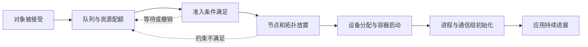

# 作业准入、调度与拓扑放置

“集群还有空卡”不足以解释一个作业为什么能或不能运行。队列可能没有配额，作业可能等待外部准入条件，单个 Pod 的需求可能超过任一节点的剩余资源，也可能无法组成满足设备互联要求的组合。资源总量、放置可行性、设备分配成功与应用开始计算需要分别判断。

本页组织这些判断的边界。Kueue、上游 Volcano 和 MindCluster 中适配的 Volcano 是三个独立来源样板；它们的版本和状态不能拼成一个已验证系统。`generic` 是概念范围，不表示任意 GPU/NPU 插件或调度配置都受支持。

## 沿着状态找等待位置

下图是本库的观察模型。不同系统可能合并阶段、延迟部分决策或重新排队，不保证每个箭头对应一个独立控制器。

| 观察层 | 需要读取的证据 | 尚不能推出什么 |
|---|---|---|
| 对象接受 | 作业/Workload/Pod 身份、generation、控制器是否接管 | 已有配额或已经排上节点 |
| 配额预留 | 队列、资源类型、请求量、flavor、配额条件 | 物理节点有合适组合；设备可访问 |
| 准入 | 当前准入条件和外部检查结果，及相应对象版本 | 全部 Pod 已启动、全部 rank 已进入训练 |
| 节点放置 | Pod 的目标节点、约束匹配、组级最小要求、调度事件 | 设备挂载和框架初始化成功 |
| 设备分配/容器启动 | Allocate、实际映射、容器状态与运行环境 | collective 契约匹配、模型或数据可用 |
| 应用就绪与进展 | 实际进程成员、通信组、step/request 进度及结果验证 | 其他任务或故障条件也正常 |

设备分配后的详细证据链见[从物理设备到容器资源的状态链](device-resource-chain.md)；组内 rank 和通信进度见[集合通信与 rank 进度](../03-communication/collectives-and-rank-progress.md)。不要把控制面上的一个 `Running` 替代这两段检查。

## 配额与准入：Kueue 的一个固定样板

Kueue v0.19.0 用 Workload 表达准入对象及 PodSet 资源需求；逻辑配额由队列/flavor 管理，启用相应拓扑功能时还检查物理放置条件，外部 AdmissionCheck 则可以继续推迟准入。其 API 分开定义 `QuotaReserved`、`Admitted` 和 `PodsReady`；这些条件的对象和含义不同。`PodsReady` 的定义还包含已经成功结束的 Pod，不能读成“所有副本此刻都在运行”。参见固定 [admission.md](https://github.com/kubernetes-sigs/kueue/blob/911a822a49bcfd99c9c62203a009efa4130ad604/site/content/en/docs/concepts/admission.md)与 [Workload API 条件定义](https://github.com/kubernetes-sigs/kueue/blob/911a822a49bcfd99c9c62203a009efa4130ad604/apis/kueue/v1beta1/workload_types.go#L628-L643)。

资源请求的对象也要明确：PodSet 的副本数乘每 Pod 需求，用于作业级配额核算；单 Pod 需求仍需在实际节点上满足。不能只保留作业总设备数而丢掉 PodSet/Pod 粒度（[固定 Workload 文档](https://github.com/kubernetes-sigs/kueue/blob/911a822a49bcfd99c9c62203a009efa4130ad604/site/content/en/docs/concepts/workload.md)）。

拓扑判断不总发生在同一个阶段。这个固定版本的 TAS 文档对 Provisioning AdmissionCheck 另列了配额预留、等待外部资源检查、再完成 topology assignment 的流程。因此，调查应看实际条件和配置，不强制把上图作为控制器的执行顺序（[固定 TAS 文档的 ClusterAutoscaler support](https://github.com/kubernetes-sigs/kueue/blob/911a822a49bcfd99c9c62203a009efa4130ad604/site/content/en/docs/concepts/topology_aware_scheduling.md#clusterautoscaler-support)）。

## Gang 约束不是应用同步屏障

Volcano v1.15.0 的 PodGroup 以 `minMember`、`minResources` 等字段表达组级最低条件，Gang 插件据此避免不满足最小规模的任意部分分配。这个最低规模不必等于作业定义中的全部副本数。满足它也不保证进程同时执行到同一行代码，或都成功加入了应用通信组（[PodGroup](https://volcano.sh/docs/v1.15.0/concepts/podgroup/)、[Gang](https://volcano.sh/docs/v1.15.0/scheduler/plugins/gang/)）。

读到“all or nothing”时，应明确 all 指什么：全部资源请求、最低成员集合、一个 PodSet，还是特定实现中的调度决策。调度器内部的 Ready、Pod condition 与应用 rendezvous 不共享同一语义。启动失败、拉取镜像失败、设备分配失败和进程退出仍需在对应层观察。

## 数量足够，为什么仍放不下

下面是原创资源示例，不是现场事故：两台节点各剩 4 个同类型完整设备，总量为 8。一个要求单 Pod 使用 8 个设备的任务，不能仅凭总量证明可放置；两个各需 4 个设备的 Pod 也还要分别满足 CPU、主机内存、标签、污点、卷和拓扑条件。

再看节点内的组合：剩余 4 个设备不一定满足一个四设备通信域的连接、成组或隔离要求。需要检查设备身份与互联图，不能把设备数压缩成唯一调度维度。资源布局的记录方法见[计算节点资源与拓扑参考](../01-hardware/resource-topology.md)。

这类等待至少可能来自三种不同证据：队列账本没有足够份额；节点资源碎片无法满足单 Pod；有足够数量却没有满足拓扑约束的组合。三者的处置前提不同，不能都归为“调度器没发现空卡”。

## 拓扑有不同层级，也有不同目标

| 约束或目标 | 应记录的对象 | 需要保留的限制 |
|---|---|---|
| 节点间通信局部性 | block/rack/交换机域、节点标签和网络路径 | 同标签不是实际带宽测量；路径健康与拥塞还需单独观测 |
| 节点内设备亲和 | CPU/NUMA、PCIe、设备互联、成对或成组规则 | 必须绑定具体产品与插件版本，不能从另一型号继承 |
| 降低碎片 | 每 Pod 资源向量、剩余容量和允许组合 | 总利用率高可能降低后续大作业的可放置性 |
| 故障域分散 | 副本/角色、节点、机架、电源与网络共同依赖 | 通信靠近与故障隔离可能有取舍，需按工作负载恢复目标决定 |

Kueue 的固定 TAS 文档用分层节点标签描述拓扑，区分 required 与 preferred：前者是必须满足的放置条件，后者允许向更高拓扑层级寻找位置。物理容量统计还受节点 Ready/可调度状态、已准入负载和其他 Pod 资源占用影响。标签层级并不提供 NVLink/HCCS 或实际网络链路的健康证明（[固定 TAS 文档](https://github.com/kubernetes-sigs/kueue/blob/911a822a49bcfd99c9c62203a009efa4130ad604/site/content/en/docs/concepts/topology_aware_scheduling.md)）。

故障域取舍参考[可靠性维度与故障域](../08-reliability/dimensions-and-failure-domains.md)。本页不给所有训练或推理服务规定统一的集中/分散策略。

## NPU 调度的具体边界

MindCluster v26.1.1 固定[调度流程](https://github.com/Ascend/mind-cluster/blob/44385c13d7b1d87def35f1604e8be4d16de6ca4e/docs/zh/scheduling/04_usage/03_basic_scheduling/02_scheduling_process_of_the_ascend_ai_processor.md)说明其 Volcano 是适配修改的版本，并按 `self-maintain-available-card` 分开两条资源维护路径。调查需要确认实际配置、可用设备账本、调度注解和最终 Allocate 映射，不能把“上游 Volcano 支持 gang”替代 NPU 设备选择的证据。

同一版本的[芯片亲和性文档](https://github.com/Ascend/mind-cluster/blob/44385c13d7b1d87def35f1604e8be4d16de6ca4e/docs/zh/scheduling/04_usage/03_basic_scheduling/01_affinity_scheduling/03_ascend_ai_processor_based_affinity.md)按产品分别说明：旧 Atlas 训练系列的双 HCCS 环、Box16 和 A3 HiAM 模组有不同条件；同页明确 Atlas 800T A2/Atlas 900 A2 PoD 不采用前述芯片亲和性调度。故不能把“同环”写成全部昇腾型号的统一要求，也不能将没有该项调度规则理解为没有互联或其他放置约束。

节点间的[交换机亲和性](https://github.com/Ascend/mind-cluster/blob/44385c13d7b1d87def35f1604e8be4d16de6ca4e/docs/zh/scheduling/04_usage/03_basic_scheduling/01_affinity_scheduling/04_node_based_affinity.md)又是另一层功能，需核对任务类型和配置。本页没有确认这些 MindCluster 组件与前述 Kueue/上游 Volcano 版本可共同部署，也没有验证目标 NPU 的硬件、驱动、固件或框架。

## 一次调查需要留下什么

保留作业与 attempt 身份、Workload/Pod UID 和对象版本、队列/flavor、实际生效的资源请求、组级最低条件、约束及拓扑标签来源，再关联同一时间窗口的配额条件、准入检查、调度事件、节点状态和设备分配映射。随后用应用日志核对哪些进程真正到达初始化和计算阶段。

这些信息应来自同一次调度尝试。历史事件与当前状态可能属于不同 generation，实时资源占用也会变化。下一项检查应先区分等待发生在哪层，不因一个 Pending 或 Running 状态直接修改资源申请、亲和规则或驱逐其他作业。

尚缺目标环境、实际调度配置、物理拓扑与运行证据。本文没有提交任务、变更队列或运行验证；来源差异、固定版本与许可范围见[本批 F12 研究记录](../../docs/research/batch-05-f12-sources.md)。
