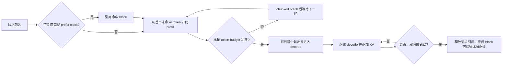

# 推理执行与 KV cache

自回归模型服务同时推进许多长度不同、到达时间不同的请求。每个请求先处理已有输入，再逐步生成输出；引擎在每次迭代中选择哪些请求继续执行，并为它们保留后续注意力所需的状态。理解这条路径需要把四件事分开：计算阶段、调度 batch、KV 状态容量，以及“释放请求状态”与“保留可复用前缀”之间的差别。

本文用 vLLM `v0.14.0` 作为可复核样板。`generic` 表示这些区分可用于组织不同推理后端的证据，不表示各引擎有相同 scheduler、block 大小、默认策略、缓存格式或硬件支持。

## 从输入到连续输出

对一个普通生成请求，可以用两个逻辑阶段描述主要工作：

| 阶段 | 输入状态 | 主要工作 | 输出边界 |
|---|---|---|---|
| prefill | 完整 prompt token，以及可能已经命中的 prefix KV | 处理尚未缓存的输入上下文，为各层建立 KV 状态，并得到首个生成位置的结果 | 第一次可观察输出；它常被用于定义 TTFT，但“首输出”是否正好含一个非空 token 取决于服务协议与实现 |
| decode | 已有 prompt 和已生成 token 对应的 KV 状态 | 每一步只为新增位置计算并追加状态，继续自回归生成 | 后续一个或多个 token/update；stream chunk、engine update 与 token 不保证一一对应 |

这是逻辑阶段，不是 kernel 数量或固定线程时间线。同一次 prefill 可以被切成多段；一次引擎 update 可以接收多个新 token；多模态 encoder、投机解码、并行策略或后端插件也会加入额外阶段。固定 vLLM 服务端统计把第一次 `is_prefilling` output 记为首 token，并用其后的 engine output timestamp 形成 ITL；同一实现以 `len(new_token_ids)` 增加 token 数，说明“一个 update 等于一个 token”并不是安全假设（[`stats.py` 256–305](https://github.com/vllm-project/vllm/blob/b17039bccc17b94a2ea107272ad7bc93508708df/vllm/v1/metrics/stats.py#L256-L305)）。

## batch 是每次迭代的调度结果

在线服务中的 batch 通常不是一组从头到尾锁定同行的请求。请求不断到达、结束、被抢占或恢复，scheduler 每次迭代重新决定活动集合及 token 预算。因此同一个迭代 batch 可以含：

- 正在产生后续输出的 decode 请求；
- 尚未完成 prompt 处理的 prefill 请求；
- 只处理部分 prompt 的 chunked prefill；
- prefix cache 命中后仅需处理剩余输入的请求。

固定 vLLM V1 的文档说明，chunked prefill 会把大 prefill 切成小块，并可与 decode 请求同批。其策略先安排 pending decode，再用 `max_num_batched_tokens` 的剩余预算安排 pending prefill；放不下的 prefill 会继续分块。文档把该特性描述为“whenever possible”默认启用，而不是无条件对所有模型与配置启用（[`optimization.md` 30–48](https://github.com/vllm-project/vllm/blob/b17039bccc17b94a2ea107272ad7bc93508708df/docs/configuration/optimization.md#L30-L48)）。



这个图没有表达具体线程、stream、kernel 或设备同步点。它只用于区分 scheduler 决策、请求阶段与缓存生命周期。

## KV cache 保存什么，容量由什么决定

注意力层在后续生成时需要历史位置的 key/value。若每一步都从头计算全部历史，上下文越长，重复工作越多；KV cache 以设备或分层存储中的空间换取对历史状态的复用。

对普通、未压缩的 dense attention，单 token 的逻辑 KV payload 可按以下维度理解：

```text
层数 × 2(K 和 V) × KV head 数 × head dimension × 每元素 byte 数
```

这只是张量维度关系，不是任一引擎承诺的实际分配公式。实际容量还会受到 block/page 粒度、对齐与 metadata、模型架构、GQA/MQA/MLA、KV dtype 或量化、并行切分、滑动窗口、跨层共享、CPU/远端 offload、prefix 副本、临时 workspace 和后端 allocator 的影响。报告“可放多少 token”时必须同时给出模型、KV 形状/dtype、并行布局、设备/层级、block 配置和其他内存占用；只写显存容量或上下文长度不能复现结论。

容量是**同时存活的状态**约束。相同请求吞吐下，更多并发序列、更长的保留上下文和更多未结束输出通常会扩大活动 KV 集合；prefix cache 还可能在请求结束后保留空闲但可复用的 block。固定 vLLM 文档说明它按内存比例预分配 GPU cache，降低并发序列或每轮 batched-token 上限会减少 KV 压力，但这些是该版本的配置关系，不是本文对其他引擎的参数建议（[`optimization.md` 19–24](https://github.com/vllm-project/vllm/blob/b17039bccc17b94a2ea107272ad7bc93508708df/docs/configuration/optimization.md#L19-L24)）。

## 容量不足、抢占重算与驱逐不是同一件事

| 事件 | 作用对象 | 对请求进度的影响 | 后续代价 |
|---|---|---|---|
| 请求正常结束后释放引用 | 已结束请求持有的 block | 请求已完成 | 引用数归零的 block 可进入 free queue；内容可能暂时保留供 prefix reuse |
| prefix-cache 驱逐 | 已空闲、仍带 cache identity 的 block | 不撤销正在运行请求的进度 | 后续相同 prefix 不能命中，需要重新 prefill |
| 活动请求抢占 | 仍未结束的请求 | 暂停其运行并释放容量 | 固定 vLLM V1 默认使用 `RECOMPUTE`，恢复时重算相应状态，增加完成时间与计算量 |
| 外部 KV load 失败 | 依赖 connector/offload 等路径的请求 | 可能直接错误结束 | 固定 vLLM finish reason 将 KV load failure 列为 request-level `ERROR` 示例；是否重试及观测路径需按实现确认 |

vLLM `v0.14.0` 文档明确说，KV 空间不足时可抢占请求，容量再次可用后重算；V1 默认 preemption mode 是 `RECOMPUTE`，抢占与重算会影响端到端延迟（[`optimization.md` 10–28](https://github.com/vllm-project/vllm/blob/b17039bccc17b94a2ea107272ad7bc93508708df/docs/configuration/optimization.md#L10-L28)）。这不能概括成所有后端都采用重算：其他实现可能 swap、offload、拒绝新请求或使用不同优先级。

“缓存驱逐”也不表示删除模型权重、结束请求或清空整个 KV pool。固定 prefix-cache 设计在 free queue 头部遇到 cached block 时执行 LRU 驱逐：从队列取出 block、从 cache mapping 删除 block ID，并清除 block hash（[`prefix_caching.md` 193–203](https://github.com/vllm-project/vllm/blob/b17039bccc17b94a2ea107272ad7bc93508708df/docs/design/prefix_caching.md#L193-L203)）。只有在该 allocator 和版本范围内，才能把这个动作称作这里的 LRU。

## prefix cache 的复用边界

固定 vLLM V1 使用基于 block 的哈希身份。hash 组件包括父 block hash、当前 block 的精确 token，以及 LoRA ID、多模态输入 hash 或 cache salt 等额外隔离信息；并且**只缓存完整 block**（[`prefix_caching.md` 5–26](https://github.com/vllm-project/vllm/blob/b17039bccc17b94a2ea107272ad7bc93508708df/docs/design/prefix_caching.md#L5-L26)）。由此得到几个边界：

1. 两个 prompt 共享一段文本，不保证所有共同 token 都命中；最后一个不完整 block 不能按该设计复用。
2. 相同 token 仍可能因 LoRA、多模态输入或 cache salt 不同而不能共享。反过来，缺少正确隔离字段会带来错误复用或租户侧信道风险。
3. 命中复用的是已经计算的 prefix KV，不会跳过剩余 prefill、采样、decode 或输出传输。
4. cache hit rate 必须说明分子/分母是 token、block 还是 request。固定 vLLM 的 `prefix_cache_queries`/`hits` counter 以 queried/cached token 数递增，不能直接称作“命中请求比例”（[`loggers.py` 498–515](https://github.com/vllm-project/vllm/blob/b17039bccc17b94a2ea107272ad7bc93508708df/vllm/v1/metrics/loggers.py#L498-L515)、[`loggers.py` 1043–1047](https://github.com/vllm-project/vllm/blob/b17039bccc17b94a2ea107272ad7bc93508708df/vllm/v1/metrics/loggers.py#L1043-L1047)）。

新请求先计算可命中 block，再分配 slots；命中的 block 会增加引用并从 free queue 移出，避免在使用中被驱逐。新 block 从 free queue 头部分配，若该位置仍是 cached block，会在重新分配前驱逐其 cache identity；运行中的请求继续追加 token，block 满后才加入缓存（[`prefix_caching.md` 119–150](https://github.com/vllm-project/vllm/blob/b17039bccc17b94a2ea107272ad7bc93508708df/docs/design/prefix_caching.md#L119-L150)）。所以“free”在这里可以表示没有活动引用，不一定表示内容已清零或不可复用。

## chunked prefill 的收益与代价要按指标拆开

prefill 往往更偏计算密集，decode 往往更受历史状态读写和内存带宽影响；把大 prefill 分块能让 decode 请求较快重新获得迭代机会。但这一策略会改变 batch 组成和等待位置，不能只用一个“延迟变好”概括。

固定 vLLM 文档把较小 `max_num_batched_tokens` 与更好的 ITL、较大的值与更好的 TTFT 联系起来，并给出特定调优建议（[`optimization.md` 41–48](https://github.com/vllm-project/vllm/blob/b17039bccc17b94a2ea107272ad7bc93508708df/docs/configuration/optimization.md#L41-L48)）。这些只是该版本文档对其 scheduler 的经验说明：实际结果会随模型、prompt/output 长度分布、并发、硬件、投机解码、prefix 命中和后端变化。正文保留机制与取舍，不复制示例数值为通用推荐。

比较策略时至少同时观察：

- TTFT、queue time 与 prefill time，判断新请求是否被分块或等待；
- ITL、decode time 与每轮 batch token 组成，判断 decode 是否更频繁获得调度；
- E2E 与抢占次数，避免局部 ITL 改善掩盖总完成时间或重算；
- request/output-token throughput 与 goodput，区分系统产量和满足 SLO 的产量；
- KV 使用量、prefix queried/hit tokens、驱逐和外部 KV load 事件，解释缓存状态。

这些指标的客户端/服务端窗口和聚合口径见[推理延迟与吞吐指标字典](latency-metrics.md)。

## Ascend 样板只能证明自身固定范围

vLLM Ascend `v0.14.0rc1` 固定功能矩阵把 Chunked Prefill 与 Automatic Prefix Caching 标为 Functional（[`supported_features.md` 7–33](https://github.com/vllm-project/vllm-ascend/blob/52d4acfa51fb868823d1070b81cbd2d97e9e4696/docs/source/user_guide/support_matrix/supported_features.md#L7-L33)）。这项状态不能继承为“所有 Ascend 模型/硬件组合支持”：

- 固定 README 列出 Atlas A2/A3 系列与 experimental 的 Atlas 300I Duo，并给出当时的软件要求；这些范围属于该插件快照（[`README.md` 49–56](https://github.com/vllm-project/vllm-ascend/blob/52d4acfa51fb868823d1070b81cbd2d97e9e4696/README.md#L49-L56)）。
- 同一 RC 的 release notes 对 310P 明确限制为 basic dense/VL models 且使用 eager mode（[`release_notes.md` 3–12](https://github.com/vllm-project/vllm-ascend/blob/52d4acfa51fb868823d1070b81cbd2d97e9e4696/docs/source/user_guide/release_notes.md#L3-L12)）。
- 固定 `conf.py` 的实际 substitution 是 vLLM `v0.14.1` 与 vLLM Ascend `v0.14.0rc1`，而本文上游样板是 vLLM `v0.14.0`（[`conf.py` 62–80](https://github.com/vllm-project/vllm-ascend/blob/52d4acfa51fb868823d1070b81cbd2d97e9e4696/docs/source/conf.py#L62-L80)）。两组快照没有被本库安装或配套验证。
- 功能矩阵链接的 GitHub issue 仅是进一步定位；issue 的关闭状态不被当作功能已修复、已发布或适用于目标模型的证据。

因此，目标 NPU 环境还需固定插件、vLLM、CANN、PyTorch/torch-npu、模型、dtype、硬件和执行模式，再分别验证功能与性能。本文没有提供任何 Ascend 启动参数或兼容组合。

## 建立可解释执行记录

要把缓存或调度现象变成可复核证据，至少保存：

| 类别 | 字段 |
|---|---|
| 版本身份 | 引擎/插件 commit 或包版本，模型 revision，runtime、driver、firmware，硬件型号 |
| 请求形状 | endpoint、prompt/output token 计数方法，长度分布，多模态/LoRA/cache salt，arrival 与并发策略 |
| scheduler | 每轮 token budget、max sequences、chunked-prefill 状态、优先级/抢占模式、投机解码与并行配置 |
| KV 结构 | KV dtype/形状、block/page 大小、pool 层级、容量、offload/connector、prefix caching 与隔离配置 |
| 状态事件 | allocate/touch/free/evict、preempt/resume/recompute、cache query/hit/load/error、request finish reason |
| 时间窗口 | cold/warm 状态、ready check/warmup、测量起止、服务端/客户端时钟和 proxy/stream 路径 |
| 输出 | TTFT/ITL/TPOT/E2E、throughput/goodput、失败/取消计数及 percentile 的样本与聚合定义 |

这些字段用于描述条件，不是要求某个后端必须暴露同名指标。缺失字段应标为 `unknown`，不能从另一平台或上游引擎推断。

## 来源范围与待验证项

- [vLLM v0.14.0 固定 prefix caching 设计](https://github.com/vllm-project/vllm/blob/b17039bccc17b94a2ea107272ad7bc93508708df/docs/design/prefix_caching.md)与[optimization 文档](https://github.com/vllm-project/vllm/blob/b17039bccc17b94a2ea107272ad7bc93508708df/docs/configuration/optimization.md)：支持本文对固定 vLLM V1 block、抢占重算和 chunked-prefill 调度的描述。
- [vLLM Ascend v0.14.0rc1 固定快照](https://github.com/vllm-project/vllm-ascend/tree/52d4acfa51fb868823d1070b81cbd2d97e9e4696)：只支持插件自身的 feature 状态、文档变量与硬件/310P 限制。
- 来源的逐文件范围、许可证、内部版本冲突和未解决问题见[第四批研究记录](../../docs/research/batch-04-inference-sources.md)。

待验证：目标模型的真实 KV bytes/token、allocator padding、block 数与可用容量；prefix hit/eviction 和 cache salt 行为；抢占、重算与外部 KV load 的完整事件；chunked-prefill 在目标请求分布上的 TTFT/ITL/E2E/goodput；取消与错误对缓存引用的清理；以及目标 NPU 软件栈的模型/硬件支持。本库没有执行上述实验。
