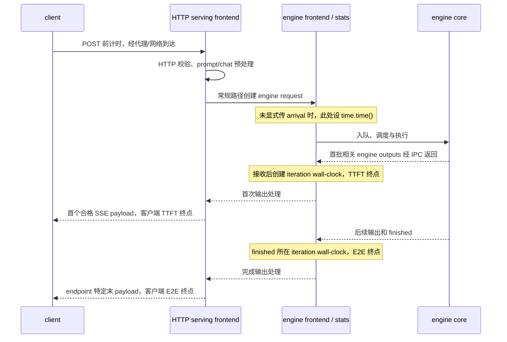

# 推理延迟与吞吐指标字典

同一个“TTFT”可以从浏览器发请求前计到首个 SSE chunk，也可以从 engine request 的 arrival 计到 frontend 收到首批相关 engine outputs 后的统计时刻。两者都合理，但包含的网络、排队、序列化和解析时间不同。比较推理指标时，名称相同不是充分条件；还必须固定样本对象、单位、起止事件、失败过滤、测量窗口与聚合方法。

本文以 vLLM `v0.14.0` 的服务端指标和 `bench serve` 实现作为精确样板，提供一套记录模板。它不是跨引擎标准，也没有给出任何通用 SLO 或性能阈值。prefill、decode、chunked prefill、抢占与 KV cache 的执行边界见[推理执行与 KV cache](execution-and-kv-cache.md)。

## 一张表先固定口径

| 名称 | 样本对象 | 常用单位 | 本页定义的核心关系 | 首要边界 |
|---|---|---|---|---|
| TTFT | request | s 或 ms/request | 请求起点到首个可观察输出 | 客户端首 stream payload 与服务端首 engine output 不同；首输出不保证正好一个非空 token |
| TPOT | request | s/token 或 ms/token | 首 token 之后的平均输出 token 时间，通常为 `(E2E-TTFT)/(Nout-1)` | 必须说明 0/1 token 怎样处理；不能与 ITL 同名互换 |
| ITL | 相邻 output update/chunk interval | s 或 ms/interval | 后续两个可观察输出之间的间隔 | chunk/update 可含多个 token；跨请求扁平化会按 interval 数加权 |
| E2E/E2EL | request | s 或 ms/request | 请求起点到所选完成事件 | completion、chat、server 的结束事件不同；连接关闭、usage 与 `[DONE]` 是否计入需明确 |
| request throughput | 窗口 | request/s | 成功完成请求数 ÷ 窗口时长 | 不等于发起速率；失败/取消是否进入分子需明确 |
| output-token throughput | 窗口 | token/s | 成功请求的输出 token 总数 ÷ 窗口时长 | token 计数可能来自 usage 或 tokenizer 回算 |
| total-token throughput | 窗口 | token/s | 成功请求的输入+输出 token 总数 ÷ 窗口时长 | 不是 decode-only 速度，也不等于硬件 token 峰值 |
| goodput | 窗口 | good request/s | 同时满足已声明 SLO 的成功请求数 ÷ 窗口时长 | 没有 SLO 集合就没有可复现 goodput；阈值和失败规则都必须保存 |

符号 `Nout` 必须绑定到一种 token 计数器及 tokenizer/model revision。stream chunk 数、引擎 output update 数和 token 数不是同一个量。

## 客户端和服务端看到的时间线



图以固定 vLLM 常规 OpenAI chat/completion 路径为样板，不假定各观察者共享时钟。HTTP 接收请求、完成 prompt/chat 预处理与创建 engine request 是不同事件：chat 先 `_preprocess_chat`，再调用 `_process_inputs`，后者未传 `arrival_time`，因此 `InputProcessor` 此时才用 `time.time()` 设置默认起点（[`serving_chat.py` 300–327](https://github.com/vllm-project/vllm/blob/b17039bccc17b94a2ea107272ad7bc93508708df/vllm/entrypoints/openai/serving_chat.py#L300-L327)、[407–428](https://github.com/vllm-project/vllm/blob/b17039bccc17b94a2ea107272ad7bc93508708df/vllm/entrypoints/openai/serving_chat.py#L407-L428)、[`serving_engine.py` 1209–1320](https://github.com/vllm-project/vllm/blob/b17039bccc17b94a2ea107272ad7bc93508708df/vllm/entrypoints/openai/serving_engine.py#L1209-L1320)、[`input_processor.py` 470–471](https://github.com/vllm-project/vllm/blob/b17039bccc17b94a2ea107272ad7bc93508708df/vllm/v1/engine/input_processor.py#L470-L471)）。completion 也先 render prompt，再创建请求（[`serving_completion.py` 127–140](https://github.com/vllm-project/vllm/blob/b17039bccc17b94a2ea107272ad7bc93508708df/vllm/entrypoints/openai/serving_completion.py#L127-L140)、[227–247](https://github.com/vllm-project/vllm/blob/b17039bccc17b94a2ea107272ad7bc93508708df/vllm/entrypoints/openai/serving_completion.py#L227-L247)）。

因此这个默认服务端窗口不包含此前已完成的 HTTP 校验和 chat template/tokenization 等工作。其他调用路径可显式传入 arrival，不能把这一结论外推为所有入口均排除所有预处理。客户端窗口则还涉及网络、代理、HTTP 处理和流式解析。

没有跨层 trace 和已知时钟关系时，不能把客户端 TTFT 减服务端 TTFT称作“网络延迟”。两者的起止事件、排队覆盖和时间源可能都不同。

## TTFT：首输出边界必须写出来

### 固定 vLLM 服务端

服务端 TTFT 使用 engine request 的 `arrival_time` 与 frontend 接收输出后创建的 iteration timestamp，两者都是 wall-clock。`AsyncLLM.output_handler` 先等待 `get_output_async()`，再创建 `IterationStats`；后者用 `time.time()`。首次 `is_prefilling` output 的 TTFT 是该 iteration 时刻减 arrival，因此包含 engine→frontend 的 IPC 与相关等待，不是 engine-core 刚产出 token 的时刻（[`async_llm.py` 498–519](https://github.com/vllm-project/vllm/blob/b17039bccc17b94a2ea107272ad7bc93508708df/vllm/v1/engine/async_llm.py#L498-L519)、[`stats.py` 233–237](https://github.com/vllm-project/vllm/blob/b17039bccc17b94a2ea107272ad7bc93508708df/vllm/v1/metrics/stats.py#L233-L237)、[252–305](https://github.com/vllm-project/vllm/blob/b17039bccc17b94a2ea107272ad7bc93508708df/vllm/v1/metrics/stats.py#L252-L305)）。

Prometheus 名称为 `vllm:time_to_first_token_seconds`，类型为 histogram（[`loggers.py` 683–715](https://github.com/vllm-project/vllm/blob/b17039bccc17b94a2ea107272ad7bc93508708df/vllm/v1/metrics/loggers.py#L683-L715)）。它不能直接拆成 queue、prefill、scheduler、计算或返回 IPC；阶段统计与 trace 需各自核对起止。

| 统计 | 时间源 | 边界 |
|---|---|---|
| 服务端 TTFT / E2E | frontend `time.time()` wall-clock | engine request arrival → 首次/finished 相关输出接收后的 iteration 时刻；受 wall-clock 调整影响 |
| 服务端 ITL 与 queue/prefill/decode/inference | engine-core monotonic timestamps | 在 engine-core 事件域内相减；不能与 wall-clock 原值相减 |
| 固定 benchmark 客户端 | `time.perf_counter()` | 在该客户端进程内计 interval；不与服务端原始 timestamp 直接相减 |

engine-core 输出时间源见 [`EngineCoreOutputs` 191–193](https://github.com/vllm-project/vllm/blob/b17039bccc17b94a2ea107272ad7bc93508708df/vllm/v1/engine/__init__.py#L191-L193)，phase 和 E2E 公式见 [`stats.py` 331–377](https://github.com/vllm-project/vllm/blob/b17039bccc17b94a2ea107272ad7bc93508708df/vllm/v1/metrics/stats.py#L331-L377)。

### 固定 `bench serve` 客户端

OpenAI completion endpoint 在调用 `session.post` 前取 `time.perf_counter()`；收到首个可解析、非 `[DONE]` 且含 `choices` 的 SSE payload 时结束 TTFT。源码明确说 payload 的 `text` 可以为空，例如只含特殊 token；后续同类 payload 才形成 ITL。若整个 HTTP 200 响应没有有效 `choices` chunk，completion 分支把请求标为失败（[`endpoint_request_func.py` 179–241](https://github.com/vllm-project/vllm/blob/b17039bccc17b94a2ea107272ad7bc93508708df/vllm/benchmarks/lib/endpoint_request_func.py#L179-L241)）。

chat endpoint 也在 POST 前计时，以首个含 `choices` 的 payload 设 TTFT；但固定实现的 HTTP 200 分支最终直接标 success，没有像 completion 分支一样验证一定收到有效 choices（[`endpoint_request_func.py` 312–365](https://github.com/vllm-project/vllm/blob/b17039bccc17b94a2ea107272ad7bc93508708df/vllm/benchmarks/lib/endpoint_request_func.py#L312-L365)）。报告必须保存 endpoint type，不能把两条路径的成功和结束语义合并。

因此客户端 TTFT 的安全名称是“time to first qualifying streamed payload”。只有在协议和 tokenizer 证据证明该 payload 含一个新 token 时，才能进一步称作严格的“首 token 到达时间”。

## TPOT：请求级均值，分母从第二个 token 开始

固定 `bench serve` 对成功请求计算：

```text
TPOT = (client E2E - client TTFT) / (output_tokens - 1)
```

仅当 `output_tokens > 1` 时，这个值进入 TPOT 分布；对 0/1 token 请求，goodput 检查使用的 `all_tpots` 放入 0（[`serve.py` 404–445](https://github.com/vllm-project/vllm/blob/b17039bccc17b94a2ea107272ad7bc93508708df/vllm/benchmarks/serve.py#L404-L445)）。所以同一运行的 TPOT percentile 样本数可能小于 completed request 数，而一 token 请求又可能自动满足非负 TPOT SLO。报告应同时给出 TPOT eligible 请求数和 0/1 token 请求数。

固定服务端对 finished request 计算：

```text
request TPOT = decode_time / (num_generation_tokens - 1)
```

其中 decode 从 first NEW_TOKEN 到 last NEW_TOKEN，并把 decode 期间的抢占包含在内；0/1 generation token 时值为 0（[`stats.py` 331–377](https://github.com/vllm-project/vllm/blob/b17039bccc17b94a2ea107272ad7bc93508708df/vllm/v1/metrics/stats.py#L331-L377)）。对应 histogram 是 `vllm:request_time_per_output_token_seconds`。

旧指标 `vllm:time_per_output_token_seconds` 在 vLLM `v0.14.0` 已标为 deprecated，内容实际沿用逐 interval ITL；不能把它与 request TPOT 混用。固定源码建议使用 `vllm:inter_token_latency_seconds`（[`loggers.py` 718–812](https://github.com/vllm-project/vllm/blob/b17039bccc17b94a2ea107272ad7bc93508708df/vllm/v1/metrics/loggers.py#L718-L812)）。

## ITL：观察到的是输出间隔，不一定是 token 间隔

### 客户端 ITL

completion/chat 客户端在首个 qualifying payload 之后，把相邻 payload timestamp 的差加入 `output.itl`。源码同时提醒 output token 可能被捆绑，usage 缺失时不能用 `len(itl)` 作为 token 数，而是用 tokenizer 对生成文本回算；回算还可能轻微高估（[`endpoint_request_func.py` 213–231](https://github.com/vllm-project/vllm/blob/b17039bccc17b94a2ea107272ad7bc93508708df/vllm/benchmarks/lib/endpoint_request_func.py#L213-L231)、[`serve.py` 416–439](https://github.com/vllm-project/vllm/blob/b17039bccc17b94a2ea107272ad7bc93508708df/vllm/benchmarks/serve.py#L416-L439)）。

`bench serve` 把所有成功请求的 `output.itl` 直接拼成一个列表后计算均值和 percentile（[`serve.py` 439–445](https://github.com/vllm-project/vllm/blob/b17039bccc17b94a2ea107272ad7bc93508708df/vllm/benchmarks/serve.py#L439-L445)、[`serve.py` 572–577](https://github.com/vllm-project/vllm/blob/b17039bccc17b94a2ea107272ad7bc93508708df/vllm/benchmarks/serve.py#L572-L577)）。这是一种 **interval-weighted** 聚合：输出更长、chunk 更多的请求贡献更多样本；它不是先求每请求 p99 再平均，也不是 request-weighted p99。

### 服务端 ITL

固定服务端在首次 output 后，以相邻 engine-core output timestamp 之差记录 `inter_token_latencies_iter`。同一个 update 又用 `len(output.new_token_ids)` 增加生成 token 数（[`stats.py` 256–305](https://github.com/vllm-project/vllm/blob/b17039bccc17b94a2ea107272ad7bc93508708df/vllm/v1/metrics/stats.py#L256-L305)）。当一次 update 有多个 token 时，一个 ITL observation 不能解释为“每 token 的时间”。对应 Prometheus histogram 是 `vllm:inter_token_latency_seconds`。

因此报告 ITL 时还要保存 speculative decoding、stream flush/coalescing、endpoint、chunk/update 数和 generation token 数。跨实现比较前，先确认 observation 是否代表 token、chunk、iteration 或 output update。

## E2E：完成事件随 endpoint 改变

固定服务端 `e2e_request_latency_seconds` 在请求形成 finished stats 时，用接收到 finished 相关输出后的 iteration wall-clock 减 engine request arrival time（[`stats.py` 331–377](https://github.com/vllm-project/vllm/blob/b17039bccc17b94a2ea107272ad7bc93508708df/vllm/v1/metrics/stats.py#L331-L377)、[`loggers.py` 838–845](https://github.com/vllm-project/vllm/blob/b17039bccc17b94a2ea107272ad7bc93508708df/vllm/v1/metrics/loggers.py#L838-L845)）。它不包括 finished observation 之后的 HTTP serialization、proxy flush、网络或客户端读取。

固定客户端实现没有一个跨 endpoint 完全统一的终点：

- completion 在每个含 `choices` 的 payload 更新 `most_recent_timestamp`，usage-only 和 `[DONE]` 不更新；latency 是最后一个 choices timestamp 减 POST 前起点；
- chat 在每个非 `[DONE]` payload 后更新 `most_recent_timestamp`，因此 usage-only payload 也可能推进终点；`[DONE]` 与连接关闭不进入该时间。

精确实现见 [`endpoint_request_func.py` completion 179–241](https://github.com/vllm-project/vllm/blob/b17039bccc17b94a2ea107272ad7bc93508708df/vllm/benchmarks/lib/endpoint_request_func.py#L179-L241) 与 [chat 312–365](https://github.com/vllm-project/vllm/blob/b17039bccc17b94a2ea107272ad7bc93508708df/vllm/benchmarks/lib/endpoint_request_func.py#L312-L365)。若业务关心“客户端拿到完整 usage”“收到 `[DONE]`”“body EOF”或 UI 完成渲染，需要另设指标；不能把这些终点塞进未说明的 E2E。

## queue、prefill、decode 和 inference 是解释项

固定服务端 finished-request stats 给出以下区间：

| 名称 | 起点 | 终点 | 抢占是否包含 |
|---|---|---|---|
| queue | 第一次 QUEUED | 第一次 SCHEDULED | 首次 scheduled 之后的等待不回写为初始 queue |
| prefill | 第一次 SCHEDULED | 第一次 NEW_TOKEN | 是，prefill 期间抢占包含在该区间 |
| decode | 第一次 NEW_TOKEN | 最后一次 NEW_TOKEN | 是，decode 期间抢占包含在该区间 |
| inference | 第一次 SCHEDULED | 最后一次 NEW_TOKEN | 是，prefill/decode 期间抢占都包含 |

来源是 [`stats.py` 319–377](https://github.com/vllm-project/vllm/blob/b17039bccc17b94a2ea107272ad7bc93508708df/vllm/v1/metrics/stats.py#L319-L377)。这些名字只属于固定实现；它们不能与客户端网络时间相加后强行闭合，也不能假设 E2E 恰好等于 queue+prefill+decode。frontend 处理、统计时间点和边界差异可能留下其他区间。

## throughput：先说清分子和窗口

固定 `bench serve` 的主窗口在创建主 benchmark 请求之前用 `perf_counter` 开始，在全部 request tasks `gather` 返回后结束。合成 arrival delay、semaphore 并发等待和所有主请求完成都在窗口内；ready check、显式 warmup 和 profiler 启动在窗口外（[`serve.py` 617–712](https://github.com/vllm-project/vllm/blob/b17039bccc17b94a2ea107272ad7bc93508708df/vllm/benchmarks/serve.py#L617-L712)、[`serve.py` 763–845](https://github.com/vllm-project/vllm/blob/b17039bccc17b94a2ea107272ad7bc93508708df/vllm/benchmarks/serve.py#L763-L845)）。

在这个窗口上，固定实现计算：

```text
request throughput     = completed successful requests / duration
output-token throughput = sum(successful output token counts) / duration
total-token throughput  = (successful input + output token counts) / duration
```

精确实现见 [`serve.py` 550–558](https://github.com/vllm-project/vllm/blob/b17039bccc17b94a2ea107272ad7bc93508708df/vllm/benchmarks/serve.py#L550-L558)。所以“tokens/s”必须补全为 output、input+output、服务端 counter rate、单请求 decode rate或其他定义。不同分子不能放在同一列比较。

客户端 request rate 默认 `inf`，意味着合成到达延迟为 0；可显式设为 Poisson/gamma arrival。`max_concurrency` 是可选限制，源码明确警告它可能让实际发起速率低于配置 request rate（[`serve.py` 1202–1213](https://github.com/vllm-project/vllm/blob/b17039bccc17b94a2ea107272ad7bc93508708df/vllm/benchmarks/serve.py#L1202-L1213)、[`serve.py` 1271–1291](https://github.com/vllm-project/vllm/blob/b17039bccc17b94a2ea107272ad7bc93508708df/vllm/benchmarks/serve.py#L1271-L1291)）。arrival rate、attempted rate、completed throughput 和 concurrency 是四个不同条件/结果。

服务端的 `vllm:prompt_tokens`、`vllm:generation_tokens` 是 counters（[`loggers.py` 573–599](https://github.com/vllm-project/vllm/blob/b17039bccc17b94a2ea107272ad7bc93508708df/vllm/v1/metrics/loggers.py#L573-L599)）。把 counter 变成 token/s 还必须选择 rate window、重启处理和标签聚合；不能拿某一时刻的累积值除以未知 uptime。

## goodput：满足哪些 SLO 的请求

固定客户端 goodput 只对成功请求检查。用户可显式提供 TTFT、TPOT、E2E 的毫秒阈值；同一个请求必须满足所有已提供条件才计为 good completed，最后除以主 benchmark duration（[`serve.py` 447–470](https://github.com/vllm-project/vllm/blob/b17039bccc17b94a2ea107272ad7bc93508708df/vllm/benchmarks/serve.py#L447-L470)、[`serve.py` 555–558](https://github.com/vllm-project/vllm/blob/b17039bccc17b94a2ea107272ad7bc93508708df/vllm/benchmarks/serve.py#L555-L558)）。

一个可复现的 goodput 结果必须同时报告：

- 每个 SLO 的名称、阈值、单位与 AND/OR 组合；
- 使用的客户端 endpoint、TTFT/E2E 边界和 TPOT 的 0/1 token 规则；
- attempted、completed、failed、cancelled 或 unknown 数量；
- 请求长度、arrival、concurrency、warm/cache 状态和 measurement duration；
- good completed 数，而不只给 good request/s。

不同 SLO 集合的 goodput 不能直接比较。没有显式 SLO 时，固定工具不会产生可解释的 request goodput；普通 throughput 不能改名为 goodput。

## 错误、取消和 cache-load failure 怎样进入统计

固定 vLLM `FinishReason` 有 `STOP`、`LENGTH`、`ABORT`、`ERROR`。源码把 ABORT 描述为客户端取消，把 ERROR 描述为可重试的 request-level internal error，并以 KV load failure 为例（[`engine/__init__.py` 26–43](https://github.com/vllm-project/vllm/blob/b17039bccc17b94a2ea107272ad7bc93508708df/vllm/v1/engine/__init__.py#L26-L43)）。Prometheus `vllm:request_success` 虽名为 success，实际按 finish reason 建标签并对 finished requests 增量（[`loggers.py` 602–616](https://github.com/vllm-project/vllm/blob/b17039bccc17b94a2ea107272ad7bc93508708df/vllm/v1/metrics/loggers.py#L602-L616)、[`loggers.py` 1123–1147](https://github.com/vllm-project/vllm/blob/b17039bccc17b94a2ea107272ad7bc93508708df/vllm/v1/metrics/loggers.py#L1123-L1147)）。因此查询必须保留 finish reason，不能把 counter 总和称作“成功请求”。

外部 abort 路径会产生 `FinishReason.ABORT` final output，但本轮代码阅读没有证明所有断连/取消入口都会进入同一个 `FinishedRequestStats` 与 histogram 路径（[`output_processor.py` 393–456](https://github.com/vllm-project/vllm/blob/b17039bccc17b94a2ea107272ad7bc93508708df/vllm/v1/engine/output_processor.py#L393-L456)、[`output_processor.py` 696–713](https://github.com/vllm-project/vllm/blob/b17039bccc17b94a2ea107272ad7bc93508708df/vllm/v1/engine/output_processor.py#L696-L713)）。取消覆盖率保持待验证。

`bench serve` 只把 `output.success` 为真的请求纳入 TTFT/TPOT/ITL/E2E 分布和 token 分子；非 200、异常及 completion 无有效 chunk 会进入 failed，output length 记 0（[`serve.py` 404–489](https://github.com/vllm-project/vllm/blob/b17039bccc17b94a2ea107272ad7bc93508708df/vllm/benchmarks/serve.py#L404-L489)）。这会产生幸存者偏差：延迟 p99 可能变好，同时失败数上升。每张 latency/throughput 表都应并列错误与取消计数，并说明 timeout 是否由客户端、proxy 或服务端判定。

## warmup、ready check 与 cache 状态

固定 CLI 的默认值是：

| 项 | 默认 | 边界 |
|---|---|---|
| ready check timeout | `0`，默认跳过 | `benchmark()` 函数签名默认 600，但 CLI 值显式传入，所以普通 CLI 默认不是 600 |
| warmup requests | `0` | 显式配置后在主计时前重复同一个 test input |
| request rate | `inf` | 所有请求合成到达延迟为 0；仍可受 max concurrency 限制 |
| percentile metrics | 生成任务默认 TTFT、TPOT、ITL | E2E percentile 需显式选择；pooling 默认 E2E |
| metric percentiles | `99` | 只表示请求的 p99 参数，不说明样本过滤和窗口 |

来源见 [`serve.py` warmup 617–712](https://github.com/vllm-project/vllm/blob/b17039bccc17b94a2ea107272ad7bc93508708df/vllm/benchmarks/serve.py#L617-L712)、[`CLI defaults` 1271–1307](https://github.com/vllm-project/vllm/blob/b17039bccc17b94a2ea107272ad7bc93508708df/vllm/benchmarks/serve.py#L1271-L1307)、[`percentiles` 1361–1395](https://github.com/vllm-project/vllm/blob/b17039bccc17b94a2ea107272ad7bc93508708df/vllm/benchmarks/serve.py#L1361-L1395)和 [`ready check` 1489–1496](https://github.com/vllm-project/vllm/blob/b17039bccc17b94a2ea107272ad7bc93508708df/vllm/benchmarks/serve.py#L1489-L1496)。

ready check/warmup 不计入主 duration，不等于没有影响。它们可能建立连接、触发编译、加载模型路径、升频或填充 prefix cache。反过来，默认 0 也不证明 cold start：服务可能已被其他请求预热，模型通常在 benchmark 前已经启动。记录至少包括服务启动时刻、ready/warmup 输入、模型/编译状态、prefix-cache 是否启用、共同前缀、cache salt、是否清空/重启以及主测量前其他流量。

“cache load”也要拆开：模型权重启动加载、prefix KV 本地命中、外部 KV connector load 和 cache miss/recompute 是不同事件。固定 `FinishReason.ERROR` 只以 KV load failure 举例，不能据此推断所有 cache miss 都是错误，或所有 load failure 都被客户端 benchmark 纳入 latency。

## percentile 与 aggregation

### 单次客户端 benchmark

固定 `bench serve` 对成功请求的 TTFT、TPOT、E2E 列表直接调用 NumPy percentile；ITL 对扁平 interval 列表调用同一函数（[`serve.py` 550–583](https://github.com/vllm-project/vllm/blob/b17039bccc17b94a2ea107272ad7bc93508708df/vllm/benchmarks/serve.py#L550-L583)）。因此结果必须附：

- percentile 算法/库与版本，尤其在跨工具比较时；
- 原始样本单位是 request 还是 interval；
- eligible、excluded、failed 数量；
- 一次 run 的 duration、arrival 与 concurrency；
- 是否把多次 run 合并原始样本，还是对各 run 的 percentile 再做统计。

所有请求失败时，工具会告警；代码对空列表采用标量 0 作为统计 fallback。这样的 0 不是低延迟证据，应与 `completed=0` 一起判为无有效 latency 样本（[`serve.py` 469–480](https://github.com/vllm-project/vllm/blob/b17039bccc17b94a2ea107272ad7bc93508708df/vllm/benchmarks/serve.py#L469-L480)、[`serve.py` 559–583](https://github.com/vllm-project/vllm/blob/b17039bccc17b94a2ea107272ad7bc93508708df/vllm/benchmarks/serve.py#L559-L583)）。

### 服务端 Prometheus histograms

vLLM 固定版本把 TTFT、ITL、request TPOT、E2E、queue、prefill、decode 和 inference 暴露为 histograms（[`loggers.py` 683–885](https://github.com/vllm-project/vllm/blob/b17039bccc17b94a2ea107272ad7bc93508708df/vllm/v1/metrics/loggers.py#L683-L885)）。Prometheus 官方 current 文档说明：classic histogram 的整体 quantile 应先在所选窗口对 bucket counter 取 rate，再按目标标签并保留 `le` 聚合，最后调用 `histogram_quantile()`；bucket 内结果是插值估计。预先计算的分位数不能通过平均得到整体分位数（[Histograms and summaries](https://prometheus.io/docs/practices/histograms/)、[`histogram_quantile`](https://prometheus.io/docs/prometheus/latest/querying/functions/#histogram_quantile)；2026-09-29 读取）。

所以一个服务端 p99 至少要记录：

| 字段 | 示例问题 |
|---|---|
| metric family | TTFT、ITL、request TPOT 还是 E2E？是否误用了 deprecated 名称？ |
| window | 最近 1m、5m、整场测试，还是滑动窗口？窗口是否覆盖预热或故障？ |
| population | 哪些 model/engine/instance/finish reason/tenant/endpoint？失败和取消是否有 observation？ |
| aggregation | 是单实例、按 model 聚合，还是全服务？classic histogram 是否保留 `le`？ |
| buckets | 各实例 bucket 边界是否兼容？目标 SLO 附近是否有足够分辨率？ |
| resets/gaps | counter reset、实例滚动、scrape gap 和缺失 series 如何处理？ |
| estimator | Prometheus histogram 插值，还是客户端原始样本 percentile？ |

官方页面是动态 `current/latest` 文档，本库没有把它固定到网站源 commit；以上原则保留读取日期，不作为特定 Prometheus/兼容后端版本的安装或查询处方。

## 最小实验记录模板

| 类别 | 必填内容 |
|---|---|
| 身份 | client/benchmark commit，server engine/plugin commit 或包版本，模型与 tokenizer revision，endpoint/protocol |
| 平台 | GPU/NPU 型号与数量、并行布局、runtime/driver/firmware、容器和 proxy/网络路径 |
| 请求 | attempted/completed/failed/cancelled，prompt/output token 计数来源与分布，arrival、burstiness、concurrency、sampling/stop 条件 |
| 调度与 KV | batch/token budgets、chunked prefill、preemption、spec decode、prefix cache/connector、cache salt、hit/query/load/error |
| 状态 | cold/warm 定义，ready check、warmup、服务启动和缓存清理边界，主测量前其他流量 |
| 时间 | 客户端/服务端起止事件，时钟，duration，超时责任层，是否含连接、usage、`[DONE]` 或 EOF |
| 指标 | 名称、单位、样本对象、eligible/excluded、分子/分母、percentile 算法或 histogram buckets/window/labels |
| 完整性 | finish reasons、HTTP/exception 分类、缺失数据、重启、scrape gap、异常或降级 |

只有这些条件可对齐时，两个数值才适合放入同一对照组。模型、长度分布、并发、cache state 或 endpoint 改变时，应保留为新的条件，而不是只保留更高吞吐或更低 p99 的结果。

## Ascend 与其他后端的边界

vLLM Ascend `v0.14.0rc1` 固定功能矩阵能支持该插件快照对 chunked prefill 与 automatic prefix caching 的状态标注，但没有为本文重新定义一套 NPU 专属 TTFT/TPOT/ITL 计时语义（[`supported_features.md` 7–33](https://github.com/vllm-project/vllm-ascend/blob/52d4acfa51fb868823d1070b81cbd2d97e9e4696/docs/source/user_guide/support_matrix/supported_features.md#L7-L33)）。不能仅因为它是 vLLM 硬件插件，就假定固定上游 `v0.14.0` 的每个 metric、benchmark endpoint 和取消/error 路径在该 RC、目标模型与 NPU 上全部存在或等价。

同一插件快照的文档 substitution 指向 vLLM `v0.14.1`，并列出自身硬件与软件范围；310P 还有 basic dense/VL 与 eager mode 限制（[`conf.py` 62–80](https://github.com/vllm-project/vllm-ascend/blob/52d4acfa51fb868823d1070b81cbd2d97e9e4696/docs/source/conf.py#L62-L80)、[`release_notes.md` 3–12](https://github.com/vllm-project/vllm-ascend/blob/52d4acfa51fb868823d1070b81cbd2d97e9e4696/docs/source/user_guide/release_notes.md#L3-L12)）。本文没有安装或验证该组合，也没有把上游 vLLM `v0.14.0` 与此插件拼成兼容配置。

对其他引擎、GPU/NPU 插件和服务协议，应复用本页的**记录字段**，重新读取其计时实现。不要复用 vLLM 的默认值、metric name 或成功过滤规则。

## 来源范围与待验证项

- [vLLM v0.14.0 固定 `stats.py`](https://github.com/vllm-project/vllm/blob/b17039bccc17b94a2ea107272ad7bc93508708df/vllm/v1/metrics/stats.py)、[`loggers.py`](https://github.com/vllm-project/vllm/blob/b17039bccc17b94a2ea107272ad7bc93508708df/vllm/v1/metrics/loggers.py)、[`endpoint_request_func.py`](https://github.com/vllm-project/vllm/blob/b17039bccc17b94a2ea107272ad7bc93508708df/vllm/benchmarks/lib/endpoint_request_func.py)与[`serve.py`](https://github.com/vllm-project/vllm/blob/b17039bccc17b94a2ea107272ad7bc93508708df/vllm/benchmarks/serve.py)：支持本文对固定版本服务端/客户端窗口、过滤、默认值和聚合对象的描述。
- [Prometheus Histograms and summaries](https://prometheus.io/docs/practices/histograms/)与[`histogram_quantile`](https://prometheus.io/docs/prometheus/latest/querying/functions/#histogram_quantile)：2026-09-29 读取的动态官方文档，只支持 histogram 聚合原则。
- [vLLM Ascend v0.14.0rc1 固定快照](https://github.com/vllm-project/vllm-ascend/tree/52d4acfa51fb868823d1070b81cbd2d97e9e4696)：只用于插件版本、功能与硬件边界。逐文件定位、许可证和版本冲突见[第四批研究记录](../../docs/research/batch-04-inference-sources.md)。

待验证：目标服务的 HTTP/proxy/stream flush 边界；client/server trace 对齐；错误、断连与取消的指标覆盖；KV load failure 与重试；spec decode 下 update/token 对应；不同 endpoint 的 usage/[DONE]/EOF；目标 Prometheus bucket 与 scrape 配置；cold/warm/cache 状态；以及目标 NPU 插件的实际 metric 暴露和模型/硬件适用性。本库没有产生任何 latency、throughput、goodput 或 percentile 实测值。
