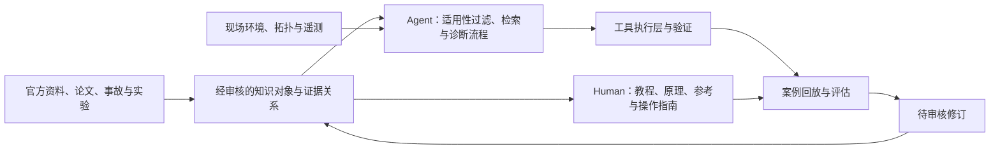

# AI 算力基础设施与计算可靠性知识库：调研与设计备忘录

调研日期：2026-09-29。范围按用户确认覆盖全栈基础设施、训练、推理，以及 Human 和 Agent 两类使用者；GPU 与 NPU 均为核心覆盖范围。NPU 本轮先以昇腾深入调研，具体厂商优先级尚待确认。

本文件是选题、资源与架构建议。项目能力依据本轮查询到的官方文档、原始论文和项目仓库；未安装这些项目，未在真实 GPU/NPU 集群验证。文中的产品设计和优先级是调研后的建议，不代表已有系统实现。

建议把知识库定位为：**一套可追溯、带适用条件、能通过案例和实验检验的 AI 计算系统知识，面向人提供学习和决策支持，面向 Agent 提供检索、诊断和验证能力。**

全栈是覆盖范围；计算可靠性是贯穿各层的主线。它包括可用性、结果正确性、性能稳定性和可恢复性。容量、成本、能耗、隔离与安全则是设计约束和权衡维度。

基于本轮调研形成的模块划分、知识模型、双入口、GPU/NPU 适配和实施步骤，见[架构建议](architecture-proposal.md)。

## 1. 全景知识地图

建议用三个正交维度组织内容：技术层 × 工作阶段 × 知识对象。目录只负责其中一个维度，其余由元数据和交叉链接表达。

| 技术层 | 应覆盖的知识 | 典型问题与可靠性连接 |
|---|---|---|
| 机房与物理设施 | 电力、散热、液冷、机柜、布线、BMC、资产与故障域 | 功率预算不足、降频、同机柜相关故障、维修后的验收 |
| 单机计算与硬件 | CPU、GPU/NPU、HBM、NUMA、PCIe、厂商互联与超节点、ECC、固件 | 卡不可见、设备内存错误、总线异常、算力下降、静默计算错误 |
| 网络与通信 | Ethernet、InfiniBand、RoCE、RDMA、拓扑、拥塞控制、NCCL/RCCL/HCCL | collective 超时、链路退化、通信热点、拓扑不匹配 |
| 存储与数据路径 | 本地 NVMe、对象存储、并行文件系统、数据加载、缓存、checkpoint | 加速器等数据、尾延迟、checkpoint 不完整或无法恢复 |
| 系统与集群平台 | OS、驱动、容器、Kubernetes、Slurm、Ray、调度、配额、多租户 | 版本不匹配、gang 无法调度、驱逐、控制面故障、资源争用 |
| 训练与后训练 | DDP/FSDP、TP/PP/EP、优化器状态、checkpoint、弹性、RL rollout | 慢 rank、hang、恢复后状态偏移、loss spike、权重同步错误 |
| 推理与服务 | vLLM 等引擎、路由、batching、KV cache、PD 分离、扩缩容 | TTFT/TPOT 恶化、OOM、服务重试、副本故障、缓存/权重版本问题 |
| 跨层运行与治理 | 遥测、SLO、事故响应、变更、容量、成本、能耗、计算完整性 | 根因定位、升级回归、故障域隔离、有效产出与资源效率 |

工作阶段包括：学习与选型 → 架构设计 → 部署与验收 → 日常运行 → 性能分析 → 故障诊断与恢复 → 复盘与升级。

厂商能力采用适配矩阵，GPU 与 NPU 各自提供完整的学习、验收、诊断、训练和推理路径。先用 NVIDIA GPU 与 Ascend NPU 两套具体环境检验公共知识模型，再根据实际设备补充其他平台。Xid、DCGM、NCCL 以及昇腾故障码、DCMI、HCCL 都是平台相关术语；共用的是诊断意图和证据结构，具体命令、指标与处置必须分别适配。

## 2. 已有资源：按借鉴方式筛选

“可读的公开资料”“开源代码”“论文中的生产系统”应分别记录。以下优先级是对本知识库的适合程度，不是对项目质量的排名。

### 2.1 知识组织与人工学习

| 资源 | 可借鉴内容 | 使用边界 |
|---|---|---|
| [stas00/ml-engineering](https://github.com/stas00/ml-engineering) | 高优先级：工程实战知识书，覆盖硬件、网络、存储、编排、训练、推理、排障；已有 [SKILL.md](https://github.com/stas00/ml-engineering/blob/master/SKILL.md) 供 Agent 使用 | 正文 CC-BY-SA-4.0；经验与操作需匹配当前环境。特别适合“人读正文 + Agent 索引 + 脚本”的组织方式 |
| [Infrasys-AI/AIInfra](https://github.com/Infrasys-AI/AIInfra) | 中文全栈课程与知识仓库，覆盖集群、通信存储、云原生、分布式训练与推理；Markdown、PPT、网站、视频配套 | 部分章节仍在补充；内容覆盖和完成状态应逐章检查，正文与代码许可分别核对 |
| [Infrasys-AI/AISystem](https://github.com/Infrasys-AI/AISystem) | 与 AIInfra 互补，侧重 AI 芯片、编译器、框架等底层知识 | 适合基础概念体系，不直接等同于故障处置库 |
| [pacoxu/AI-Infra](https://github.com/pacoxu/AI-Infra) | 中英文基础设施地图、学习路径、专题和案例；覆盖云原生、推理、调度、观测与训练 | Apache-2.0；更适合作为生态导航和工程专题知识源 |
| [InternLM/Awesome-LLM-Training-System](https://github.com/InternLM/Awesome-LLM-Training-System) | 训练系统研究索引，含专门的 [Fault Tolerance](https://github.com/InternLM/Awesome-LLM-Training-System/blob/main/Fault_Tolerance.md) 分类 | 是论文/项目索引，具体结论需回到原始论文；适合作为可靠性研究选题入口 |
| [AWS Distributed AI](https://github.com/awslabs/awsome-distributed-ai) | 参考架构、训练与推理示例、健康验证、监控和微基准，文档与可运行资产同仓 | MIT-0；针对 AWS 平台。旧 aws-samples/awsome-distributed-training 已重定向到此仓库 |
| [AI Infrastructure Knowledge Base](https://ai-infrastructure.net/) 与 [Agent skill 入口](https://ai-infrastructure.net/agent-skill/) | 最贴近本项目的现成先例：硬件、网络、集群、训练、推理、性能、runbook，以及 Agent 入口 | 社区知识站。本轮未确认它自身的公开源码仓库和复用许可证；适合研究目录、路由、呈现方式，技术结论回查原始资料 |
| [该站 Changelog](https://ai-infrastructure.net/changelog/) | 纠错、版本固定、验证范围标注的公开记录 | 站方自述的验证不等于本项目独立验证；可借鉴知识维护流程 |
| [NVIDIA GPU Debug Guidelines](https://docs.nvidia.com/deploy/gpu-debug-guidelines/gpu-node-triage.html) 与 [Xid 文档](https://docs.nvidia.com/deploy/xid-errors/index.html) | 设备问题的分流、证据收集、错误码与处置关系 | 错误码是调查线索，不能直接等同唯一根因；代际和软件版本必须保留 |
| [Google SRE Workbook](https://sre.google/workbook/table-of-contents/) | SLO、监控、事故响应和运维方法 | 通用可靠性知识，需要补充 GPU 作业与计算正确性语义 |
| [Machine Learning Systems](https://mlsysbook.ai/) / [源码仓库](https://github.com/harvard-edge/cs249r_book) | 从单机到规模化系统的学习主线，教材、实验和教学工具 | 教材为 CC-BY-NC-SA-4.0，各工具单独许可；适合概念解释与课程组织，具体部署操作仍需版本化产品文档 |
| [Stanford CS336 2025](https://cs336.stanford.edu/spring2025/) | GPU、并行训练、系统优化与推理，配套可动手的课程任务 | 这是课程归档，重点在语言模型系统，不覆盖完整机房与集群运维 |
| [Lambda distributed-training-guide](https://github.com/LambdaLabsML/distributed-training-guide) | 从单 GPU 到 DDP、多机、FSDP、TP 的逐章最小代码 | 适合“概念—代码—实验”的教学模板，不是全面可靠性框架 |
| [Diátaxis](https://diataxis.fr/) | 将教程、操作指南、参考、原理解释分开 | 是文档组织方法，不是软件平台 |

全栈基础设施部分还应优先收录下面这些实体模型和平台资料：

| 资源 | 可借鉴内容 | 使用边界 |
|---|---|---|
| [NetBox](https://github.com/netbox-community/netbox/blob/main/README.md) | 机架、设备、线缆、网络地址、电源及其关系，兼顾 UI 与 API | 主要表达预期配置状态；实时观测和事件历史应另外记录 |
| [Redfish](https://www.dmtf.org/standards/redfish) / [OpenBMC](https://github.com/openbmc/openbmc) | 硬件资源 schema，以及电源、散热、资产、事件、固件管理 | 前者是规范，后者是 BMC 软件项目；具体设备能力与移植成熟度不同 |
| [NVIDIA GPU Operator](https://docs.nvidia.com/datacenter/cloud-native/gpu-operator/latest/) | GPU 驱动、容器工具链、device plugin、发现与监控组件的部署依赖 | 需要绑定平台支持矩阵；Operator 与其部署组件的许可、支持范围分别记录 |
| [Slurm](https://slurm.schedmd.com/overview.html) | 资源、节点、partition、作业、优先级、排队和 accounting | 调度系统可用与训练状态成功恢复是两个不同结论 |
| [Kueue](https://kueue.sigs.k8s.io/docs/overview/) / [Volcano](https://volcano.sh/docs/home/introduction/) | 作业准入、配额、公平性、拓扑与任务整体调度；适合作业排队问题库 | Kueue 不替换 kube-scheduler；Volcano 包含调度器和作业管理，不能简单视为等价替代 |
| [DeepSeek 3FS](https://github.com/deepseek-ai/3FS) | SSD/RDMA、存算分离、一致性、数据加载、checkpoint 与 KV cache 存储 | 有特定硬件和 FoundationDB 等依赖；性能数据需保留原始测试配置 |

### 2.2 可接入或包装的诊断、验证与恢复能力

| 资源 | 能力与借鉴点 | 接入前需要保留的边界 |
|---|---|---|
| [DCGM Diagnostics](https://docs.nvidia.com/datacenter/dcgm/latest/user-guide/dcgm-diagnostics.html) / [dcgm-exporter](https://github.com/NVIDIA/dcgm-exporter) | GPU 健康检查、诊断与 Prometheus 遥测；建立“指标—异常—检查—解释”的映射 | Diagnostics 不能替代完整硬件诊断；压力测试与被动查询的资源影响不同；Exporter 与 DCGM 版本需配套 |
| [NCCL Troubleshooting](https://docs.nvidia.com/deeplearning/nccl/user-guide/docs/troubleshooting.html) / [RAS](https://docs.nvidia.com/deeplearning/nccl/user-guide/docs/troubleshooting/ras.html) | 分布式通信故障树、运行中 rank/进程健康视图 | RAS 自 NCCL 2.24 引入；配置检查不能代替数据路径压测，也不能单独确认根因 |
| [nccl-tests](https://github.com/NVIDIA/nccl-tests) / [nvbandwidth](https://github.com/NVIDIA/nvbandwidth) | 集合通信正确性和性能、GPU 数据传输带宽测试 | 基准结果需要绑定消息大小、拓扑、并发、版本和机器基线；不能脱离条件设置统一阈值 |
| [Microsoft SuperBench](https://github.com/microsoft/superbenchmark) | AI 基础设施验证与 profiling；适合验收、回归和性能退化诊断 | [论文](https://www.usenix.org/conference/atc24/presentation/xiong)中的生产系统、验证策略与公开代码的实际覆盖要分开记录 |
| [Google Cluster Health Scanner](https://github.com/GoogleCloudPlatform/cluster-health-scanner) | 把 NCCL、DCGM、网络、straggler 和小模型训练测试组织成健康扫描 | 当前支持矩阵围绕 Google GPU 机型与 GKE/Slurm；迁移到其他环境需要适配 |
| [NVIDIA Resiliency Extension](https://github.com/NVIDIA/nvidia-resiliency-ext) | hang 检测、作业内重启、checkpoint、straggler 与故障归因；还可研究 Agent 接口 | 当前 [v0.7.0 文档](https://nvidia.github.io/nvidia-resiliency-ext/release-notes.html)明确 Attribution/Restart Agent 为实验性；in-process restart 已弃用，不能照抄旧教程 |
| [DLRover](https://github.com/intelligent-machine-learning/dlrover) | 弹性训练、自动诊断恢复、Flash Checkpoint、XPU-Timer；有中文材料 | 内存 checkpoint 的热恢复依赖对应内存仍存活；进程恢复速度不等同于整机故障恢复保证 |
| [torchft](https://github.com/meta-pytorch/torchft) | 按 step 容错、进程组恢复、借助健康副本恢复状态 | 重点面向存在模型复制维度的训练；不同并行策略的能力与限制需要单列 |
| [vLLM Metrics](https://docs.vllm.ai/en/latest/design/metrics/) | 推理排队、KV cache、TTFT、TPOT、端到端延迟等指标语义 | 计量起点、单位、聚合方式和版本不可省略；inter-token latency 与每请求 TPOT 不宜混写 |
| [Ray Serve 容错文档](https://docs.ray.io/en/latest/serve/production-guide/fault-tolerance.html) | 副本、worker、head 与控制面的分层容错及演练方法 | 集群层恢复依赖部署方式和 GCS/KubeRay 配置，不能把副本恢复外推成端到端无损 |
| [ROCm Validation Suite](https://github.com/ROCm/ROCmValidationSuite) / [AMD SMI](https://rocmdocs.amd.com/projects/amdsmi/en/latest/) | AMD GPU 的验证、压力测试和管理遥测 | 需要匹配硬件与 ROCm/驱动支持矩阵；可用来检验知识模型是否真正跨厂商 |
| [Ascend MindCluster](https://github.com/Ascend/mind-cluster) | NPU 核心资源：集群组件、故障诊断、故障模式与恢复知识，详见 2.5 | [README](https://github.com/Ascend/mind-cluster/blob/master/README_EN.md)区分正式 release 与开发分支；代码 Apache-2.0，[docs 为 CC BY 4.0](https://github.com/Ascend/mind-cluster/blob/master/docs/LICENSE) |

### 2.3 Human/Agent 双用、诊断工作流与评估

| 资源 | 最值得借鉴的设计 | 适用边界 |
|---|---|---|
| [NVIDIA DGX Station AI Skills](https://github.com/NVIDIA/dgx-spark-playbooks/blob/main/nvidia/station-ai-skills/README.md) | 人读 CLI 与版本化 JSON；先探测环境，再查固定版本资料；来源带 revision/hash/位置；recipe、preflight、执行后验证 | 官方特定平台样例，面向 DGX Station/GB300；不要理解为通用 GPU 集群自治系统 |
| [Ascend Agent Skills](https://github.com/Ascend/agent-skills) | 昇腾环境、设备、通信、迁移、精度与性能等任务的现成 Agent 入口；含将 Issue 整理为排障 FAQ 的流程 | [MulanPSL-2.0](https://github.com/Ascend/agent-skills/blob/master/LICENSE)；需逐技能审核适用环境、外部依赖与操作影响。本轮仅调研，未安装或执行 |
| [HolmesGPT](https://github.com/HolmesGPT/holmesgpt) | SRE Agent，借鉴工具集、证据调查和把运行数据带入诊断的工作流 | 通用 SRE 能力，需要补充 GPU/NCCL/训练语义与本地环境适配 |
| [K8sGPT](https://github.com/k8sgpt-ai/k8sgpt) | 先由 analyzer 做确定性检查，再由模型解释；适合环境检查器设计 | Kubernetes 资源分析不等于 GPU 通信与数值故障分析，需要扩展 |
| [Runme](https://github.com/runmedev/runme) | 将 Markdown 代码块变成可执行步骤，连接人读操作指南与自动执行 | 可执行文档还需要适用性检查、结果验证与执行影响控制 |
| [AIOpsLab](https://github.com/microsoft/AIOpsLab) | 用环境、故障注入、任务与评估接口测试 AIOps Agent | 可复用评测框架思路；其已有环境不等于 GPU 故障覆盖，需要另建算力案例 |
| [kagent](https://github.com/kagent-dev/kagent) | Kubernetes 中 Agent 与工具的组织、部署和连接 | 当运行平台选定为 Kubernetes 时再评估；知识模型不必依赖它 |
| [Agent Skills 规范](https://agentskills.io/specification) | 简短任务入口、按需读取 references、脚本和资源分离 | Skill 是工作流程与检索入口；不能靠提示词替代执行层的权限、输入检查和限额 |
| [Material for MkDocs](https://github.com/squidfunk/mkdocs-material) | Markdown 驱动、可搜索的人读静态文档站 | 是候选发布层；先把内容与 schema 做好，站点主题可以替换 |

### 2.4 适合作为故障分类和案例种子的研究

| 原始资料 | 值得提炼的知识 | 不应直接外推的内容 |
|---|---|---|
| [Revisiting Reliability in Large-Scale ML Research Clusters](https://arxiv.org/abs/2410.21680) | 故障分类、规模效应、ETTR；同时考虑大量小作业与少量大作业 | 特定集群观察不能直接成为所有集群的故障率先验 |
| [MegaScale，NSDI 2024](https://www.usenix.org/conference/nsdi24/presentation/jiang-ziheng) | 全栈观测、通信/计算协同、故障与 straggler 处理 | 论文工程经验不等于一个可直接安装的完整开源产品 |
| [ByteRobust](https://arxiv.org/abs/2509.16293) | 将故障发现、定界、定位和恢复作为训练基础设施常规流程 | 论文报告的生产效果具有模型、规模和环境条件 |
| [The Llama 3 Herd of Models](https://arxiv.org/html/2407.21783v3#S3.SS3.SSS4) | 真实训练中断分类、未知根因、checkpoint 与恢复损失 | 历史训练案例不是硬件可靠性通用基准 |
| [Understanding Stragglers，OSDI 2025](https://www.usenix.org/conference/osdi25/presentation/lin-jinkun) | 慢 rank 的归因和损失分析；“慢”与“坏”分开处理 | 不能默认最慢 rank 就是故障硬件 |
| [Understanding Silent Data Corruption in LLM Training，ACL 2025](https://aclanthology.org/2025.acl-long.996/) | 健康/故障节点对照、子模块到训练过程的计算错误影响 | 这是实证研究，不是通用 SDC 检测产品 |
| [Meta AI 硬件可靠性实践](https://engineering.fb.com/2025/07/22/data-infrastructure/how-meta-keeps-its-ai-hardware-reliable/) | 静态、瞬态和静默错误，以及生命周期中的持续检测 | 未报显式错误不能作为计算正确的充分证据；其内部系统也不能直接视为公开代码 |

### 2.5 NPU 核心覆盖：先以昇腾建立完整样板

以下项目分别承担知识来源、诊断实现、运行数据接入与 Agent 工作流等角色。它们组合起来比单独寻找一个“大而全 NPU Wiki”更适合作为本项目的参考底座。表中链接部分指向开发分支，正式收录知识时需固定 release 或 commit；这份调研清单不代表生产版本推荐。

| 资源 | 最值得借鉴的内容 | 适用性与许可边界 |
|---|---|---|
| [Ascend Agent Skills](https://github.com/Ascend/agent-skills) | 模块化任务入口、references、脚本与验证；已有 npu-smi、HCCL test、GPU→NPU 适配审查、profiling 异常分析、精度验证等技能 | [MulanPSL-2.0](https://github.com/Ascend/agent-skills/blob/master/LICENSE)。技能描述属于项目声明的能力，不能代替本地验证 |
| [vLLM-ascend FAQ Generator](https://github.com/Ascend/agent-skills/blob/master/skills/vLLM-ascend_FAQ_Generator/SKILL.md) | 从已关闭 Issue 提取结构化 Debug FAQ，直接对应“工程问题→知识条目”的维护流程 | 应额外保留 Issue 原始证据、受影响版本、关闭原因与验证状态；closed 不能直接等同已修复或结论正确。这是本项目建议的审核条件 |
| [MindCluster](https://github.com/Ascend/mind-cluster) / [Ascend FaultDiag](https://github.com/Ascend/mind-cluster/tree/master/component/ascend-faultdiag) | 日志清洗、故障事件、根因节点分析、自定义故障实体与 SDK；可参考其故障模式表示和诊断流程 | 代码 Apache-2.0，docs CC BY 4.0；[26.0.0 版本说明](https://github.com/Ascend/mind-cluster/blob/master/docs/en/release_notes.md)明确故障模式库改为直接开源。诊断覆盖依赖设备、日志及版本 |
| [MindIO TFT / ACP](https://github.com/Ascend/mind-cluster/tree/master/component/mindio) | checkpoint 加速与异步持久化、临终 checkpoint、UCE 在线恢复、进程级恢复等机制 | 属于 MindCluster 源码；需框架适配、状态副本等条件，不能外推为任意故障无损恢复。[功能说明](https://github.com/Ascend/mind-cluster/blob/master/docs/en/scheduling/references/fault_recovery_acceleration/01_product_description.md) |
| [Ascend Device Plugin](https://github.com/Ascend/mind-cluster/tree/master/component/ascend-device-plugin) / [NPU Exporter](https://github.com/Ascend/mind-cluster/tree/master/component/npu-exporter) | Kubernetes 设备发现、分配、健康上报与设备遥测；作为知识判断的现场证据入口 | MindCluster 代码许可范围；依赖驱动、DCMI 与硬件支持矩阵。设备资源管理与指标采集分别建模 |
| [CANN 官方文档（8.5.0 版本入口）](https://www.hiascend.com/doc_center/source/zh/CANNCommunityEdition/850/index/index.html) / [TorchNPU](https://github.com/Ascend/pytorch) | CANN 运行时、通信、算子、框架适配；TorchNPU 安装、兼容矩阵、测试及故障定位资料 | 具体版本是资料快照，不表示推荐；CANN 各组件和发行包许可逐项核验。TorchNPU [docs 为 CC BY 4.0](https://github.com/Ascend/pytorch/blob/master/docs/LICENSE)，代码另查根许可证 |
| [MindSpeed](https://github.com/Ascend/MindSpeed) / [MindSpeed-LLM](https://github.com/Ascend/MindSpeed-LLM) | 训练加速、并行策略、迁移适配、预训练与微调实例 | Core 加速库与 LLM 训练套件分别记录；模型、后端与版本支持不同，不能直接继承上游框架的能力声明 |
| [vllm-ascend](https://github.com/vllm-project/vllm-ascend) / [SGLang Ascend 专区](https://github.com/sgl-project/sglang/tree/main/docs/docs/hardware-platforms/ascend-npus) / [MindIE-LLM](https://github.com/Ascend/MindIE-LLM) | 推理部署、模型与功能支持、环境采集、性能调优和回归案例 | vllm-ascend 为 Apache-2.0；MindIE-LLM [源码采用 Mulan PSL v2](https://github.com/Ascend/MindIE-LLM/blob/master/LICENSE.md)，不能据此推断全部 MindIE 产品及依赖统一开放 |
| [HDK / npu-smi 官方文档](https://www.hiascend.com/doc_center/source/zh/HDK/2610/A3/A3npu/npusmia3_0003.html) / [Ascend DMI 诊断文档](https://www.hiascend.com/document/detail/zh/mindcluster/500/toolbox/toolboxug/toolboxug_0020.html) | 设备状态、错误信息及健康、兼容性、计算与带宽等检查，可提炼为平台探针 | 此处确认的是官方工具文档，未确认统一开源许可；文档分别有版本与产品边界。查询、配置、复位及压力测试的运行影响必须分开 |
| [CANN oam-tools / HCCL Test](https://gitcode.com/cann/oam-tools/tree/master/src/hccl_test) | 集合通信的正确性、性能与多机验收；参考可重复的通信基线实验 | 已确认公开源码入口，本轮未成功核实 LICENSE；依赖 CANN/HCCL/MPI 与拓扑，单项测试通过不等于训练整体可靠 |

最值得先深入的是 **Agent Skills 的知识入口、FaultDiag 的故障表达、TorchNPU 的环境兼容矩阵**。Human 可由这些资料获得原理、指南和案例；Agent 使用同一来源提炼的适用条件、证据与工具能力。

NPU 场景应补充以下结构化字段：

- 硬件：厂商、芯片型号/代际、板卡/服务器、物理与逻辑设备标识、主机架构、节点内与跨节点互联拓扑。
- 软件：HDK/固件/驱动、CANN、PyTorch/torch_npu 或其他框架、训练/推理引擎、算子包和容器镜像摘要。兼容性记录的是完整组合，而非单个版本号。
- 工作负载：模型与 revision、shape、dtype、layout、图/动态图执行模式、量化方案、并行策略及规模。
- 故障证据：错误码所属组件及版本、host/device 日志、rank 与设备映射、时间线、故障前变更、诊断工具版本。
- 验证：运行成功、吞吐稳定、精度符合基准、checkpoint 恢复一致性分别设判据；用 CPU 或其他平台作参照时记录允许误差和非确定性条件。

跨平台复用“采集健康状态、验证通信、定位慢 rank、验证恢复”等诊断意图，分别绑定各平台实现。NPU 的算子适配、图编译、数据格式与精度问题应独立建模；GPU 命令或阈值不能仅改名后套用。

若后续涉及寒武纪等其他加速器，可从 [torch_mlu](https://github.com/Cambricon/torch_mlu)、[vllm-mlu](https://github.com/Cambricon/vllm-mlu) 和 [PaddleCustomDevice](https://github.com/PaddlePaddle/PaddleCustomDevice) 继续扩展。它们是不同平台的独立入口，不能推断与昇腾兼容，也不应将所有国产 GPU、MLU、GCU 等统一标成 NPU。

许可记录按“项目—版本—文件/文档—发行包”分开。MulanPSL-2.0 属于宽松许可，允许使用、修改与分发；再分发需附许可证并保留相关声明，有明确的专利授权与终止条款，不要求衍生项目统一开源。具体以[许可证全文](https://github.com/Ascend/agent-skills/blob/master/LICENSE)为准。公开可读的产品文档和二进制包不自动继承邻近开源仓库的许可。

## 3. 搜索带来的设计洞察

**已有材料的短板往往发生在连接处。** 课程负责解释原理，厂商文档负责某个组件，框架负责执行，事故论文负责总结经验。这个知识库可补足“症状—上下文—机制—证据—工具—验证”的连接。这个判断是对上述资源分布的归纳，而非“市面上没有竞争者”的断言。

**一条好知识应该说明什么时候不能用。** 同样的错误码、通信参数或恢复方案，会随 GPU/NPU 代际、驱动、通信库、拓扑与并行策略而改变。NVRx 的弃用记录、NCCL RAS 的版本边界及 MindCluster 的版本配套矩阵说明：版本、前置条件、失效条件应成为正文与检索过滤条件。

**计算完整性应与故障恢复并列。** 重启成功只说明程序重新运行，不能证明模型、优化器、数据进度或 KV cache 的状态正确。SDC、数值溢出、正常非确定性、数据异常需要不同证据来区分，不能把所有 loss spike 都归因于坏卡。[SDC 研究](https://aclanthology.org/2025.acl-long.996/)

**从“答对根因”扩展到“选对下一项检查”。** 现场往往缺少证据。一个有价值的 Agent 应能列出尚未排除的假设，选择成本和干扰可接受的检查，并在证据不足时停止。SuperBench 的主动验证研究提供了相关启发；最优检查策略仍是本项目可研究的问题。[SuperBench 论文](https://www.usenix.org/conference/atc24/presentation/xiong)

**知识质量最好有可回放证据。** Markdown 的流畅程度不能证明诊断有效。每个关键 runbook 应至少关联一个真实脱敏案例或清楚标为合成的实验案例，用时间顺序评估诊断过程。AIOpsLab 可提供任务与评测组织方面的参考。[AIOpsLab](https://github.com/microsoft/AIOpsLab)

**指标字典值得单独建设。** “GPU 利用率高”“tokens/s 高”“服务健康”表达的是不同事实。每个指标应包含统计对象、分子分母、时间窗口、单位、聚合方式和负载条件；训练关注有效进展与恢复损失，推理关注满足既定 SLO 的成功服务，计算正确性另有验证。

## 4. Human 与 Agent 共用知识，采用不同视图

经审核知识可以用 Git 中的 Markdown/YAML 管理；现场真相则来自监控、调度、资产和作业系统，并携带时间戳。检索索引和网站都是可重建的发布产物。

跨层关联需要一条稳定的实体链：机房/机架 → 主机 → GPU/NPU/NIC/SSD → K8s/Slurm 节点 → Pod/Job/Rank → 模型/请求。这样才能回答“这条链路异常影响哪些任务”。资产配置、实时状态和事件历史分别建模，时间与实体映射是它们之间的连接依据。

建议先定义八种对象，而不是把所有内容存成“文章”：

| 对象 | 核心用途 | 例子 |
|---|---|---|
| Concept | 解释原理、先修关系与边界 | collective、故障域、ETTR、数值非确定性 |
| Component / Environment | 表达实体、依赖、支持矩阵 | GPU/NPU—互联—交换机；驱动—runtime—框架 |
| Metric | 统一测量口径 | TTFT、checkpoint 时延、ECC 计数 |
| Failure / Hypothesis | 记录可证伪的故障机制 | rank 未进入 collective、链路退化 |
| Procedure / Runbook | 描述检查或操作流程 | 通信 hang 排查、节点验收 |
| Tool capability | 定义输入输出与执行影响 | 读取指标、解析日志、运行基准 |
| Case | 保存时间线、证据、判断与结果 | 一次升级导致吞吐回退 |
| Experiment / Evaluation | 定义复现、回放和通过标准 | 隐藏根因的排障任务 |

关系可以先用稳定 ID 和 YAML 引用表示，例如 `depends_on`、`observed_with`、`supports`、`refutes`、`tested_by`。只有证据足够时才使用因果关系。等确实需要复杂多跳查询，再决定是否引入图数据库。

每条可操作知识至少保留：

- 身份：稳定 ID、标题、类型、术语别名、中英文关键词、维护者。
- 适用性：硬件、软件版本、拓扑、工作负载、并行策略、精度、前置条件和排除条件。
- 证据：原始来源与具体位置、文档版本/commit、访问时间、主张、支持和反对证据。
- 验证：文档核对时间、实验验证时间及环境；明确区分“读过文档”和“实际跑过”。
- 过程：输入、输出、下一步分支、停止条件、成功判据和失败后的处理。
- 执行：权限、资源影响、范围、超时、幂等性、回滚条件。
- 状态：草稿、已审核、已验证、需复核、已弃用；历史案例保持原貌。

不要给所有来源粗暴合成一个“可信度分数”。官方规范、作者实验、生产事故、用户报告、本地复现各自能证明不同事情。

Human 的学习路径采用“概念—案例—实验”三联体：先理解一次训练或推理请求经过哪些资源，再读一个跨层案例，最后通过受控实验观察机制。资深工程师则从决策表、兼容矩阵、故障索引进入。

Agent 的入口应短小：先发现相关能力，再按需取回知识对象和原始证据。可以逐步提供 `search_knowledge`、`get_runbook`、`check_applicability`、`collect_evidence`、`replay_case` 等接口；这里是建议的接口名称，并非已经实现的工具。

工具的效果必须由执行层检查。例如压力测试即使不改配置，也会占用 GPU/NPU；“只读”不能仅按是否写文件判断。初期以离线日志解析、知识检索和已有遥测查询为主，主动压测、隔离节点和恢复动作分别建模。

## 5. 一个贯穿多层的案例示意

题目：“分布式训练出现 NCCL timeout。”下述是组织方式示例，不是已确认的真实故障处方。

1. **记录现场。** 软件版本、GPU/NIC 拓扑、并行策略、作业与 rank 映射、最近变更，以及日志时间是否对齐。
2. **区分观测与假设。** timeout 是症状；某 rank 提前异常退出、数据加载停顿、collective 次序不一致、网络或设备问题都是候选分支。
3. **选择区分检查。** 优先查较早出现的异常、rank 进度、现有 RAS/Flight Recorder 和系统日志；证据不足时说明还缺什么。
4. **决定下一步。** 对每个假设记录支持/反对证据；需要主动测试时说明测试环境、资源影响和预期能排除哪些原因。
5. **验证恢复。** 重新运行只是一个观测；还需检查持续进度、通信性能和所恢复状态是否满足该工作负载的要求。
6. **沉淀案例。** 保存当时可见的证据与后续结果，并产生待审核的知识修订。

对人展示完整解释、分支理由和练习；对 Agent 提供结构化前置条件、证据引用和分支；对评测器隐藏最终根因并按时间释放材料。同一个案例支持三种用途。

NPU 需同时建立独立的 HCCL 通信异常案例：保留上述证据推理结构，另外记录 CANN/torch_npu 版本、设备与 rank 映射、实际通信配置、host/device 日志和适用的拓扑检查。是否读取 rank table、是否使用某种网络工具，应按具体部署判断，不能把 NCCL RAS 等 GPU 诊断步骤移植为昇腾的既有能力。

## 6. 建设顺序与第一批内容

建议先建立全景索引，再做若干贯穿各层的完整案例。每个领域至少有一页系统地图、一组关键术语、一份权威来源清单和一个典型问题入口，以保证全栈覆盖。

第一批可选八个问题，每个都需要选定参考环境并明确证据状态：

| 场景 | 连接的层次 | 最值得验证的能力 |
|---|---|---|
| 新节点验收不达标 | 资产、硬件、驱动、网络、基准 | 配置/拓扑核对与分层验证 |
| GPU/NPU 不可见或设备报错 | PCIe、固件、驱动、容器、调度 | 先定位故障层，再解释错误码 |
| 分布式训练 timeout | 数据、框架、rank、通信、硬件 | 多假设排查与证据排序 |
| GPU/NPU 很忙但训练吞吐下降 | 数据加载、通信、计算、频率、资源争用 | 区分利用率与有效进展 |
| checkpoint 写入慢或恢复失败 | 模型/优化器状态、I/O、存储、版本 | 恢复一致性和有效恢复点 |
| loss spike / 输出数值异常 | 数据、精度、kernel、优化器、SDC | 区分算法异常、数值问题与硬件问题 |
| 推理 TTFT 或尾延迟恶化 | 流量、排队、KV cache、引擎、网络、硬件 | SLO 分解与负载条件匹配 |
| 集群有空卡但作业排不上 | 配额、gang、拓扑、健康标记、调度策略 | 解释资源总量与可用分配的差异 |

每个完整案例交付四件套：人读说明、结构化诊断路径、脱敏证据包、验证/评测判据。如果没有真实事故数据，先使用明确标注的合成实验，不能包装成生产案例。

NPU 首批案例优先覆盖：驱动/CANN/torch_npu 配套不一致；宿主机识卡而容器或任务不可见；HCCL 超时或多机性能退化；算子与图模式适配失败；迁移后的精度或吞吐变化；checkpoint 恢复后状态验证。上述案例是建设建议，尚无本地实验结果。

实施可以分为三个增量，不必预先承诺固定工期：

1. **内容与模型增量。** 定义术语、对象、模板、来源登记；编写全景索引和首批深度案例。Git + Markdown/YAML 足够起步。
2. **双入口增量。** 生成人读站点；为 Agent 提供按版本过滤的关键词检索和对象获取。错误码、环境变量、指标名优先精确检索；用评测证明需要后再加入向量检索。
3. **能力与评估增量。** 包装日志解析和探针，接入受控实验/事故回放；将新案例转成修订提案，审核后发布。

优先复用文档发布、遥测、诊断工具和评测框架。自己建设的核心是领域对象、适用性规则、证据关系、跨层诊断路径和可回放案例。不要把选择一个通用 RAG 框架当成知识库设计已经完成。

## 7. 如何知道它有效

| 面向对象 | 值得衡量的结果 |
|---|---|
| Human 学习 | 能否从新案例解释机制；能否选择合理的下一项检查；查资料与定位问题所需时间 |
| Human 工程工作 | 设计决策是否有依据；验收条件是否完整；复盘知识是否能复用于后续事故 |
| Agent 检索 | 证据召回、引用准确、版本适配、过期条目识别 |
| Agent 诊断 | 下一项检查是否有区分力；是否虚构根因；证据不足时能否保留 unknown |
| Agent 执行 | 工具参数与前置条件匹配；资源与时间预算；验证结果；是否越过允许的动作范围 |
| 知识维护 | 原始来源变更后能否找到受影响条目；复核积压；有实验支撑的条目比例 |

评测应拆分知识检索、诊断决策和工具执行，以免一次失败无法解释。测试集按事故家族、版本和时间划分，避免最终根因或近乎相同的事故文本泄漏到评测输入。

可以比较三条基线：通用模型直接回答、模型检索普通文档、模型使用结构化知识与工具。观察增益后再决定是否值得加入更复杂的检索、图结构或多 Agent 协作。

值得持续探索的三个方向：

- **下一项检查的选择。** 在时间、权限和算力干扰预算下，如何最大程度减少诊断不确定性。
- **跨环境知识迁移。** 哪些故障机制跨厂商成立，哪些诊断证据与动作必须绑定具体硬件和软件版本。
- **知识失效检测。** 来源变更、依赖升级或新反例出现时，如何定位需要重验的主张、runbook 与实验。

后续具体实施需要确定的变量是：使用者水平与角色、首批可获得的真实环境和日志、是否公开发布及复用范围、主要硬件与平台。它们影响优先级，但不改变全栈覆盖与 Human/Agent 共用知识的总体设计。
